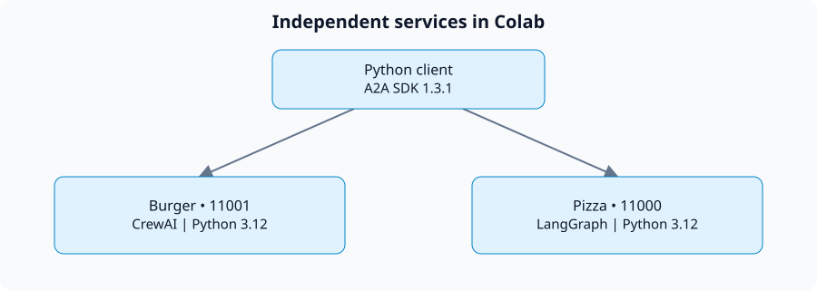
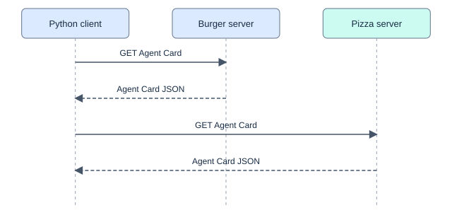
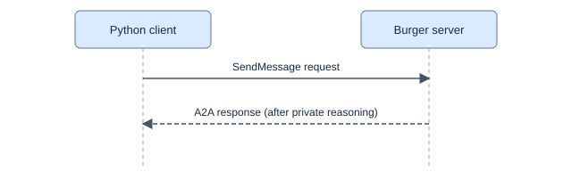
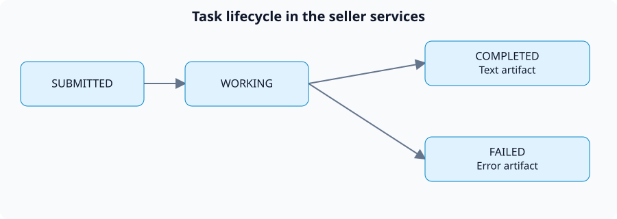
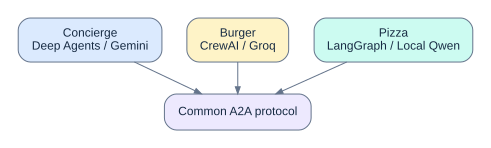

# Stage 1 — Understanding Agent2Agent (A2A)

Explore agent interoperability through two independent food seller services. The objective is to discover capabilities, construct messages, interpret task responses and observe service independence. No client-side LLM is required.



**Prerequisites:** Colab, internet access, one provider API key, basic Python and asynchronous programming. Execute one numbered cell at a time. Read the explanation and inspect the output before continuing. All menus and orders are simulated; no real purchases occur.

## Cell 01 — Clone the repository

The repository contains the current seller services, the A2A client and reusable lifecycle helpers. Use a fresh Colab runtime for this notebook. The clone is deliberately separate from the notebook file.

```python
# Cell 01 — Clone the repository
from pathlib import Path
import subprocess, sys, os
REPO = Path('/content/w6-demo')
if not REPO.exists():
    subprocess.run(['git','clone','https://github.com/AI-Learning-Repo/w6-demo',str(REPO)],check=True)
assert (REPO/'lab_utils.py').is_file(), 'The repository must contain the current lab utilities.'
print(REPO)
```


## Cell 02 — Install notebook packages

The notebook has its own Python environment. The seller frameworks will be installed separately. Pin the A2A SDK to the version used by the services.

```python
# Cell 02 — Install notebook packages
subprocess.run([sys.executable,'-m','pip','install','-q','uv','google-genai','groq','requests','pandas','-r',str(REPO/'clients/requirements.txt')],check=True)
from importlib.metadata import version
print('A2A SDK:',version('a2a-sdk'))
assert version('a2a-sdk') == '1.3.1'
```

## Cell 03 — Configure infrastructure

`lab_utils` manages independent processes and their logs. The 20-second delay is a starting point, not a guarantee against provider quotas. No inference is performed here.

```python
# Cell 03 — Configure infrastructure
sys.path.insert(0,str(REPO))
sys.path.insert(0,str(REPO/'clients'))
import lab_utils as lab
from IPython.display import Code, JSON, Markdown, display, SVG
REQUEST_DELAY = 20 # @param {type:"integer"}
lab.configure(REPO,delay=REQUEST_DELAY)
print(lab.AGENTS)
```

## Cell 04 — Choose a model provider

Add `GEMINI_API_KEY` or `GROQ_API_KEY` to Colab Secrets and enable notebook access. Choose one provider; only its key is required. Model availability is account-dependent. GPT-OSS is the default Groq alternative; Qwen can be explored when available.

```python
# Cell 04 — Choose a model provider
# @title Provider configuration
from google.colab import userdata
PROVIDER = 'gemini' # @param ["gemini", "groq"]
GEMINI_MODEL = 'gemini-3.5-flash' # @param {type:"string"}
GROQ_MODEL = 'openai/gpt-oss-120b' # @param ["openai/gpt-oss-120b", "qwen/qwen3.8-27b"]
MODEL = GEMINI_MODEL if PROVIDER=='gemini' else GROQ_MODEL
key_name = 'GEMINI_API_KEY' if PROVIDER=='gemini' else 'GROQ_API_KEY'
os.environ[key_name] = userdata.get(key_name)
assert os.environ[key_name]
if PROVIDER=='gemini':
    os.environ['GOOGLE_API_KEY']=os.environ[key_name]
    os.environ['GOOGLE_GENAI_USE_VERTEXAI']='false'
print(PROVIDER,MODEL)
```

## Cell 05 — Check model availability

Listing models checks the provider connection without generating a completion. The selected identifier should appear in the returned list.

```python
# Cell 05 — Check model availability
if PROVIDER=='gemini':
    from google import genai
    models=[m.name.removeprefix('models/') for m in genai.Client(api_key=os.environ[key_name]).models.list() if 'generateContent' in (m.supported_actions or [])]
else:
    from groq import Groq
    models=[m.id for m in Groq(api_key=os.environ[key_name]).models.list().data]
print('\n'.join(sorted(models)))
assert MODEL in models, 'Choose a model available to this account.'
```

> *'Note'*: Cells 06 and 07 set up isolated Python environments and download dependencies. This process usually takes 2–3 minutes. Please do not stop or interrupt the cell while it runs.

## Cell 06 — Create isolated seller environments

Each seller uses Python 3.12 in its own `.venv`. This avoids forcing CrewAI and LangGraph dependencies into the same environment.

```python
# Cell 06 — Create isolated seller environments
lab.create_environments()
for config in lab.AGENTS.values():
    print(config['directory']/'.venv/bin/python')
```

## Cell 07 — Install seller dependencies

Install the repository’s pinned requirements into each seller environment. This is local installation; no cloud deployment is needed.

```python
# Cell 07 — Install seller dependencies
for config in lab.AGENTS.values():
    lab.install_requirements(config['directory'])
    lab.run_command(['uv','pip','check','--python',config['directory']/'.venv/bin/python'])
```

## Cell 08 — Start and inspect the services

The launcher starts two independent HTTP processes on loopback. Readiness means the Agent Card endpoint responds; it does not guarantee an inference call will succeed. The process table should show distinct PIDs.

```python
# Cell 08 — Start and inspect the services
cards=lab.switch_provider(PROVIDER,MODEL)
lab.show_processes()
lab.run_command(['ps','-eo','pid,ppid,args']) if False else None
assert all(any(i['protocolVersion']=='1.0' for i in c['supportedInterfaces']) for c in cards.values())
```

The local URLs are `http://127.0.0.1:11001` (burger) and `http://127.0.0.1:11000` (pizza). The provider is an implementation choice, not part of the A2A transport contract.

## Cell 09 — Observe the process boundary

A separate PID and listening socket demonstrate that the client does not import seller business logic. Both services are local to the runtime; provider inference uses an external API.

```python
# Cell 09 — Observe the process boundary
!ps -eo pid,ppid,args | grep -E '[p]ython.*__main__.py'
!ss -ltnp | grep -E '11000|11001'
```

### Discovery
An Agent Card is public service metadata, not a model response. It advertises skills, input/output modes and supported interfaces. A2A 1.0 discovery uses `/.well-known/agent-card.json`.



## Cell 10 — Retrieve Agent Cards over HTTP

This GET request uses ordinary HTTP, without the SDK. Compare the names and skills. Discovery consumes no inference tokens.

```python
# Cell 10 — Retrieve Agent Cards over HTTP
import requests
for name, cfg in lab.AGENTS.items():
    r=requests.get(cfg['url']+'/.well-known/agent-card.json',timeout=10)
    r.raise_for_status()
    display(Markdown('### '+name)); display(JSON(r.json(),expanded=True))
```

## Cell 11 — Compare advertised interfaces

Protocol version and application version are distinct. The interface describes the binding and endpoint. The underlying framework need not appear in the card.

```python
# Cell 11 — Compare advertised interfaces
import pandas as pd
rows=[]
for name, card in cards.items():
    for i in card['supportedInterfaces']:
        rows.append(dict(agent=name, application=card['version'], protocol=i['protocolVersion'], binding=i['protocolBinding'], endpoint=i['url'], skills=', '.join(s['name'] for s in card['skills'])))
display(pd.DataFrame(rows))
```

## Cell 12 — Run the discovery program

This reusable command performs a similar check from a standalone Python process. Compare its output with the direct GET request.

```python
# Cell 12 — Run the discovery program
lab.run_command([sys.executable,REPO/'clients/test_discovery.py'])
```

### Messages and tasks
A message has a role, identifier and parts. A text part is the payload, not the entire protocol object. A service may return a message directly or manage a task. These sellers return completed tasks with text artifacts. A context ID associates exchanges; a task ID identifies a unit of work.





## Cell 13 — Construct a typed request

The SDK uses Protobuf types. Inspect the serialized representation before sending. A new message has a unique identifier and user role. This cell does not contact an LLM.

```python
# Cell 13 — Construct a typed request
from a2a.client import create_client, ClientConfig
from a2a.helpers import new_text_message
from a2a.types import Role, SendMessageRequest, TaskState
from google.protobuf.json_format import MessageToDict
request=SendMessageRequest(message=new_text_message(text='What is the price of one Classic Cheeseburger? Use euros. Do not create an order.',role=Role.ROLE_USER))
display(JSON(MessageToDict(request),expanded=True))
```

## Cell 14 — Send the message using the SDK

The client resolves the Agent Card and selects a compatible transport. Non-streaming configuration still exposes an asynchronous iterator in this SDK. Collect responses and close the connection even on failure. Expect €8.50; exact wording varies.

```python
# Cell 14 — Send the message using the SDK
import asyncio
async def exchange(url, request):
    client=await create_client(agent=url,client_config=ClientConfig(streaming=False))
    try:
        return [chunk async for chunk in client.send_message(request)]
    finally:
        await client.close()
chunks=await asyncio.wait_for(exchange(lab.AGENTS['burger']['url'],request),timeout=180)
for chunk in chunks: display(JSON(MessageToDict(chunk),expanded=True))
```

## Cell 15 — Interpret the completed task

Extract the state, identifiers and artifact text. A completed task is a protocol success, not proof that every factual claim is correct. Check the expected price.

```python
# Cell 15 — Interpret the completed task
task=next(c.task for c in reversed(chunks) if c.HasField('task'))
print('Task:',task.id,'Context:',task.context_id,'State:',TaskState.Name(task.status.state))
assert task.status.state==TaskState.TASK_STATE_COMPLETED
answer='\n'.join(part.text for artifact in task.artifacts for part in artifact.parts if part.text)
display(Markdown(answer))
```

## Cell 16 — Contact the other framework

The same client helper works with LangGraph. The service-specific logic stays behind the network interface. Expect €34.00 for the example below.

```python
# Cell 16 — Contact the other framework
from a2a_client import discover, send
await asyncio.sleep(REQUEST_DELAY)
result=await send(lab.AGENTS['pizza']['url'],'Calculate the total for two Margherita Pizzas and one Pepperoni Pizza in euros. Do not create an order.',show_json=True,timeout=180)
display(Markdown(result['text']))
```

## Cell 17 — Inspect the reusable client (optional)

The helper wraps discovery, message construction, task validation, artifact extraction and connection cleanup. Compare it with the explicit SDK exchange above. This cell consumes no inference tokens.

```python
# Cell 17 — Inspect the reusable client (optional)
lab.show_source(REPO/'clients/a2a_client.py')
```

## Cell 18 — Run a combined smoke test (optional)

Run only if additional inference is appropriate. The script checks task completion and expected EUR amounts. The `--full` option adds two calculation cases. A delay is inserted between requests.

```python
# Cell 18 — Run a combined smoke test (optional)
RUN_SMOKE = False # @param {type:"boolean"}
if RUN_SMOKE:
    await asyncio.sleep(REQUEST_DELAY)
    lab.run_command([sys.executable,REPO/'clients/test_all.py','--delay',REQUEST_DELAY,'--json'])
```

### Framework and provider independence
The client depends on the protocol rather than the implementation. Switching model providers requires restarting the local services, because their configuration is inherited at launch. Existing in-memory task state does not survive that restart.



## Cell 19 — Switch providers (optional)

Configure the other provider secret first. Discovery should still work at the same endpoints. A subsequent read-only query can verify inference. Leave the checkbox off if only one provider is configured.

```python
# Cell 19 — Switch providers (optional)
SWITCH = False # @param {type:"boolean"}
if SWITCH:
    other='groq' if PROVIDER=='gemini' else 'gemini'
    other_key='GROQ_API_KEY' if other=='groq' else 'GEMINI_API_KEY'
    os.environ[other_key]=userdata.get(other_key)
    cards=lab.switch_provider(other,GROQ_MODEL if other=='groq' else GEMINI_MODEL)
    lab.run_command([sys.executable,REPO/'clients/test_discovery.py'])
```

## Cell 20 — Demonstrate service independence

Stop the pizza service and probe both cards. Burger should remain reachable. Restart pizza afterward. This experiment makes no model requests.

```python
# Cell 20 — Demonstrate service independence
lab.stop_seller('pizza')
for name,cfg in lab.AGENTS.items():
    try: print(name,requests.get(cfg['url']+'/.well-known/agent-card.json',timeout=3).status_code)
    except requests.RequestException: print(name,'unavailable')
lab.start_seller('pizza'); cards['pizza']=lab.wait_for_agent('pizza')
```

## Cell 21 — Inspect server code (optional)

The entry point declares the service contract and HTTP routes; the executor adapts protocol tasks to the agent implementation. Stage 3 will construct such a server independently.

```python
# Cell 21 — Inspect server code (optional)
lab.show_source(lab.AGENTS['burger']['directory']/'__main__.py')
lab.show_source(lab.AGENTS['burger']['directory']/'agent_executor.py')
```

### Practice and reflection
1. Retrieve the complete menu from either seller using `send`. Predict the price of a different combination and compare it with the response.
2. Identify the message ID, task ID, context ID and artifact ID. Explain why they differ.
3. Explain why a client can contact both frameworks without importing either framework.
4. Distinguish a transport timeout from a completed task containing an incorrect price.

Allow a delay between any additional inference requests. Inspect `lab.show_log("burger")` or `lab.show_log("pizza")` if a request fails; a timeout alone does not establish a rate-limit error.

## Cell 22 — Stop the services

Release both server processes when finished. This does not delete source files or virtual environments.

```python
# Cell 22 — Stop the services
lab.stop_all()
```
