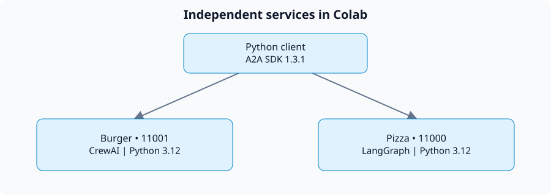
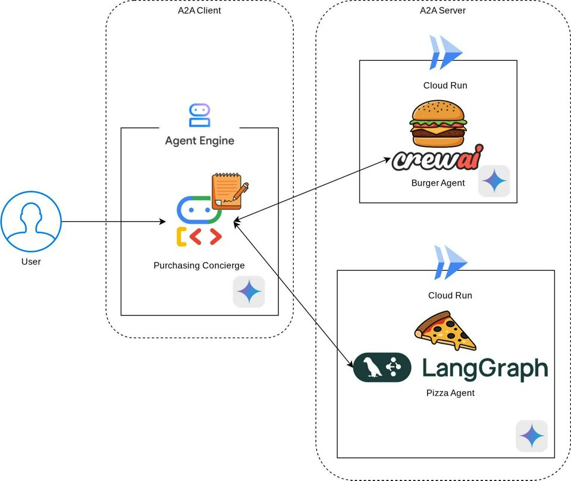
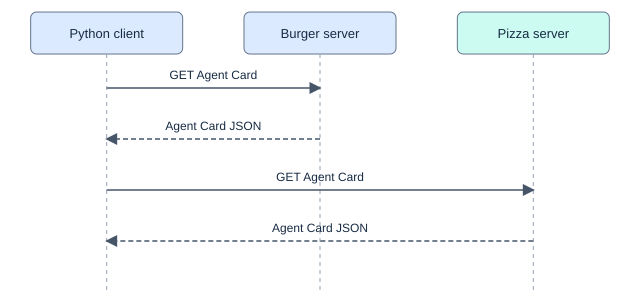
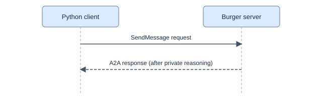
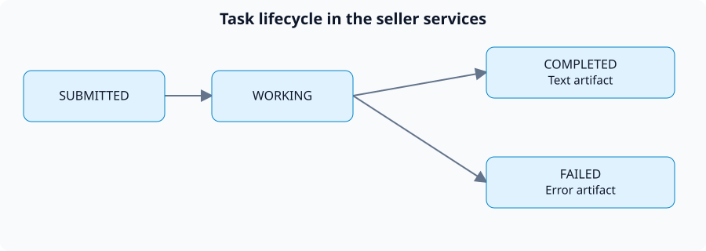
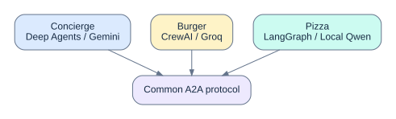

# Stage 1 — Understanding Agent2Agent (A2A)

Explore agent interoperability through two independent food seller services. The objective is to discover capabilities, construct messages, interpret task responses and observe service independence. No client-side LLM is required.



**Prerequisites:** Colab, internet access, one provider API key, basic Python and asynchronous programming. Execute one numbered cell at a time. Read the explanation and inspect the output before continuing. All menus and orders are simulated; no real purchases occur.

## Cell 01 — Clone the repository

The repository contains the current seller services, the A2A client and reusable lifecycle helpers. Use a fresh Colab runtime for this notebook. The clone is deliberately separate from the notebook file.

```python
# Cell 01 — Clone the repository
from pathlib import Path
import subprocess, sys, os
REPO = Path('/content/w6-demo')
if not REPO.exists():
    subprocess.run(['git','clone','https://github.com/AI-Learning-Repo/w6-demo',str(REPO)],check=True)
assert (REPO/'lab_utils.py').is_file(), 'The repository must contain the current lab utilities.'
print(REPO)
```

<details>
<summary><strong>Cell 01 — Detailed code explanation</strong></summary>

- `from pathlib import Path` imports an object-oriented way of representing filesystem paths. Unlike a plain string, a `Path` supports operations such as `/` for joining directories and `.exists()` for testing existence.
- `subprocess` runs external programs, `sys` provides information about the Python interpreter, and `os` provides access to environment variables. These modules will be reused later.
- `REPO = Path('/content/w6-demo')` establishes a single absolute path for the repository. Subsequent cells refer to this variable instead of relying on the current working directory.
- `if not REPO.exists()` prevents cloning again when the directory already exists. It does not update an existing clone.
- `subprocess.run([...], check=True)` runs Git with separate arguments: the `clone` operation, repository URL and destination. `check=True` raises an exception if Git exits unsuccessfully.
- The assertion verifies that the expected utility module exists. This is a basic check of repository contents, not a check that every file is current.
- `print(REPO)` displays the local path for subsequent inspection.

**Expected result:** `/content/w6-demo`. No agent server has started, and no model is called. If the assertion fails, check the repository contents and branch before proceeding.

</details>





## Cell 02 — Install notebook packages

The notebook has its own Python environment. The seller frameworks will be installed separately. Pin the A2A SDK to the version used by the services.

```python
# Cell 02 — Install notebook packages
subprocess.run([sys.executable,'-m','pip','install','-q','uv','google-genai','groq','requests','pandas','-r',str(REPO/'clients/requirements.txt')],check=True)
from importlib.metadata import version
print('A2A SDK:',version('a2a-sdk'))
assert version('a2a-sdk') == '1.3.1'
```

<details>
<summary><strong>Cell 02 — Detailed code explanation</strong></summary>

- `sys.executable` identifies the Python interpreter running the notebook. Calling it with `-m pip` ensures installation targets that interpreter rather than an unrelated `pip` executable.
- `install` requests package installation; `-q` reduces ordinary progress output.
- `uv` will create and manage isolated seller environments. `google-genai` and `groq` provide model-listing APIs, `requests` enables ordinary HTTP discovery, and `pandas` supports tabular output.
- `-r` instructs pip to read the client requirements file. That file supplies the A2A client dependencies; the seller frameworks are not installed here.
- `check=True` stops execution if installation fails.
- `importlib.metadata.version` reads installed distribution metadata. The printed version and assertion confirm that the client environment contains the expected SDK release.

**Expected result:** `A2A SDK: 1.3.1`. The SDK release number is not the same as the wire protocol version. Installation may require network access; a dependency error should be resolved before continuing.

</details>

## Cell 03 — Configure infrastructure

`lab_utils` manages independent processes and their logs. The 20-second delay is a starting point, not a guarantee against provider quotas. No inference is performed here.

```python
# Cell 03 — Configure infrastructure
sys.path.insert(0,str(REPO))
sys.path.insert(0,str(REPO/'clients'))
import lab_utils as lab
from IPython.display import Code, JSON, Markdown, display, SVG
REQUEST_DELAY = 20 # @param {type:"integer"}
lab.configure(REPO,delay=REQUEST_DELAY)
print(lab.AGENTS)
```

<details>
<summary><strong>Cell 03 — Detailed code explanation</strong></summary>

- `sys.path.insert(0, ...)` adds the repository and client directories to the beginning of Python's module search path. The notebook can then import modules stored in those directories without installing the repository as a package.
- `import lab_utils as lab` gives a short namespace for the reusable infrastructure helpers. This avoids repeatedly defining process-management code.
- `Code`, `JSON`, `Markdown`, `display` and `SVG` are notebook presentation helpers. They display source, structured data, formatted text and vector graphics respectively; they do not implement A2A.
- `REQUEST_DELAY` is a configurable interval in seconds. The Colab `# @param` comment allows it to be edited through a form.
- `lab.configure(REPO, delay=REQUEST_DELAY)` initializes the utility module with the repository location and requested delay.
- `lab.AGENTS` holds service configuration, including directories, URLs and ports. Printing it makes the configuration visible.

**Expected result:** entries for the burger and pizza services. This configures the launcher but does not start the services. A delay reduces request bursts; it does not guarantee that provider quotas will be respected.

</details>

## Cell 04 — Choose a model provider

Add `GEMINI_API_KEY` or `GROQ_API_KEY` to Colab Secrets and enable notebook access. Choose one provider; only its key is required. Model availability is account-dependent. GPT-OSS is the default Groq alternative; Qwen can be explored when available.

```python
# Cell 04 — Choose a model provider
# @title Provider configuration
from google.colab import userdata
PROVIDER = 'gemini' # @param ["gemini", "groq"]
GEMINI_MODEL = 'gemini-3.5-flash' # @param {type:"string"}
GROQ_MODEL = 'openai/gpt-oss-120b' # @param ["openai/gpt-oss-120b", "qwen/qwen3.8-27b"]
MODEL = GEMINI_MODEL if PROVIDER=='gemini' else GROQ_MODEL
key_name = 'GEMINI_API_KEY' if PROVIDER=='gemini' else 'GROQ_API_KEY'
os.environ[key_name] = userdata.get(key_name)
assert os.environ[key_name]
if PROVIDER=='gemini':
    os.environ['GOOGLE_API_KEY']=os.environ[key_name]
    os.environ['GOOGLE_GENAI_USE_VERTEXAI']='false'
print(PROVIDER,MODEL)
```

<details>
<summary><strong>Cell 04 — Detailed code explanation</strong></summary>

- `userdata` is Colab's interface for accessing secrets granted to the notebook. The key is retrieved at runtime rather than embedded in source code.
- `PROVIDER` selects a backend; the two model variables preserve the corresponding model identifiers. The Colab form comments expose the choices in the interface.
- The conditional expression selecting `MODEL` chooses one model identifier based on the provider. The other model is not invoked.
- `key_name` selects the matching secret name. `os.environ[key_name] = userdata.get(key_name)` makes the credential available to code in the notebook and to subsequently launched child processes.
- The assertion checks that the retrieved value is nonempty; missing or inaccessible secrets may raise an error before this line.
- For Gemini, `GOOGLE_API_KEY` is also populated, and `GOOGLE_GENAI_USE_VERTEXAI` is set to the string `false` to select the intended non-Vertex configuration.
- The last line prints the provider and model, not the secret.

**Expected result:** a provider/model pair such as `gemini gemini-3.5-flash`. Model availability depends on the account. Do not print environment variables containing credentials or commit them to a repository.

</details>

## Cell 05 — Check model availability

Listing models checks the provider connection without generating a completion. The selected identifier should appear in the returned list.

```python
# Cell 05 — Check model availability
# Cell 05 — Check model availability

if PROVIDER == 'gemini':
    from google import genai

    with genai.Client(
        api_key=os.environ[key_name],
        vertexai=False
    ) as client:

        models = [
            m.name.removeprefix('models/')
            for m in client.models.list()
            if 'generateContent' in (m.supported_actions or [])
        ]

else:
    from groq import Groq

    with Groq(api_key=os.environ[key_name]) as client:
        models = [
            m.id
            for m in client.models.list().data
        ]

print('\n'.join(sorted(models)))

assert MODEL in models, 'Choose a model available to this account.'

print(f'\nSelected model: {MODEL}')
print(f'Provider: {PROVIDER}')
print('Model availability check passed.')
```

<details>
<summary><strong>Cell 05 — Detailed code explanation</strong></summary>

- The `if` statement chooses the provider-specific discovery API; only the selected branch executes.
- In the Gemini branch, `genai.Client(api_key=...)` creates an authenticated SDK client. `.models.list()` enumerates model records available through that API.
- The list comprehension filters records by the `generateContent` capability. `(m.supported_actions or [])` safely handles a missing or empty action list.
- `.removeprefix('models/')` normalizes identifiers so they can be compared with the selected model string.
- In the Groq branch, `Groq(...).models.list().data` returns model records, and `m.id` extracts each identifier. This branch does not explicitly filter models for tool calling or other capabilities.
- `sorted(models)` orders the names; `'\n'.join(...)` produces one name per line.
- The assertion checks that the selected identifier is in the list.

**Expected result:** a list containing `MODEL`. Listing models tests API access, but does not prove that a completion or tool call will succeed. No completion is requested by this cell.

</details>

> *'Note'*: Cells 06 and 07 set up isolated Python environments and download dependencies. This process usually takes 2–3 minutes. Please do not stop or interrupt the cell while it runs.

## Cell 06 — Create isolated seller environments

Each seller uses Python 3.12 in its own `.venv`. This avoids forcing CrewAI and LangGraph dependencies into the same environment.

```python
# Cell 06 — Create isolated seller environments
lab.create_environments()
for config in lab.AGENTS.values():
    print(config['directory']/'.venv/bin/python')
```

<details>
<summary><strong>Cell 06 — Detailed code explanation</strong></summary>

- `lab.create_environments()` delegates virtual environment creation to the existing helper. Each configured seller receives an independent Python environment rather than sharing the notebook's package installation.
- `.venv` is the conventional directory for a virtual environment. Its interpreter can have a different Python version and dependency set from the notebook interpreter.
- `lab.AGENTS.values()` iterates over configuration dictionaries without needing their names.
- `config['directory'] / '.venv/bin/python'` constructs the absolute path to each seller interpreter.
- `print(...)` exposes those paths so that the separation can be inspected.

**Expected result:** two distinct interpreter paths beneath the burger and pizza directories. The environments isolate Python dependencies, not network access or security permissions. Neither service is started by this cell.

</details>

## Cell 07 — Install seller dependencies

Install the repository’s pinned requirements into each seller environment. This is local installation; no cloud deployment is needed.

```python
# Cell 07 — Install seller dependencies
for config in lab.AGENTS.values():
    lab.install_requirements(config['directory'])
    lab.run_command(['uv','pip','check','--python',config['directory']/'.venv/bin/python'])
```

<details>
<summary><strong>Cell 07 — Detailed code explanation</strong></summary>

- The `for` loop handles each seller configuration in turn. Sequential installation makes it easier to identify which environment failed.
- `lab.install_requirements(config['directory'])` delegates installation of the seller's requirements file to the helper, targeting the corresponding isolated environment.
- `lab.run_command([...])` invokes an external command through the shared command runner.
- `uv pip check --python <path>` checks the installed distributions in the explicitly selected environment for unsatisfied or incompatible dependency requirements.
- The path expression ensures the check targets the seller rather than the notebook interpreter.

**Expected result:** successful installation and dependency checks for both environments. A successful dependency check does not test model access, imports of every module, or A2A behavior; those are separate validation steps.

</details>

## Cell 08 — Start and inspect the services

The launcher starts two independent HTTP processes on loopback. Readiness means the Agent Card endpoint responds; it does not guarantee an inference call will succeed. The process table should show distinct PIDs.

```python
# Cell 08 — Start and inspect the services
cards=lab.switch_provider(PROVIDER,MODEL)
lab.show_processes()
lab.run_command(['ps','-eo','pid,ppid,args']) if False else None
assert all(any(i['protocolVersion']=='1.0' for i in c['supportedInterfaces']) for c in cards.values())
```

<details>
<summary><strong>Cell 08 — Detailed code explanation</strong></summary>

- `lab.switch_provider(PROVIDER, MODEL)` applies the provider configuration, starts or restarts the seller processes, and waits for their Agent Cards. The returned `cards` mapping contains the advertised metadata.
- Child processes inherit environment variables when launched. Changing a notebook variable alone cannot reconfigure a process that is already running.
- `lab.show_processes()` displays process information so the separate services can be identified.
- The expression ending in `if False else None` is intentionally inactive: Python evaluates the `else` branch, so the `ps` command on that line is not executed.
- The outer `all(...)` checks every returned card. The inner `any(...)` checks whether at least one supported interface advertises protocol version `1.0`.
- This assertion checks advertised compatibility only; it does not validate every protocol operation.

**Expected result:** two live server processes and cards advertising A2A 1.0. If startup fails, inspect the server logs. A successful readiness check does not establish that a provider inference request will succeed.

</details>

The local URLs are `http://127.0.0.1:11001` (burger) and `http://127.0.0.1:11000` (pizza). The provider is an implementation choice, not part of the A2A transport contract.

## Cell 09 — Observe the process boundary

A separate PID and listening socket demonstrate that the client does not import seller business logic. Both services are local to the runtime; provider inference uses an external API.

```python
# Cell 09 — Observe the process boundary
!ps -eo pid,ppid,args | grep -E '[p]ython.*__main__.py'
!ss -ltnp | grep -E '11000|11001'
```

<details>
<summary><strong>Cell 09 — Detailed code explanation</strong></summary>

- The leading `!` is an IPython/Colab shell escape, not standard Python syntax.
- `ps -eo pid,ppid,args` displays processes with their process ID, parent process ID and command-line arguments.
- The pipe sends the output to `grep -E`, which applies an extended regular expression.
- `[p]ython.*__main__.py` matches Python commands running the server entry point; the bracket expression helps avoid matching the grep command itself.
- `ss -ltnp` displays listening TCP sockets (`-l`, `-t`), numeric addresses (`-n`) and process information (`-p`) where permitted.
- The second filter retains lines containing the two expected port numbers.

**Expected result:** separate PIDs and listening sockets on ports 11000 and 11001. Process information may depend on system permissions or command availability. This provides evidence of independent services, not proof of correct A2A responses.

</details>

### Discovery
An Agent Card is public service metadata, not a model response. It advertises skills, input/output modes and supported interfaces. A2A 1.0 discovery uses `/.well-known/agent-card.json`.



## Cell 10 — Retrieve Agent Cards over HTTP

This GET request uses ordinary HTTP, without the SDK. Compare the names and skills. Discovery consumes no inference tokens.

```python
# Cell 10 — Retrieve Agent Cards over HTTP
import requests
for name, cfg in lab.AGENTS.items():
    r=requests.get(cfg['url']+'/.well-known/agent-card.json',timeout=10)
    r.raise_for_status()
    display(Markdown('### '+name)); display(JSON(r.json(),expanded=True))
```

<details>
<summary><strong>Cell 10 — Detailed code explanation</strong></summary>

- `requests` is an ordinary HTTP client library. This experiment deliberately avoids the A2A SDK to show that discovery is a network operation.
- `lab.AGENTS.items()` yields each service name and its configuration dictionary.
- Appending `/.well-known/agent-card.json` to the base URL constructs the discovery endpoint used in these services.
- `requests.get(..., timeout=10)` issues an HTTP GET with a timeout. No natural-language message is sent.
- `r.raise_for_status()` raises an HTTP error for unsuccessful status codes rather than silently displaying an error page as a valid card.
- `r.json()` parses the response body into Python data. `JSON(..., expanded=True)` renders it as an expandable structured object.
- The semicolon separates two display calls: a Markdown heading and the JSON card.

**Expected result:** two Agent Cards containing names, skills, supported interfaces and other metadata. Compare their advertised capabilities rather than inferring how the servers are implemented. This does not invoke a model.

</details>

## Cell 11 — Compare advertised interfaces

Protocol version and application version are distinct. The interface describes the binding and endpoint. The underlying framework need not appear in the card.

```python
# Cell 11 — Compare advertised interfaces
import pandas as pd
rows=[]
for name, card in cards.items():
    for i in card['supportedInterfaces']:
        rows.append(dict(agent=name, application=card['version'], protocol=i['protocolVersion'], binding=i['protocolBinding'], endpoint=i['url'], skills=', '.join(s['name'] for s in card['skills'])))
display(pd.DataFrame(rows))
```

<details>
<summary><strong>Cell 11 — Detailed code explanation</strong></summary>

- `pandas` is used for presenting structured metadata in a table.
- `rows=[]` initializes an empty list of records.
- The outer loop iterates through the cards returned during startup. The inner loop iterates through all advertised interfaces, since one agent may advertise more than one.
- `dict(...)` builds a row with the local agent label, application version, protocol version, binding, endpoint and advertised skill names.
- `', '.join(s['name'] for s in card['skills'])` turns the list of skills into a readable string. A generator expression extracts each skill name.
- `pd.DataFrame(rows)` converts the collected dictionaries into columns; `display` renders the table.

**Expected result:** at least one interface row for each seller, showing protocol version `1.0` and the advertised network endpoints. Application version describes the service; protocol version describes its communication contract. Neither identifies the underlying LLM.

</details>

## Cell 12 — Run the discovery program

This reusable command performs a similar check from a standalone Python process. Compare its output with the direct GET request.

```python
# Cell 12 — Run the discovery program
lab.run_command([sys.executable,REPO/'clients/test_discovery.py'])
```

<details>
<summary><strong>Cell 12 — Detailed code explanation</strong></summary>

- `lab.run_command` runs an external command using the repository's infrastructure helper.
- `sys.executable` selects the notebook's interpreter, which already contains the pinned client SDK.
- `REPO / 'clients/test_discovery.py'` locates the standalone discovery script without depending on the current directory.
- Running the script in another Python process demonstrates that discovery can be performed outside the notebook's interactive state.
- The script uses the repository's discovery implementation; inspect its source if additional details are required.

**Expected result:** discovery information for both services. Compare names, URLs and advertised protocol versions with Cell 10. No inference is required for discovery.

</details>

### Messages and tasks
A message has a role, identifier and parts. A text part is the payload, not the entire protocol object. A service may return a message directly or manage a task. These sellers return completed tasks with text artifacts. A context ID associates exchanges; a task ID identifies a unit of work.





## Cell 13 — Construct a typed request

The SDK uses Protobuf types. Inspect the serialized representation before sending. A new message has a unique identifier and user role. This cell does not contact an LLM.

```python
# Cell 13 — Construct a typed request
from a2a.client import create_client, ClientConfig
from a2a.helpers import new_text_message
from a2a.types import Role, SendMessageRequest, TaskState
from google.protobuf.json_format import MessageToDict
request=SendMessageRequest(message=new_text_message(text='What is the price of one Classic Cheeseburger? Use euros. Do not create an order.',role=Role.ROLE_USER))
display(JSON(MessageToDict(request),expanded=True))
```

<details>
<summary><strong>Cell 13 — Detailed code explanation</strong></summary>

- `create_client` and `ClientConfig` will be used to construct an A2A client and configure its behavior in the next cell.
- `new_text_message` constructs a message containing a text part and supplies the message metadata required by the SDK helper.
- `Role.ROLE_USER` identifies the message as originating from the requesting side. This is a protocol role, not proof of a user's identity or authorization.
- `SendMessageRequest(message=...)` wraps the message in a typed request object. The natural-language content is only one field of the protocol structure.
- The instruction to use euros and avoid creating an order defines a read-only business request.
- `MessageToDict` converts the Protobuf object into a Python dictionary suitable for inspecting its JSON representation.
- `display(JSON(..., expanded=True))` renders the serialized structure without sending it.

**Expected result:** a request containing a message identifier, role and text part. This local construction does not contact either seller or model.

</details>

## Cell 14 — Send the message using the SDK

The client resolves the Agent Card and selects a compatible transport. Non-streaming configuration still exposes an asynchronous iterator in this SDK. Collect responses and close the connection even on failure. Expect €8.50; exact wording varies.

```python
# Cell 14 — Send the message using the SDK
import asyncio
async def exchange(url, request):
    client=await create_client(agent=url,client_config=ClientConfig(streaming=False))
    try:
        return [chunk async for chunk in client.send_message(request)]
    finally:
        await client.close()
chunks=await asyncio.wait_for(exchange(lab.AGENTS['burger']['url'],request),timeout=180)
for chunk in chunks: display(JSON(MessageToDict(chunk),expanded=True))
```

<details>
<summary><strong>Cell 14 — Detailed code explanation</strong></summary>

- `asyncio` supports asynchronous execution and timeout management.
- `async def exchange(url, request)` defines a coroutine that accepts any compatible service endpoint and a prepared request.
- `await create_client(...)` resolves the service and creates the SDK client. `ClientConfig(streaming=False)` selects non-streaming behavior.
- `client.send_message(request)` exposes an asynchronous iterator in this SDK. The asynchronous list comprehension waits for and collects the returned response objects.
- `try`/`finally` ensures that the client connection is closed after the exchange, including when message processing raises an exception.
- `asyncio.wait_for(..., timeout=180)` limits the notebook's wait for the exchange. A client-side timeout does not necessarily cancel server-side processing.
- The final loop serializes each returned object and displays it as JSON.

**Expected result:** a response containing a completed task and a price artifact, typically €8.50. This cell invokes the seller's LLM. A timeout, transport failure or failed task should be investigated separately using logs.

</details>

## Cell 15 — Interpret the completed task

Extract the state, identifiers and artifact text. A completed task is a protocol success, not proof that every factual claim is correct. Check the expected price.

```python
# Cell 15 — Interpret the completed task
task=next(c.task for c in reversed(chunks) if c.HasField('task'))
print('Task:',task.id,'Context:',task.context_id,'State:',TaskState.Name(task.status.state))
assert task.status.state==TaskState.TASK_STATE_COMPLETED
answer='\n'.join(part.text for artifact in task.artifacts for part in artifact.parts if part.text)
display(Markdown(answer))
```

<details>
<summary><strong>Cell 15 — Detailed code explanation</strong></summary>

- `reversed(chunks)` examines response objects from last to first, favoring the most recent task snapshot.
- `c.HasField('task')` tests whether a response contains the Protobuf task field. `next(...)` selects the first matching task; if none exists, it raises `StopIteration`.
- `task.id` identifies the work item, and `task.context_id` associates related interactions. `TaskState.Name(...)` converts the numeric enum into a readable state name.
- The assertion checks for the terminal completed state. It does not establish business correctness.
- The nested generator expression traverses artifacts and their parts, retaining nonempty text values. The newline join combines them into a readable response.
- `display(Markdown(answer))` renders the returned text, including any Markdown formatting.

**Expected result:** a completed task and an answer mentioning €8.50. Verify the amount against the expected menu price. The supplied code asserts task completion but does not automatically assert the numerical price.

</details>

## Cell 16 — Contact the other framework

The same client helper works with LangGraph. The service-specific logic stays behind the network interface. Expect €34.00 for the example below.

```python
# Cell 16 — Contact the other framework
from a2a_client import discover, send
await asyncio.sleep(REQUEST_DELAY)
result=await send(lab.AGENTS['pizza']['url'],'Calculate the total for two Margherita Pizzas and one Pepperoni Pizza in euros. Do not create an order.',show_json=True,timeout=180)
display(Markdown(result['text']))
```

<details>
<summary><strong>Cell 16 — Detailed code explanation</strong></summary>

- `from a2a_client import discover, send` imports the reusable communication helpers from the client directory added in Cell 03. Only `send` is called here.
- `await asyncio.sleep(REQUEST_DELAY)` pauses asynchronously before the next inference request; it does not block the entire event loop.
- The pizza URL is taken from the same configuration mapping used for the burger service.
- `send(...)` delegates the protocol exchange to the helper, while the natural-language request specifies quantities, currency and the prohibition on creating an order.
- `show_json=True` requests protocol diagnostics; `timeout=180` supplies the configured wait limit to the helper.
- The returned dictionary's `text` field contains the extracted response, which is rendered as Markdown.

**Expected result:** two Margherita pizzas at €10.00 each plus a €14.00 Pepperoni pizza, for a total of €34.00. The same client communicates with a different framework without importing its business logic. The result should be checked independently.

</details>

## Cell 17 — Inspect the reusable client (optional)

The helper wraps discovery, message construction, task validation, artifact extraction and connection cleanup. Compare it with the explicit SDK exchange above. This cell consumes no inference tokens.

```python
# Cell 17 — Inspect the reusable client (optional)
lab.show_source(REPO/'clients/a2a_client.py')
```

<details>
<summary><strong>Cell 17 — Detailed code explanation</strong></summary>

- `lab.show_source(...)` displays a source file from the repository using the infrastructure helper.
- The path identifies the reusable A2A client module rather than a remote seller implementation.
- This is a source inspection operation; it does not execute the displayed file or send a request.
- Compare the helper's discovery, typed message construction, asynchronous exchange, response parsing and cleanup with Cells 13–16.
- Consider which logic is generic protocol handling and which assumptions are specific to the teaching servers, such as expecting a completed task with text artifacts.

**Expected result:** a formatted Python source listing. Understanding the helper makes it easier to reuse it in an intelligent coordinating agent without treating the protocol as a hidden operation.

</details>

## Cell 18 — Run a combined smoke test (optional)

Run only if additional inference is appropriate. The script checks task completion and expected EUR amounts. The `--full` option adds two calculation cases. A delay is inserted between requests.

```python
# Cell 18 — Run a combined smoke test (optional)
RUN_SMOKE = False # @param {type:"boolean"}
if RUN_SMOKE:
    await asyncio.sleep(REQUEST_DELAY)
    lab.run_command([sys.executable,REPO/'clients/test_all.py','--delay',REQUEST_DELAY,'--json'])
```

<details>
<summary><strong>Cell 18 — Detailed code explanation</strong></summary>

- `RUN_SMOKE = False` makes this additional inference test opt-in. The Colab boolean parameter can be used to enable it.
- Python executes the indented block only when `RUN_SMOKE` is true.
- `await asyncio.sleep(REQUEST_DELAY)` adds a pause before starting the separate test process.
- `lab.run_command` launches `test_all.py` using the notebook interpreter.
- `--delay` passes the configured interval to the script; the shared command runner converts command arguments to strings.
- `--json` requests detailed JSON output. The command shown does not include `--full`, so it runs the default smoke cases rather than the extended calculation cases.

**Expected result:** when disabled, no output or inference from this block; when enabled, the script tests both services. These checks are useful but do not prove that all possible requests will succeed. Inspect failures rather than repeatedly rerunning the script without diagnosing them.

</details>

### Framework and provider independence
The client depends on the protocol rather than the implementation. Switching model providers requires restarting the local services, because their configuration is inherited at launch. Existing in-memory task state does not survive that restart.



## Cell 19 — Switch providers (optional)

Configure the other provider secret first. Discovery should still work at the same endpoints. A subsequent read-only query can verify inference. Leave the checkbox off if only one provider is configured.

```python
# Cell 19 — Switch providers (optional)
SWITCH = False # @param {type:"boolean"}
if SWITCH:
    other='groq' if PROVIDER=='gemini' else 'gemini'
    other_key='GROQ_API_KEY' if other=='groq' else 'GEMINI_API_KEY'
    os.environ[other_key]=userdata.get(other_key)
    cards=lab.switch_provider(other,GROQ_MODEL if other=='groq' else GEMINI_MODEL)
    lab.run_command([sys.executable,REPO/'clients/test_discovery.py'])
```

<details>
<summary><strong>Cell 19 — Detailed code explanation</strong></summary>

- `SWITCH = False` makes the provider-switching experiment optional.
- The conditional expression chooses the opposite provider relative to the initial `PROVIDER` variable.
- `other_key` selects the corresponding Colab secret; `userdata.get` retrieves it and the assignment exposes it to subsequently launched processes.
- `lab.switch_provider(...)` receives the alternative provider and its associated model identifier, restarts services and retrieves their cards.
- The standalone discovery script checks that the same A2A endpoints remain reachable.
- The initial `PROVIDER` variable itself is not reassigned in this cell, so rerunning it selects the same alternative relative to the initial choice.

**Expected result:** successful discovery after restarting the services. This demonstrates unchanged communication interfaces, not successful inference with the new provider. A subsequent read-only message is needed to verify model execution. In-memory tasks may be lost on restart.

</details>

## Cell 20 — Demonstrate service independence

Stop the pizza service and probe both cards. Burger should remain reachable. Restart pizza afterward. This experiment makes no model requests.

```python
# Cell 20 — Demonstrate service independence
lab.stop_seller('pizza')
for name,cfg in lab.AGENTS.items():
    try: print(name,requests.get(cfg['url']+'/.well-known/agent-card.json',timeout=3).status_code)
    except requests.RequestException: print(name,'unavailable')
lab.start_seller('pizza'); cards['pizza']=lab.wait_for_agent('pizza')
```

<details>
<summary><strong>Cell 20 — Detailed code explanation</strong></summary>

- `lab.stop_seller('pizza')` terminates the pizza process managed by the utility module.
- The loop visits both configured services and attempts an HTTP GET to each Agent Card endpoint.
- The `try` block prints the HTTP status code when a response is obtained. The `except requests.RequestException` branch handles network-level failures such as refused connections or timeouts.
- A non-success HTTP status is printed rather than raised because this probe does not call `raise_for_status`.
- The final line contains two statements: start the pizza process, then wait for its Agent Card and update the corresponding entry in `cards`.

**Expected result:** burger responds with HTTP 200 while pizza is unavailable; after restart, pizza is reachable again. This experiment demonstrates process independence. It does not invoke either model or test automatic recovery by an intelligent client.

</details>

## Cell 21 — Inspect server code (optional)

The entry point declares the service contract and HTTP routes; the executor adapts protocol tasks to the agent implementation. Stage 3 will construct such a server independently.

```python
# Cell 21 — Inspect server code (optional)
lab.show_source(lab.AGENTS['burger']['directory']/'__main__.py')
lab.show_source(lab.AGENTS['burger']['directory']/'agent_executor.py')
```

<details>
<summary><strong>Cell 21 — Detailed code explanation</strong></summary>

- Both calls use `lab.show_source` to display existing server source code without executing it.
- `lab.AGENTS['burger']['directory']` selects the folder belonging to the burger service.
- `__main__.py` is the entry point used when launching the server. Inspect how it advertises the Agent Card and constructs HTTP routes and request handling.
- `agent_executor.py` bridges incoming A2A requests to the underlying application agent. Inspect where it extracts user input, invokes the agent and returns task updates or artifacts.
- Comparing the two files helps distinguish service configuration and transport handling from application execution.

**Expected result:** two Python source listings. Identify the protocol-facing components separately from the CrewAI implementation. No inference is performed.

</details>

### Practice and reflection
1. Retrieve the complete menu from either seller using `send`. Predict the price of a different combination and compare it with the response.
2. Identify the message ID, task ID, context ID and artifact ID. Explain why they differ.
3. Explain why a client can contact both frameworks without importing either framework.
4. Distinguish a transport timeout from a completed task containing an incorrect price.

Allow a delay between any additional inference requests. Inspect `lab.show_log("burger")` or `lab.show_log("pizza")` if a request fails; a timeout alone does not establish a rate-limit error.

## Cell 22 — Stop the services

Release both server processes when finished. This does not delete source files or virtual environments.

```python
# Cell 22 — Stop the services
lab.stop_all()
```

<details>
<summary><strong>Cell 22 — Detailed code explanation</strong></summary>

- `lab.stop_all()` delegates cleanup to the infrastructure module's managed-process registry.
- The helper stops the seller processes started through the lab utilities, releasing their listening ports and associated process resources.
- It does not remove the cloned repository, installed dependencies or virtual environments.
- Cleanup is separate from closing a client connection: closing a client releases client-side resources, while stopping a server terminates the service itself.

**Expected result:** both managed services stop. If another activity needs them, they must be started again. This operation makes no model requests.

</details>
