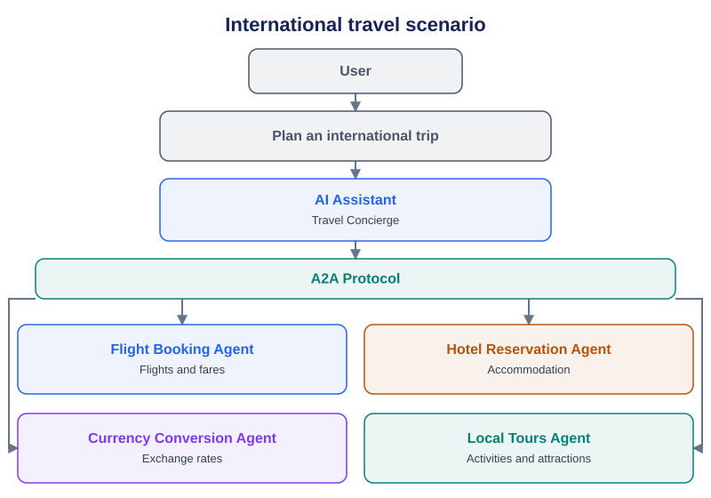
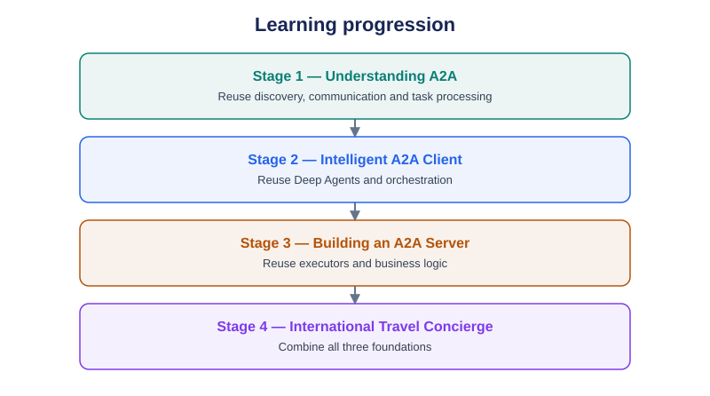
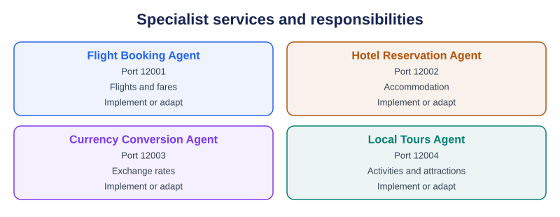
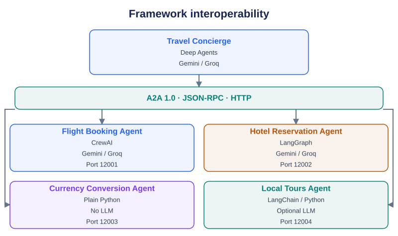
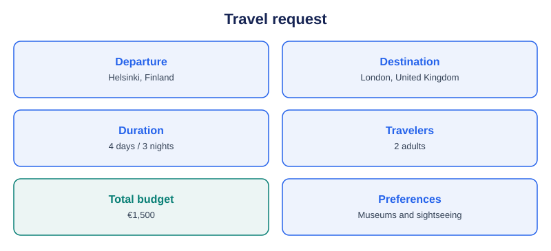
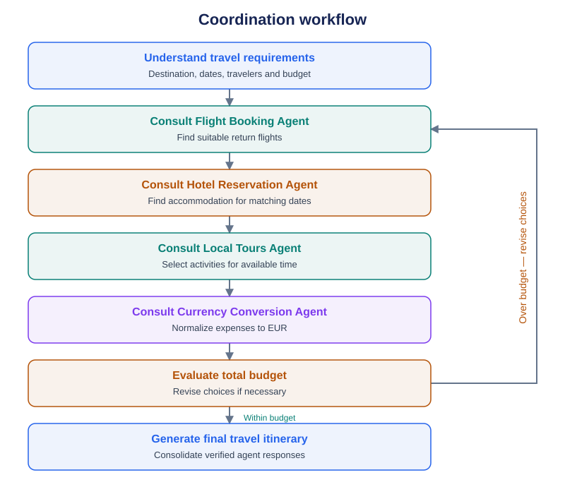
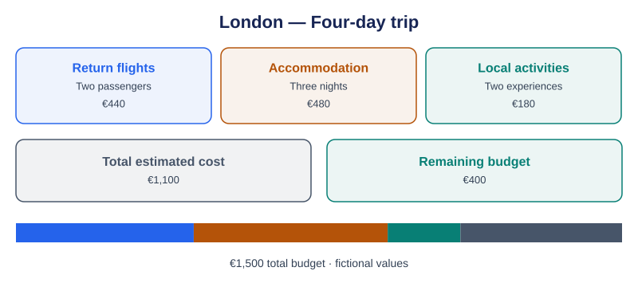
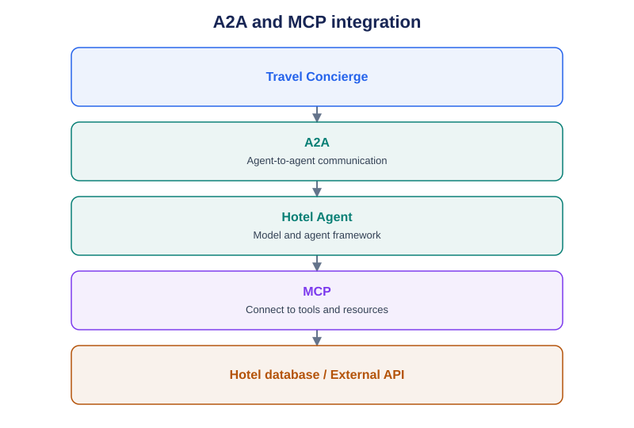
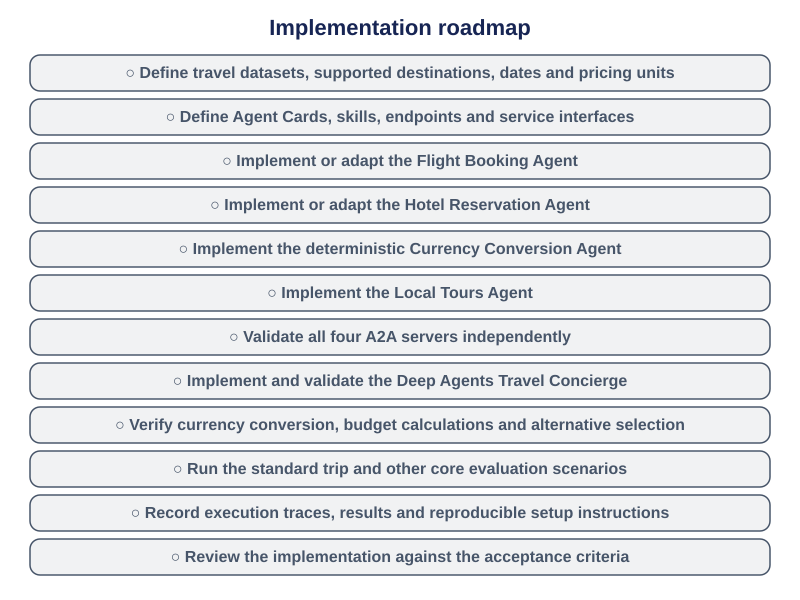

# Lab 4 — Plan an International Trip

## Introduction and objectives

Design and implement a multi-agent **Travel Concierge** that coordinates independently running specialist services using the Agent2Agent (A2A) protocol. Given a travel request, the system must gather relevant flight, accommodation, currency and activity information, evaluate available options, and produce an itinerary that satisfies the requested travel preferences and budget.

This is an open-ended implementation project. Use the architecture and requirements in this document to develop your own working solution. You may adapt existing implementations rather than write every component from scratch.

By completing the activity, you will demonstrate the ability to:

- Implement and expose specialist services through A2A Agent Cards, executors and HTTP endpoints.
- Discover remote agents, inspect their skills, exchange messages, and process tasks and artifacts.
- Build an intelligent coordinating client using Deep Agents.
- Integrate independently implemented agents, including both LLM-powered and deterministic services.
- Coordinate dependent tasks, normalize currencies, validate a shared budget, and revise an itinerary when necessary.
- Test individual services and the complete multi-agent system, including unsuccessful requests and unavailable services.

## Resources and use of AI

Use the materials, source code, implementations and examples from:

- **Lab 1 — Understanding A2A:** Agent Cards, discovery, messages, tasks, artifacts and communication with independent server processes.
- **Lab 2 — Building an Intelligent A2A Client:** Deep Agents, tool calling, agent selection and coordination.
- **Lab 3 — Building an A2A Agent Server:** deterministic business logic, server construction, executors, provider configuration and integration with a coordinating client.
- [GitHub repository: AI-Learning-Repo/w6-demo](https://github.com/AI-Learning-Repo/w6-demo).
- [Official A2A documentation](https://a2a-protocol.org/latest/topics/what-is-a2a/).

You are permitted to use LLMs, such as ChatGPT, Gemini and Groq-hosted models, for **brainstorming**, exploring architectural alternatives, discussing implementation strategies, generating code examples and troubleshooting. You are responsible for understanding, evaluating, testing and explaining your final implementation. Treat AI-generated suggestions as starting points rather than automatically accepted solutions.

The existing food seller implementations, reusable client communication module and infrastructure utilities are your technical references. Adapt them to develop all four travel-specific A2A services and the Travel Concierge. Create your own travel datasets, service implementations and tests. No additional travel-specific starter files are necessary to begin this activity.

Use simulated travel data for the core project. Do not make actual reservations, payments or bookings.

## 1. International travel scenario from the official A2A documentation

The [official A2A example scenario](https://a2a-protocol.org/latest/topics/what-is-a2a/#a2a-example-scenario) provides the conceptual foundation for this project. Retain its architecture and terminology when designing your implementation.

The scenario begins with a complex user request:

> Plan an international trip.

Four specialized agents provide different services, while an AI assistant coordinates their activities and consolidates their results into a coherent travel plan.



*International travel architecture adapted from the official A2A scenario.*

| Concept from the official documentation | Application in Lab 4 |
|---|---|
| International travel scenario | The main implementation challenge |
| Four specialized agents | Independent remote A2A servers |
| AI assistant | Deep Agents Travel Concierge |
| Agent discovery | Agent Cards describing available capabilities |
| Interoperability | Communication across different agent frameworks |
| Opaque execution | Black-box specialist services with their own internal implementations |
| Request lifecycle | Messages, tasks and artifacts |
| Agent autonomy | Independent business logic and tools |
| Orchestration | Coordination and consolidation into a complete travel plan |

The official example describes an architecture rather than an executable travel application. Your task is to turn that architecture into a functioning multi-agent system using the protocol and implementation patterns from Labs 1–3.

## 2. Reusing the previous lab implementations

Use the technical foundations established in the previous three labs. The travel scenario introduces new application logic, but the communication protocol, process-management techniques and integration patterns remain the same.



| Existing component | Application in Lab 4 |
|---|---|
| `lab_utils.py` | Reuse or extend environment setup, server registration, process management and readiness checks for the travel services. |
| `clients/a2a_client.py` | Reuse discovery, A2A messaging, task validation and artifact extraction. |
| Gemini initialization | Reuse model selection and API-key configuration. |
| Groq initialization | Reuse model selection and API-key configuration. |
| Provider switching | Reuse the approach for selecting a provider and restarting affected services. |
| Request delays | Retain configurable delays to reduce request bursts. |
| Virtual environments | Reuse isolated seller environments as the pattern for travel service environments. |
| A2A server implementation | Adapt the server entry point, executor and task lifecycle from Lab 3. |
| Deep Agents concierge | Adapt the discovery, communication tools and coordination patterns from Lab 2. |
| Agent Cards | Define new travel skills, descriptions, endpoints and supported interfaces. |

Use A2A protocol 1.0 and A2A Python SDK version 1.3.1 to ensure compatibility with the helper utilities from Labs 1–3. Avoid introducing a separate communication protocol where A2A already meets the requirements.

You may clone the existing repository in Google Colab and create your own project workspace. Consult its README and inspect the existing utility and client source code as needed. Retain separate processes for the specialist services and use localhost endpoints so the system can be executed within one Colab runtime.

For LLM-powered components, reuse Gemini or Groq configuration from Labs 1–3, including the model-listing, connectivity and provider-selection patterns. Select models available through your account. Keep API keys out of source files, datasets and submitted logs. Test deterministic services without an LLM before introducing model-dependent components.

## 3. Specialist services and implementation responsibilities

Develop four independently running A2A specialist services and an intelligent Travel Concierge. Each service must have its own identity, Agent Card, endpoint and application logic. You may reuse a common server adapter or adapt the food seller implementations rather than duplicate the same protocol code in every service.



Use the following service responsibilities and port assignments. If a port is unavailable in your environment, choose a different port and update the corresponding Agent Card and client configuration consistently.

| Agent | Port | Responsibility |
|---|---:|---|
| Flight Booking Agent | 12001 | Searches simulated flights, fares and schedules. |
| Hotel Reservation Agent | 12002 | Searches accommodation, checks availability and calculates costs. |
| Currency Conversion Agent | 12003 | Converts amounts between currencies using simulated exchange rates. |
| Local Tours Agent | 12004 | Recommends available activities and calculates tour costs. |

The Travel Concierge must use Deep Agents to coordinate these services. It acts as an A2A client and does not need to expose an A2A server endpoint for the core project.

| Component | Implementation requirement |
|---|---|
| Flight Agent | Implement or adapt an existing A2A server to provide flight search and fare information. |
| Hotel Agent | Implement or adapt an existing A2A server to provide accommodation search, availability and stay costs. |
| Currency Agent | Implement a deterministic A2A service for currency conversion. |
| Local Tours Agent | Implement an A2A service for activity search, recommendations and cost calculations. |
| Travel Concierge | Implement an intelligent Deep Agents client. |
| Agent discovery | Discover and inspect all four services using reusable A2A functions. |
| Budget management | Aggregate costs in EUR, check the budget and revise selections when required. |
| Error handling | Detect invalid requests, unavailable options, failed tasks and unavailable services. |
| Final itinerary | Consolidate selected options, dates, costs, assumptions and sources into a usable travel plan. |

### 3.1 Flight Booking Agent

The service must return simulated return-flight options matching the requested departure location, destination, dates and number of travelers. Include enough information for the concierge to compare prices and identify the arrival and departure dates used for later accommodation and activity searches. Clearly distinguish the fare per traveler from the total fare for the group.

### 3.2 Hotel Reservation Agent

The service must return available accommodation options matching the destination, check-in date, check-out date and number of travelers. Include the price per night or per room, the number of nights, the total accommodation cost and the currency. Return a clear response when the requested dates or occupancy cannot be accommodated.

### 3.3 Currency Conversion Agent

The service must convert a supplied amount from a source currency to a target currency using a fixed, documented exchange-rate dataset. Include the original amount, source currency, exchange rate, target currency and converted amount. Handle unsupported currencies explicitly. Perform the arithmetic deterministically rather than asking an LLM to calculate exchange rates or monetary totals.

### 3.4 Local Tours Agent

The service must return available local activities matching the destination, travel dates, group size and preferences. Include each activity's name, duration or schedule, price per participant or group, currency and any availability restrictions. Make it possible for the concierge to compare alternatives and select at least two appropriate activities.

### 3.5 A2A service interface

For each specialist, define an Agent Card that accurately describes its capabilities and skills. Advertise the correct HTTP endpoint, supported A2A interface, protocol version and communication capabilities. Use a request handler and executor to receive A2A messages, call the service's business logic, manage the task lifecycle and return the result as an artifact or a suitable A2A response.

Use the implementations from Lab 3 as the reference for constructing and testing the server. The concierge should not need to import the specialist's internal business functions to retrieve travel information.

## 4. Framework interoperability

One of the fundamental objectives of the Agent2Agent (A2A) protocol is to enable communication between independently implemented agents, regardless of their underlying agent frameworks, programming languages or model providers.



*The international travel architecture combines independently implemented specialist services using A2A 1.0 over HTTP with JSON-RPC.*


The specialist services in the international travel planning system do not need to use the same framework or model provider. However, using different frameworks is not a mandatory requirement for implementing an A2A-compatible multi-agent system.

All LLM-powered agents may be implemented using Deep Agents, which has been introduced in the preceding activities. Deterministic services may be implemented using ordinary Python functions without requiring an LLM.

The following table illustrates possible implementation choices.

| Agent | Suggested implementation | Alternative implementation | LLM required? |
|---|---|---|---|
| Flight Booking Agent | Deep Agents | CrewAI, LangGraph or plain Python | Depends on implementation |
| Hotel Reservation Agent | Deep Agents | LangGraph, CrewAI or plain Python | Depends on implementation |
| Currency Conversion Agent | Plain Python | Deep Agents with deterministic calculation tools | No |
| Local Tours Agent | Deep Agents or plain Python | LangChain, LangGraph or CrewAI | Optional |
| Travel Concierge | Deep Agents | Another suitable agent framework | Yes, for intelligent coordination |

The implementation of the Travel Concierge using Deep Agents is recommended because it allows the concepts and implementation approaches introduced in the preceding activities to be reused.

The use of CrewAI, LangGraph or other agent frameworks is optional. These frameworks may be explored to demonstrate interoperability between independently implemented agents.

### 4.1. Using a common agent framework

One possible approach is to implement the Travel Concierge and all intelligent specialist agents using Deep Agents, while implementing the Currency Conversion Agent using ordinary Python.

Although most agents use the same framework, they remain independent services with their own responsibilities, capabilities, Agent Cards, endpoints and execution environments.

Communication between these services must take place through the A2A protocol rather than through direct imports or internal subagent delegation.

This architecture demonstrates that A2A can be used even when all intelligent agents are implemented using the same framework.

### 4.2. Using heterogeneous agent frameworks

As an optional extension, one or more specialist agents may be implemented using a different framework.

For example, the Flight Booking Agent may use CrewAI, the Hotel Reservation Agent may use LangGraph, and the Travel Concierge may use Deep Agents.

The coordinating agent should be able to communicate with these specialist services without requiring knowledge of their internal implementation details.

This approach provides an additional demonstration of framework-level interoperability.

The existing CrewAI Burger Agent and LangGraph Pizza Agent in the GitHub repository may be used as reference implementations when exploring this approach.

### 4.3. Model-provider interoperability

Agents may also use different LLM providers or models while using the same agent framework.

For example, the Travel Concierge may use a Groq-hosted model, while the Flight Booking Agent uses Gemini and the Hotel Reservation Agent uses another Groq-hosted model.

The A2A communication layer remains unchanged because the underlying model provider is an internal implementation decision.

This provides another way to explore interoperability without requiring familiarity with multiple agent frameworks.

### 4.4. Selecting an appropriate implementation

Select the implementation approach according to the responsibilities of each agent and the complexity of the task.

Not every specialist service requires an LLM. Deterministic operations such as currency conversion, price calculation, filtering available flights and calculating accommodation costs can be implemented using ordinary Python functions.

LLMs are particularly useful when a service needs to interpret natural language, reason about preferences, select appropriate tools or make decisions based on multiple constraints.

The use of additional frameworks or LLMs should be justified by the requirements of the service rather than introduced solely to increase architectural complexity.

The essential requirement is that the independently implemented services expose their capabilities through A2A-compatible interfaces and that the Travel Concierge communicates with them using the A2A protocol.

## 5. Data sources and simulation requirements

Use **simulated travel data for the core activity**. The datasets must contain enough information to exercise the complete system and reproduce expected results. Commercial travel API credentials are not required for this project.

| Aspect | Simulated data | Real APIs |
|---|---|---|
| Additional API keys | Not required | Often required |
| Reproducibility | High: fixed inputs and outputs | Variable: results can change |
| Testing expected results | Easy to establish from controlled data | More difficult when external data changes |
| Cost | Minimal data-access cost | Potential API charges |
| Availability | Controlled by the dataset | Depends on external services |
| A2A integration | Can be tested independently of external APIs | Requires handling additional API dependencies |
| Realism | Limited by the simulation | Potentially higher |

Create small JSON datasets representing flights, hotels, tours and exchange rates. The agents should query these datasets through their own internal tools.

For example, organize the Flight Agent as follows:

```text
flight_agent/
├── agent.py
├── agent_executor.py
├── __main__.py
└── data/
    └── flights.json
```

This separation allows the coordinating agent to obtain information through the specialist's A2A interface without directly accessing its database. Each specialist is responsible for interpreting its own data and providing the relevant results.

### 5.1 Dataset design

Design a consistent data representation for each service. The following fields illustrate the information required to support the travel scenarios and test cases. Field names and file structures may be adapted to your implementation.

| Dataset | Suggested information |
|---|---|
| `flights.json` | Flight or return-option identifier, origin, destination, departure and arrival dates and times, available seats, fare, currency and fare unit. |
| `hotels.json` | Hotel identifier, destination, availability dates, room capacity, available rooms, nightly rate and currency. |
| `rates.json` | Source currency, target currency, fixed conversion rate and a description identifying the rates as simulated. |
| `tours.json` | Activity identifier, destination, name, category, availability, duration or schedule, price, currency and pricing unit. |

Include both available and unavailable options so that the system can demonstrate successful searches, alternative selection and meaningful error responses. Provide lower-cost and higher-cost alternatives for the budget revision tests.

Use consistent travel dates and currencies across datasets. Include GBP-denominated accommodation or activities for London so that currency conversion is a meaningful part of the core scenario. Keep the rates fixed during a test run and define whether each amount represents one person, one room, one night or the entire group.

Real flight, hotel or currency APIs may be integrated as an optional read-only extension. No actual reservations, payments or bookings should occur in the core activity or the extension.

## 6. Main activity scenario

Use Helsinki as the departure location. London is the required reference destination. You may extend the same architecture and datasets to support other international destinations, such as Tokyo, New York and Istanbul.



| Requirement | Value |
|---|---|
| Departure | Helsinki, Finland |
| Destination | London, United Kingdom |
| Duration | 4 days / 3 nights |
| Travelers | 2 adults |
| Total budget | €1,500 |
| Preferences | Museums and sightseeing |

London is useful for exercising the Currency Conversion Agent because prices expressed in GBP must be normalized to EUR before the concierge can evaluate the overall budget.

Choose a specific set of four travel days and three accommodation nights that are represented in your simulated datasets. Include these dates in the request or have the concierge obtain clarification before performing date-dependent searches. The dataset dates, rather than real-time travel availability, determine the outcome of the activity.

Use the following reference request:

> Plan a four-day international trip from Helsinki to London for two adults with a maximum budget of €1,500. Include return flights, three nights of accommodation and at least two local activities. Convert all costs to euros, provide a detailed itinerary and stay within the budget. Do not make any actual reservations.

The concierge must obtain the flight, accommodation, exchange-rate and activity information through the corresponding A2A services. It should not answer solely from its model's general knowledge or prices embedded in its own prompt.

## 7. Multi-agent collaboration workflow

The task requires more than contacting four agents and concatenating their responses. The result of one service may determine the request sent to another service. For example, flight arrival and departure times determine the dates available for accommodation and activities.



Implement a coordination workflow that can:

1. Understand the travel requirements, including destination, dates, group size, budget and preferences. Ask for clarification when essential details are missing.
2. Discover the available specialist services and identify their skills from their Agent Cards.
3. Consult the Flight Booking Agent to obtain suitable return-flight options.
4. Consult the Hotel Reservation Agent to find accommodation for the matching dates and number of travelers.
5. Consult the Local Tours Agent to identify suitable activities within the available time and preferences.
6. Consult the Currency Conversion Agent to normalize foreign-currency expenses to EUR.
7. Evaluate the total budget using the selected options. If the selection exceeds the limit, request or select lower-cost alternatives and recompute the total.
8. Generate a final itinerary by consolidating the verified responses, or explain why the requirements cannot be satisfied with the available data.

Deep Agents can support the planning, delegation, evaluation of intermediate results and revision of selections required in this workflow. Adapt the tool definitions and discovery mechanisms from Lab 2. The coordinating model should select relevant tools based on the available capabilities and the travel request.

The diagram illustrates one possible execution plan, not a hardcoded order that every request must follow. Independent searches may be performed in a different order, provided dependencies between the results are respected. For the initial implementation, execute remote inference requests sequentially and retain configurable cooldowns to reduce rate-limit problems.

### 7.1 Budget and currency management

Normalize monetary amounts to EUR before aggregating costs. Use the number of travelers, number of nights, per-unit prices and exchange rates from the specialist responses. Avoid counting a group total twice or multiplying a total accommodation price by the number of nights again.

Use deterministic arithmetic for conversion, subtotals and the final budget comparison. Preserve the original amounts and currencies alongside their converted values so the calculation can be verified. If the total is above the requested budget, select valid lower-cost alternatives and repeat the calculation. If no feasible combination exists, report the limitation rather than claiming the trip is within budget.

### 7.2 Intelligent client requirements

The Travel Concierge must expose A2A communication to its coordinating model through suitable tools, such as agent discovery and remote message sending. Use the configured service endpoints as the discovery entry points and use the advertised Agent Cards to understand what each service can do.

Record the agent selections, A2A task outcomes and relevant returned information. Inspect the actual tool calls and service responses when validating the itinerary. Distinguish a completed task from a correct business result: a completed task may still report that no suitable flight, hotel or activity is available.

## 8. Example expected output

Using fictional travel data, a successful result might have the following cost breakdown.



**London — Four-day trip:** illustrative itinerary for two travelers.

| Category | Details | Estimated cost |
|---|---|---:|
| Return flights | Two passengers | €440 |
| Accommodation | Three nights | €480 |
| Local activities | Two selected experiences | €180 |
| **Total estimated cost** | | **€1,100** |
| **Remaining budget** | | **€400** |

These are fictional example dataset values, not current travel quotes. Your actual result may differ according to the options and exchange rates in your own simulated datasets.

For example, a simulated exchange rate of **1 GBP = 1.20 EUR** would convert a £400 accommodation total to €480 and a £150 activity total to €180. Adding €440 in return flights produces the €1,100 illustrated above. The remaining budget is €1,500 minus €1,100, or €400. This example demonstrates the conversion and calculation logic rather than prescribing the exchange rate your dataset must use.

The final response must include the selected return flights, accommodation for three nights, at least two local activities, and a four-day itinerary compatible with the selected travel dates and schedules. Identify which agents supplied the information. Show the original and converted amounts where relevant, the total estimated cost, the remaining budget and any expenses not covered by the estimate, such as meals, local transport or insurance.

State clearly that the itinerary is based on simulated data and that no actual bookings have been made.

## 9. Implementation phases and testing

Develop the system incrementally. Validate individual services before relying on their responses in the coordinating client.

| Phase | Activity | Implementation checkpoint |
|---|---|---|
| 1 | Initialize the environment and implement or adapt the Flight, Hotel and Currency services. | Clone or access the reference repository, create the datasets, configure isolated environments and start the three services. |
| 2 | Discover and independently test the Flight, Hotel and Currency agents. | Retrieve valid Agent Cards and verify A2A requests, task states, artifacts and business results using the direct client. |
| 3 | Implement the Local Tours Agent. | Create its dataset, business logic, Agent Card, executor and server endpoint; validate it independently. |
| 4 | Build the intelligent Travel Concierge. | Expose discovery and messaging as tools, coordinate all four services, and implement currency normalization and budget checking. |
| 5 | Execute and evaluate travel scenarios. | Run end-to-end tests, inspect execution traces, validate itineraries and verify failure handling. |
| 6 | Extend the system. | Explore additional destinations, provider switching or optional integrations. |

Use the previous labs as implementation references throughout these phases. You may implement a minimal deterministic version of a service first and add model-powered reasoning after its A2A communication and business functions work correctly.

### 9.1 Evaluation scenarios

Use controlled simulated datasets to test the following scenarios. Record the input, relevant agent calls, expected outcome, actual outcome and whether the test passed. The first six scenarios exercise the core implementation. The last two are extension opportunities.

| Scenario | Capability evaluated | Expected behavior |
|---|---|---|
| Standard trip | Basic agent coordination | Produce a four-day Helsinki–London itinerary for two adults, with three nights and at least two activities, within the €1,500 budget. |
| Limited budget | Planning and revision | Detect that an initial combination is over budget, try suitable lower-cost options and recalculate. Report an infeasible request if no valid combination exists. |
| Foreign currency | Currency normalization | Obtain a simulated GBP-to-EUR conversion through the Currency Agent and verify the arithmetic independently. |
| Unavailable hotel | Alternative selection | Recognize that an option is unavailable for the requested dates and select an available alternative or report the limitation. |
| Unavailable remote agent | Graceful error handling | Recognize that a required service cannot be reached or returns a failed task. Report missing information without inventing a complete itinerary. |
| Incomplete travel request | Asking for clarification | Identify missing essential information, such as travel dates, destination or budget, and obtain clarification or state an explicit assumption before proceeding. |
| Multiple destinations (optional) | More advanced coordination | Extend the data and service capabilities to handle additional destinations or a multi-destination itinerary. |
| Provider switching (optional) | Model interoperability | Change a supported LLM provider for a service or the concierge while retaining the A2A interface and validating the result again. |

For the core tests, ensure that the required business results can be checked against your dataset. If a model response reports task completion but contains an incorrect price, invalid dates or unsupported information, the test has not passed.

## 10. Project organization

Use the [existing GitHub repository](https://github.com/AI-Learning-Repo/w6-demo) as the source of reusable implementations and infrastructure. Create your own working copy of the project for the travel activity. Keep the travel services separate from the food seller examples so that the latter remain available as references.

The following directory layout is one way to organize the completed project. The travel-specific directories and files represent work to be created during the activity. You may use a different layout if the service implementations, datasets, tests, setup instructions and entry points remain easy to locate.

```text
w6-demo/
├── README.md
├── lab_utils.py
│
├── remote_seller_agents/              # Reference implementations from earlier labs
│   ├── burger_agent/
│   ├── pizza_agent/
│   └── dessert_agent/                 # If retained from Lab 3
│
├── remote_travel_agents/              # Implement the four travel services
│   ├── flight_agent/
│   │   ├── agent.py
│   │   ├── agent_executor.py
│   │   ├── __main__.py
│   │   ├── requirements-colab.txt
│   │   └── data/
│   │       └── flights.json
│   ├── hotel_agent/
│   │   └── data/
│   │       └── hotels.json
│   ├── currency_agent/
│   │   └── data/
│   │       └── rates.json
│   └── local_tours_agent/
│       └── data/
│           └── tours.json
│
├── clients/
│   ├── a2a_client.py                  # Reuse the A2A communication module
│   ├── test_discovery.py
│   ├── test_all.py
│   ├── test_travel_agents.py           # Implement travel service tests
│   └── travel_concierge.py             # Implement the coordinating client
│
├── lab4/
│   ├── README.md                      # Activity and execution instructions
│   ├── travel_concierge.ipynb          # Example notebook entry point
│   ├── requirements.txt
│   └── img/
│       ├── lab4-01-international-travel-scenario.svg
│       ├── lab4-04-framework-interoperability.svg
│       ├── lab4-06-coordination-workflow.svg
│       └── ...
│
└── docs/
    └── lab_utils_reference.md
```

Each travel service should have its own executable server entry point and dependency specification, or an explicitly documented shared server implementation that can be launched independently for each specialist.

The travel project must run independently of the food seller services. The burger, pizza and dessert servers do not need to be running. Reuse existing infrastructure where appropriate, but do not make the concierge depend on the implementation details or data files of the food sellers.

## 11. Optional advanced extension — A2A and MCP

The official A2A documentation distinguishes between A2A for communication among agents and the Model Context Protocol (MCP) for connecting agents to tools and external resources.

Extend one specialist service, for example the Hotel Agent, to retrieve data through an MCP tool or resource instead of accessing its dataset directly.



The Travel Concierge still communicates with the Hotel Agent through A2A. The Hotel Agent uses MCP internally to access a database or external API. The external resource does not replace the A2A interface between the concierge and the specialist agent.

Demonstrate that the concierge can retrieve accommodation information through the same A2A interface after this internal change. MCP integration is optional; the four-service A2A implementation and the core travel tests must work without it.

## 12. Implementation checklist

Start by defining the travel datasets, skills, Agent Cards and responsibilities of the four specialist services. Once the interfaces are defined, implement the services and test each independently before integrating the Travel Concierge.



- [ ] Define travel datasets, supported destinations, dates and pricing units.
- [ ] Define Agent Cards, skills, endpoints and service interfaces.
- [ ] Implement or adapt the Flight Booking Agent.
- [ ] Implement or adapt the Hotel Reservation Agent.
- [ ] Implement the deterministic Currency Conversion Agent.
- [ ] Implement the Local Tours Agent.
- [ ] Validate all four A2A servers independently.
- [ ] Implement and validate the Deep Agents Travel Concierge.
- [ ] Verify currency conversion, budget calculations and alternative selection.
- [ ] Run the standard trip and other core evaluation scenarios.
- [ ] Record execution traces, results and reproducible setup instructions.
- [ ] Review the implementation against the acceptance criteria below.

## 13. Expected deliverables

Submit a complete, reproducible implementation of your Travel Concierge project. Include the following artifacts:

| Deliverable | Required content |
|---|---|
| Source code | All four specialist services, their A2A interfaces, the Deep Agents coordinating client, and any shared utilities used by the implementation. |
| Simulated datasets | The flight, hotel, currency and local tours data required to reproduce the test scenarios. |
| Execution instructions | A README describing prerequisites, dependency installation, API-key configuration, model selection, server launch commands, endpoints, client execution and cleanup. |
| Executable entry point | A Colab notebook or documented Python entry point that starts or connects to the services and executes the travel scenarios. |
| Test evidence | The inputs, expected and actual results, A2A task outcomes and relevant client or server logs for the core scenarios. |
| Final itinerary | The result of the Helsinki–London reference scenario with selected options, dates, detailed costs, currency conversion, total and remaining budget. |
| Implementation explanation | A concise description of your architecture, chosen frameworks, reuse of previous lab components, agent selection, coordination strategy and error handling. Include limitations and any optional extensions implemented. |

Make the project available as a repository link or a source archive that contains the required files. Include the executable notebook or entry point and any execution evidence necessary to reproduce and inspect the results. Do not include API keys, `.env` files containing secrets, installed virtual environments, caches or unrelated runtime files.

## 14. Acceptance criteria

Use the following criteria to verify that the core implementation is complete. These criteria describe the required behavior; they do not prescribe the internal implementation of each service.

| Criterion | Evidence of completion |
|---|---|
| A2A protocol and service discovery | Four independently running remote services expose valid Agent Cards with correct endpoints and useful skill descriptions. The client can discover them and exchange A2A messages. |
| Service functionality | Each service processes its own travel requests and returns results consistent with its simulated data. Task states and artifacts or other appropriate A2A responses are handled correctly. |
| Intelligent coordination | A Deep Agents client selects and invokes the relevant specialists through A2A tools, uses their returned information and respects dependencies between results. The execution trace demonstrates actual remote communication. |
| Framework interoperability | LLM-powered and deterministic services communicate through the same A2A protocol independently of their underlying frameworks. |
| Complete reference scenario | The system produces a feasible four-day Helsinki–London itinerary for two adults, including return flights, three nights of accommodation and at least two local activities. Dates and availability are consistent. |
| Currency conversion and budget accuracy | Foreign-currency costs are converted through the Currency Agent. Units, subtotals, total and remaining budget are correct and verifiable. The selected itinerary stays within €1,500 for the standard scenario. |
| Revision and error handling | The system handles an over-budget selection, unavailable accommodation, an unavailable service and an incomplete request without inventing data or falsely claiming a successful result. |
| Reproducibility | The implementation can be executed using the documented setup, supplied datasets, dependency specifications and entry points. Simulated data and assumptions are identified clearly. |
| Implementation understanding | The architecture, service responsibilities, model usage, tool calls and decisions can be explained using the submitted code and execution evidence. |

A valid result does not require the exact fictional prices shown in Section 8. It requires a correct and reproducible result based on your datasets and the specified travel constraints.

## References

- [A2A Protocol — What is A2A?](https://a2a-protocol.org/latest/topics/what-is-a2a/), including the international travel example and the distinction between A2A and MCP.
- [AI-Learning-Repo/w6-demo](https://github.com/AI-Learning-Repo/w6-demo), including the reusable implementations and utilities from Labs 1–3.


