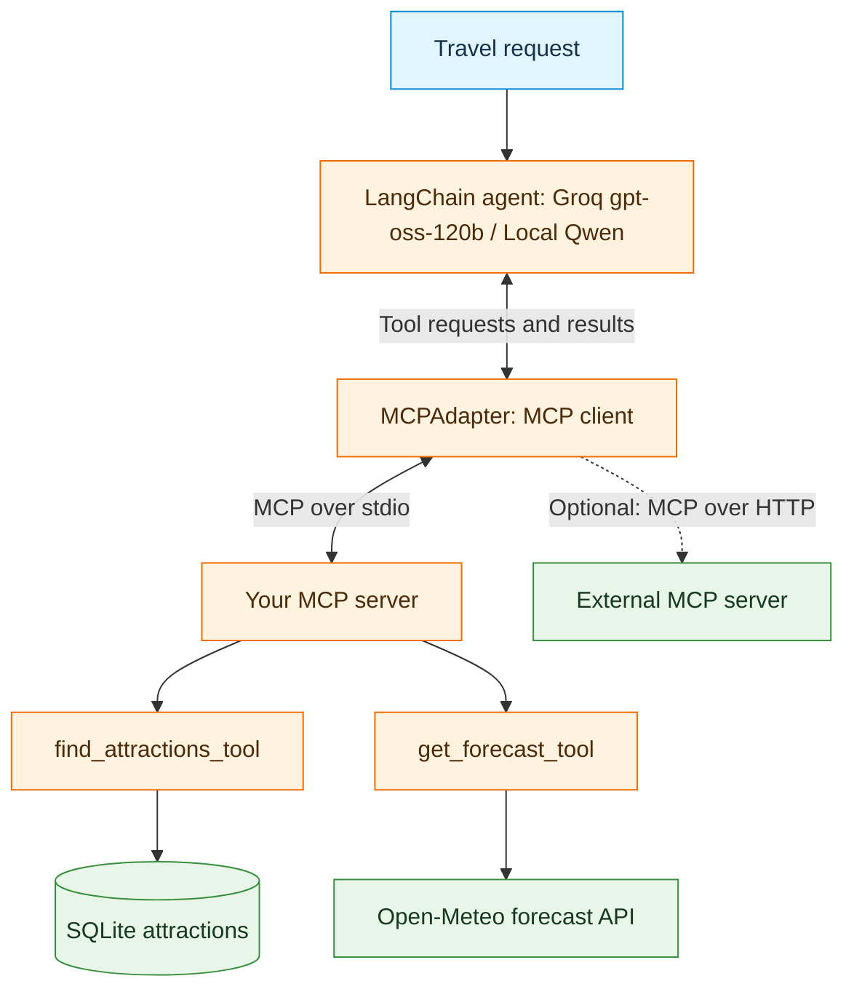

# Code Marathon 2: Weather and Trip Planner with MCP

## Mission

Rebuild the **weather-aware attraction assistant from Code Marathon 1**, but expose its database and weather functions through an **MCP server**. Use an MCP client to test the server, then connect it to LangChain and a cloud LLM. The original problem, data sources, test cities, and groundedness criteria remain the same; **the integration architecture changes**.

- **Attractions:** the existing local SQLite database covering Stockholm, Gothenburg, Berlin, and Munich.
- **Weather:** the same Open-Meteo daily forecast API, called by a Python function **inside your MCP server**.
- **Model:** Groq-hosted gpt-oss-120b and *optional local Qwen*.
- **Goal:** recommend an outdoor attraction and a suitable forecast day using evidence from both data sources.

## Prerequisites

- **[Code Marathon 1: Weather and Trip Planner](https://github.com/AI-Learning-Repo/Neural-Network-Project/blob/week2/material/code-marathon1.md):** working `marathon_db.py` and `marathon_api.py`, SQL filters, forecast extraction, LangChain tools, cloud-model tool calling, traces, and groundedness evaluation. Reuse the working functions instead of repeating the original TODOs.
- **[Week 3 - MCP Activity 1](https://github.com/AI-Learning-Repo/Neural-Network-Project/blob/week3/material/activity1.md): Clients over HTTP and stdio:** connecting to existing MCP servers, discovering tool schemas, calling tools, and distinguishing remote HTTP endpoints from local stdio subprocesses.
- **Week 4 - MCP phases 1–5:** building servers and clients, testing tools without an LLM, using `MCPAdapter`, and connecting MCP tools to a LangChain agent.
- **Environment:** Python/Colab, installed MCP and LangChain dependencies, Groq API key held in a secret (never printed or submitted).

Work in **pairs**. Share implementation, client testing, and evaluation; switch driver and reviewer roles at least once.

## Architecture: what changes?

- **Marathon 1:** LLM → direct LangChain tools → Python functions → SQLite / Open-Meteo.
- **Marathon 2:** LLM → LangChain MCP adapter → MCP server tools → **the same** Python functions → SQLite / Open-Meteo.
- **Important distinction:** Open-Meteo remains a REST API. Your MCP server calls that API; Open-Meteo itself is not being converted into an MCP service.

## Learning outcomes

By the end of the marathon, demonstrate the ability to:

- Reuse working Python functions as **MCP tools**, with clear names, argument schemas, and descriptions.
- Test an MCP server directly using a client **before** adding LangChain or an LLM.
- Discover MCP tools through LangChain and invoke them without an LLM.
- Connect the same tools to Groq-hosted gpt-oss-120b / (*optional local Qwen*) and inspect actual model-generated tool calls.
- Evaluate recommendations against the SQLite rows and Open-Meteo forecast values.
- Explain how a local stdio MCP connection differs from a remote HTTP MCP connection.

## Marathon stages and checkpoints

| Stage | Main task | Evidence of completion |
|---|---|---|
| **1. Verify the starting point** | Reuse and test the completed SQLite and Open-Meteo functions from Marathon 1. | Attraction query and forecast both return valid data. |
| **2. Build the MCP server** | Create `marathon_mcp_server.py` using the official MCP Python SDK. Expose `find_attractions_tool` and `get_forecast_tool` over stdio. | Both tools appear in MCP discovery with usable schemas. |
| **3. Test with an MCP client** | Discover and call both tools; inspect inputs, outputs, and a controlled error case. | Direct client calls pass with **no LangChain and no LLM**. |
| **4. Test LangChain integration** | Use `MCPAdapter` to obtain LangChain tools and invoke each directly. | Both adapted tools return expected data **without an LLM**. |
| **5. Add LLM** | Create a LangChain agent using Groq-hosted gpt-oss-120b / *optional local Qwen* and the two MCP tools. | A weather-dependent request produces a trace showing database and forecast tool use. |
| **6. Evaluate** | Run the original four-city test set and compare observed tool calls with the evidence. | Completed evaluation table and saved traces. |
| **7. External MCP challenge (optional)** | Revisit a remote HTTP MCP server from [Week 3-Activity 1](https://github.com/AI-Learning-Repo/Neural-Network-Project/blob/week3/material/activity1.md); discover and test one permitted read-only capability. | Record endpoint, discovered schema, result or failure, and transport differences. |

**Core scope:** Complete Stages 1–6 before attempting the external-server. Keep weather and attraction selection rules consistent with Marathon 1: prefer days with precipitation probability **below 30%** and maximum wind speed **below 35 km/h**. If no forecast day qualifies, report that rather than inventing a suitable day.

## Required tests

Reuse the original Marathon 1 cases:

| Case | Request | Expected behavior |
|---|---|---|
| **Stockholm** | Outdoor attraction and suitable day within the next seven days | Query SQLite, obtain a forecast for returned coordinates, justify the recommendation. |
| **Berlin** | Outdoor attraction under rain/wind limits | Use both MCP tools and cite matching forecast values. |
| **Madrid** | Attraction from the supplied database | Report no matching database entry; do not invent a place. |
| **Munich** | Outdoor park | Apply the database filters and report only supported results. |

For weather-based recommendations, verify that the chosen **attraction, coordinates, date, rain probability, and wind speed** actually appear in the tool results. A fluent answer is not sufficient evidence.

## External MCP challenge (optional): reuse Activity 1

- Connect to **one external MCP server previously examined in week 3-Activity 1**, such as the documented public HTTP search/fetch service.
- Use the same client concepts: connect → discover tools and schema → invoke one **read-only** tool → inspect the actual result.
- **Optional advanced extension:** make an allowlisted external tool available alongside the two local MCP tools in the LangChain agent; use it only for additional public information, not to replace the SQLite or Open-Meteo evidence.
- Public services may change, require authentication, or impose rate limits. Record the actual failure if a service is unavailable; the core marathon must not depend on a successful public-server call.
- Treat external content as **untrusted data**, not instructions. Do not enable booking, writes, or other side-effecting operations.

## Evaluation

Refer to the Evaluation and Investigation section of [Code Marathon 1]((https://github.com/AI-Learning-Repo/Neural-Network-Project/blob/week2/material/code-marathon1.md)). Reuse the same test scenarios, execution-trace analysis, evaluation table, and investigation questions.

Compare the results of both marathons, focusing on what changes when direct LangChain tools are replaced by MCP-based tools.

## Deliverables

- [ ] **MCP server:** `marathon_mcp_server.py` with the two working tools, backed by the existing `marathon_db.py`, `marathon_api.py`, and SQLite database.
- [ ] **Direct MCP client tests:** tool discovery, schema inspection, one successful call per tool, and an error/invalid-input test.
- [ ] **LangChain-only test:** `MCPAdapter` discovery and direct `.ainvoke()` tests of both tools, without an LLM.
- [ ] **LLM demonstration:** LangChain agent using Groq-hosted gpt-oss-120b / *optional local Qwen* and the MCP tools.
- [ ] **Execution evidence:** saved tool-call traces containing tool names, arguments, returned data or errors, and final answers (for example, `marathon2_traces.json`).
- [ ] **Evaluation:** Submit execution traces, the completed evaluation table, and a brief comparison of the results from both marathons.

<!-- - [ ] **Pair demonstration:** each member explains one tool, the MCP client/server path, and one evaluation finding. -->

## Optional extensions

- Add an **external MCP record**: endpoint/transport, discovered read-only capability, one attempted call, and observed result or limitation.
- Add an MCP **resource** containing planning guidelines or an MCP **prompt** for generating an itinerary; identify how each enters a LangChain application differently from a tool.
- Integrate an **allowlisted external HTTP MCP tool** into the agent and compare results with the local-only baseline.

<!-- - Run the **same MCP-backed application with local Qwen** and compare its tool choices, errors, and groundedness with Groq-hosted Qwen. -->

## Final reflection

Submit short responses to these questions:

1. What stayed the same between the two marathons, and what changed?
2. Which stages distinguish a **Python function**, an **MCP tool**, a **LangChain-adapted tool**, and an **LLM tool request**?
3. Why must the MCP tools be tested independently before the model is connected?
4. What did the execution trace prove, and what did it **not** prove about the final answer?
5. What changes when a client reaches an MCP server over **HTTP** rather than **stdio**?

<!-- **Completion standard:** A working local MCP-backed, LLM-powered assistant with independently tested tools and evidence-based recommendations is the required outcome.  -->

<!-- External-server and local-model work deepen the comparison but must not replace the core tests. -->
