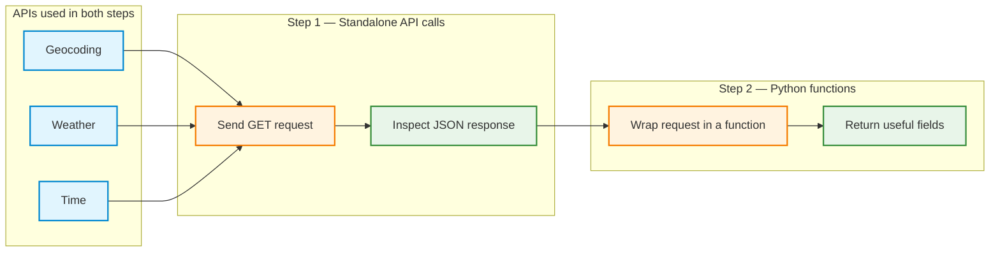

# Activity: From API Calls to Python Functions

**Learning objective:** Call three external APIs directly using Python, inspect their responses, and convert the working API requests into reusable functions.

**Environment:** Google Colab with a CPU runtime. No GPU, language model, LangChain, or tool-calling framework is required for this activity.

**Connection to the previous activity:** The previous activity introduced ordinary Python functions. This activity adds external API requests inside those functions. The functions created here will provide the foundation for later tool-calling activities.

## APIs used in this activity

| API | Purpose | Input |
|---|---|---|
| [Open-Meteo Geocoding](https://open-meteo.com/en/docs/geocoding-api) | Find a city and its coordinates | City name |
| [Open-Meteo Weather](https://open-meteo.com/en/docs) | Retrieve current weather data | Latitude and longitude |
| [Time.Now](https://time.now/developer) | Retrieve the current local time | IANA timezone, such as `Europe/Berlin` |

The two steps use **the same three APIs**. Only the Python code organization changes between Step 1 and Step 2.

---



---

# Step 1: Test each API as a standalone request

**Goal:** Send HTTP requests directly, inspect the returned JSON, and extract selected fields before introducing reusable functions.

A typical API call follows three operations:

1. **Request:** Send a URL and any required query parameters.
2. **Response:** Receive an HTTP status code and a JSON response.
3. **Extraction:** Read the fields needed for the task.

## 1.0: Prepare Google Colab

Open a new Google Colab notebook and select a CPU runtime. Run the following code cell.

```python
import requests
import json

GEO_URL = "https://geocoding-api.open-meteo.com/v1/search"
WEATHER_URL = "https://api.open-meteo.com/v1/forecast"
TIME_URL = "https://time.now/developer/api/time"

print("Ready to call APIs")
```

The `requests` package sends HTTP requests. The `json` package helps display the response in a readable format. The three URL constants identify the services used in the activity.

## 1.1: Geocoding API: Find a city

**Task:** Request the geographic information for Berlin and examine the response.

### A. Send the request

Run the following code cell.

```python
params = {
    "name": "Berlin",
    "count": 1,
    "countryCode": "DE"
}

response = requests.get(
    GEO_URL,
    params=params,
    timeout=15
)

print("URL:", response.url)
print("Status:", response.status_code)

response.raise_for_status()

data = response.json()
print(json.dumps(data, indent=2))
```

**Observe:** The response contains a `results` list. Each result represents a matching location. The `latitude`, `longitude`, and `timezone` fields are especially important for the next API requests.

### B. Extract the relevant fields

Run the following code cell.

```python
city = data["results"][0]

print("City:", city["name"])
print("Country:", city["country"])
print("Latitude:", city["latitude"])
print("Longitude:", city["longitude"])
print("Timezone:", city["timezone"])
```

### C. Experiment

1. Replace `Berlin` with `Tokyo`, `Paris`, or another city.
2. Update or remove `countryCode` as appropriate for the selected city.
3. Run the request again and compare the coordinates and timezone.
4. Test an invented city name and inspect the response before attempting to access `results[0]`.

**Record:** What changes when the city changes? What happens when no matching city exists?

## 1.2: Weather API: Retrieve current weather

**Task:** Request weather data using Berlin's approximate coordinates.

The Weather API differs from Geocoding: it expects **latitude and longitude**, rather than a city name.

### A. Send the request

Run the following code cell.

```python
params = {
    "latitude": 52.52,
    "longitude": 13.41,
    "current": "temperature_2m,relative_humidity_2m,wind_speed_10m",
    "timezone": "auto"
}

response = requests.get(
    WEATHER_URL,
    params=params,
    timeout=15
)

print("URL:", response.url)
print("Status:", response.status_code)

response.raise_for_status()

weather_data = response.json()
print(json.dumps(weather_data, indent=2))
```

**Observe:** The response includes current measurements in `current` and their units in `current_units`. Weather values change over time; fixed output numbers are not expected.

### B. Extract the relevant fields

Run the following code cell.

```python
current = weather_data["current"]
units = weather_data["current_units"]

print("Weather time:", current["time"])
print(
    "Temperature:",
    current["temperature_2m"],
    units["temperature_2m"]
)
print(
    "Humidity:",
    current["relative_humidity_2m"],
    units["relative_humidity_2m"]
)
print(
    "Wind speed:",
    current["wind_speed_10m"],
    units["wind_speed_10m"]
)
```

### C. Experiment

1. Change the coordinates to another city.
2. Add `precipitation` to the comma-separated `current` parameter.
3. Print the precipitation value and its unit.
4. Explain the difference between the `current` and `current_units` dictionaries.

## 1.3: Time.Now API: Retrieve the local time

**Task:** Retrieve the current local time for Berlin.

The Time.Now API receives a timezone identifier such as `Europe/Berlin`. Such identifiers describe regions and their daylight-saving rules, not just fixed UTC offsets.

### A. Send the request

Run the following code cell.

```python
params = {
    "timezone": "Europe/Berlin"
}

response = requests.get(
    TIME_URL,
    params=params,
    timeout=15
)

print("URL:", response.url)
print("Status:", response.status_code)

response.raise_for_status()

time_data = response.json()
print(json.dumps(time_data, indent=2))
```

### B. Extract the relevant fields

Run the following code cell.

```python
print("Timezone:", time_data["timezone"])
print("Current time:", time_data["datetime"])
print("UTC offset:", time_data["utc_offset"])
print("DST active:", time_data["dst"])
```

### C. Experiment

1. Repeat the request with `Asia/Tokyo`.
2. Repeat the request with `Europe/London` and `America/New_York`.
3. Compare the datetime values and UTC offsets.
4. Test an invalid timezone and inspect the HTTP status code and response.

## Step 1 checkpoint

Confirm that each standalone request can perform the following operations:

- Send a GET request with a URL and query parameters.
- Print the full request URL and HTTP status code.
- Convert the JSON response into a Python dictionary.
- Extract relevant values from the response.
- Describe what happens when an API cannot produce a normal result.

**Key distinction:** At this point, API requests have been tested directly. Reusable functions have not yet been created.

---

# Step 2: Wrap each API request in a Python function

**Goal:** Reuse the same working requests with different inputs, without copying the entire request code for every new city, location, or timezone.

A reusable function has three parts: **parameters** (inputs), **processing** (the HTTP request and JSON extraction), and a **return value** (the useful result). The external API endpoint does not change during this step.

Use separate Colab code cells for each `%%writefile` command. The `%%writefile` line must be the first line of its cell.

## 2.1: Create a Geocoding function

**Task:** Define `geocode_city(city_name, country_code=None)` in a Python file. Return a small dictionary containing the location fields needed by later API calls.

Run the following cell.

```python
%%writefile geocoding_api.py
import requests

def geocode_city(city_name, country_code=None):
    """Find coordinates and timezone for a city."""

    url = "https://geocoding-api.open-meteo.com/v1/search"

    params = {
        "name": city_name,
        "count": 1
    }

    if country_code:
        params["countryCode"] = country_code

    response = requests.get(url, params=params, timeout=15)
    response.raise_for_status()

    data = response.json()
    results = data.get("results", [])

    if not results:
        return {"error": "City not found"}

    city = results[0]

    return {
        "name": city["name"],
        "country": city["country"],
        "latitude": city["latitude"],
        "longitude": city["longitude"],
        "timezone": city["timezone"]
    }


if __name__ == "__main__":
    print(geocode_city("Berlin", "DE"))
```

Run the file in a new cell.

```python
!python geocoding_api.py
```

**Observe:** The function takes a city name as an argument, makes the same Geocoding API request, and **returns** a dictionary. The `if not results` branch handles a valid response with no matches.

**Experiment:** Replace the test call with `geocode_city("Tokyo", "JP")`. Repeat using a nonexistent city. Explain the difference between `print(...)` and `return ...`.

## 2.2: Create a Weather function

**Task:** Define `get_current_weather(latitude, longitude)` in a Python file. Return current conditions and units in a compact dictionary.

Run the following cell.

```python
%%writefile weather_api.py
import requests

def get_current_weather(latitude, longitude):
    """Get current weather information for coordinates."""

    url = "https://api.open-meteo.com/v1/forecast"

    params = {
        "latitude": latitude,
        "longitude": longitude,
        "current": "temperature_2m,relative_humidity_2m,wind_speed_10m",
        "timezone": "auto"
    }

    response = requests.get(url, params=params, timeout=15)
    response.raise_for_status()

    data = response.json()
    current = data["current"]
    units = data["current_units"]

    return {
        "time": current["time"],
        "temperature": current["temperature_2m"],
        "temperature_unit": units["temperature_2m"],
        "humidity": current["relative_humidity_2m"],
        "humidity_unit": units["relative_humidity_2m"],
        "wind_speed": current["wind_speed_10m"],
        "wind_speed_unit": units["wind_speed_10m"]
    }


if __name__ == "__main__":
    print(get_current_weather(52.52, 13.41))
```

Run the file in a new cell.

```python
!python weather_api.py
```

**Observe:** The coordinates are now function arguments rather than fixed values inside the request.

**Experiment:** Run the function with a different city's coordinates. Extend the function to include precipitation in both the requested variables and returned dictionary.

## 2.3: Create a Time function

**Task:** Define `get_local_time(timezone)` in a Python file. Return the timezone, local datetime, UTC offset, and daylight-saving information.

Run the following cell.

```python
%%writefile time_api.py
import requests

def get_local_time(timezone):
    """Get current local time in a timezone."""

    url = "https://time.now/developer/api/time"

    params = {
        "timezone": timezone
    }

    response = requests.get(url, params=params, timeout=15)
    response.raise_for_status()

    data = response.json()

    return {
        "timezone": data["timezone"],
        "datetime": data["datetime"],
        "utc_offset": data["utc_offset"],
        "dst": data["dst"]
    }


if __name__ == "__main__":
    print(get_local_time("Europe/Berlin"))
```

Run the file in a new cell.

```python
!python time_api.py
```

**Observe:** A timezone string is the only required argument. The returned dictionary contains the selected fields from the API response.

**Experiment:** Call the function with `Asia/Tokyo` and `America/New_York`. Compare the outputs.

## 2.4: Import and test all three functions

**Task:** Import the functions from their `.py` files and run basic checks. Use a new code cell after creating all three files.

```python
from geocoding_api import geocode_city
from weather_api import get_current_weather
from time_api import get_local_time

# Test 1: Geocoding
location = geocode_city("Berlin", "DE")
print("Location:", location)
assert "latitude" in location
assert "longitude" in location
assert "timezone" in location

# Test 2: Weather
weather = get_current_weather(52.52, 13.41)
print("Weather:", weather)
assert isinstance(weather["temperature"], (int, float))

# Test 3: Time
local_time = get_local_time("Europe/Berlin")
print("Time:", local_time)
assert local_time["timezone"] == "Europe/Berlin"

print("All three function tests passed!")
```

**Observe:** These checks verify the presence and type of important fields. They do not expect a particular temperature or clock time, because those values change.

## 2.5: Challenge: Connect the three functions

**Task:** Use the location returned by Geocoding as the input for Weather and Time.Now. Keep the entire process in ordinary Python.

```python
from geocoding_api import geocode_city
from weather_api import get_current_weather
from time_api import get_local_time

city = geocode_city("Tokyo", "JP")

if "error" not in city:
    weather = get_current_weather(
        city["latitude"],
        city["longitude"]
    )

    local_time = get_local_time(city["timezone"])

    print("City:", city["name"])
    print("Weather:", weather)
    print("Local time:", local_time)
else:
    print(city["error"])
```

**Explain:** Identify the fields returned by `geocode_city` that become inputs to `get_current_weather` and `get_local_time`. Describe why the weather and time functions do not need to search for the city independently.

## Step 2 checkpoint

| Item | Result |
|---|---|
| `geocode_city(...)` | Returns a city name, country, coordinates, and timezone |
| `get_current_weather(...)` | Returns current weather values and units |
| `get_local_time(...)` | Returns local time details for a timezone |
| Combined Python program | Passes outputs from one function into other functions |

**Key distinction:** These are ordinary Python functions that call APIs. They are **not** LLM tools yet. A later activity will introduce tool definitions and language-model tool calling.

---

# Reflection questions

Write short responses in a final Markdown cell in the Colab notebook.

1. What changes between a standalone API request and an API request inside a function?
2. Why does the Geocoding API accept a city name while the Weather API requires coordinates?
3. What is the purpose of `params` in `requests.get()`?
4. What does `response.raise_for_status()` do?
5. Why do the three functions return dictionaries instead of only printing responses?
6. How does `geocode_city` handle a successful API response with no matching city?
7. Which Geocoding fields connect to the Weather and Time.Now functions?
8. Are the three functions already LLM tools? Explain the distinction.

# Submission checklist

- [ ] Standalone Geocoding, Weather, and Time.Now requests completed.
- [ ] JSON responses inspected and selected fields printed.
- [ ] Three reusable functions implemented in `.py` files.
- [ ] All three functions imported and tested from Colab.
- [ ] At least one additional city or timezone experiment completed.
- [ ] Combined three-function challenge executed.
- [ ] Reflection answers included in a Markdown cell.

**Submit:** The completed Google Colab notebook. Include all code cells, relevant output, experiments, and reflection answers.

## Final takeaway

**Step 1:** Send HTTP requests directly and inspect the JSON responses.  
**Step 2:** Place those same requests inside reusable Python functions with explicit arguments and return values.

The API functionality stays the same. The change is the organization and reusability of the Python code.

**API documentation:** [Open-Meteo Geocoding](https://open-meteo.com/en/docs/geocoding-api) · [Open-Meteo Weather](https://open-meteo.com/en/docs) · [Time.Now Developer API](https://time.now/developer)
