# Activity: Step 3: Test API Tools with LangChain Only

```mermaid
flowchart LR
    classDef input fill:#e1f5fe,stroke:#0288d1,stroke-width:2px;
    classDef process fill:#fff3e0,stroke:#f57c00,stroke-width:2px;
    classDef output fill:#e8f5e9,stroke:#388e3c,stroke-width:2px;

    f["Step 2: Working Python function"]:::input
    d["Step 3: Add @tool"]:::process
    s["Tool name, description, and input schema"]:::output
    i["Call tool.invoke with arguments"]:::process
    a["Existing function calls external API"]:::input
    r["Receive tool result"]:::output

    f --> d
    d --> s
    s --> i
    i --> a
    a --> r
```




**Learning objective:** Convert the three working API functions from Step 2 into LangChain tools, inspect their definitions, and execute them directly without a language model.

**Environment:** Google Colab, CPU runtime. No GPU, Groq account, Qwen model, API keys, agent, or LLM is required.

**Prerequisite:** Complete Steps 1 and 2. The following Python files must exist in the current Colab session:

- `geocoding_api.py` containing `geocode_city(city_name, country_code=None)`
- `weather_api.py` containing `get_current_weather(latitude, longitude)`
- `time_api.py` containing `get_local_time(timezone)`

If a new Colab runtime is in use, rerun the `%%writefile` cells from Step 2 to recreate these files before proceeding.

## What changes in Step 3?

A **Python function** defines executable behavior. A **LangChain tool** makes that behavior available through a standard interface containing a name, a description, an input schema, and an invocation method.

The API endpoints and request logic remain unchanged. The additional layer is LangChain's `@tool` decorator.

| Step 2: Python function | Step 3: LangChain tool |
|---|---|
| `geocode_city("Berlin", "DE")` | `geocode_city_tool.invoke({"city_name": "Berlin", "country_code": "DE"})` |
| `get_current_weather(52.52, 13.41)` | `get_current_weather_tool.invoke({"latitude": 52.52, "longitude": 13.41})` |
| `get_local_time("Europe/Berlin")` | `get_local_time_tool.invoke({"timezone": "Europe/Berlin"})` |

In this activity, **Python explicitly chooses which tool to call**. No LLM selects or executes tools yet.

---

## 3.0: Prepare LangChain in Colab

**Task:** Install LangChain's tool interface and verify that the three Step 2 modules can be imported.

Run this code in a new Colab cell:

```python
%pip -q install -U langchain-core
```

The `@tool` decorator is provided by `langchain_core.tools`. The `langchain-core` package is the part of the LangChain ecosystem needed for these standalone tool tests.

Run the import check in the next code cell:

```python
from geocoding_api import geocode_city
from weather_api import get_current_weather
from time_api import get_local_time
from langchain_core.tools import tool

print("Step 2 functions and LangChain are ready.")
```

**Checkpoint:** If an import fails for one of the three API modules, recreate that `.py` file using the matching `%%writefile` cell from Step 2. A successful package installation does not recreate files from an earlier Colab session.

## 3.1: Turn the existing functions into LangChain tools

**Task:** Create one new Python file, `api_tools.py`, containing three tool wrappers. Each wrapper calls its corresponding Step 2 function.

Run the following in a **new code cell**. The `%%writefile` line must be the first line of that cell.

```python
%%writefile api_tools.py
from langchain_core.tools import tool

from geocoding_api import geocode_city
from weather_api import get_current_weather
from time_api import get_local_time


@tool
def geocode_city_tool(city_name: str, country_code: str | None = None) -> dict:
    """Find a city's name, country, coordinates, and timezone.

    Use this tool when a city name must be converted into geographic data.
    """
    return geocode_city(city_name, country_code)


@tool
def get_current_weather_tool(latitude: float, longitude: float) -> dict:
    """Get current temperature, humidity, and wind speed for coordinates.

    Use this tool when latitude and longitude are already known.
    """
    return get_current_weather(latitude, longitude)


@tool
def get_local_time_tool(timezone: str) -> dict:
    """Get the local datetime, UTC offset, and daylight-saving status.

    Use an IANA timezone name such as Europe/Berlin.
    """
    return get_local_time(timezone)
```

**Observe:** Three elements have been added around the existing functions:

1. **`@tool`** converts each wrapper function into a LangChain tool.
2. **Type hints**, such as `city_name: str` and `latitude: float`, help describe and validate input arguments.
3. **Docstrings** provide descriptive information about what each tool does and when it is appropriate.

The imported Step 2 functions continue to contain the actual HTTP requests. There is no need to copy API URLs or `requests.get(...)` calls into `api_tools.py`.

### Check the wrapper structure

For the Geocoding tool, trace the sequence:

```text
geocode_city_tool.invoke({"city_name": "Berlin", "country_code": "DE"})
    -> geocode_city_tool(...)
    -> geocode_city(...)
    -> Open-Meteo Geocoding API
    -> Python dictionary returned to the caller
```

**Question:** Which parts of the code belong to LangChain, and which parts were already implemented in Step 2?

## 3.2: Inspect a tool before running it

**Task:** Import the Geocoding tool and inspect its name, description, and input schema.

Run the following code cell:

```python
import json
from api_tools import geocode_city_tool

print("NAME:")
print(geocode_city_tool.name)

print("\nDESCRIPTION:")
print(geocode_city_tool.description)

print("\nARGUMENTS:")
print(json.dumps(geocode_city_tool.args, indent=2))

print("\nFULL INPUT SCHEMA:")
print(json.dumps(geocode_city_tool.args_schema.model_json_schema(), indent=2))
```

**Observe:** The tool name identifies the operation. The description explains its purpose. The schema describes expected arguments and indicates which are required or optional.

**Record:** Identify the required argument in the Geocoding tool schema. Identify the optional argument and its default value in the Python function definition.

**Concept check:** A schema describes **how to call a tool**. It does not retrieve geographic information or make an HTTP request by itself.

## 3.3: Test the Geocoding tool with `.invoke()`

**Task:** Execute the Geocoding tool directly using a dictionary of named arguments.

```python
location = geocode_city_tool.invoke({
    "city_name": "Berlin",
    "country_code": "DE"
})

print(json.dumps(location, indent=2))

assert "latitude" in location
assert "longitude" in location
assert "timezone" in location
print("Geocoding tool test passed.")
```

Compare the function and tool calls:

```python
regular_result = geocode_city("Berlin", "DE")
tool_result = geocode_city_tool.invoke({
    "city_name": "Berlin",
    "country_code": "DE"
})

print("Function result:", regular_result)
print("Tool result:", tool_result)

assert regular_result == tool_result
print("Both paths returned the same location data.")
```

**Observe:** The same Step 2 function performs the external API request in both cases. LangChain adds a structured invocation interface; it does not replace the Geocoding API.

**Experiment:** Change the arguments to `"Tokyo"` and `"JP"`. Repeat using only `{"city_name": "Berlin"}` to test the optional country code.

## 3.4: Test the Weather and Time tools

**Task:** Run the two remaining tools independently. Use the same input values as in Steps 1 and 2.

### A. Weather tool

```python
from api_tools import get_current_weather_tool

weather = get_current_weather_tool.invoke({
    "latitude": 52.52,
    "longitude": 13.41
})

print(json.dumps(weather, indent=2))

assert isinstance(weather["temperature"], (int, float))
assert "temperature_unit" in weather
print("Weather tool test passed.")
```

**Observe:** The tool takes two numeric arguments and returns the same weather fields as the earlier Python function. Weather values are time-dependent; fixed temperature and wind-speed numbers are not expected.

### B. Time tool

```python
from api_tools import get_local_time_tool

local_time = get_local_time_tool.invoke({
    "timezone": "Europe/Berlin"
})

print(json.dumps(local_time, indent=2))

assert local_time["timezone"] == "Europe/Berlin"
assert "datetime" in local_time
print("Time tool test passed.")
```

**Observe:** The tool accepts an IANA timezone string. The value returned for local time will change each time the request is executed.

### C. Inspect the three tool definitions together

```python
tools = [
    geocode_city_tool,
    get_current_weather_tool,
    get_local_time_tool
]

for current_tool in tools:
    print("\nTool:", current_tool.name)
    print("Description:", current_tool.description)
    print("Arguments:", json.dumps(current_tool.args, indent=2))
```

**Record:** Compare the required inputs of all three tools. Explain why the Weather tool requires coordinates while the Time tool requires a timezone string.

## 3.5: Observe input validation

**Task:** Submit an intentionally incomplete argument dictionary to the Geocoding tool. Observe the validation error without stopping the notebook.

```python
from pydantic import ValidationError

try:
    geocode_city_tool.invoke({
        "country_code": "DE"
        # Missing required key: "city_name"
    })
except ValidationError as error:
    print("Validation error detected:")
    print(error)
```

**Observe:** The LangChain tool checks the argument structure against its schema before executing the wrapped function. The error occurs because the required `city_name` argument is missing.

A schema can detect missing or invalid argument types. It does **not** guarantee that a city exists, that coordinates represent the intended location, or that an external API is available.

**Experiment:** Run the Geocoding tool with `{"city_name": "AnInventedCityName123"}`. Compare the returned `{"error": "City not found"}` result with the schema-validation error above.

## 3.6: Combine the three tools without an LLM

**Task:** Recreate the Step 2 three-function challenge using LangChain tools. Keep tool selection and execution explicit in Python.

```python
from api_tools import (
    geocode_city_tool,
    get_current_weather_tool,
    get_local_time_tool
)

city = geocode_city_tool.invoke({
    "city_name": "Tokyo",
    "country_code": "JP"
})

if "error" not in city:
    weather = get_current_weather_tool.invoke({
        "latitude": city["latitude"],
        "longitude": city["longitude"]
    })

    local_time = get_local_time_tool.invoke({
        "timezone": city["timezone"]
    })

    print("City:", city["name"])
    print("Weather:", weather)
    print("Local time:", local_time)
else:
    print(city["error"])
```

**Observe:** The Geocoding tool returns coordinates and a timezone. Those values become arguments for the other two tools.

**Explain:** Identify the code that chooses which tool runs first, second, and third. Explain why this workflow is **not yet LLM tool calling**, even though all three components are LangChain tools.

### Mini-challenge

Repeat the workflow for `Paris` in `FR` and then `Helsinki` in `FI`.

1. Keep the three tool definitions unchanged.
2. Change only the arguments supplied to the Geocoding tool.
3. Verify that the Weather and Time tools receive values from the Geocoding result rather than hard-coded coordinates or timezones.
4. Record the resulting city name, temperature with its unit, and local datetime for each run.

<!-- 
## 3.7: Optional preview: A LangChain tool-call message

A tool can also receive a structured **tool-call object**. This is useful later when connecting a tool-calling LLM. In this optional experiment, the call is written manually in Python; **no LLM creates the call**.

```python
tool_call = {
    "type": "tool_call",
    "name": "get_local_time_tool",
    "args": {"timezone": "Europe/Berlin"},
    "id": "manual_time_call_001"
}

message = get_local_time_tool.invoke(tool_call)

print("Response type:", type(message).__name__)
print("Tool call ID:", message.tool_call_id)
print("Content:", message.content)
```

**Observe:** Calling `.invoke()` with an argument dictionary normally returns the direct function result. Calling `.invoke()` with a full tool-call object produces a `ToolMessage` associated with the supplied call ID.

**Concept check:** The structured message format supports the later LLM-tool interaction. It does not mean that an LLM was involved in this activity. 
-->

---

# Step 3 checkpoint

| Concept | Meaning |
|---|---|
| Ordinary Python function | Contains reusable executable code, including the HTTP request |
| `@tool` | Converts a function into a LangChain tool |
| Tool name | Identifies the tool |
| Tool description | Explains the tool's purpose |
| Tool input schema | Describes the allowed input structure |
| `.invoke({...})` | Executes the tool with explicitly supplied arguments |
| LLM selection of tools | **Not included in Step 3** |

**Key distinction:** Converting functions into tools does not automatically connect them to an LLM. During Step 3, Python code supplies every tool call and its arguments.

# Reflection questions

Write short answers in a final Markdown cell in Colab.

1. What is added when a regular Python function is converted into a LangChain tool?
2. What roles do the tool name, docstring, and argument type hints play?
3. What is the difference between `geocode_city(...)` and `geocode_city_tool.invoke({...})`?
4. What is the relationship between a tool schema and an HTTP API request?
5. Which tool arguments are required, and which are optional?
6. What happens when the `city_name` argument is missing from a Geocoding tool call?
7. Why is a nonexistent city different from a missing required tool argument?
8. Why is the combined workflow still controlled by Python rather than an LLM?
9. Which parts of Step 2 remained unchanged after introducing LangChain tools?

# Submission checklist

- [ ] `langchain-core` installed and the Step 2 modules successfully imported.
- [ ] `api_tools.py` created with three `@tool` wrappers.
- [ ] Geocoding tool name, description, and input schema inspected.
- [ ] Geocoding, Weather, and Time tools independently tested with `.invoke()`.
- [ ] Invalid tool input tested and the validation error explained.
- [ ] Three-tool weather-and-time workflow executed without an LLM.
- [ ] Mini-challenge completed for at least one additional city.
- [ ] Reflection questions answered.

# References

- [LangChain Python tools reference](https://reference.langchain.com/python/langchain-core/tools)
- [LangChain `@tool` decorator reference](https://reference.langchain.com/python/langchain-core/tools/convert/tool)
- [Open-Meteo Geocoding documentation](https://open-meteo.com/en/docs/geocoding-api)
- [Open-Meteo Weather documentation](https://open-meteo.com/en/docs)
- [Time.Now developer documentation](https://time.now/developer)

**Next step:** Connect these tested LangChain tools to a Groq-hosted Qwen model. Tool definitions and API functions remain the same; model-generated tool selection and arguments become the new concepts.
