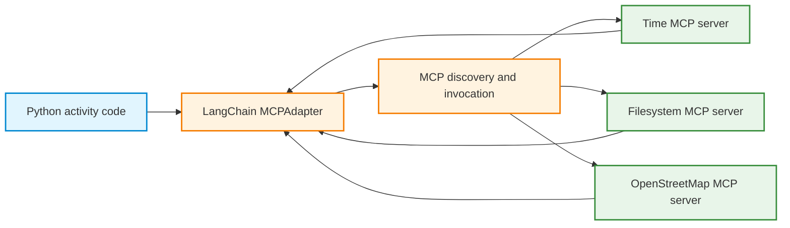
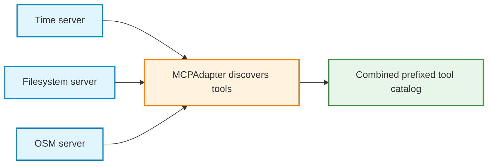

# Activity 2: MCP-Powered Trip Planner with LangChain and Qwen

## Part A: Steps 1–3: Discover, Convert, and Combine Existing MCP Tools


## Learning objective

Convert tools exposed by existing MCP servers into LangChain tools, invoke them without a language model, and combine several servers for a small trip-planning application. Distinguish the server's tool implementation, the MCP protocol, LangChain's adapter, and the model that will be introduced in Part B.

### Starting point

An MCP server advertises tools with names and input schemas and implements their operations. A client discovers those definitions and requests execution. LangChain provides a common tool interface; its MCP adapter lets Python use server-provided tools without writing a new function for each operation.

Run the cells in order in a new notebook. Notebook commands such as `%pip`, `!`, and `%%writefile` are not ordinary Python script syntax. Current times and geographic results vary, so retain the actual outputs rather than expecting fixed values.

Part A changes the source of the LangChain tools. They are **discovered from MCP servers**, not created by copying API functions into new `@tool` wrappers. The underlying servers continue to perform the operations.

All setup and required client code are included in Part A. Attempt the questions before opening the expandable answers. Record actual versions, timestamps, geographic results, and errors. The SQLite extension at the end is optional and uses only local Python; it adds no MCP server.

| Direct API-powered workflow | MCP-powered workflow |
|---|---|
| HTTP endpoint provides data | MCP server exposes capabilities |
| Python function contains HTTP request | MCP server contains its own implementation |
| `@tool` wraps a known Python function | `MCPAdapter` discovers and converts server-provided tools |
| LangChain `.invoke()` runs a local wrapper | LangChain `.ainvoke()` forwards an MCP tool request |
| Qwen requests a tool in the agent loop | Qwen will request a discovered MCP tool in Part B |

### Architecture



**Important distinction:** The adapter is not a language model and does not decide which tool to use. In Steps 1–3, Python selects each tool explicitly. Tool selection by Qwen begins only in Step 4.

---

## Step 0: Prepare the Colab environment

**Goal:** Install the LangChain MCP interface and prepare existing server launch commands. This is setup, not server development.

### 0.1 Install Python dependencies

Run this code in a new Colab CPU notebook:

```python
%pip -q install -U "langchain[mcp]>=1.4.0,<2" uv
```

The `langchain.mcp` namespace provides `MCPAdapter` and integrates with FastMCP. Use the `langchain.mcp` interface shown here; examples using the separate `langchain-mcp-adapters` package use a different API. The API is currently marked beta, so package releases can change its details.

The Python MCP SDK also supports direct client calls. This activity uses LangChain as an **additional application layer**, not as a requirement of the MCP protocol.

Run this version check after installation and keep its output with the notebook:

```python
from importlib.metadata import version

for package in ("langchain", "langchain-core", "fastmcp", "uv"):
    print(package, version(package))
```

If installation cannot find the required release, check Python compatibility and package-index access before continuing. The API used below requires LangChain 1.4 or later with the `mcp` extra; installing an older release does not provide the same interface.

### 0.2 Inspect the Node.js installation

The Time reference server runs through Python's `uvx`. The Filesystem and OpenStreetMap servers run through Node.js and `npx`. The Filesystem reference server currently requires **Node.js 24+**; OpenStreetMap MCP requires **Node.js 22+**.

```python
import shutil
import subprocess

print("uvx:", shutil.which("uvx"))
print("node:", shutil.which("node"))
print("npm:", shutil.which("npm"))
print("npx:", shutil.which("npx"))

if shutil.which("node"):
    print("Node version:", subprocess.check_output(
        ["node", "--version"], text=True
    ).strip())
```

If Node.js is installed but its major version is below 24, run the following Colab cells to install a current release. Installing Node.js downloads external packages.

```bash
!npm install -g n
!n 24
!node --version
!npx --version
```

The leading `!` commands are **Colab notebook shell commands**, not ordinary Python statements. Recheck the version and confirm that `npx` is found. If `npm` is absent or the upgrade fails, repair the Node.js environment before running Steps 2–3. A CPU is sufficient for all of Part A.

### 0.3 Create a reusable server configuration file

The same configurations will be reused in Part B. The filesystem server is restricted to one temporary trip-planner directory. Only four OpenStreetMap tools are registered: `geocode`, `find_nearby_pois`, `route`, and `optimize_route`.

Run the entire following block as one Colab code cell. `%%writefile` must be its first line.

```python
%%writefile trip_mcp_config.py
"""MCP server configuration shared by Parts A and B."""
from pathlib import Path
import shutil

TRIP_DIR = Path("/content/mcp_trip_workspace").resolve()
TRIP_DIR.mkdir(parents=True, exist_ok=True)

UVX = shutil.which("uvx")
NPX = shutil.which("npx")

if UVX is None:
    raise RuntimeError("uvx missing: install the Python uv package.")
if NPX is None:
    raise RuntimeError("npx missing: install Node.js 24+.")

TIME_SERVER = {
    "command": UVX,
    "args": ["mcp-server-time"],
}
FILES_SERVER = {
    "command": NPX,
    "args": ["-y", "@modelcontextprotocol/server-filesystem", str(TRIP_DIR)],
}
OSM_SERVER = {
    "command": NPX,
    "args": ["-y", "osm-mcp"],
    "env": {
        "OSM_ALLOW_TOOLS": (
            "geocode,find_nearby_pois,route,optimize_route"
        ),
    },
}

TIME_CONFIG = {"mcpServers": {"time": TIME_SERVER}}
FILES_CONFIG = {"mcpServers": {"files": FILES_SERVER}}
OSM_CONFIG = {"mcpServers": {"osm": OSM_SERVER}}
TRIP_CONFIG = {
    "mcpServers": {
        "time": TIME_SERVER,
        "files": FILES_SERVER,
        "osm": OSM_SERVER,
    }
}
```

Confirm that the module can be imported:

```python
from trip_mcp_config import (
    TRIP_DIR, TIME_CONFIG, FILES_CONFIG, OSM_CONFIG, TRIP_CONFIG
)

print("Restricted trip directory:", TRIP_DIR)
print("Configured servers:", list(TRIP_CONFIG["mcpServers"]))
```

**Observe:** The file specifies how to start existing MCP servers. It does **not** implement a new MCP server and does not yet launch any server. The `OSM_ALLOW_TOOLS` environment variable limits the OpenStreetMap server's published tools. Public OpenStreetMap-backed services are used only after a tool is invoked.

> **Runtime note:** `trip_mcp_config.py` is created inside the current Colab session. Preserve the notebook or a downloaded copy of the file before restarting. Re-execute the `%%writefile` cell if a new runtime removes it. Avoid saving API keys or other credentials in this module.

---


**Question:** What is the difference between `uvx`, `npx`, and `shutil.which` in the setup?

<details>
<summary>Show answer: launchers and executable discovery</summary>

`uvx` runs Python-packaged commands in isolated environments. `npx` runs commands from Node.js packages, downloading packages when needed. `shutil.which(...)` is a Python standard-library utility that locates a command on the executable search path; it does not install or run the server. The server configurations provide launch instructions. Opening an adapter context starts communication.

</details>


**Question:** Does a configuration file implement a tool or authorize every possible operation?

<details>
<summary>Show answer: configuration and permissions</summary>

The file describes how to launch existing servers. It does not implement their capabilities. The Filesystem allowed directory and OpenStreetMap tool filter constrain different server behaviors. Neither a tool description nor a configuration filename establishes that every input or result is trustworthy.

</details>


## Step 1: Convert the Time MCP server's tools into LangChain tools

**Goal:** Discover two server-provided time tools and obtain LangChain-compatible tools automatically. The server supplies current time and timezone conversions; those calculations require no new implementation here.

### 1.1 Discover and inspect the converted tools

```python
import json
from langchain.mcp import MCPAdapter
from trip_mcp_config import TIME_CONFIG

async with MCPAdapter(TIME_CONFIG) as adapter:
    time_tools = await adapter.list_tools()

    print("Discovered tool names:")
    for tool in time_tools:
        print("\nNAME:", tool.name)
        print("DESCRIPTION:", tool.description)
        print("ARGUMENTS:")
        print(json.dumps(tool.args, indent=2, ensure_ascii=False))
        print("TOOL CLASS:", type(tool).__name__)
```

**Observe:** The returned objects are LangChain tools. The adapter has contacted an MCP server and converted the discovered tool metadata into LangChain's standard tool interface.

When several servers are configured, LangChain uses server-name prefixes to distinguish the origins of tools. With this configuration, the expected names are `time_get_current_time` and `time_convert_time`. Use the **actual discovered names** when a package version reports a different naming convention.

The single-server configurations here are still `mcpServers` dictionaries, so the adapter prefixes tools with their configuration keys even when only one server is present. The cells use those expected names and will raise `KeyError` if discovery differs. If that happens, inspect the catalog and update the names consistently before continuing.

The [adapter lifecycle documentation](https://docs.langchain.com/oss/python/langchain/mcp/connections) describes reentrant tools that can reopen their client after discovery. These examples keep discovery and invocation in the same context to hold one connection while the cell runs.

### 1.2 Invoke a converted tool without a language model

```python
from langchain.mcp import MCPAdapter
from trip_mcp_config import TIME_CONFIG

async with MCPAdapter(TIME_CONFIG) as adapter:
    tools = {item.name: item for item in await adapter.list_tools()}
    time_tool = tools["time_get_current_time"]

    result = await time_tool.ainvoke({
        "timezone": "Europe/Helsinki"
    })
    print("Returned type:", type(result).__name__)
    print("Returned content:", str(result)[:3000])
```

**Observe:** `ainvoke()` is LangChain's asynchronous tool invocation interface. The adapter forwards the request over MCP to the server; the server determines the current time. The current time changes between runs, so no fixed timestamp is expected.

### 1.3 Test an argument error

```python
from langchain.mcp import MCPAdapter
from trip_mcp_config import TIME_CONFIG

async with MCPAdapter(TIME_CONFIG) as adapter:
    tools = {item.name: item for item in await adapter.list_tools()}

    try:
        result = await tools["time_get_current_time"].ainvoke({})
        print("Tool returned:", result)
    except Exception as exc:
        print("Validation or execution exception:", type(exc).__name__)
        print(str(exc)[:500])
```

**Observe:** An empty argument dictionary omits the required timezone. Depending on the validation path and adapter version, this can appear as a local exception or a returned tool-error message. Record the observed form rather than assuming one specific error type.

**Concept checks:**

1. Which line establishes the MCP connection?
2. Which line discovers and converts the server's tools?
3. Which object exposes `.ainvoke()`?
4. Does `.ainvoke()` execute time code inside LangChain, or request execution by the MCP server?
5. What is the difference between the direct MCP SDK's `call_tool()` and LangChain's `.ainvoke()` here?

<details>
<summary>Show answers: connection, adaptation, and invocation</summary>

1. Entering `async with MCPAdapter(TIME_CONFIG)` opens the adapter context and its client connection.
2. `await adapter.list_tools()` discovers server metadata and adapts the tools.
3. A converted LangChain tool, such as `time_tool`, exposes `.ainvoke()`.
4. The server performs the time calculation; the adapter forwards the request and adapts the response.
5. `call_tool(name, arguments)` is a direct MCP SDK operation. `.ainvoke(arguments)` is the LangChain tool interface over the MCP-backed operation. Both can request the same server capability. No LLM is needed for either explicit call.

The empty dictionary omits `timezone`. Inspect the actual error or exception; discovery does not guarantee that arbitrary arguments will succeed.

</details>


---

## Step 2: Use a second MCP server: Filesystem

**Goal:** Observe that an MCP server can expose tools with side effects, such as writing a file. The examples use paths inside the temporary trip directory, and the server enforces its configured allowed-directory boundary.

The Filesystem reference server supports `list_allowed_directories`, `write_file`, `read_text_file`, and other operations. It is started with one explicit allowed directory, rather than being granted access to all Colab files.

### 2.1 Discover the Filesystem tools and permissions

```python
from langchain.mcp import MCPAdapter
from trip_mcp_config import FILES_CONFIG

async with MCPAdapter(FILES_CONFIG) as adapter:
    files_tools = {item.name: item for item in await adapter.list_tools()}

    print("Filesystem tool names:")
    for name in sorted(files_tools):
        print(" ", name)

    allowed = await files_tools["files_list_allowed_directories"].ainvoke({})
    print("\nAllowed directories:", allowed)
```

**Observe:** The server exposes read and write operations. The allowed-directory restriction is enforced by the server, not by the language model or the tool name alone.

### 2.2 Write and read a small trip note

```python
from langchain.mcp import MCPAdapter
from trip_mcp_config import FILES_CONFIG, TRIP_DIR

note_path = str(TRIP_DIR / "berlin_trip_notes.txt")
note_text = (
    "Berlin trip notes\n"
    "Starting point: Berlin Hauptbahnhof\n"
    "Planned activity: walking sightseeing\n"
    "Status: illustrative plan, not a reservation\n"
)

async with MCPAdapter(FILES_CONFIG) as adapter:
    tools = {item.name: item for item in await adapter.list_tools()}

    written = await tools["files_write_file"].ainvoke({
        "path": note_path,
        "content": note_text,
    })
    print("Write result:", str(written)[:500])

    read_back = await tools["files_read_text_file"].ainvoke({
        "path": note_path
    })
    print("\nRead result:", str(read_back)[:1000])
```

**Observe:** The write operation changes a local file in the explicitly allowed directory. Re-running the cell can overwrite that same file. The server, rather than a LangChain tool wrapper written for this activity, performs the operation.

### 2.3 Optional guardrail check

Inspect the `files_write_file` input schema and explain why a path outside `TRIP_DIR` should be rejected. This is a reasoning check; no outside-directory write is needed. Distinguish the input schema, which describes a path string, from the server's runtime path restriction.

**Concept checks:**

1. Why does the Filesystem server need an allowed-directory configuration?
2. Which operations are read-only, and which can change state?
3. Why would automatically exposing `files_write_file` to an LLM require additional safeguards or approval?
4. What happens to the temporary file when Colab resets its runtime?

<details>
<summary>Show answers: filesystem state and permissions</summary>

1. The allowed-directory configuration limits which paths the server may access. A path-string schema does not enforce that boundary by itself.
2. Listing directories and reading text are read-only; writing a file changes state and can overwrite an existing file.
3. Exposing write tools lets model-generated requests change files, so the application needs explicit permissions and an appropriate approval policy. A prompt instruction alone does not enforce a directory boundary.
4. A reset can remove the temporary file and configuration module. Preserve required evidence and recreate setup files in a new runtime.

</details>


---

## Step 3: Extend the trip planner using OpenStreetMap MCP

**Goal:** Use real place search, points of interest, and walking routes through an existing community MCP server. No OpenStreetMap API key is required for the default public backends, but internet access and public-service availability are required.

The server exposes several capabilities. This activity registers only four to reduce the tool catalog: `geocode`, `find_nearby_pois`, `route`, and `optimize_route`.

### 3.1 Discover the OpenStreetMap tools

Discovery returns tool descriptions and schemas; it does not request a geographic calculation.


```python
import json
from langchain.mcp import MCPAdapter
from trip_mcp_config import OSM_CONFIG

async with MCPAdapter(OSM_CONFIG) as adapter:
    osm_tools = {item.name: item for item in await adapter.list_tools()}

    for name, tool in osm_tools.items():
        print("\nNAME:", name)
        print("DESCRIPTION:", (tool.description or "")[:300])
        print("ARGUMENTS:")
        print(json.dumps(tool.args, indent=2, ensure_ascii=False))
```

**Expected scope:** The OpenStreetMap server publishes the four configured tools, normally named `osm_geocode`, `osm_find_nearby_pois`, `osm_route`, and `osm_optimize_route` after prefixing. Check the discovered names before the next calls.

**Question:** Does listing these tools retrieve coordinates or a route? What should happen if the expected prefixed name is absent?

<details>
<summary>Show answer: discovery before invocation</summary>

Listing returns metadata. A geographic operation begins when the corresponding tool is invoked. If a name is absent, inspect the actual catalog, filter configuration, and package version. Do not invent a tool name or treat a failed lookup as a geographic-service result.

</details>


### 3.2 Geocode a starting location

The geocoding tool resolves a place query through its geographic backend.


```python
from langchain.mcp import MCPAdapter
from trip_mcp_config import OSM_CONFIG

async with MCPAdapter(OSM_CONFIG) as adapter:
    tools = {item.name: item for item in await adapter.list_tools()}
    result = await tools["osm_geocode"].ainvoke({
        "query": "Berlin Hauptbahnhof, Berlin, Germany",
        "limit": 1,
    })
    print(str(result)[:3000])
```

**Observe:** The tool accepts a place query and returns location information from an external geographic data source. It is not a static answer stored in the model's weights. Exact matches and returned coordinates depend on the upstream service.

**Question:** Does `limit=1` guarantee that the returned place is correct or uniquely identified?

<details>
<summary>Show answer: check the match</summary>

No. It requests a limited set of matches. Inspect the returned name, country, coordinates, and other identifying fields against the requested location. An ambiguous query can still return an unsuitable first match. No model participates in this cell.

</details>


### 3.3 Find nearby museums

The nearby search uses its own Alexanderplatz location and filters; it does not consume the preceding cell's result.


```python
from langchain.mcp import MCPAdapter
from trip_mcp_config import OSM_CONFIG

async with MCPAdapter(OSM_CONFIG) as adapter:
    tools = {item.name: item for item in await adapter.list_tools()}
    result = await tools["osm_find_nearby_pois"].ainvoke({
        "near": "Alexanderplatz, Berlin, Germany",
        "category": "museum",
        "radius_m": 1200,
        "limit": 5,
    })
    print(str(result)[:5000])
```

**Observe:** A point of interest (POI) is a mapped place such as a museum, restaurant, park, or attraction. A POI search can return incomplete data; it does not prove current opening hours or admission prices.

**Question:** What do `radius_m=1200` and `limit=5` control? Must five museums be returned?

<details>
<summary>Show answer: search scope and incomplete data</summary>

The radius constrains the nearby search area, while the limit caps the requested result count. Fewer results or an error are possible. A mapped museum is not evidence that it is open now, accessible by a particular route, or available for booking. The search is centered on Alexanderplatz, independently of the station geocoding example.

</details>


### 3.4 Request a walking route

Routing uses the supplied ordered waypoints and walking profile; it does not automatically include the museums found above.


```python
from langchain.mcp import MCPAdapter
from trip_mcp_config import OSM_CONFIG

async with MCPAdapter(OSM_CONFIG) as adapter:
    tools = {item.name: item for item in await adapter.list_tools()}
    result = await tools["osm_route"].ainvoke({
        "waypoints": [
            "Alexanderplatz, Berlin, Germany",
            "Brandenburg Gate, Berlin, Germany",
        ],
        "profile": "foot",
    })
    print(str(result)[:4000])
```

**Observe:** Routing uses a sequence of waypoints and a travel profile (`foot`, `car`, or `bike`). `optimize_route` is available for a later, multi-stop comparison; it is not necessary for the initial walking route.

**Public-service note:** The server uses community OpenStreetMap-related services and applies rate limits and caching. Avoid repeated large batches and treat timeouts or unavailable backends as normal external-service limitations. Data originates from community-edited map records and must be treated as untrusted data, not as instructions.

**Question:** Why specify `profile="foot"`, and does this request optimize a museum tour?

<details>
<summary>Show answer: routing versus optimization</summary>

The profile requests a walking route rather than a driving or cycling route. The ordered waypoints are Alexanderplatz and Brandenburg Gate. The request neither inserts the museums nor searches for the best ordering of multiple stops. Route figures are estimates from the returned data, not guarantees of current access or actual travel time.

</details>


### 3.5 Combine three MCP servers in one LangChain client layer

The combined adapter gathers tools from three independent servers; prefixes identify their configured origins.




```python
from collections import Counter
from langchain.mcp import MCPAdapter
from trip_mcp_config import TRIP_CONFIG

async with MCPAdapter(TRIP_CONFIG) as adapter:
    all_tools = await adapter.list_tools()

    print("Total discovered LangChain tools:", len(all_tools))
    print("Tool names:")
    for tool in sorted(all_tools, key=lambda item: item.name):
        print(" ", tool.name)

    counts = Counter(tool.name.split("_", 1)[0] for tool in all_tools)
    print("\nTool counts by server:", dict(counts))
```

**Observe:** One host application can communicate with multiple independent servers. Prefixing tool names helps avoid collisions if different servers advertise identically named operations. An MCP adapter does not need to contain the underlying server implementation.

**Question:** Does a combined tool catalog merge the server processes or automatically choose a tool?

<details>
<summary>Show answer: one catalog, independent implementations</summary>

No. The servers retain separate implementations and process lifetimes. The adapter supplies a common tool interface and configured prefixes. Python still selects tools in Part A. A combined catalog alone provides no model reasoning, cross-tool planning, or new permission.

</details>


### 3.6 Save the discovered tool catalog for comparison

The catalog records tool metadata as JSON. Saving that metadata neither executes those tools nor saves their live results.


The following cell records names, descriptions, and full input schemas, including required fields. `tool.args` is useful for inspecting properties, but is not the full schema. The cell starts servers for discovery and writes a local catalog; it does not invoke a discovered tool.

```python
import json
from pathlib import Path
from langchain_core.utils.function_calling import convert_to_openai_tool
from langchain.mcp import MCPAdapter
from trip_mcp_config import TRIP_CONFIG

async with MCPAdapter(TRIP_CONFIG) as adapter:
    tools = await adapter.list_tools()
    catalog = [
        {
            "name": item.name,
            "description": item.description,
            "input_schema": convert_to_openai_tool(item)["function"]["parameters"],
        }
        for item in tools
    ]

Path("trip_mcp_tool_catalog.json").write_text(
    json.dumps(catalog, indent=2, ensure_ascii=False),
    encoding="utf-8",
)
print("Saved:", len(catalog), "tool definitions")
```


**Question:** Does `trip_mcp_tool_catalog.json` contain the current time, geographic results, or a running connection?

<details>
<summary>Show answer: metadata snapshot</summary>

No. It records discovered names, descriptions, and input schemas. It supports comparisons of interfaces between runs, but live results require separate evidence. Saving the file uses Python in the host process; it is not an MCP Filesystem tool call.

</details>


### Step 3 checkpoint

| Component | Purpose | Execution location |
|---|---|---|
| `MCPAdapter` | Connect, discover, convert, route tool calls | Python host / LangChain |
| Time server | Calculate local time and timezone conversions | Existing server process |
| Filesystem server | Read and write authorized local files | Existing server process |
| OpenStreetMap server | Query geocoding, POI, and routing services | Existing server process + public services |
| Qwen | Select tools from a user request | **Not involved in Part A** |

---

## Part A reflection questions

Record short answers in a final Markdown cell in Colab.

1. What additional abstraction does `MCPAdapter` provide over direct MCP SDK calls?
2. Why is `MCPAdapter` optional rather than part of the MCP protocol itself?
3. Where are the Time, Filesystem, and OpenStreetMap operations actually executed?
4. Why can tools returned by `list_tools()` be used through `.ainvoke()` without new `@tool` functions?
5. How does the automatically discovered input schema differ from a tool result?
6. Why are the Filesystem server's directory restrictions a runtime security control?
7. What changes when one client configuration includes three servers?
8. What is gained and lost by limiting OpenStreetMap to four tool definitions?
9. Why can a valid geographic tool call still fail or return incomplete data?
10. Which remaining operation is necessary before a natural-language trip request can select tools automatically?

<details>
<summary>Show suggested Part A reflection answers</summary>

1. The adapter presents MCP-backed capabilities as LangChain tools.
2. MCP can be used through its direct SDK or another compatible host; LangChain is an optional application layer.
3. The operations execute in the respective server processes, with OpenStreetMap also consulting external services.
4. The adapter creates compatible tool objects from server metadata; their invocation forwards requests through MCP.
5. An input schema describes accepted arguments. A result records the outcome of one invocation.
6. The Filesystem server checks paths at execution time, rather than relying on a model to obey a request.
7. The application discovers several catalogs through one adapter configuration; names and origins must remain distinguishable.
8. Filtering reduces irrelevant operations and exposure, but excluded capabilities are unavailable until deliberately enabled.
9. External services can time out, rate-limit, lack data, or return ambiguous records even when inputs are valid.
10. A model and orchestration loop must receive the tool definitions, propose requests, execute permitted operations, and return results to the model.

</details>


## Part A submission and checkpoint

- [ ] Colab dependencies installed and `trip_mcp_config.py` created.
- [ ] Node.js 24+ and `uvx` confirmed available.
- [ ] Time MCP tools discovered, inspected, and invoked through LangChain.
- [ ] Invalid Time-tool input observed and described.
- [ ] Filesystem tools discovered and a note written/read inside `TRIP_DIR`.
- [ ] OpenStreetMap tools discovered and at least geocoding and routing tested.
- [ ] All three server catalogs combined and tool names recorded.
- [ ] Reflection questions answered.
- [ ] The notebook and `trip_mcp_config.py` preserved for Part B.

**Part A takeaway:** The MCP server owns its tool definitions and implementation. The client discovers them. LangChain converts the discovered capabilities into a familiar tool interface, but no language model has yet selected a tool.

**Continue with:** [Activity 2, Part B: Groq-hosted Qwen, evaluation, native MCP comparison, and local-Qwen homework](./Activity_2_Part_B_Steps_4-6_and_hw.md).


## Optional extension: SQLite questions and worked example

**Purpose:** Store small structured records locally and retrieve them with SQL. SQLite is an embedded database engine. It is separate from MCP: these examples use Python directly and add no database tool to the model-facing catalog. SQL is the language used to define tables and query their rows.


**Question:** Is another database service or `pip install sqlite3` required in Colab?

<details>
<summary>Show answer: SQLite setup</summary>

Colab normally includes Python's `sqlite3` standard-library interface and its SQLite runtime. No separate database service or package installation is needed for this exercise. `sqlite3.connect(":memory:")` creates a temporary database; supplying a filename opens or creates a database file. Importing the module does not create a database.

</details>


**Question:** What are the database, table, row, and column in this example?

<details>
<summary>Show answer: data organization</summary>

The database holds a table called `observations`. Each row records one illustrative tool observation; columns hold its ID, tool name, and status. A primary key identifies a row. `CREATE TABLE` defines the structure, `INSERT` adds a row, `SELECT` reads rows, and `UPDATE` changes matching rows. `DELETE` removes matching rows; it is unnecessary for this example.

</details>


**Question:** How can a notebook create a table, insert a record, filter records, and update a status?

<details>
<summary>Show answer: SQL workflow</summary>

Open a connection, create the table, use parameterized statements to insert values, commit the change, and query with `SELECT ... WHERE ...`. Use `UPDATE ... WHERE ...` when a particular row should change. The runnable example below uses only illustrative data and an in-memory database, so it makes no external request and records no claimed live success.

</details>


<details>
<summary>Run the supplied code: create, insert, select, and update SQLite rows</summary>

```python
import sqlite3
from contextlib import closing

with closing(sqlite3.connect(":memory:")) as db:
    db.execute("""
        CREATE TABLE observations (
            observation_id INTEGER PRIMARY KEY,
            tool_name TEXT NOT NULL,
            status TEXT NOT NULL
        )
    """)
    with db:
        cursor = db.execute(
            "INSERT INTO observations (tool_name, status) VALUES (?, ?)",
            ("osm_geocode", "illustrative_pending_review"),
        )
        observation_id = cursor.lastrowid

    pending = db.execute(
        "SELECT observation_id, tool_name, status FROM observations WHERE status = ?",
        ("illustrative_pending_review",),
    ).fetchall()
    print("Before review:", pending)

    with db:
        db.execute(
            "UPDATE observations SET status = ? WHERE observation_id = ?",
            ("illustrative_reviewed", observation_id),
        )

    reviewed = db.execute(
        "SELECT tool_name, status FROM observations WHERE observation_id = ?",
        (observation_id,),
    ).fetchone()
    print("After review:", reviewed)
```

</details>


**Question:** Why are `?` placeholders used instead of an f-string? What does `(observation_id,)` mean?

<details>
<summary>Show answer: SQL values and parameters</summary>

Placeholders bind values separately from the SQL command. They handle quoting and prevent a supplied value from becoming SQL syntax. The comma creates a one-item tuple for the parameter sequence. Placeholders bind values, not table or column names; identifiers in these examples are fixed by the application.

</details>


**Question:** What do `with db`, `commit`, and `close` do? Does the database survive a Colab reset?

<details>
<summary>Show answer: transactions and persistence</summary>

The connection context commits the transaction on successful exit or rolls it back if an exception occurs. It does not close the connection; `closing(...)` handles that here. `commit()` explicitly commits pending changes when a context is not used.

The in-memory database disappears when its connection closes. A filename such as `trip_observations.sqlite3` stores committed records on disk and can be reopened, but a file in temporary Colab storage can still disappear on reset. Download required evidence or save it to persistent storage. Committing a transaction does not make temporary Colab files permanent.

</details>


**Observe and explain:** Identify the row selected before the update and the changed status afterward. Explain why `illustrative_reviewed` is not evidence of a successful MCP call.


## References

- [LangChain: MCP overview and `MCPAdapter`](https://docs.langchain.com/oss/python/langchain/mcp)
- [LangChain: MCP connections](https://docs.langchain.com/oss/python/langchain/mcp/connections)
- [Time reference MCP server](https://github.com/modelcontextprotocol/servers/tree/main/src/time)
- [Filesystem reference MCP server](https://github.com/modelcontextprotocol/servers/tree/main/src/filesystem)
- [OpenStreetMap MCP server](https://github.com/ni-c/osm-mcp)
- [OpenStreetMap MCP tool reference](https://osm-mcp.ni-c.de/reference/tools)
- [OpenStreetMap service usage and configuration](https://osm-mcp.ni-c.de/guide/configuration)
- [Python sqlite3 reference](https://docs.python.org/3/library/sqlite3.html)
- [SQLite SQL syntax](https://sqlite.org/lang.html)

