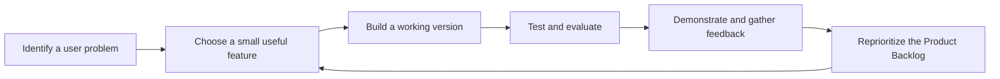
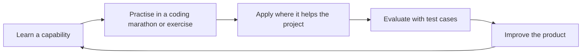
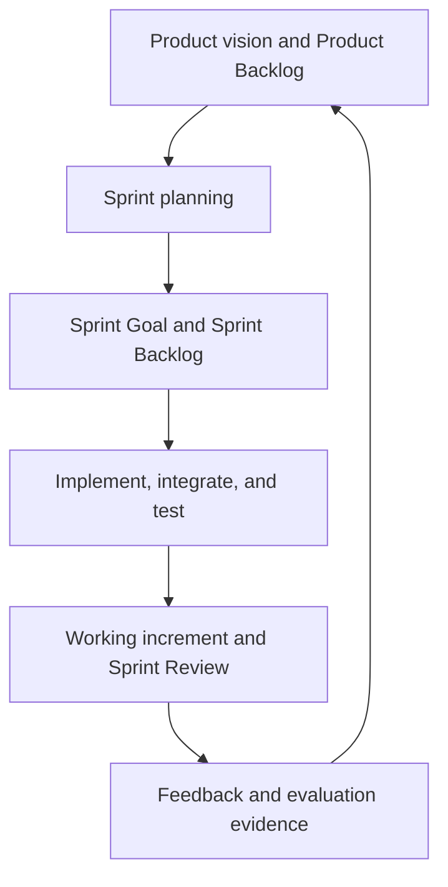

# From an AI Idea to a Working Product

*A guide to the AI assistant and agent project*

## The project challenge

The goal of this project is to **design, implement, test, and demonstrate a useful AI assistant or AI agent** that addresses a real-world problem. A successful project is not simply a chatbot connected to a language model. It is a product with an identifiable user, a specific problem to solve, useful functionality, and evidence that the system works.

The project develops over eight weeks. At the beginning, it is not necessary to know the final architecture or every feature. The team starts with an achievable idea, creates a small working version, learns new techniques, and decides which improvements will make the product more useful. Each version should provide something that can be demonstrated and evaluated.

The central question is:

> How can an AI idea become a working, useful, and evaluated product?

## AI assistant or AI agent?

An **AI assistant** primarily helps a person complete a task. For example, a campus-events assistant might answer questions about upcoming activities, help narrow down choices, and explain the available options.

An **AI agent** can go further by selecting actions, invoking tools, observing the results, and making additional decisions in pursuit of a goal. For example, an event-finding agent might search an event database, check the details of a selected event, and then compose a recommendation based on what the tools returned.

The categories overlap: an assistant can use an agent internally, and an agent can present itself through a conversational assistant interface. **The project does not need to use multiple agents or maximize autonomy.** Choose an architecture that solves the problem safely and reliably. A well-designed assistant with one or two tools may be preferable to a complicated agent that fails unpredictably.

| Question | Mainly assistant-oriented | More agentic behavior |
|---|---|---|
| What initiates the interaction? | A user's question or request | A user's goal or request, potentially involving several steps |
| How is work performed? | Often a direct response, sometimes using retrieved information | Tool selection, tool execution, observation, and further decisions |
| Who controls external actions? | The application and user | Still the application and user: model requests must be validated and authorized |
| What makes it successful? | Helpful, accurate support | Helpful and accurate task completion with appropriately controlled actions |

## Start with a problem, not a technology list

A project idea should explain **who** experiences a problem, **what** they are trying to achieve, and **why** the proposed AI functionality would help. Starting with a long list of technologies often leads to features without a clear purpose.

Consider these questions when choosing the problem:

1. Who will use the product, and what task matters to them?
2. What information does the system need? Is it available, trustworthy, and permitted to use?
3. What could the system do better than a fixed form, ordinary search, or a simple script?
4. What is the smallest useful task the system could complete?
5. How would the team test whether the result is correct?
6. Could a wrong answer or unintended action harm a user, expose private information, or cause an unwanted change?

The initial product description can be provisional. New technical knowledge and evidence from testing may change the team's priorities.

## How the product develops

The project follows an **iterative and incremental** process. *Incremental* means adding useful functionality in small pieces. *Iterative* means revisiting earlier decisions and improving them based on evidence.

Early progress might be modest: a simple interface, a local dataset, and one tool. What matters is that the pieces work together and can be tested. A later version might replace local data with an external service, add a retrieval system, or improve the model's decisions.

### Learn → practise → apply → evaluate → improve

New capabilities are introduced through explanations and hands-on demonstrations. Coding marathons provide focused opportunities to practise implementation, debugging, and collaboration. The team then considers whether the capability belongs in its own project.

These stages support each other. **A technique should be added because it addresses a product need**, not merely because it has been introduced in class.

## A roadmap of capabilities

The technical scope becomes clearer as the project advances. The following overview shows how the new capabilities relate to possible product improvements; it is not a requirement to finalize every decision in Week 1.

| Period | Main capabilities explored | Possible product-development question |
|---|---|---|
| **Weeks 1–4** | Agent fundamentals, LangChain, functions and tools, external APIs, and MCP clients/servers | What information or actions should the assistant access, and how can it access them safely? |
| **Week 5** | Retrieval-Augmented Generation (RAG) | Would retrieving relevant documents or domain knowledge improve answers? |
| **Week 6** | Single-agent and multi-agent systems | Is one agent sufficient, or is there a justified benefit to separating responsibilities? |
| **Week 7** | Fine-tuning, model comparisons, security, and reliability | Would model adaptation or a different model improve a measured weakness? |
| **Week 8** | Integration, evaluation, and demonstration | Can the product complete representative tasks reliably, and can its design decisions be explained? |

The project uses Python and LangChain as its principal starting point. Small local Qwen models in Google Colab are suitable for initial experiments. Other frameworks, models, and services can be investigated when they serve a clear engineering purpose.

### Example: an incrementally developed events assistant

A team might begin with an assistant that helps students find relevant campus events:

- **Initial version:** Search a small, manually prepared event dataset using a Python function; show matching events in a simple interface.
- **Next improvement:** Connect a tool to an external event-information service, after checking its availability, usage terms, and reliability.
- **Later improvement:** Use retrieval if the assistant must answer questions from event policies or related documents.
- **Architecture investigation:** Compare a simple single-agent design with a more elaborate design only when a real limitation justifies the added complexity.
- **Evaluation throughout:** Check whether the assistant returns real events, honors filters, handles missing data, and avoids unsupported claims.

This is an illustration, not a required project topic or a fixed implementation plan.

## Working in sprints

Project work is organized into three development sprints. A **sprint** is a focused period in which the team selects a goal, implements and tests relevant work, then reviews what was achieved. Sprint reviews should demonstrate a **working improvement**, not only slides or plans.

The Product Backlog is an ordered, evolving list of possible improvements. The Sprint Backlog contains the items and work selected for the current sprint. A review informs the next cycle; it is normal for priorities to change as the team learns.

The intended milestones are:

- **Sprint 1 (Week 3):** Aim for a first usable version, including a basic interface, a small Qwen model, tools, a database, and external API integration. Begin with the smallest end-to-end workflow; if a dependency blocks part of the target, demonstrate what works, preserve test evidence, and make the remaining work visible.
- **Sprint 2 (Week 5):** Improve the product with MCP integration, additional functionality, and stronger evaluation.
- **Sprint 3 (Week 8):** Deliver an integrated, tested product, addressing RAG, architecture choices, security, and systematic evaluation. Multi-agent systems should be investigated rather than added without justification.

A working increment can be small, but it should be **demonstrable, testable, and integrated**. Partially written code that has never been run is not the same as a working feature.

## How the team collaborates

Scrum provides lightweight roles and artifacts for coordinating development. The **Product Owner** helps clarify user needs and backlog priorities. The **Scrum Master** facilitates the process and helps the team identify obstacles. **Developers** design, implement, test, integrate, and document the product. These are responsibilities, not a division between people who write code and people who do not: every team member should develop practical implementation skills.

Coding marathons, collaborative debugging, and shared reviews are opportunities to ensure that each member can explain and contribute to the software. The GitHub repository provides a shared history of the product, decisions, code, documentation, backlog changes, and tests.

Keep the work visible through a small set of useful artifacts:

| Artifact | Purpose |
|---|---|
| `README.md` | Explain the problem, product status, setup, and how to run the application |
| Product vision | Identify users, the problem, and the intended benefit |
| Product Backlog | Record and prioritize candidate features, research tasks, and improvements |
| Sprint Goal and Sprint Backlog | State what the team intends to deliver next and how it plans to do so |
| Source code and tests | Provide a reproducible implementation and evidence of correctness |
| Evaluation notes and demo evidence | Record what worked, what failed, and what should change |

The detailed mechanics of Scrum and course assessment are provided separately. The important principle here is **shared ownership and visible progress**.

## Evaluate from the beginning

Evaluation is part of development, not an activity reserved for the final demonstration. Before implementing a feature, consider how to recognize success and failure. Start with a few representative examples, then expand them as the system becomes more capable.

For a tool-using assistant, useful questions include:

| Aspect | Question to test |
|---|---|
| Task success | Did the system accomplish the user's intended task? |
| Correctness | Do returned details match the source data or API response? |
| Tool use | Was the appropriate tool selected with valid arguments? |
| Grounding | Does the answer reflect the tool results without inventing facts? |
| Robustness | What happens with missing data, invalid requests, or unavailable services? |
| Efficiency | How many calls, how much time, and what resources were used? |
| Safety | Are sensitive information and state-changing actions protected? |

For example, an events assistant could be tested with: *“Find a workshop happening on Friday.”* A useful test does not merely check whether the assistant generates an answer; it checks whether the event exists, whether the date is correct, and whether the response handles an empty result honestly.

Keep evaluations comparable when changing models or architectures. Record the inputs, conditions, observed outputs, and known limitations. A single successful run is useful evidence, but it does not demonstrate general reliability.

## Responsible and practical engineering

An AI system can make convincing mistakes. Tool access may also expose data or trigger real actions. Teams should therefore:

- Validate tool arguments and verify results against their source.
- Prefer read-only operations while learning and prototyping; require appropriate authorization before state-changing operations.
- Avoid committing API keys, passwords, personal information, or sensitive datasets to GitHub.
- Check data access permissions, licensing, API terms, rate limits, and possible costs.
- Design useful failure messages and safe behavior when external services are unavailable.
- Be able to explain, modify, and debug code suggested by an AI coding assistant.

More technology is not automatically better. A simpler design that solves the chosen problem reliably is a strong engineering outcome.

## The first step

The project begins by exploring problems, selecting a provisional idea, and creating the initial Product Backlog and Sprint 1 plan. The goal is **not to predict the entire eight-week solution**. It is to choose a feasible starting point and organize the first useful increment.

Continue with **[Week 1 — Project Brainstorming and Sprint 1 Planning](./brainstorming_sprint1.md)** for the workshop activities and templates.
