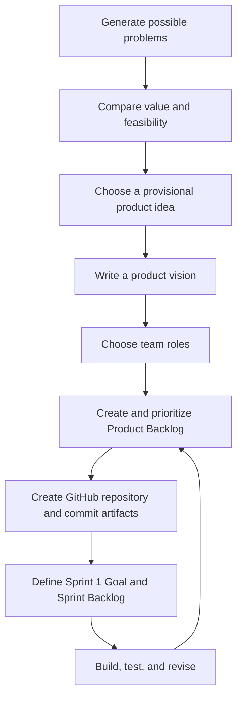
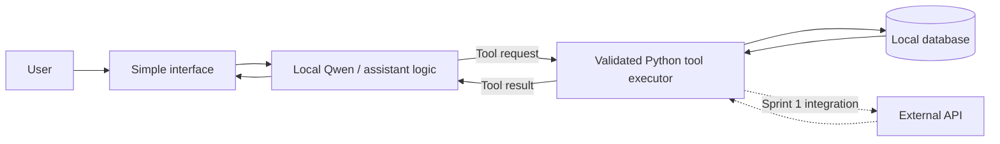

# Week 1 — Project Brainstorming and Sprint 1 Planning


## Purpose

By the end of today, the team should have started to:

1. Identify and compare real-world problems suitable for an AI assistant or agent.
2. Select an initial idea and express its value to a specific user.
3. Choose a **Product Owner** and **Scrum Master**, with development responsibilities shared across the team.
4. Create an initial **Product Backlog** with prioritized, testable items.
5. Create a shared **GitHub repository** and commit/push the planning artifacts.
6. Define a **Sprint 1 Goal** and begin a **Sprint 1 Backlog**.

Some work will continue after class. The course includes approximately **11 hours of independent work per student each week**, so the session is the beginning of the planning process.

## From idea to Sprint 1



The arrows describe a useful starting sequence, not a one-way process. A test or an unexpected technical limitation may require revisiting the product idea, scope, or priorities.

## Suggested workshop agenda

The following three-hour agenda helps the team use its shared class time. 


- Understand the project challenge 
- Generate ideas individually and as a group 
- Compare feasibility and shortlist ideas
- Select an idea and draft the product vision 
- Choose Scrum roles and collaboration practices
- Draft the initial Product Backlog
- Create the GitHub repository
- Begin Sprint 1 planning 

## Activity 1 — Discover useful problems

Start with **problems and users**, not models or frameworks. An AI product is useful when it helps a specific group of people accomplish something meaningful.

Each team member should propose at least one or two problems before the group narrows the list. For each idea, briefly identify:

- **User:** Who experiences this problem?
- **Task:** What does the person want to accomplish?
- **Pain point:** What is difficult, slow, repetitive, or confusing today?
- **Potential AI contribution:** Would understanding natural language, retrieving information, or selecting tools provide a genuine benefit?
- **Evidence:** How could the team test whether the proposed product works?

Examples might include finding campus events, comparing publicly available products, locating community services, exploring a public dataset, or helping users navigate technical documentation. These are possibilities, not assigned project topics.

### Idea notes template

Copy this short structure for each candidate idea:

```markdown
### Idea: [Working title]
- Intended users:
- Problem or task:
- Current difficulty:
- Proposed AI assistant or agent behavior:
- Data, tools, or services likely to be needed:
- A first testable feature:
- Main uncertainty or risk:
```

At this stage, prefer generating several plausible ideas over immediately committing to the first suggestion.

## Activity 2 — Compare the ideas

Discuss each shortlisted idea using a consistent set of criteria. A simple **1–3 scale** can help structure the conversation (1 = weak/uncertain, 2 = moderate, 3 = strong), but the total score should not make the decision automatically.

| Criterion | Guiding question |
|---|---|
| User value | Does the idea address a concrete problem for identifiable users? |
| Feasibility | Can a basic working version be built within the project timeframe? |
| Data and service access | Are trustworthy, legal, and affordable data sources available? |
| Tool-use opportunity | Is there a meaningful task for a Python function or external tool? |
| Testability | Can correctness and task completion be checked with examples? |
| Safety and privacy | Can the product be developed without unnecessary sensitive data or uncontrolled actions? |
| Team interest | Is the problem interesting enough to sustain exploration and improvement? |

**Decision:** Select one idea as the team's *provisional* project direction. Record why it was selected, what alternatives were considered, and the most important uncertainty that should be investigated next.

A narrower, testable idea is usually a better starting point than an ambitious idea without a realistic first version.

## Activity 3 — Define a product vision

A **product vision** explains the purpose of the product without prescribing every technical decision.

A useful structure is:

> For **[target users]**, who need to **[complete a task or solve a problem]**, the product will **[provide a useful capability]**. Its value is **[expected improvement]**. The first version will focus on **[one or two essential tasks]**.

### Example: campus events assistant

> For students looking for campus activities, the assistant will help discover events that match a date and interest. It will reduce the need to search across multiple listings. The first version will search a small event dataset and return verified event details in a simple interface.

Make the first scope explicit:

| In scope for the first working version | Possible later improvement |
|---|---|
| Accept a simple event-search request | Handle follow-up questions |
| Search a small verified dataset | Integrate an external event service |
| Display matching events | Summarize related policies or documents |
| Test a few example requests | Investigate multiple agents if justified |

### Product vision checklist

- [ ] The target users are identifiable.
- [ ] The problem is described in ordinary language.
- [ ] The expected benefit is specific.
- [ ] A first useful task can be demonstrated.
- [ ] The team can identify an initial way to evaluate success.
- [ ] Known data-access, privacy, and technical uncertainties are recorded.

Save the initial vision to `docs/PRODUCT_VISION.md`. It can be revised after experiments or user feedback.

## Activity 4 — Organize team responsibilities

Once the initial product direction is chosen, select these Scrum roles:

| Role | Main responsibility |
|---|---|
| **Product Owner** | Clarify the product's intended value, help order Product Backlog items, and resolve priority questions with the team |
| **Scrum Master** | Facilitate meetings and the development process, help reveal obstacles, and support effective teamwork |
| **Developers (all team members)** | Design, code, test, integrate, evaluate, and document the working product |

The Product Owner and Scrum Master are **not exempt from technical participation**. Every team member is expected to gain practical experience. Coding marathons and collaborative reviews support this shared responsibility.

Agree on a few working practices, such as how often progress is shared, how branches or pull requests will be used, how code is reviewed, and what happens when someone is blocked. Record the agreement in the repository or team notes.

## Activity 5 — Create the Product Backlog

The **Product Backlog** is the team's ordered list of possible work needed to improve the product. It can include user-facing features, experiments, technical tasks, tests, security improvements, and research questions.

A useful user-story format is:

> As a **[type of user]**, I want **[capability]**, so that **[benefit]**.

Each important story should have **acceptance criteria**: observable conditions for deciding that the story is complete. Avoid vague items such as “Build the AI” or “Make it intelligent.”

### Example backlog

| ID | Initial item | Priority | Example acceptance evidence |
|---|---|---|---|
| PBI-01 | As a student, I want to find events by date so that I can plan my week. | High | A search returns only events matching the chosen date. |
| PBI-02 | As a student, I want to see event location and time so that I can decide whether to attend. | High | Returned details match the stored source. |
| PBI-03 | As a student, I want a clear message when nothing matches so that I know the search was completed. | High | An empty result is reported without inventing events. |
| PBI-04 | As a student, I want current event information so that the recommendations are useful. | Medium | An external source is investigated and its returned data is validated. |
| PBI-05 | As a team, we need repeatable tests so that we can detect regressions. | High | Several fixed queries produce recorded expected outcomes. |

This is an illustration: the selected project should have its own stories. Begin with a manageable backlog of about **5–8 candidate items**, then refine it rather than trying to specify the entire product in detail.

### Two useful backlog principles

**DEEP** describes a healthy Product Backlog:

- **Detailed appropriately:** Near-term work has more detail than distant ideas.
- **Emergent:** The backlog changes as new information is discovered.
- **Estimated:** The team develops rough estimates or size judgments as items become clearer.
- **Prioritized:** Important work is ordered before less valuable work.

**INVEST** is a guide for writing useful user stories:

- **Independent:** Can be completed with limited dependence on other stories.
- **Negotiable:** Describes a need without prematurely fixing the exact implementation.
- **Valuable:** Provides recognizable value to a user or stakeholder.
- **Estimable:** Is understandable enough to assess its size.
- **Small:** Fits a manageable development step.
- **Testable:** Has observable acceptance criteria.

Not every technical investigation must be forced into a user-story format. For example, “Check whether the event API can be accessed within its free tier” is a legitimate time-boxed research task. Record the expected finding and how the team will report it.

### Product Backlog file template

Create `docs/PRODUCT_BACKLOG.md` with an initial table:

```markdown
# Product Backlog

| ID | User story / task | Priority | Acceptance criteria | Notes |
|---|---|---|---|---|
| PBI-01 | As a ..., I want ..., so that ... | High | ... | ... |
| PBI-02 | ... | Medium | ... | ... |
```

The Product Backlog is expected to evolve. Update it after experiments, sprint reviews, and changes in the team's understanding.

## Activity 6 — Create the GitHub repository

GitHub will hold the shared source code and a visible record of planning and development. Create one repository for the team and grant appropriate access to collaborators.

A possible structure is:

```text
ai-project/
├── README.md
├── docs/
│   ├── PRODUCT_VISION.md
│   ├── PRODUCT_BACKLOG.md
│   └── SPRINT_1_BACKLOG.md
├── src/
├── tests/
└── notebooks/
```

The folders can be created gradually. Start by putting the README, product vision, and **Product Backlog** under version control. The Sprint 1 Backlog can be added as planning progresses. GitHub Issues or GitHub Projects may be used alongside Markdown files if the team prefers.

**Verify that the backlog is on GitHub**, not only saved on one person's computer. In the GitHub interface, adding or editing a file and selecting **Commit changes** records it in the repository. If working locally, commit the files and push the branch to the remote repository. Confirm that other team members can open them.

For example, in an already configured local Git repository:

```bash
git add README.md docs/PRODUCT_VISION.md docs/PRODUCT_BACKLOG.md
git commit -m "Add product vision and initial backlog"
git push
```

Do not add API keys, passwords, personal records, or datasets that the team does not have permission to share. If the project involves sensitive information, consider a private repository and data-handling controls.

## Activity 7 — Plan Sprint 1

**Sprint planning** turns product priorities into a short-term development commitment. The team selects a realistic goal and the work it believes can achieve that goal.

A **Sprint Goal** describes the useful result the team wants to demonstrate. The **Sprint Backlog** describes the selected items and the work needed to deliver them.

### Example Sprint Goal

> By the Sprint 1 review, demonstrate an event-search assistant with a basic user interface, a small local Qwen model, a tool connected to stored event data, and recorded test results. Integrate and validate an external event API as part of the first-version target; if access is blocked, document the blocker and demonstrate the functioning local workflow.

The course's Sprint 1 target includes a working interface, a small Qwen model, tools, a database, and external API integration. Plan for this **smallest end-to-end product**, while making risks and incomplete integrations visible rather than presenting unfinished work as complete.

### Example Sprint 1 Backlog

| Selected item | Implementation tasks | Evidence of completion |
|---|---|---|
| PBI-01 — Search events | Create sample records; implement and test a search function; expose it as a tool | Fixed searches return the expected matching records |
| PBI-02 — Display results | Create a minimal interface and connect it to the assistant | A user can enter a query and see matching event details |
| PBI-04 — Current event data | Investigate an approved event API; implement a read-only adapter if feasible | Documented API response, validation, and handling of failures |
| PBI-05 — Evaluation | Choose representative successful and unsuccessful requests; save results | Test cases, expected outcomes, and observations stored in GitHub |

The Sprint Backlog should also identify who is taking responsibility for each task, dependencies, rough estimates, and current status. Collaboration and code review remain shared responsibilities even when one person is listed as the task owner.

### Definition of Done

Agree on a short **Definition of Done** for the team. For example, a completed increment should:

- Run from the documented setup procedure.
- Meet the item's acceptance criteria.
- Have basic tests or recorded validation evidence.
- Handle important error cases without inventing results.
- Be committed to the shared repository and understandable to another team member.
- Be ready to demonstrate, not merely described as finished.

Copy the current plan into `docs/SPRINT_1_BACKLOG.md`:

```markdown
# Sprint 1 Backlog

## Sprint Goal
[One or two sentences describing the working outcome]

## Selected Product Backlog Items
| ID | Tasks | Owner(s) | Estimate | Status | Evidence |
|---|---|---|---|---|---|

## Definition of Done
- [ ] Runs from documented setup
- [ ] Acceptance criteria checked
- [ ] Changes committed and reviewed

## Risks and Dependencies
- [Important uncertainty, person responsible, and next action]
```

Do not fill the sprint only with infrastructure tasks. Prioritize a **vertical slice**: the smallest path from a user request through the model and tool to a useful, testable result.

### First-version architecture sketch

A simple sketch can help identify the implementation tasks. It is only a starting point; the actual design can change.



Notice the boundary between **the model asking for an action** and **the application validating and performing it**. This distinction becomes especially important when tools connect to external services.

## Continue the planning outside class

The workshop begins the work; it does not have to finish every artifact. The expected independent-work time allows the team to refine its idea and prepare for implementation.

Before the next class meeting, aim to:

1. Refine the product vision and identify the initial user task.
2. Investigate the feasibility of required data sources and services.
3. Agree on roles and collaboration practices.
4. Prioritize the Product Backlog and add acceptance criteria to high-priority items.
5. Confirm that the repository and Product Backlog are committed/pushed to GitHub and accessible to the whole team.
6. Complete the Sprint 1 Goal and initial Sprint Backlog, including task responsibilities and key risks.
7. Define at least **three representative test cases** for the first working feature.

A simple test-case record could be:

| Input | Expected behavior | How to verify |
|---|---|---|
| “Find an event on Friday.” | Return events scheduled on Friday or state that none exist | Compare against verified source data |
| “Find an event on an impossible date.” | Explain that no matching events were found | Check empty-result behavior |
| “Where is event X?” | Return the stored location or explain that it is unavailable | Compare with the underlying event record |

These tests are the starting point for evaluation, not a complete test suite.

## Checklist

- [ ] We can explain the chosen problem and intended users in a few sentences.
- [ ] We considered at least one alternative project idea.
- [ ] Our product's first useful task is clear and testable.
- [ ] We selected a Product Owner and Scrum Master and agreed that development is shared.
- [ ] We drafted and ordered a Product Backlog.
- [ ] We created a GitHub repository and can access it as a team.
- [ ] We committed/pushed our Product Backlog, or assigned a specific follow-up action to finish it.
- [ ] We drafted a Sprint 1 Goal and began the Sprint 1 Backlog.
- [ ] We know which planning tasks will continue outside class.

### Reflection

Before moving to implementation, consider these questions together:

1. What is the **smallest working result** that would demonstrate value to a user?
2. Which part of the proposed product genuinely needs an LLM, and which parts can be ordinary Python functions?
3. What evidence would persuade someone else that the feature works?
4. Which assumption is most likely to fail, and how can it be tested early?
5. Can every team member explain the first planned workflow and contribute to implementing it?

The plan is a starting hypothesis. As the team learns, the backlog and architecture will change. The goal is steady progress toward a **useful, reproducible, evaluated product**.


