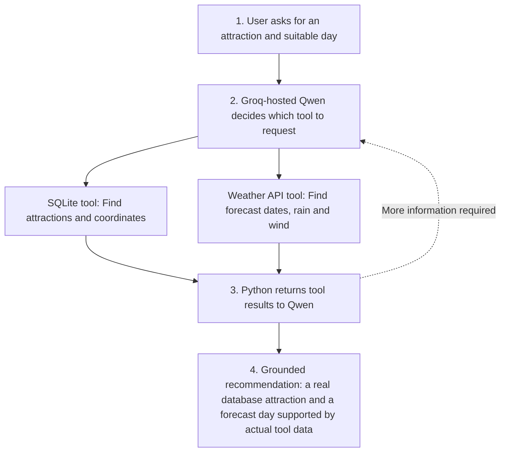
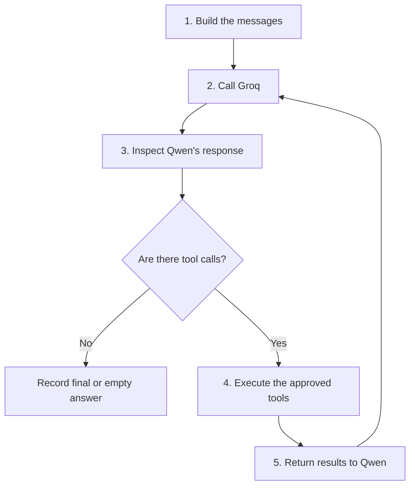

# Afternoon Code Marathon: Complete Explanation and Answers

The goal of this activity is to build an **AI trip-planning assistant** that recommends an outdoor attraction based on places stored in a database and weather information from a live API.

The activity is divided into nine sections. Some sections require writing code, others require running tests, and the final sections require analyzing what the AI did.

This guide explains:

1. What to do at each step.
2. Why each step is necessary.
3. The correct code for every TODO.
4. How to check whether the implementation works.
5. Answers to all investigation, evaluation, and project questions.

## First: Understand what is being built

Imagine someone asks:

> Find an outdoor attraction in Berlin and recommend a day with low rain probability and light wind.

An ordinary LLM might suggest a location based on its training knowledge. However, it might invent an attraction or provide inaccurate weather information.

In this activity, the LLM must use **two tools**:

- `find_attractions_tool`: searches a local SQLite database for attractions.
- `get_forecast_tool`: retrieves real forecast data from Open-Meteo.

### How the completed assistant should work



**The model does not execute Python directly.** Qwen combines the database and forecast information after Python returns tool results.

The key distinction is:

**The LLM chooses a tool and proposes arguments. Python checks the request and executes the actual tool.**

For example, the LLM might request:

```json
{
  "name": "find_attractions_tool",
  "arguments": {
    "city": "Berlin",
    "outdoor_only": true
  }
}
```

This is a requested operation, not an executed database query. The Python execution loop receives the request and calls the registered tool.

---

## Step 0: Understand the mission

### What to do

Read the learning outcomes and completion criteria before starting.

The final system must be able to retrieve outdoor attractions from Sweden and Germany, obtain weather forecasts, and combine both into a recommendation.

The required result is a **working Groq-hosted Qwen assistant**, with execution evidence and a brief evaluation. The local Qwen implementation is optional.

### What should exist at the end?

| Item | Purpose |
|---|---|
| `marathon_db.py` | Creates and searches the attraction database |
| `attractions_sweden_germany.sqlite` | Stores attraction records |
| `marathon_api.py` | Retrieves weather forecasts |
| `marathon_tools.py` | Converts Python functions into LangChain tools |
| `marathon_agent.py` | Connects Groq-hosted Qwen to the tools |
| `marathon_traces.json` | Records tool requests, results, and final answers |
| Evaluation answers | Explain whether the AI behaved correctly |

There is no need to implement hotel booking, transport routing, or a user interface.

## Step 1: Pair workflow and planning

### What to do

The activity is designed for two students.

One student initially works on the database tool, while the other works on the weather API tool. Roles are switched during integration or evaluation.

Both students should be able to explain both implementations.

The suggested schedule totals three hours:

| Stage | Time | Expected result |
|---|---:|---|
| Database |  | Database created and inspected |
| Database/API functions |  | Both functions tested |
| LangChain tools |  | Both `.invoke()` tests pass |
| Groq integration |  | Working model/tool conversation |
| Evaluation |  | Test cases and answers |
| Demonstration |  | Working demonstration |

The important point is that the database and weather code are tested separately **before connecting them to the LLM**. This makes errors easier to identify.

---

## Step 2: Prepare Google Colab and Groq

### What to do

Open Google Colab, create a notebook, and install the required packages.

```python
%pip -q install requests groq langchain-core
```

These libraries have different responsibilities:

| Library | Purpose |
|---|---|
| `requests` | Sends HTTP requests to the weather API |
| `groq` | Communicates with Groq-hosted Qwen |
| `langchain-core` | Defines LangChain tools and argument schemas |
| `sqlite3` | Accesses SQLite; already included with Python |

Next, create a Groq API key and store it in Colab Secrets under `GROQ_API_KEY`. Enable notebook access to that secret.

Run the initialization code supplied in Step 2 of the activity.

### What happens in the initialization code?

```python
os.environ["GROQ_API_KEY"] = userdata.get("GROQ_API_KEY")
```

This reads the API key from Colab Secrets into an environment variable.

```python
GROQ_CLIENT = Groq(api_key=os.environ["GROQ_API_KEY"])
```

This creates the client used to communicate with Groq.

```python
MODEL_ID = "qwen/qwen3.8-27b"
```

This identifies the Qwen model the activity attempts to use.

```python
available_ids = {item.id for item in GROQ_CLIENT.models.list().data}
```

This retrieves the model IDs currently available through the account.

```python
assert MODEL_ID in available_ids
```

This checks whether the selected model appears in that list.

### What should happen?

The output should be:

```text
Groq client and selected model ready.
```

If the assertion fails, the selected model is unavailable for that account. Follow the activity's instruction to choose an available model supporting structured tool calls.

**Why use a CPU runtime?** The Qwen model is hosted remotely by Groq, so Colab is not running the large model locally. No GPU is required for the mandatory implementation.

**What if Colab restarts?** Generated Python files and the SQLite database may be lost. Rerun the notebook cells that create them.

**What if the API key is missing?** The Groq client cannot authenticate. Check the secret name and notebook access; do not paste the key into the code.

---

## Step 3: Create and search the SQLite attractions database

This step is about using a database **without involving the LLM yet**.

### Step 3.1: Create the file

Run the entire supplied cell beginning with:

```python
%%writefile marathon_db.py
```

`%%writefile` is a Colab/Jupyter cell command that saves the cell's content as a Python file.

The file defines a list called `ATTRACTIONS` with 12 sample places in four cities:

| City | Outdoor examples | Indoor example |
|---|---|---|
| Stockholm | Djurgården, Skansen Open-Air Museum | Vasa Museum |
| Gothenburg | Slottsskogen, Gothenburg Botanical Garden | Universeum |
| Berlin | Tiergarten, Tempelhofer Feld | German Museum of Technology |
| Munich | English Garden, Olympiapark | Deutsches Museum |

An indoor attraction is intentionally included in each city to test whether the filtering works.

The function:

```python
initialize_db()
```

creates the database table and inserts the sample records.

The second function:

```python
find_attractions(city, category=None, outdoor_only=True, limit=5)
```

searches the table.

Its arguments mean:

- `city`: city to search.
- `category`: optional type, such as `"park"`.
- `outdoor_only`: whether to exclude indoor attractions.
- `limit`: maximum number of records to return.

### Step 3.2: Complete TODO 1A and TODO 1B

The task asks for two filters: one for outdoor attractions and one for category.

Replace:

```python
if outdoor_only:
    # TODO 1A
    pass

if category:
    # TODO 1B
    pass
```

with:

```python
if outdoor_only:
    sql += " AND is_outdoor = 1"

if category:
    sql += " AND lower(category) = lower(?)"
    arguments.append(category.strip())
```

### Why does this work?

The original query begins with:

```sql
SELECT * FROM attractions WHERE lower(city) = lower(?)
```

This selects attractions matching a city, ignoring capitalization.

If `outdoor_only=True`, the following condition is added:

```sql
AND is_outdoor = 1
```

That excludes records with `is_outdoor = 0`.

If a category is provided, another condition is added:

```sql
AND lower(category) = lower(?)
```

The `?` is an SQL parameter placeholder. The actual category value is supplied separately through `arguments`.

This is important because **parameterized SQL prevents user-provided values from being interpreted as SQL commands**.

For example:

```python
find_attractions(
    "Berlin",
    category="park",
    outdoor_only=True
)
```

should return the two Berlin parks in the supplied database: Tempelhofer Feld and Tiergarten.

### Run the tests

Run:

```python
!python marathon_db.py
```

Then run the assertion tests in Step 3.2.

The expected result, after correct implementation, is:

```text
Database filters passed.
```

### What if different arguments are used?

| Input | Expected behavior |
|---|---|
| `find_attractions("Berlin")` | Returns outdoor Berlin attractions |
| `find_attractions("Berlin", category="park")` | Returns outdoor Berlin parks |
| `find_attractions("Berlin", outdoor_only=False)` | Includes indoor Berlin attractions |
| `find_attractions("Madrid")` | Returns `[]` |
| `find_attractions("")` | Raises `ValueError` |
| `find_attractions("Berlin", limit=20)` | Raises `ValueError` |

The last case fails because the function explicitly restricts `limit` to 1–12.

**Checkpoint:** The database works independently. No Groq call is needed.

---

## Step 4: Create the weather forecast function

Now the system needs a second data source.

The SQLite database answers:

> Which outdoor attractions exist in Berlin?

The Open-Meteo API answers:

> What are the forecast rain probability and wind speed for those coordinates?

The weather API requires geographic coordinates, so the database results provide useful input for the next operation.

### Step 4.1: Create the weather file

Run the supplied cell beginning with:

```python
%%writefile marathon_api.py
```

The main function is:

```python
get_forecast(latitude, longitude, days=7)
```

The inputs are latitude, longitude, and number of forecast days.

For example:

```python
get_forecast(52.515, 13.351, days=3)
```

requests a three-day forecast for the coordinates supplied.

The function builds the API parameters:

```python
params = {
    "latitude": latitude,
    "longitude": longitude,
    "daily": "precipitation_probability_max,wind_speed_10m_max",
    "forecast_days": days,
    "timezone": "auto",
    "wind_speed_unit": "kmh",
}
```

These request daily precipitation probability and maximum wind speed.

The following line sends the HTTP request:

```python
response = requests.get(FORECAST_URL, params=params, timeout=20)
```

`timeout=20` prevents the request from waiting indefinitely at the HTTP client level.

Then:

```python
response.raise_for_status()
```

raises an exception for HTTP error responses.

Finally:

```python
data = response.json()
daily = data["daily"]
```

converts the response to Python data structures and extracts the daily forecast object.

### Step 4.2: Complete TODO 2A and TODO 2B

Replace the two `None` placeholders with:

```python
observations = []

for index, date_string in enumerate(daily["time"]):
    observations.append({
        "date": date_string,
        "rain_probability_max_pct":
            daily["precipitation_probability_max"][index],
        "wind_speed_max_kmh":
            daily["wind_speed_10m_max"][index],
    })
```

### Why is the index necessary?

The weather API returns separate arrays.

For illustration, imagine the API returned:

```python
daily = {
    "time": ["Day-A", "Day-B", "Day-C"],
    "precipitation_probability_max": [15, 45, 20],
    "wind_speed_10m_max": [18, 22, 40],
}
```

*These numbers are fictional examples, not a retrieved forecast.*

Index `0` refers to Day-A across all arrays.

Therefore, the function combines the corresponding values into one dictionary:

```python
{
    "date": "Day-A",
    "rain_probability_max_pct": 15,
    "wind_speed_max_kmh": 18
}
```

Using different indices for rain and wind would incorrectly associate values from different days.

### How is weather suitability decided?

The activity specifies two classroom rules:

- **Rain probability:** below 30% (`< 30%`).
- **Maximum wind speed:** below 35 km/h (`< 35 km/h`).

Both conditions must be true.

### Interactive forecast suitability check

*Illustrative data only. The table shows how the two conditions are evaluated for each day.*

The interactive example is represented as a static Markdown table:

| Day | Rain probability | Wind speed | Rain below 30% | Wind below 35 km/h | Satisfies both classroom limits? |
|---|---:|---:|---|---|---|
| Day A | 15% | 18 km/h | Pass | Pass | Yes |
| Day B | 45% | 22 km/h | Fail | Pass | No |
| Day C | 20% | 40 km/h | Pass | Fail | No |
| Day D | 25% | 28 km/h | Pass | Pass | Yes |

Notice that a 30% rain probability **does not** satisfy a rule of *below 30%*. The comparison is strict, not inclusive.

### Run the tests

Run the `get_forecast()` tests from Step 4.2.

The tests verify that the function returns three dates, a timezone, numeric weather values, and sensible ranges.

Successful output should include:

```text
Forecast extraction passed.
```

The actual forecast numbers depend on the time and location of the API request, so they cannot be known in advance.

**Checkpoint:** Both the database and weather functions should now work independently.

---

## Step 5: Turn the Python functions into LangChain tools

At this point, there are two ordinary Python functions:

```python
find_attractions(...)
get_forecast(...)
```

They work, but Qwen does not yet know they exist.

Step 5 makes them available for tool calling.

### Step 5.1: Create `marathon_tools.py`

Run the supplied `%%writefile marathon_tools.py` cell.

The important part is the `@tool` decorator:

```python
@tool
def find_attractions_tool(
    city: str,
    category: str | None = None,
    outdoor_only: bool = True,
    limit: int = 5,
) -> list[dict]:
```

The decorator wraps the function as a LangChain tool. This provides a tool name, description, and schema describing its arguments.

For example, the type annotation:

```python
outdoor_only: bool = True
```

indicates that `outdoor_only` is a Boolean parameter and defaults to `True`.

The description explains when the model should use the tool.

The second tool:

```python
@tool
def get_forecast_tool(
    latitude: float,
    longitude: float,
    days: int = 7
) -> dict:
```

describes how to request a weather forecast.

### Why do tools need descriptions and schemas?

The model must understand:

- Which tool is appropriate for a request.
- What arguments the tool accepts.
- What information the tool will return.
- What the tool cannot provide.

For example, the database tool description states that opening hours and live availability are not provided. This helps prevent the model from presenting unsupported information.

### What does the registry do?

```python
APPROVED_TOOLS = [find_attractions_tool, get_forecast_tool]

TOOL_REGISTRY = {
    item.name: item for item in APPROVED_TOOLS
}
```

`APPROVED_TOOLS` defines the tools that are allowed.

`TOOL_REGISTRY` creates a name-to-tool mapping. Python can use this dictionary to look up and execute an approved function.

The model cannot add arbitrary Python functions to the registry.

### What does `groq_schema()` do?

```python
def groq_schema(item):
    return {
        "type": "function",
        "function": {
            "name": item.name,
            "description": item.description,
            "parameters": item.args_schema.model_json_schema(),
        },
    }
```

This converts the LangChain tool's metadata into the structured function format sent to Groq.

The schema describes the tool; it does not execute the tool.

### Step 5.2: Test both tools

Run the `.invoke()` test cell from the activity.

The first part:

```python
attractions = find_attractions_tool.invoke({
    "city": "Stockholm",
    "outdoor_only": True,
    "limit": 3
})
```

executes the LangChain-wrapped database function.

The second part:

```python
place = attractions[0]

weather = get_forecast_tool.invoke({
    "latitude": place["latitude"],
    "longitude": place["longitude"],
    "days": 3,
})
```

executes the weather tool using coordinates returned by the database tool.

This demonstrates how the output of one tool can become the input of another.

### Answer to the Step 5 investigation question

**Question: Identify the difference between a direct Python call, `.invoke()` on a LangChain tool, and a model-generated tool request. Which part executes each operation?**

| Operation | Meaning | Who executes it? |
|---|---|---|
| `find_attractions("Berlin")` | Direct call to the original Python function | Python |
| `find_attractions_tool.invoke({...})` | Call to the LangChain-wrapped function | LangChain invokes the Python implementation |
| Model-generated tool request | Qwen produces a tool name and proposed arguments | Nothing executes until the Python agent processes the request |
| `execute_tool_calls(...)` | Validates and dispatches the model's requested calls | Python, through the approved registry |

**Answer:** A direct function call executes Python code immediately. A LangChain `.invoke()` call executes the tool through its standardized wrapper. A model-generated tool call is only a request describing an action. The agent's Python execution loop must validate and execute it.

This separation is a central part of secure tool-calling architecture.

---

## Step 6: Connect Groq-hosted Qwen to the tools

This is the most important integration step.

The previous steps created the data sources and tool definitions. Now the LLM receives the tool schemas and can request operations.

### Step 6.1: Create `marathon_agent.py`

Run the entire supplied file-writing cell.

The file contains three main parts:

| Component | Responsibility |
|---|---|
| `SYSTEM_PROMPT` | Tells Qwen how to behave |
| `execute_tool_calls()` | Executes approved tool requests |
| `run_marathon_agent()` | Manages the conversation between Qwen and Python |

### Step 6.2: Complete TODO 3

The task asks for a rule telling Qwen which weather conditions count as suitable.

Add the following strings inside `SYSTEM_PROMPT`, replacing the TODO comment:

```python
"Prefer forecast days with maximum daily precipitation "
"probability below 30% and maximum daily wind speed "
"below 35 km/h. "
"If no retrieved forecast day meets both limits, "
"state that explicitly instead of describing an "
"unsuitable day as suitable. "
"Low rain probability does not guarantee rain-free weather."
```

The existing prompt strings should remain unchanged. These additional strings belong inside the same parentheses.

### Why is this necessary?

Without explicit criteria, Qwen may interpret "good weather" inconsistently.

For example, it might consider a day with 45% rain probability acceptable, while the exercise requires a value below 30%.

The system prompt establishes the desired rule.

However, **prompt instructions are not the same as programmatic validation**. The model can still make a mistake. That is why Step 7 requires checking the final answer against the actual forecast values.

### Step 6.3: Understand the execution loop

The agent follows this process:



**1. Build the messages**

```python
messages = [
    {"role": "system", "content": SYSTEM_PROMPT},
    {"role": "user", "content": question},
]
```

The model receives its instructions and the user's request.

**2. Call Groq**

```python
response = client.chat.completions.create(
    model=model_id,
    messages=messages,
    tools=TOOL_SCHEMAS,
    tool_choice="auto",
    parallel_tool_calls=False,
    max_completion_tokens=512,
)
```

Qwen receives the conversation and descriptions of the available tools.

`tool_choice="auto"` allows Qwen to request tools or produce a final response.

**3. Inspect Qwen's response**

```python
calls = message.tool_calls or []
```

If there are no requested tool calls, the agent treats the message as a final response.

Otherwise, the tool names and JSON arguments are extracted.

**4. Execute the approved tools**

```python
results = execute_tool_calls(parsed)
```

Python checks the requested tool names and arguments, invokes registered tools, and collects results or error statuses.

**5. Return results to Qwen**

```python
messages.append({
    "role": "tool",
    "tool_call_id": call.id,
    "content": json.dumps(result),
})
```

The result is associated with the original call ID. Qwen can then decide whether more information is needed or whether to answer.

### What is the execution trace?

`trace` is a Python dictionary that records what happened during the model/tool conversation.

It contains:

```python
trace = {
    "question": question,
    "model": model_id,
    "status": "running",
    "answer": None,
    "turns": [],
    "tool_call_count": 0,
}
```

During execution, each turn stores requested calls and their results.

The trace helps answer questions such as: Did Qwen call the correct tool? Did it use the correct arguments? Did it call the same tool repeatedly? Did any operation fail?

### What are the important safeguards?

| Code | Reason |
|---|---|
| `name not in TOOL_REGISTRY` | Rejects unknown tools |
| `not isinstance(arguments, dict)` | Rejects arguments that are not a dictionary |
| `try/except` around `.invoke()` | Records tool failures without crashing the whole execution loop |
| `max_rounds=6` | Limits the number of model-request rounds |
| `max_tool_calls=8` | Limits the total number of executed tool requests |
| `seen_calls` | Marks repeated identical requests in the trace |
| `tool_call_id` | Links a result to the correct model-requested operation |

One detail is especially important: **`seen_calls` only marks repeats in this implementation. It does not stop them.** A repeated call can still execute unless another limit is reached.

Also, `parallel_tool_calls=False` requests nonparallel tool use. The loop still processes whatever calls are returned and should not assume the model will always follow the intended sequence.

### Step 6.4: Run the Stockholm and Berlin tests

Run the supplied code:

```python
stockholm_trace = run_marathon_agent(
    GROQ_CLIENT,
    MODEL_ID,
    "Find an outdoor attraction in Stockholm and recommend a suitable "
    "day within the next seven days with low rain probability and light wind."
)
```

Then run the Berlin test.

An ideal execution will look conceptually like this:

**ILLUSTRATIVE TRACE: NOT A LIVE EXECUTION**

1. **Round 1: Database tool.** Qwen requests `find_attractions_tool` for Stockholm. Python returns attraction names and coordinates.
2. **Round 2: Weather tool.** Qwen requests `get_forecast_tool` using coordinates from an attraction. Python returns daily forecast values.
3. **Round 3: Final answer.** Qwen recommends a database attraction and a day satisfying the weather criteria, or reports that no matching day was found.

The actual number of rounds may differ. Qwen might request forecasts for several attractions, make repeated requests, or skip a necessary tool.

### What if something goes wrong?

| Situation | Expected handling |
|---|---|
| Qwen requests a nonexistent tool | `unknown_tool` result |
| JSON arguments are malformed | `invalid_arguments` result |
| A database or weather tool raises an exception | `tool_error` result |
| A Groq request raises an exception | `api_error` trace status |
| Total requested calls would exceed eight | `max_tool_calls_reached` |
| Six model rounds finish without a final response | `max_rounds_reached` |
| Qwen responds without calling tools | Agent records a final or empty answer, which must still be evaluated for groundedness |

A `final_answer` status means that the model produced nonempty text. It does **not** prove that the answer is correct.

**Checkpoint:** A successful weather-dependent test should contain at least one database call, at least one weather API call, and a final answer supported by the corresponding results.

---

## Step 7: Investigate and evaluate the assistant

This section is about **checking whether the AI actually used the tools correctly**.

A fluent response is not enough. A recommendation is only grounded when it matches the retrieved database and weather information.

### Step 7.1: Run all four test cases

Run the supplied code for Madrid and Munich, in addition to the earlier Stockholm and Berlin tests.

The activity uses four requests for different purposes:

| Case | What is being tested | Expected tool behavior |
|---|---|---|
| A: Stockholm | Combining database and weather information | Database, then weather |
| B: Berlin | Another weather-dependent recommendation | Database, then weather |
| C: Madrid | Handling a city missing from the database | Database, then report no matches |
| D: Munich | Selecting outdoor parks | Database with appropriate filters |

Stockholm and Berlin need both tools because their requests depend on weather.

Madrid should produce an explanation that the catalog contains no matching attractions. A weather request is not necessary when no database candidate has been found.

Munich only asks for an outdoor park. Since weather is not mentioned, a database call is sufficient.

### How to inspect the trace

The activity creates a file named:

```text
marathon_traces.json
```

This stores the results of the four test cases.

Run the following code to inspect each requested call and its result:

```python
for city, trace in all_traces.items():
    print("\nCASE:", city)
    print("STATUS:", trace["status"])
    print("ANSWER:", trace["answer"])

    for turn in trace["turns"]:
        for call, result in zip(
            turn["calls"], turn["results"]
        ):
            print("Tool:", call["name"])
            print("Arguments:", call["arguments"])
            print("Repeated:", call["repeated"])
            print("Result status:", result["status"])
            print("Result:", result.get("data"))
```

This displays the evidence required for the evaluation.

### Step 7.2: Complete the evaluation table

The table cannot be filled with actual call counts or success judgments until the code has been executed. Those values depend on the model and live API responses.

Here is how to complete each column:

| Column | What to record |
|---|---|
| Request | Stockholm, Berlin, Madrid, or Munich |
| Tools called | Tool names in the order requested |
| Calls / repeats | Total executed calls and number marked repeated |
| Correct arguments? | Whether city, category, coordinates, and days were appropriate |
| Final answer grounded? | Yes, Partially, or No, based on the retrieved results |
| Missing evidence or errors? | Unsupported attraction, incorrect weather, failed call, missing data, etc. |

For example, for Berlin, compare the attraction named in the final answer with the actual rows in the database result. Then compare its stated date, precipitation probability, and wind speed with the returned forecast.

A successful run should satisfy the evidence checks. It should not merely have a `final_answer` status.

## Step 7.3: Answers to all eight guided questions

### Question 1. Which tool was called first for each request? Why was that tool appropriate or inappropriate?

**Answer:**

For Stockholm and Berlin, the appropriate first tool is `find_attractions_tool`.

This is because the database identifies valid attractions and provides their coordinates. The weather tool can then use those coordinates.

For Madrid, the database should also be consulted first. Because Madrid is not among the four supported cities, the database should return an empty list.

For Munich, the database is sufficient to find outdoor parks.

If Qwen calls the weather tool first using coordinates not obtained from the approved database, that does not follow the activity's intended workflow.

The actual order must be checked in the execution trace.

### Question 2. Did a weather-dependent recommendation use both the database and weather API? If not, which evidence is missing?

**Answer:**

A valid weather-dependent recommendation should use both tools.

The database provides evidence that the attraction exists in the approved catalog and supplies its location.

The weather API provides evidence about the forecast for that location.

If the database tool is missing, the recommended attraction has not been verified against the approved source.

If the weather tool is missing, the suggested date lacks the required current forecast evidence.

For Stockholm and Berlin, a response without both kinds of evidence is incomplete.

For Madrid or the Munich park-only request, both tools are not necessarily required.

### Question 3. How many times was each tool called? Did any calls repeat with identical arguments? When might repetition be justified?

**Answer:**

The exact number of calls depends on the model's behavior.

An efficient Stockholm or Berlin interaction might request the attraction tool once and the weather tool once. However, a model could request weather for multiple candidate attractions.

Repetition is detected using:

```python
signature = json.dumps(entry, sort_keys=True)
entry["repeated"] = signature in seen_calls
```

This creates a comparable representation of a tool name and its arguments.

A repeat can sometimes be justified if an earlier request failed transiently and retrying is appropriate. However, repeatedly requesting identical data without a reason wastes time and API requests.

The current code records repeated calls but does not automatically prevent them.

To answer this question for the actual implementation, count the calls and `repeated=True` entries in `marathon_traces.json`.

### Question 4. Did the final answer identify an attraction actually returned by SQLite? Did the recommended date and weather values match the Open-Meteo response?

**Answer:**

This requires three checks.

**First: Attraction.** The final recommendation must name an attraction returned by `find_attractions_tool`.

**Second: Date.** The recommended date must appear in the corresponding `get_forecast_tool` result.

**Third: Forecast.** The stated rain probability and wind speed must match the values for that date.

For example, suppose the following data were returned:

```python
{
    "date": "Example-Day",
    "rain_probability_max_pct": 18,
    "wind_speed_max_kmh": 22
}
```

*Illustrative data only, not actual weather results.*

A recommendation that quotes 18% rain probability and 22 km/h wind for that day would match this hypothetical result.

A recommendation that quotes 5% rain probability would not.

The same principle applies to real execution traces.

**Conclusion:** The answer is grounded only when the attraction, date, and relevant weather values are supported by the tool outputs.

### Question 5. What happened when the requested city had no database entries? Did the assistant report the limitation or invent a recommendation?

**Answer:**

The database includes Stockholm, Gothenburg, Berlin, and Munich. It does not include Madrid.

Therefore:

```python
find_attractions("Madrid")
```

should return:

```python
[]
```

The correct model response should explain that no matching attractions were found in the local catalog.

It must not invent a Madrid database record or pretend that an attraction was retrieved.

For example, an appropriate response would be:

> No matching attractions were found for Madrid in the available attractions database. The catalog currently covers four cities in Sweden and Germany.

If the model recommends a Madrid attraction as though it came from the database, this is a groundedness failure.

### Question 6. What should happen when the weather API fails, returns a missing field, or has no day satisfying the thresholds?

**Answer:**

Three situations must be distinguished.

**Case A: Weather API failure**

If the API raises an exception, the Python executor returns a structured `tool_error` result.

The assistant should explain that weather data could not be retrieved and avoid making unsupported weather claims.

**Case B: Missing weather field**

If a required JSON field is absent, the weather function may raise a `KeyError`, which the tool executor catches.

If the field exists but contains `None`, the current forecast function may return that missing value without raising an exception.

In either case, missing data must not be treated as a safe weather forecast. A stronger implementation would validate the returned values.

**Case C: No suitable forecast day**

If no retrieved day satisfies both:

$$
\text{Rain probability} < 30\%
$$

and

$$
\text{Wind speed} < 35\ \text{km/h}
$$

the assistant should report that no forecast day meets the classroom criteria.

It must not label a day as suitable when one of those limits is exceeded.

For example:

> None of the retrieved forecast days meets both the precipitation and wind criteria. A qualifying outdoor day cannot be recommended from the available forecast.

This is better than inventing a suitable forecast.

### Question 7. What is the difference between tool execution success, tool selection quality, answer groundedness, and efficiency?

**Answer:**

These are four different dimensions of evaluation.

| Concept | Meaning | Example |
|---|---|---|
| Tool execution success | The requested tool runs without an execution error | SQLite successfully returns attraction rows |
| Tool selection quality | The model chooses the appropriate tool for its information need | Selecting the weather tool when forecast data is needed |
| Answer groundedness | The final answer is supported by retrieved evidence | The recommended attraction, date, and forecast match the tool results |
| Efficiency | The task is completed without unnecessary operations | Avoiding repeated identical API requests |

A system can succeed in one dimension and fail in another.

For example, the weather tool may execute successfully, but Qwen might ignore its results and recommend an unsuitable date.

That would be a successful tool execution but a failure in groundedness.

Similarly, a model might generate an accurate answer after unnecessarily repeating the same database query five times. Its answer could be grounded, but its execution would be inefficient.

**Conclusion:** Tool execution success alone does not demonstrate that the entire assistant works correctly.

### Question 8. Identify one change to the tool descriptions, prompt, or validation logic that could improve the assistant. Describe a test that would show whether the change helped.

**Answer:**

One useful improvement is to validate the suitability criteria in Python instead of relying entirely on the LLM to compare the weather values.

For example, add a helper function:

```python
def suitable_days(forecast):
    return [
        day
        for day in forecast["days"]
        if isinstance(day.get("rain_probability_max_pct"), (int, float))
        and isinstance(day.get("wind_speed_max_kmh"), (int, float))
        and day["rain_probability_max_pct"] < 30
        and day["wind_speed_max_kmh"] < 35
    ]
```

This function selects only days that meet both classroom conditions and have numeric weather values.

Test it with fictional data:

```python
sample_forecast = {
    "days": [
        {
            "date": "A",
            "rain_probability_max_pct": 20,
            "wind_speed_max_kmh": 25
        },
        {
            "date": "B",
            "rain_probability_max_pct": 50,
            "wind_speed_max_kmh": 20
        },
        {
            "date": "C",
            "rain_probability_max_pct": 10,
            "wind_speed_max_kmh": 40
        },
        {
            "date": "D",
            "rain_probability_max_pct": 30,
            "wind_speed_max_kmh": 35
        }
    ]
}

result = suitable_days(sample_forecast)

assert len(result) == 1
assert result[0]["date"] == "A"
```

Only day A should pass.

Day B fails the rain limit, day C fails the wind limit, and day D fails because the thresholds use strict comparisons.

This validation could be integrated into the recommendation workflow to make suitability checking more reliable. The tests demonstrate the filter itself works; an additional end-to-end test would be needed to confirm the LLM uses the validated result correctly.

---

## Step 8: Pair demonstration and project connection

### What to do

Demonstrate the assistant using one successful case and one case involving missing information or failure.

For a successful example, show the user request, the database tool call, the weather tool call, and the final recommendation.

For a missing-data example, show what happens when Madrid is requested.

Both pair members should explain how at least one tool works and how its result reaches the LLM.

### Answers to the four project-connection questions

These questions are open-ended. The following answers give one possible course-project idea.

**Question 1. Identify two tools that could be useful in a possible course project.**

Example project: *Weather-aware campus activity assistant.*

Two tools could be:

- `find_campus_events_tool`: retrieves events from a local database.
- `get_forecast_tool`: retrieves weather conditions for outdoor events.

**Question 2. Identify a suitable database or external API for the project.**

A SQLite database could store campus events, their dates, categories, locations, and whether they are indoors or outdoors.

The Open-Meteo API could provide the weather forecast for the event locations.

**Question 3. Propose one user request that requires combining at least two tools.**

Example:

> Find an outdoor campus event taking place this weekend and recommend one with a low probability of rain.

The event database supplies the available events and their dates. The weather API supplies the forecast. The LLM combines those results to recommend an event.

**Question 4. Describe one potential tool-use failure and an evaluation method for detecting it.**

One possible failure is recommending an event that does not exist in the event database.

This can be detected by comparing the final recommendation with the records actually returned by the database tool.

Another possible failure is recommending an outdoor event despite weather values exceeding the defined limits.

This can be detected by checking the reported weather values against the forecast API result and suitability thresholds.

---

## Step 9: Optional extensions

These are not required for successful completion of the core activity.

| Extension | What it involves | Additional learning |
|---|---|---|
| Local Qwen3.5-4B | Replace Groq-hosted Qwen with a locally executed model | Compare hosted and local tool calling |
| OpenTripMap | Retrieve attraction candidates from an external service | Work with another API and its data contract |
| Routing tool | Add journey information from a routing service | Combine more than two data sources |
| Saved preferences | Store preferences or previous selections | Persistence and write operations |
| Air quality | Add environmental data to recommendations | Multi-constraint decision-making |

The most relevant extension is the local Qwen comparison, because it reuses the same tools while changing the model execution environment.

No additional extension should replace the required Groq demonstration.

---

## Final: What exactly needs to be submitted?

Use this checklist to confirm that the activity is complete.

- [ ] Groq API access is configured in Colab Secrets.
- [ ] marathon_db.py contains the completed SQL filters.
- [ ] The SQLite database has been initialized.
- [ ] marathon_api.py contains the completed forecast extraction.
- [ ] Both functions pass their independent tests.
- [ ] marathon_tools.py is created and both .invoke() tests pass.
- [ ] marathon_agent.py contains the completed weather suitability prompt.
- [ ] Stockholm and Berlin have been tested with Groq-hosted Qwen.
- [ ] Madrid and Munich test cases have been executed.
- [ ] marathon_traces.json has been exported.
- [ ] The evaluation table is filled using actual results.
- [ ] All eight guided questions have been answered.
- [ ] The four project-connection questions have been answered.
- [ ] Both pair members can explain a tool call and its result.
- [ ] No API key is included in the submission.

The activity explicitly asks for the Colab notebook, four Python files, `marathon_traces.json`, the completed evaluation table, guided answers, and project notes. The SQLite file itself is created by the notebook; the submission instructions do not separately require it. Never submit the API key.

One practical reminder: whenever a `%%writefile` cell is rerun, it overwrites the corresponding `.py` file with the code currently in that notebook cell. Make edits in the cell before rerunning it, and make sure Python is using the updated module code when testing.

## The five concepts to remember

1. **Database function:** retrieves attraction information from SQLite.
2. **API function:** retrieves forecast information from Open-Meteo.
3. **LangChain tool:** describes and wraps a function so the model can request it.
4. **Groq agent loop:** receives model-generated tool requests, executes approved tools using Python, and returns results to the model.
5. **Evaluation:** verifies that the final answer actually follows from the retrieved evidence.

The most important learning outcome is understanding the distinction between **a model deciding what information it needs** and **Python executing the operations needed to obtain that information**.

A correct implementation does not merely produce a plausible travel suggestion. It produces a suggestion that can be traced back to actual database rows and matching forecast values.
