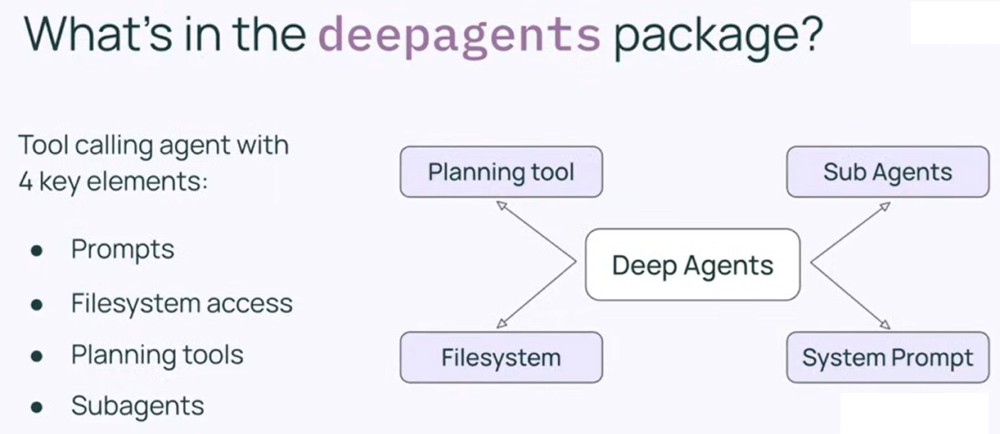
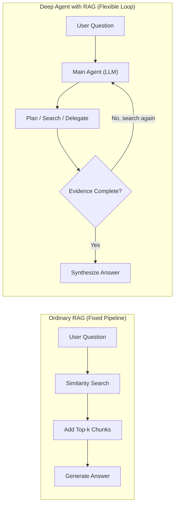
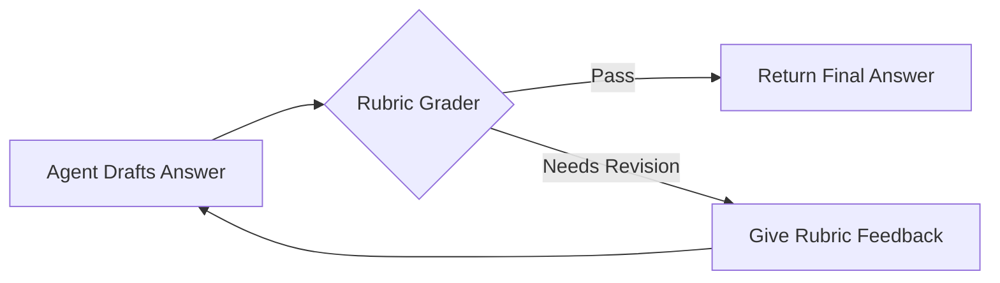
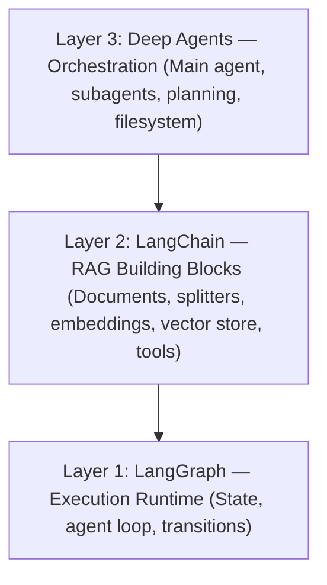
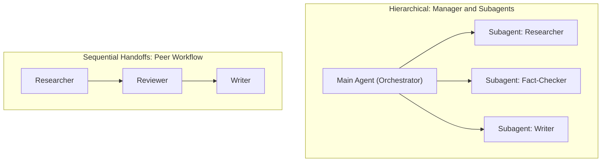
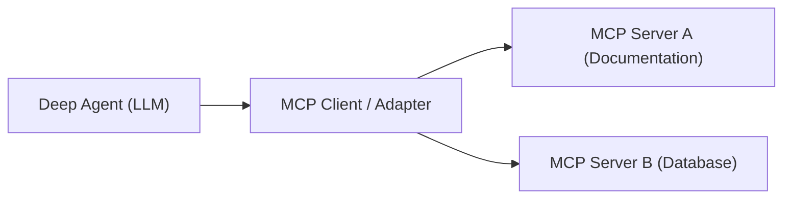

# Understanding Deep Agents, Middleware, and Subagents

A standard RAG pipeline follows a direct pattern: retrieve relevant chunks from a document collection, add them to the LLM's context, and generate an answer. **Deep Agents** does not replace RAG. Instead, it gives an LLM structured capabilities to decide *how* to use RAG, tools, and other agents when solving more complicated tasks.


---

## 1. How Ordinary RAG Works

Suppose a user asks:

> *"What is the baggage limit for the Skylark-4 seaplane?"*

A typical RAG system follows a fixed sequence defined in application code: retrieve relevant chunks from the vector store, add them to the prompt, call the LLM, and return the answer (e.g., that the limit is 14 kg).

For straightforward, single-fact questions, ordinary RAG is simple, fast, and sufficient.

## 2. What Changes When a Question Becomes Complicated?

Now consider a multi-part question:

> *"I'm bringing a hard-shell suitcase on the Skylark-4 seaplane. What should I do, what will storage cost, and what happens if Protocol Gull is activated on Kaldor?"*

This question spans multiple sections or handbooks. A single `top-k` similarity search for the entire query can easily miss one of the parts.

An **agent** gives the LLM another option: instead of answering immediately, it can choose actions in a loop—for instance, searching for luggage restrictions first, storage fees second, evacuation rules third, and then combining the findings.

## 3. What Is a Deep Agent?



A **Deep Agent** is an agent harness equipped with ready-made capabilities for managing multi-step work. It is still powered by a standard LLM (not a special kind of model): the LLM handles reasoning and decisions, while Deep Agents provides tools, a virtual filesystem, subagent delegation, context management, and optional task planning.



### Key Benefits and Trade-offs

- **Flexible investigation:** The agent can run multiple targeted searches and adjust its next step based on what it finds.
- **Context management:** Retrieved chunks can be written to a virtual filesystem so the main agent works with file paths and concise summaries rather than filling its context window with raw text.
- **Subagents:** The main agent can delegate inspection of individual files to specialized subagents, each running in its own isolated context.
- **Reusable capabilities:** Planning, delegation, and file-management tools are provided out of the box.

**Trade-off:** Extra planning, delegation, and verification steps require more model calls, more tokens, higher latency, and greater exposure to API rate limits. For small collections like three short handbooks, ordinary RAG is simpler and often enough; the labs use Deep Agents so you can practice the architecture directly.

## 4. Tools vs. Middleware

A useful distinction is:

- A **tool** gives an agent an action it can perform (e.g., searching documents).
- **Middleware** wraps around agent execution to add capabilities, rules, or checks.

| Concept | Meaning | Lab Example |
| --- | --- | --- |
| **LLM** | The model generating responses and selecting actions | Groq `gpt-oss-20b` |
| **Tool** | A function the agent can call | `search_trip_docs()` |
| **Prompt** | Instructions describing how to behave | "Search before answering" |
| **Middleware** | Logic that runs around the agent workflow | `TodoListMiddleware()` |
| **Subagent** | A specialist agent assigned a narrower task | `chunk-analyst` |
| **Backend** | Storage used by filesystem tools | `StateBackend()` |

### Example: `TodoListMiddleware`

```python
from langchain.agents.middleware import TodoListMiddleware

agent = create_deep_agent(
    model=model,
    tools=[search_trip_docs],
    backend=backend,
    subagents=[chunk_analyst_subagent],
    middleware=[TodoListMiddleware()],
)
```

Adding `TodoListMiddleware()` gives the agent the `write_todos` tool so it can break a multi-part question into a plan (e.g., check luggage restrictions, check storage fees, check Protocol Gull rules, then synthesize with citations).

The middleware makes planning *available*, but does not force the LLM to plan every query—simple questions may still be answered after a single search.

### Example: `RubricMiddleware`

In Lab 2, `RubricMiddleware` adds an evaluation-and-revision loop around the agent's draft response:



A rubric can enforce requirements such as answering every part of a question and citing source handbooks. However, a grader that does not inspect the original source chunks cannot independently verify factual accuracy.

Other middleware patterns include retrying failed model calls, limiting call counts, summarizing long conversation histories, and requiring human approval before sensitive actions.

## 5. LangChain vs. LangGraph vs. Deep Agents

These three tools operate at different layers of the same ecosystem rather than competing as mutually exclusive alternatives:

| Aspect | LangChain | LangGraph | Deep Agents |
| --- | --- | --- | --- |
| **Main purpose** | Build LLM apps and agents | Control stateful workflows | Provide a ready-made multi-step agent |
| **Provides** | Models, RAG blocks, tools, agent loops | State, nodes, edges, persistence | Filesystem, subagents, context tools, planning |
| **Control level** | High-level and configurable | Explicit and fine-grained | High-level with built-in conventions |
| **Typical entry point** | `create_agent()` | `StateGraph()` | `create_deep_agent()` |
| **Best suited when** | Building a standard RAG assistant or tool loop | Enforcing exact transitions and rules | Solving multi-step tasks without building harness machinery |

LangChain agents run on LangGraph under the hood, and Deep Agents builds on top of both LangChain and LangGraph.

## 6. How the Layers Fit Together in the Labs



In the labs, LangChain handles document loading, splitting, embeddings, vector storage, and retrieval; Deep Agents coordinates planning, file offloading, and subagent delegation; and LangGraph manages the underlying execution state automatically.

## 7. Line-by-Line Walkthrough of `create_deep_agent()`

```python
from langchain.agents.middleware import TodoListMiddleware

agent = create_deep_agent(
    model=model,
    tools=[search_trip_docs],
    backend=backend,
    subagents=[chunk_analyst_subagent],
    middleware=[TodoListMiddleware()],
)
```

- **`model=model`:** Assigns the main agent's LLM (e.g., `ChatGroq(model="openai/gpt-oss-20b", temperature=0)`), which handles reasoning, tool selection, delegation, and synthesis.
- **`tools=[search_trip_docs]`:** Grants the main agent permission to call the custom RAG search tool. Note that the vector store lives inside `search_trip_docs`, rather than being passed directly to `create_deep_agent()`.
- **`backend=backend`:** Connects the virtual filesystem (`StateBackend()`), enabling tools such as `read_file`. Unlike the vector store (which stores searchable embeddings), `StateBackend` stores files generated during an agent run.
- **`subagents=[chunk_analyst_subagent]`:** Registers specialist subagents so the main agent can delegate work via Deep Agents' built-in `task()` tool.
- **`middleware=[TodoListMiddleware()]`:** Exposes `write_todos` for optional planning. Note that isolated subagents do not automatically inherit the main agent's custom middleware.

## 8. Assigning and Configuring Subagents

Think of the main agent as an orchestrator and subagents as focused specialists.

### Defining Custom Subagents

Subagent names and roles are defined in Python—not all subagents are predefined by the framework (though Deep Agents also includes a built-in `general-purpose` subagent):

```python
chunk_analyst_subagent = {
    "name": "chunk-analyst",
    "description": (
        "Analyze one retrieved trip planner chunk file. "
        "Pass the question and file path."
    ),
    "system_prompt": CHUNK_ANALYST_INSTRUCTIONS,
    "tools": [],
}
```

| Field | Purpose |
| --- | --- |
| `name` | Unique identifier used when delegating via `task()` |
| `description` | Helps the main agent decide when to select this specialist |
| `system_prompt` | Instructions defining how the subagent performs its task |
| `tools` | Custom tools available to the subagent (`[]` blocks inheriting `search_trip_docs`, while filesystem tools like `read_file` remain available) |
| `model` | Optional override to assign a different LLM |

You can register multiple distinct subagents (e.g., `document-researcher`, `fact-checker`, `report-writer`), and the main agent selects among them using their `name` and `description`:

```python
task(
    subagent_type="chunk-analyst",
    description="Read /retrieved/abc/chunk_1.md and extract luggage restrictions.",
)
```

### Choosing the Subagent LLM

By default, subagents inherit the parent's `model`, though each delegated call still runs as a **separate model call with its own isolated context**. You can also override `model` per subagent:

```python
main_model = ChatGroq(model="openai/gpt-oss-120b", temperature=0)
worker_model = ChatGroq(model="openai/gpt-oss-20b", temperature=0)

chunk_analyst_subagent = {
    "name": "chunk-analyst",
    "description": "Analyze one retrieved chunk.",
    "system_prompt": CHUNK_ANALYST_INSTRUCTIONS,
    "tools": [],
    "model": worker_model,
}

agent = create_deep_agent(
    model=main_model,
    subagents=[chunk_analyst_subagent],
)
```

Because the main agent and every delegated subagent task make separate LLM calls, subagent workflows consume more tokens and can hit API rate limits faster—executed either in parallel or sequentially depending on the model and runtime.

## 9. Subagents vs. Multi-Agent Systems

Subagents are a **hierarchical** form of multi-agent system, whereas multi-agent systems more broadly also include sequential handoffs or peer-to-peer networks:



| Feature | Subagents in Deep Agents | Multi-Agent Systems (General) |
| --- | --- | --- |
| **Architecture** | Hierarchical (parent–child) | Hierarchical, sequential, networked, etc. |
| **Coordination** | Main agent delegates via `task()` | Depends on system design |
| **Communication** | Subagent returns results to parent | Agents may hand off or share state directly |
| **LLM** | Same or different models | Same or different models |

Using `chunk-analyst` subagents in the labs **is** a multi-agent system—even when the orchestrator and all subagent instances use the same underlying Groq model, because each has its own instructions, context window, and tool calls.

## 10. Using MCP with Deep Agents

A Deep Agent can act as an **MCP client** to discover and call tools exposed by external **MCP servers** alongside local RAG tools:



In LangChain (`langchain[mcp]` 1.4.0+, currently a beta API), `MCPAdapter` connects to an MCP server and exposes its tools:

```python
# pip install -U "langchain[mcp]"
from langchain.mcp import MCPAdapter
from deepagents import create_deep_agent
from langchain.agents.middleware import TodoListMiddleware

async with MCPAdapter("https://docs.langchain.com/mcp") as adapter:
    mcp_tools = await adapter.list_tools()

    agent = create_deep_agent(
        model=model,
        tools=[search_trip_docs, *mcp_tools],
        backend=backend,
        subagents=[chunk_analyst_subagent],
        middleware=[TodoListMiddleware()],
    )

    result = await agent.ainvoke({
        "messages": [
            {
                "role": "user",
                "content": "Find documentation explaining Deep Agents.",
            }
        ]
    })

print(result["messages"][-1].text)
```

- **MCP client integration:** Adding `*mcp_tools` to `tools=[...]` gives the main agent access to external MCP tools (subagents with `"tools": []` do not automatically receive them unless explicitly added).
- **MCP server integration:** Exposing a Deep Agent *as* an MCP server requires a separate server wrapper that invokes the agent when an external client calls an exposed tool.

## 11. When to Choose Each Approach

Choose the architecture based on task complexity:

- **Ordinary RAG:** Best for straightforward FAQs over small or well-indexed document sets where low latency and low token cost matter.
- **Deep Agents:** Best for open-ended, multi-step tasks that benefit from planning, filesystem offloading, repeated retrieval, and subagent context isolation.
- **Explicit LangGraph (`StateGraph`):** Best when strict business rules require guaranteed transitions (for example, always enforcing a verification step in code rather than relying on a prompt).

---

### Further Reading

- [Deep Agents Subagents Guide](https://docs.langchain.com/oss/python/deepagents/subagents)
- [LangChain MCP Integration Guide](https://docs.langchain.com/oss/python/langchain/mcp)
