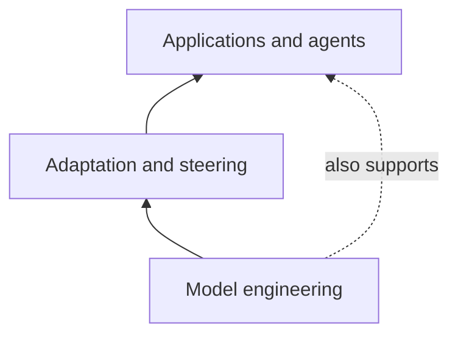
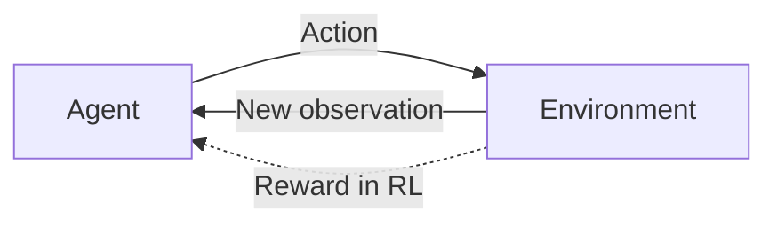
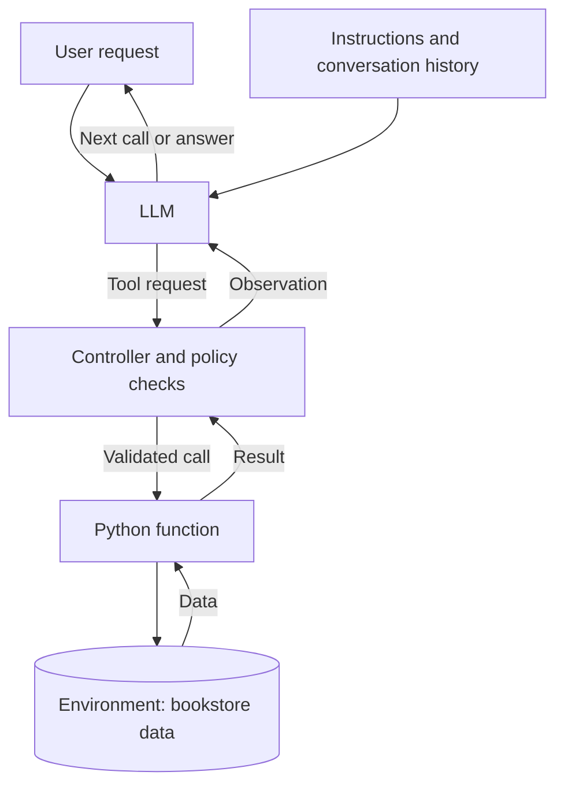
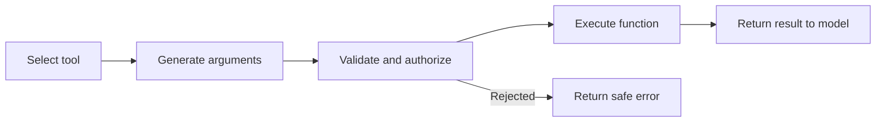
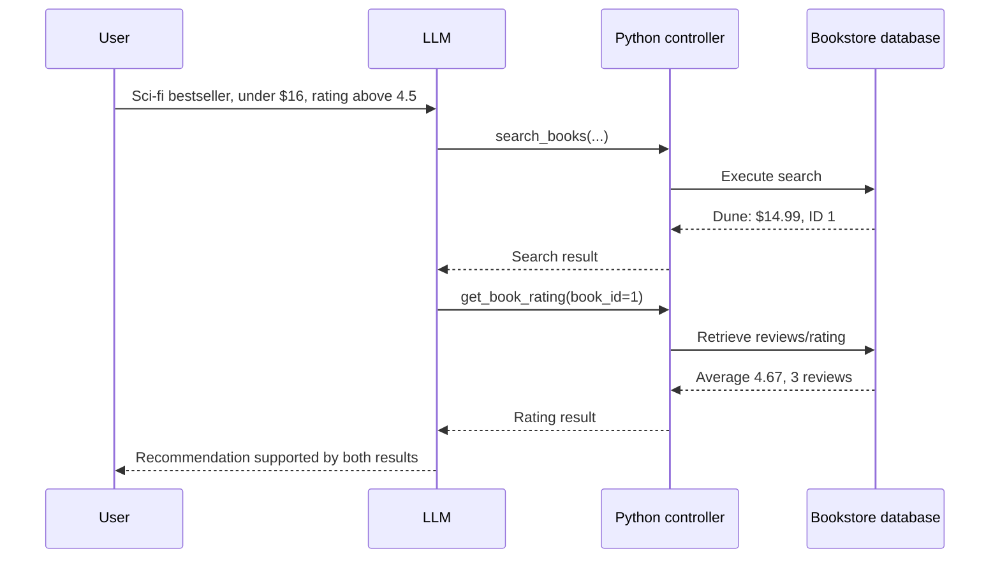
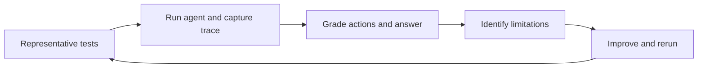
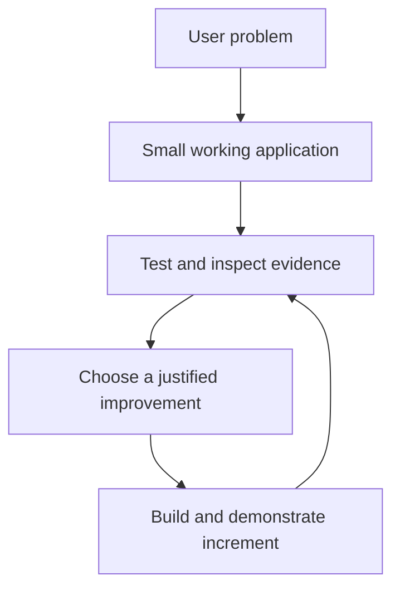

# Lecture 1 Companion — Understanding AI Assistants, Agents, Tools, and Evaluation

After working through this chapter, you should be able to:

1. Explain how agent applications fit into the broader language-model ecosystem.
2. Distinguish an AI assistant from an agentic workflow without treating them as unrelated categories.
3. Identify the model, controller, tools, environment, and observations in an agent system.
4. Describe how a plain Python function becomes a model-accessible tool—and why it should be tested first.
5. Trace a tool call from selection and arguments through validation, execution, and the returned result.
6. Explain multi-step tool use using the bookstore example.
7. Distinguish model inference, agent frameworks, and application-owned execution logic.
8. Identify meaningful evaluation and safety checks for an AI product.


---

## 1. From generating text to engineering useful systems

A large language model (LLM) can produce text, code, explanations, summaries, and other outputs based on a request and the context provided to it. This is useful, but a fluent answer does not necessarily solve a real problem. A system might need to search a database, verify a price, check an availability record, calculate an amount, or use information that was never part of the model's training data.

That distinction motivates **AI application engineering**. Rather than viewing the model as the entire product, the model is one component in a larger application. The other components include data, interfaces, tools, policies, tests, and sometimes external services.

Imagine an application for choosing books. An LLM without access to the catalog might recommend a plausible title but cannot verify the current store price. A bookstore application with a search tool can retrieve that price from the store's actual data. The difference is not only in how convincing the answer sounds; it is in **where the evidence comes from**.

The engineering goal is therefore to build a system that is useful, predictable enough to operate, and testable. An application that reliably solves a narrow task may be more valuable than a highly autonomous application whose actions are difficult to understand or verify.

## 2. The LLM stack and the evolution of agents

The lecture groups language-model work into three broad, overlapping areas:

| Area | Main question | Examples |
|---|---|---|
| LLM engineering | How are models built and executed? | Architectures, training, GPU computation, inference systems |
| LLM adaptation | How can a model's behavior be changed or steered? | Fine-tuning, prompting and other adaptation methods |
| LLM applications | How can a model support real tasks? | Assistants, retrieval systems, tools, agents and evaluations |

This diagram is a conceptual teaching aid, not a strict separation between fields or academic courses.



### Agents existed before language models

The idea of an *agent* comes from a much broader AI tradition. At a basic level, an agent interacts with an environment: it receives an observation, chooses an action, and encounters a new situation. In **reinforcement learning (RL)**, the environment may additionally supply reward signals that help an agent learn a policy through experience.

For example, an Atari-playing agent can receive a game frame, select a controller action, and then observe the resulting screen. Work on Deep Q-Networks, AlphaGo, and OpenAI Five provides examples of agents operating in this tradition. They show that interacting with environments is not a new invention associated with chatbots.



**Modern LLM agents are not necessarily reinforcement-learning systems.** In a tool-calling application, a previously trained model can interpret a request and generate an action request during inference. Python code executes that action and returns the observation. There may be no new training or reward optimization during this interaction.

Transformer-based LLMs and in-context learning made it easier to express diverse tasks using natural language. *In-context learning* means that instructions and examples can shape the model's behavior during a particular request **without changing its model weights**. This is different from fine-tuning. The deeper technical details are not needed to understand tool calling.

## 3. AI assistant and AI agent: overlapping ideas

An **AI assistant** is described mainly by what it does for the user: answering, guiding, helping decide, or completing tasks. An **AI agent** or **agentic workflow** is described mainly by how it operates: selecting actions, interacting with tools or an environment, observing results, and potentially continuing through several steps.

The distinction is useful, but it is not a hard boundary. An assistant may use an agent loop internally. A system called an agent may be no more than a chatbot with a single tool. Different applications allow different levels of autonomy.

Consider three versions of a bookstore application:

1. **Answering assistant:** responds to general questions about books using the information already in the model context.
2. **Tool-using assistant:** searches a catalog when asked about available books and returns the retrieved information.
3. **Multi-step agentic assistant:** searches for matching books, identifies which facts are still missing, retrieves their ratings, and formulates a grounded recommendation.

All three may have the same chat interface. What changes is the system's ability to interact with data and coordinate operations. More autonomy also means more responsibility for limiting and evaluating what the system can do.

## 4. The components of a tool-using agent

A practical agent system can be understood as a set of interacting parts.

- The **language model** interprets requests and may propose a tool call or a final answer.
- **Instructions and context** specify the task, previous messages, allowed tools, and relevant data.
- **Tools** are operations that the application can perform, often implemented as ordinary Python functions.
- The **application controller** connects the model to the tools. It checks requests, executes approved functions, sends back results, and decides whether to continue.
- The **environment** contains the resources with which the tools interact, such as a database or a local file.
- **Memory** means information retained during or across interactions. Conversation history is a simple form of working context. Persistent memory is optional.
- **Planning** refers to choosing steps or subgoals. Some tasks need explicit planning; small workflows often do not.



### Why the controller matters

The controller is the boundary between generating text and performing an operation. An LLM may output a message resembling:

```json
{"name": "get_book_rating", "arguments": {"book_id": 1}}
```

That is **a request to the surrounding application**, not Python code that has already run. The application must determine whether `get_book_rating` is registered, whether `book_id` is valid, and whether the call is allowed. Only then does the Python function run.

This separation is particularly important when tools can make purchases, send messages, modify files, or disclose private information. Even a read-only database function should validate its inputs, because incorrect arguments can lead to incorrect results.

## 5. Why tools are important—and what they do not guarantee

Language models can be useful without tools, but they have practical limits. They may not know the current contents of a specific database, they may be unable to perform a requested external action, and they may produce incorrect values when guessing.

Tools extend what an application can do. A calculator produces a deterministic numeric result for a valid expression. A search function retrieves records from a catalog. A review function returns stored feedback. A file-reading tool can obtain information that was not in the model's original input.

This creates several advantages:

- **Grounding:** responses can rely on external evidence rather than guesses.
- **Task completion:** the application can perform permitted operations, not only describe them.
- **Separation of responsibilities:** Python can enforce deterministic rules while the model handles flexible language.
- **Modularity:** tools can be tested and improved independently of the model.

However, tool access introduces risks:

- The model may select the wrong function or supply incorrect arguments.
- The function may fail or return incomplete information.
- The model may misread a correct result and produce an unsupported conclusion.
- A powerful tool may expose private data or change external state unexpectedly.
- Long sequences create more opportunities for errors to propagate.

A tool result therefore improves the available evidence; it does **not** guarantee that the final answer or action is correct.

Historical research reflects the growing importance of tool use. **WebGPT** explored browsing as a way to support answers with information; **MRKL** described modular combinations of neural language systems and expert components; **Toolformer** examined learning when and how to call tools; and **Gorilla** studied model interaction with APIs. Their deeper methods are reserved for later reading.

## 6. Start with a Python function and test it independently

A tool should perform a clearly defined operation even when no LLM is involved. A minimal example can use a small in-memory catalog:

```python
BOOKS = [
    {"id": 1, "title": "Dune", "genre": "sci-fi", "price": 14.99},
    {"id": 2, "title": "Example Mystery", "genre": "mystery", "price": 12.50},
]


def search_books(genre: str, max_price: float) -> list[dict]:
    """Find books matching a genre and a maximum price."""
    return [
        book for book in BOOKS
        if book["genre"] == genre and book["price"] <= max_price
    ]


print(search_books("sci-fi", 16))
```

The function accepts two arguments, filters known data, and returns a list of records. There is no model involved. You can immediately test several behaviors: a matching book, no matching books, and price boundaries.

The real bookstore notebook uses SQLite and additional fields, but the design principle is the same. **First verify the ordinary function. Then expose it to a language model.** This reduces ambiguity when something fails: the problem may be in the function, the schema, the model's selected arguments, or the controller.

### Tool contracts

A good tool contract specifies:

| Element | Purpose |
|---|---|
| Name | Identifies the operation, for example `search_books` |
| Description | States what the operation does and when it is useful |
| Argument schema | Defines required fields and types |
| Result shape | Makes the returned data understandable and testable |
| Error behavior | Explains how missing or invalid inputs are handled |
| Permissions | Restricts what the operation is allowed to do |

The name and description help the model choose the tool. The argument schema helps represent inputs such as `max_price: float`. None of these elements removes the need for application-level checks. For instance, a positive price is a stronger rule than merely checking that `max_price` is a floating-point number.

### Registering a function with LangChain

LangChain provides tool abstractions for connecting Python functions to language-model workflows. A simplified example is:

```python
from langchain_core.tools import tool

@tool
def get_book_rating(book_id: int) -> dict:
    """Return the average rating and review count for a book ID."""
    if book_id == 1:
        return {"book_id": 1, "average_rating": 4.67, "review_count": 3}
    return {"book_id": book_id, "found": False}

# This invokes the tool directly from Python; no LLM is involved.
print(get_book_rating.invoke({"book_id": 1}))
```

The `@tool` decorator provides a model-facing tool representation and supports structured invocation. In larger applications, Pydantic schemas are often used to express typed inputs and further constraints. A manual `.invoke(...)` is useful for independent testing. It does **not** mean that an LLM selected the function.

The same architectural separation applies whether the application uses LangChain, another framework, or a custom execution loop.

## 7. Anatomy of a tool call: five distinct stages

Tool calling is easiest to understand by separating the model's decisions from the application's responsibilities.



**1. Selection.** The model chooses an operation from the available tool descriptions. For a book query, it may select `search_books`.

**2. Argument generation.** The model extracts constraints from natural language. “A sci-fi bestseller under $16” may lead to `genre="sci-fi"`, `is_bestseller=True`, and `max_price=16`.

**3. Validation and authorization.** Python checks that the requested function exists, the arguments have the expected types, values meet domain rules, and the operation is permitted. `"True"` (a string) is not the same value as `True` (a Boolean); silent coercion should not be assumed safe.

**4. Execution.** Python calls the actual function. This is where the database is queried. The model does not directly execute SQL merely by generating text that looks like a tool request.

**5. Observation.** The function result is added to the interaction history so the model can use it. The model can answer, ask another question, or request another tool call.

This process is central to agent reliability. If the model produces an unknown tool name, the controller should return an error or refuse execution. If a purchase tool exists, permission checks and user confirmation should occur before the purchase is made.

### What an execution trace shows

A trace records what actually happened rather than only what the final answer says. It may include the user's question, raw model output, parsed tool request, validated arguments, function result, follow-up calls, final answer, and stopping reason.

A trace allows questions such as: Did the model use the rating tool? Did the rating tool actually return a value? Did the final text reflect that value? These are three distinct facts.

## 8. Multi-step tool calling in the bookstore

Consider the request:

> Find a sci-fi bestseller under $16 with a rating above 4.5.

The first function can search for matching books by genre, price, and bestseller status. It may return **Dune**, with a price of **$14.99**. That result is not enough to establish the rating condition unless the rating is included in the search result. The model must use another available operation to obtain the missing information.



This is a **multi-step workflow** because the second decision depends on the first tool's result. The model does not have to plan every call in advance. It can choose, observe, and choose again.

The application maintains the conversation history so the model can see previous requests and observations. It also enforces practical limits, such as the maximum number of model turns or tool calls. Without limits, repeated or incorrect requests could waste resources or cause unintended behavior.

The model may also decide that no tool is needed. A robust controller should allow a final answer without requiring the model to call something on every turn.

## 9. LangChain, local Qwen, and GroqCloud

Three different responsibilities are easy to confuse:

1. **The model** predicts the next output, which may contain a tool request or a final response.
2. **The framework**, such as LangChain, helps describe tools and organize common model/tool interactions.
3. **The application** owns access to data, execution rules, credentials, logs, limits, and safety checks.

A framework can reduce repetitive engineering, but it does not make a model's proposed actions automatically safe or correct. Understanding the underlying control loop remains important.

### Local versus hosted inference

In the exercises, **Qwen3.5** can run locally in a Google Colab environment. This means the notebook downloads the model and performs inference using its allocated hardware. Local inference can be useful for observing raw model behavior and experimenting with the execution loop, but it requires model downloads and adequate computing resources.

**GroqCloud** is an inference service that hosts models through an API. In this arrangement, the prompt and model request are sent to a hosted service, while the bookstore functions and their database can remain in the local Python application. The fact that inference is hosted does **not** mean that the remote model automatically receives unrestricted access to local data or executes arbitrary Python functions.

**Groq and Grok are different names:** Groq is associated with inference infrastructure and its GroqCloud API; **Grok** refers to a model family developed by **xAI**. When comparing models, distinguish the model provider from the company serving the inference request.

For GroqCloud exercises, an API key is typically stored in **Google Colab → Secrets** as `GROQ_API_KEY`. The notebook must be granted permission to access that secret when Colab asks. The key should never be pasted into a shared notebook or committed to GitHub. Hosted-model experiments are also subject to the service's current usage limits.

### Why a fair comparison matters

A model may appear more capable because it was given more output tokens, a better prompt, different tools, or easier test questions. To compare tool-calling behavior, use the same tasks, tool contracts, data, and evaluation rules whenever possible. Record conditions that cannot be made identical, such as model hardware or provider-specific limits.

Multimodal processing is a separate extension: a model may also be given an actual image, such as a book cover. Visual descriptions should be checked against the image itself. A longer answer is not necessarily a more accurate one.

## 10. How do we evaluate an agent?

A successful-looking response is only one observation. The agent may have selected an unnecessary tool, applied a filter incorrectly, or used a correct tool result to produce a misleading claim.

The lecture groups agent engineering into **system, data, and evaluations**:

- The **system** includes architecture, control logic, tool interfaces, and permissions.
- The **data** includes task inputs, database records, prompt context, and representative evaluation cases.
- The **evaluations** specify what counts as success and collect comparable evidence.

Useful evaluation dimensions include:

| Dimension | Question |
|---|---|
| Task success | Did the application meet the user's actual request? |
| Tool selection | Did it choose the tool needed for the task? |
| Argument correctness | Were the types and constraints valid? |
| Grounding | Does the final answer match the returned data? |
| Reliability | Does it behave consistently over repeated tests? |
| Robustness | What happens when requests or conditions change? |
| Efficiency | How many model/tool calls and how much time were needed? |
| Safety | Were risky actions rejected or correctly authorized? |

Three broader properties are especially useful:

**Consistency:** If the same task is run again, does it still succeed? Outputs need not have identical wording to be successful.

**Robustness:** If the user rephrases a request, asks for an unavailable book, or supplies an invalid ID, does the system respond appropriately?

**Predictable failure modes:** When something fails, does the system produce a traceable error and stop safely, or does it invent an answer or repeat invalid actions?



Evaluation cases should ideally be defined **before** reviewing model outputs, so that expectations are not changed simply to favor a model. For an agent with a database, correctness can often be checked using known records. Other situations, including visual interpretation, require careful human review.

## 11. Security, privacy, and responsible actions

Agents can use tools that reveal private information or change external state. The challenge is not merely whether the model can perform the action, but **whether it should**.

Consider the privacy scenario in the lecture's PrivacyLens slide. An assistant is asked to share a summary of work-related events. It retrieves calendar entries, including an unrelated private appointment, and risks including the private appointment in its outgoing message. The technical tool call may be successful, but the behavior crosses a privacy boundary.

This example illustrates several protective principles:

- **Least privilege:** a tool should have only the permissions required for its task.
- **Read-only defaults:** starting with search and retrieval is safer than starting with purchases or messages.
- **Validation and authorization:** tool schemas and permissions should be checked before execution.
- **Confirmation:** impactful actions should require explicit approval when appropriate.
- **Data minimization:** only data relevant and authorized for the task should be included in outputs.
- **Observability:** logs and traces should make failures understandable without exposing secrets.

Tool results and retrieved content should also be treated as data, not as trusted instructions that can override the application's rules. This concern becomes more important when agents interact with web pages, documents, or other systems outside the developer's control.

## 12. Turning the concepts into a product

Learning about agents becomes most useful when connected to an actual problem. A practical project can begin with a target user, a single useful workflow, and a small set of representative tests. New capabilities can be considered as the product develops.



For example, a team creating an events assistant might first search a small collection of event records. Later it could investigate an external data source, retrieval over policy documents, or a different architecture—but only when these changes solve a real limitation. A single-agent design may remain entirely appropriate.

The repeated engineering cycle is **learn → practise → apply → evaluate → improve**. Each working increment should support a meaningful user task and provide some evidence that it behaves as intended. The ability to explain why one tool was selected, how it was tested, and what its limitations are is as important as the final demonstration.

### Questions for reflection

1. How can a system be called an *assistant* and still use agentic workflows internally?
2. Why is testing a Python function separately useful before exposing it to a model?
3. In a tool-call trace, what evidence distinguishes *requesting a tool* from *successfully executing it*?
4. Why is the second call to `get_book_rating` necessary in the bookstore example?
5. What failures could be concealed by looking only at the final answer?
6. How would you test an AI product with a missing record, an invalid parameter, and a repeated user request?
7. When does an additional tool improve a product, and when does it merely increase complexity?

