# Lecture companion: Building an MCP application in five phases

| Phase | New element | What stays unchanged |
|---|---|---|
| **1. Math + FastMCP** | A callable MCP tool and a standalone client | Python performs the calculation |
| **2. Trip + FastMCP** | Resources and prompts alongside a tool | A client discovers and requests server capabilities |
| **3. Trip + official MCP SDK** | A second server library and two client libraries | The MCP operations and Trip behavior |
| **4. Trip + LangChain, no LLM** | Tools, documents, and prompt templates in LangChain | The official-SDK Trip server |
| **5. Trip + LangChain + LLM** | Model-assisted tool selection and context-driven answers | The same underlying MCP capabilities |

**Terminology checkpoint:** 

- MCP is the *protocol*. 
- `fastmcp` and `mcp` are *Python libraries* that implement it. 
- In the architecture, **data-layer operations** (tools, resources, prompts, and MCP request/response messages) are distinct from the **transport layer** (stdio or Streamable HTTP). HTTP and stdio are transports—not competing MCP protocols.

---

## Phase 1: Math MCP server and client with FastMCP (tools)

### Diagram 1.1: MCP standard versus the library selected for this phase

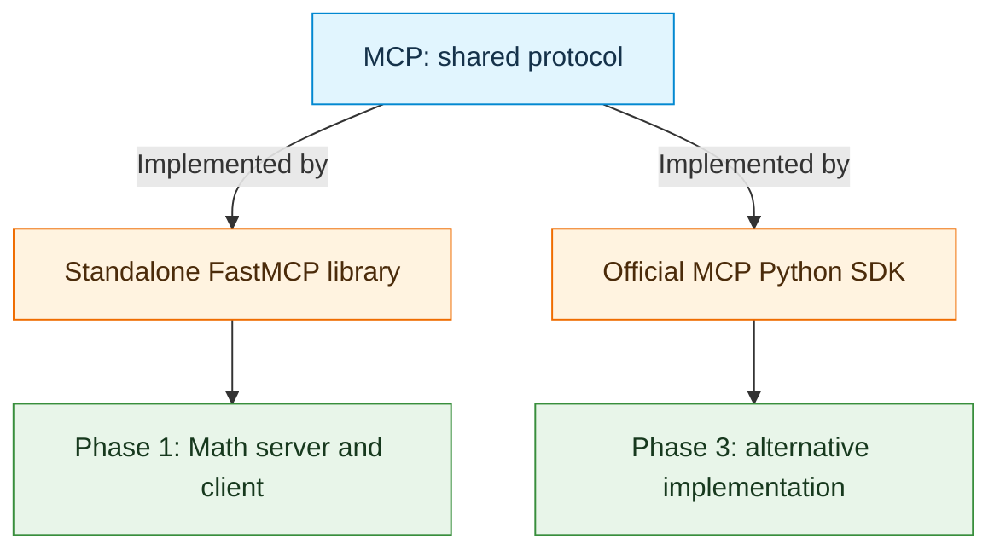

- Phase 1 uses `from fastmcp import FastMCP` on the server and `from fastmcp import Client` on the client.
- The official SDK is another implementation of the same MCP standard; it is introduced explicitly in Phase 3.
- `fastmcp` a different protocol from MCP, or a library implementing MCP?

### Diagram 1.2: Discover and call the calculator through a separate server process

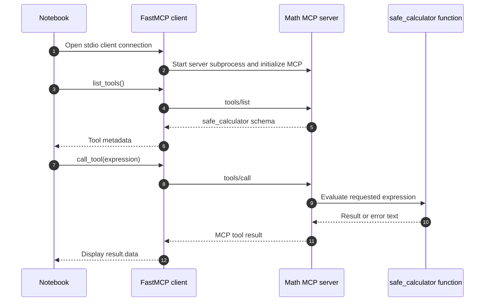

- Discovery (`list_tools`) describes a tool but does not execute it.
- Invocation (`call_tool`) sends arguments over MCP; the calculation runs in the **server process**, not in the client notebook.
- The notebook's `safe_calculator` currently uses Python `eval()`. Despite its name, this is **not a safe general-purpose expression parser**; it is a teaching prototype, not a production security pattern.
- At which step does the calculation actually happen?

### Diagram 1.3: The two architectural layers: capability messages versus transport

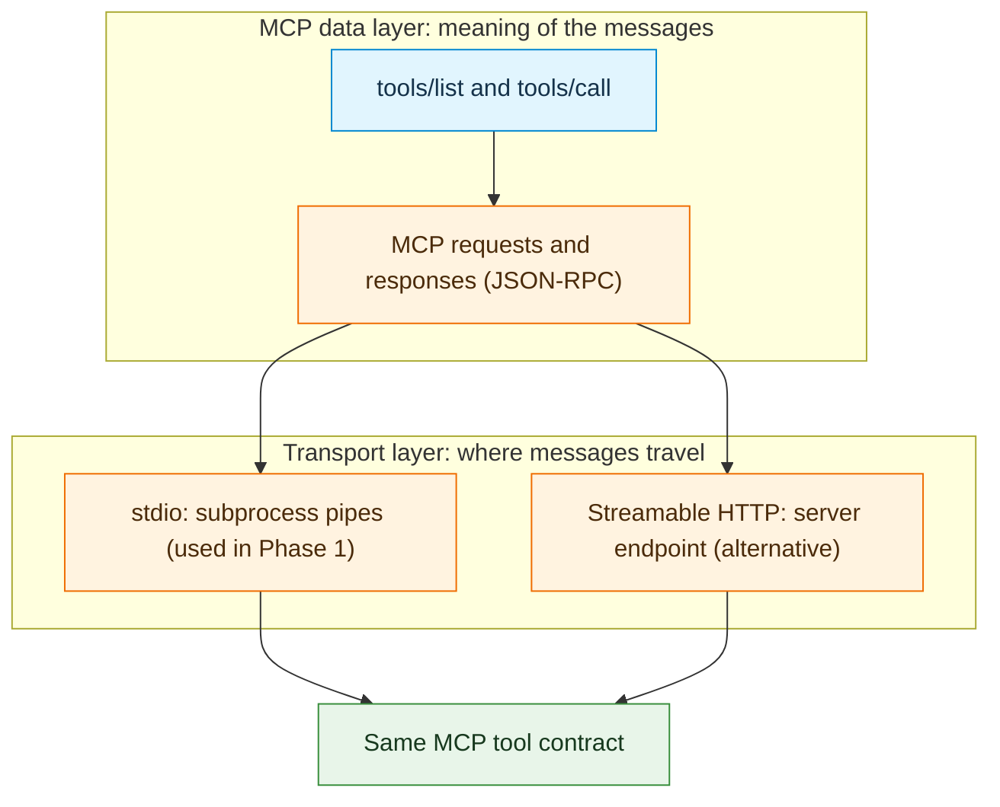

- **Data layer:** The client asks to list or call a tool; MCP defines what those operations mean.
- **Transport layer:** The notebook uses stdio to communicate with a launched process. A remotely hosted server can use Streamable HTTP instead.
- stdio carries MCP messages through stdin/stdout; the server should send diagnostics to stderr rather than mixing them with protocol output.
- What changes if the same server capability is offered over HTTP instead of stdio?

**Phase 1 takeaway:** A local Python function becomes a discoverable MCP tool; the client communicates through the protocol without importing the function.

---

## Phase 2: Trip MCP server and client with FastMCP (tools, resources, prompts)

### Diagram 2.1: One Trip server exposes three different capabilities

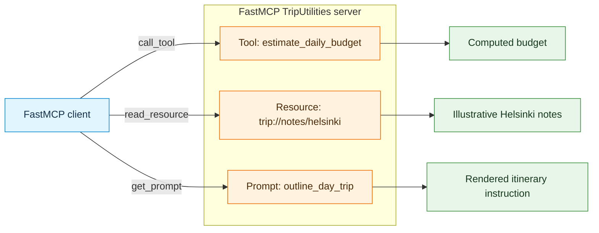

- **Tool:** Performs work; `estimate_daily_budget(days, daily_cost)` calculates a result.
- **Resource:** Provides content identified by a URI; Helsinki notes are illustrative, **not live travel data**.
- **Prompt:** Produces reusable instructions from arguments; `outline_day_trip(city, focus)` renders a request, but does not itself generate an itinerary.
- Why should the Helsinki notes be a resource rather than a budget-calculation tool?

### Diagram 2.2: Three distinct request patterns over the same MCP connection

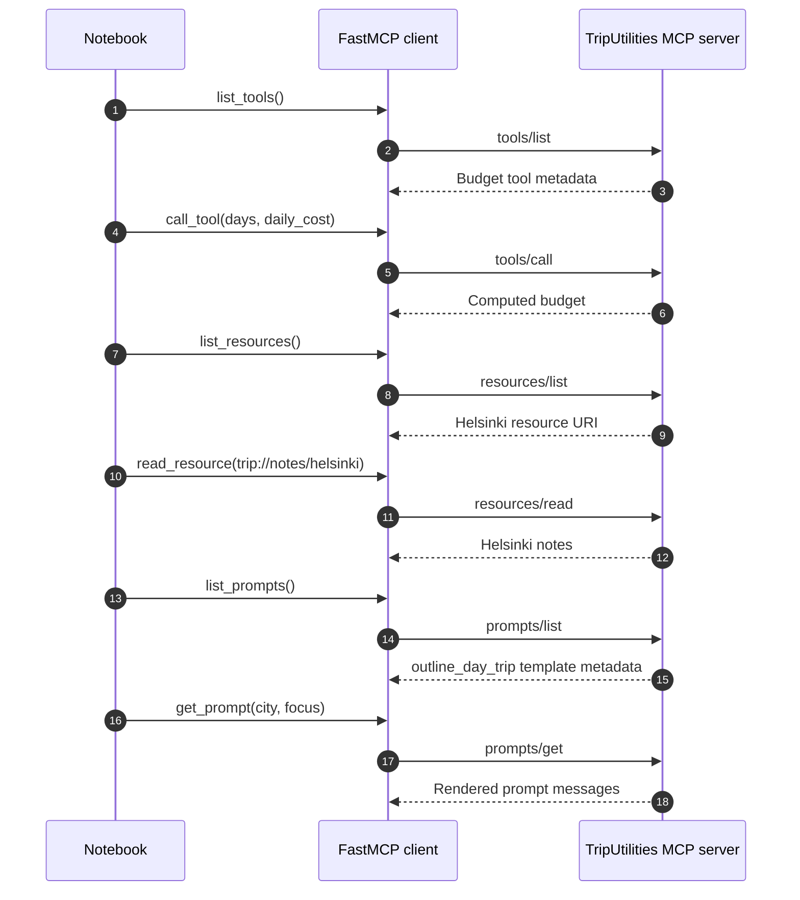

- `list_*` discovers capability metadata; `call_tool`, `read_resource`, and `get_prompt` request the corresponding results.
- The *same client connection and stdio transport* support all three operations.
- The client chooses each request explicitly. No LLM makes decisions in this phase.
- Which operation executes code, which reads data, and which prepares instructions?

### Diagram 2.3: The data layer grows; the transport does not change

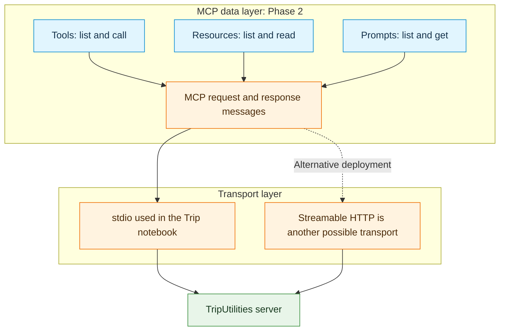

- Adding resources and prompts expands **what** the client can request; it does not require changing **how** messages travel.
- An HTTP deployment is shown as an architectural alternative, **not as a notebook step**.

**Phase 2 takeaway:** MCP is more than tool calling. A server can expose actions, data, and reusable prompt definitions through the same interface.

---

## Phase 3: Trip MCP server with the official SDK and two client libraries

 
### Diagram 3.1: One official-SDK server, two interoperable clients

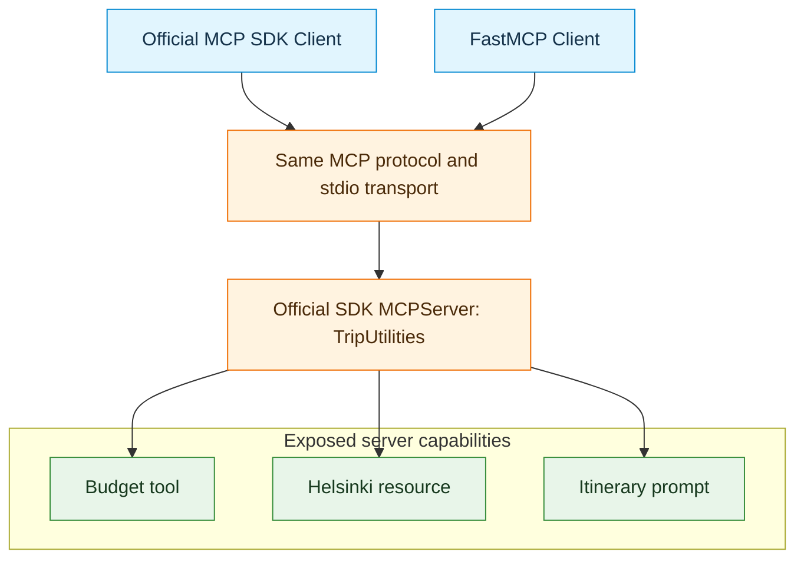

- The server changes to `from mcp.server import MCPServer` but still exposes the same tool, resource, and prompt.
- Both test clients use MCP; each launches its own stdio connection to the server program in its test cell.
- Compatibility depends on compatible MCP protocol and transport support, not matching Python imports.
- Why is the server implementation invisible to a client that relies on discovery?

### Diagram 3.2: Comparable operations, different high-level Python result wrappers

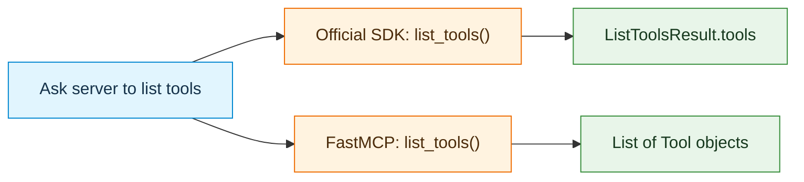

- Both clients expose familiar methods such as `list_tools`, `call_tool`, `read_resource`, and `get_prompt`.
- The official SDK uses `response.tools`; the standalone FastMCP client directly returns a tool list in this notebook.
- **Similar protocol behavior does not guarantee identical Python return types**. For tool results, inspect SDK result content/structured content versus the FastMCP convenience property `result.data`.
- Which parts of a client implementation are standardized, and which are library-specific?

### Diagram 3.3: Equivalent tests with either client

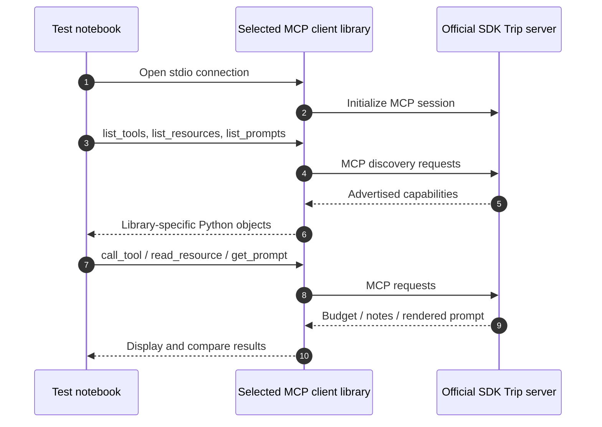

- Run the diagram's sequence **twice**: once with `mcp.Client`, once with `fastmcp.Client`.
- Comparing the same server behavior isolates differences in the clients rather than differences in underlying business logic.
- MCP interoperability is a protocol property; the Python client experience may differ without changing server capabilities.

---

## Phase 4: Trip MCP server with LangChain, without an LLM

### Diagram 4.1: The three MCP capabilities enter LangChain differently

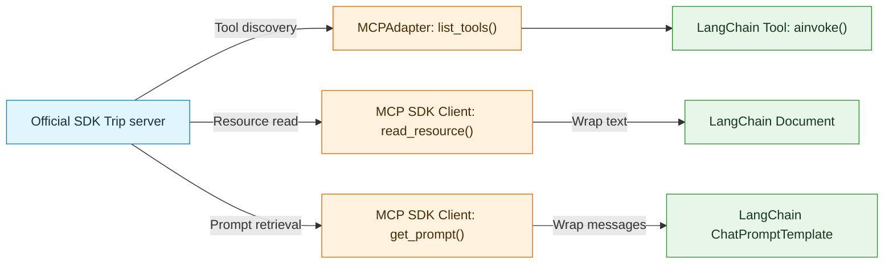

- `MCPAdapter` automatically adapts **tools** in the notebook.
- The official SDK client explicitly retrieves **resources** and **prompts**; notebook code wraps their contents in `Document` and `ChatPromptTemplate` objects.
- A LangChain `Document` is context, not an executable MCP tool; a rendered prompt template is instructions, not a server operation performed by the model.
- Why do tools remain callable while resource and prompt conversions produce in-memory objects?

### Diagram 4.2: Direct invocation proves the adapter works without an LLM

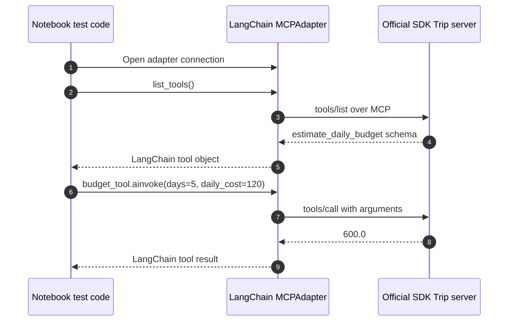

- The **notebook** selects the tool and supplies `days=5` and `daily_cost=120`.
- The adapter handles the MCP connection and conversion; **no LLM** chooses the tool or arguments.
- Keep the connection open during invocation; standalone callable wrappers need a live connection to reach the server.
- If this test succeeds, which potential source of error has been ruled out before adding an LLM?

### Diagram 4.3: Resources and prompts are retrieved, then represented locally

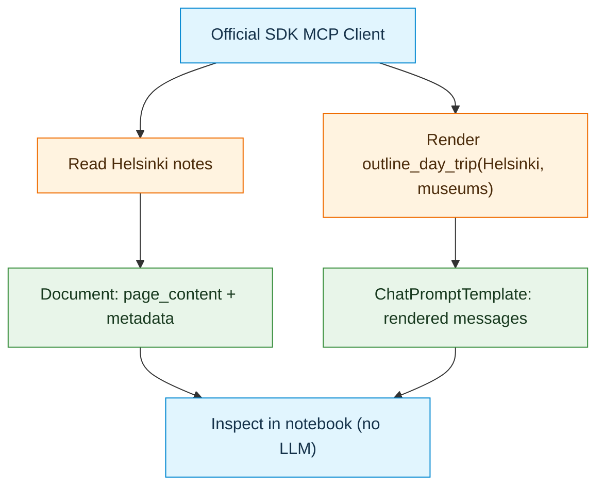

- Retrieved content is a **snapshot at retrieval time**, not a live tool proxy.
- The MCP prompt is already rendered with its arguments before it becomes a LangChain template in this notebook; changing its city/focus requires a new MCP prompt request.

**Phase 4 takeaway:** MCP integration should be tested in isolation: discovery, conversion, direct execution, and content inspection all work without model-generated decisions.

---

## Phase 5: Trip MCP server with LangChain and an LLM

### Diagram 5.1: Tool workflow: the model proposes; LangChain and MCP execute

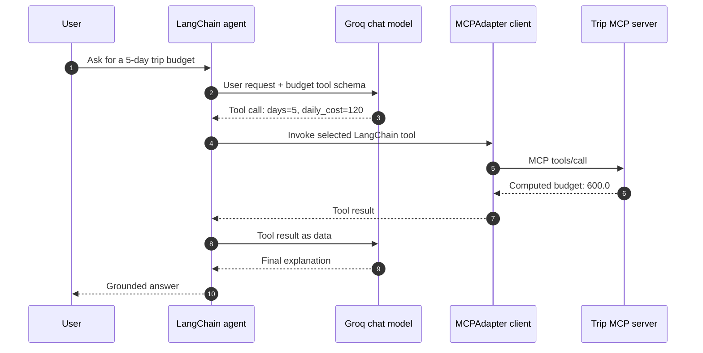

- `create_agent(model=chat_model, tools=...)` lets the model **request** a tool call.
- LangChain and the MCP client execute the request; the model does not run the Python function itself.
- A model may choose not to call a tool or may produce bad arguments. Inspect the actual message trace to determine what happened.
- Which participant chose the arguments, and which participant executed the calculation?

### Diagram 5.2: Resource workflow: retrieve context before the LLM call

```mermaid
flowchart LR
    resource["MCP resource: Helsinki notes"]:::input
    sdk["Official SDK Client: read_resource"]:::process
    doc["LangChain Document"]:::output
    template["ChatPromptTemplate: context + question"]:::process
    model["Groq chat model"]:::process
    answer["Answer using supplied notes"]:::output

    resource --> sdk
    sdk --> doc
    doc --> template
    template --> model
    model --> answer

    classDef input fill:#e1f5fe,stroke:#0288d1,color:#15324a;
    classDef process fill:#fff3e0,stroke:#ef6c00,color:#4b2b0a;
    classDef output fill:#e8f5e9,stroke:#388e3c,color:#17391e;
```

- The **application**, not the LLM, reads the MCP resource and puts the content into the prompt.
- The server notes are explicitly illustrative. The answer should not present them as proof of live operating hours, weather, route times, or availability.
- This is context-augmented generation, not dynamic MCP resource selection by the model.
- What would need to change for the application to retrieve only relevant resources on demand?

### Diagram 5.3: Prompt workflow: render MCP instructions, then call the model

- The MCP prompt provides a **request template**, not verified travel facts and not a tool execution.
- The notebook converts the rendered MCP messages into LangChain messages and calls `trip_prompt | chat_model`.
- The resulting itinerary can be plausible but unverified; the example provides **no live verification tools** for opening hours or travel times.
- Why does a well-worded prompt alone not establish that travel details have been checked?

**Phase 5 takeaway:** The agent may execute tools dynamically, while the resource and prompt chains use content fetched beforehand. In all three paths, results must be inspected for correctness and grounding.

---

## Cross-phase recap: what changed, and what remained the same?

| Concept | Phase 1 | Phase 2 | Phase 3 | Phase 4 | Phase 5 |
|---|---|---|---|---|---|
| Server library | FastMCP | FastMCP | Official MCP SDK | Official MCP SDK | Official MCP SDK |
| MCP capabilities | Tool | Tool, resource, prompt | Same three | Same three | Same three |
| Client interface | FastMCP | FastMCP | Official SDK and FastMCP | LangChain MCPAdapter for tools; SDK Client for content | Same integration paths |
| Model involved? | No | No | No | No | Yes (Groq) |
| Who selects requests? | Notebook | Notebook | Notebook | Notebook | Agent/model for tools; application for resources/prompts |
| Transport shown in notebooks | stdio | stdio | stdio | stdio | stdio |
