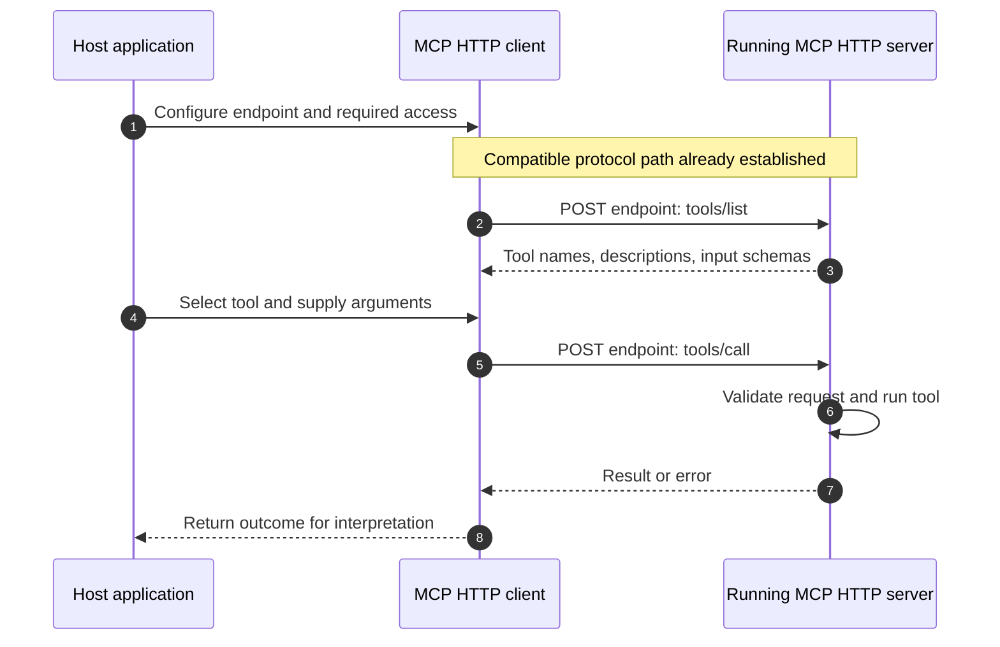
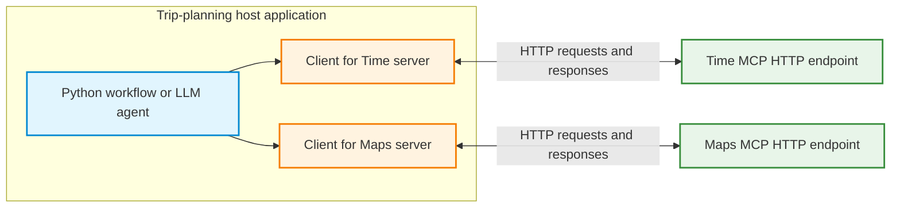
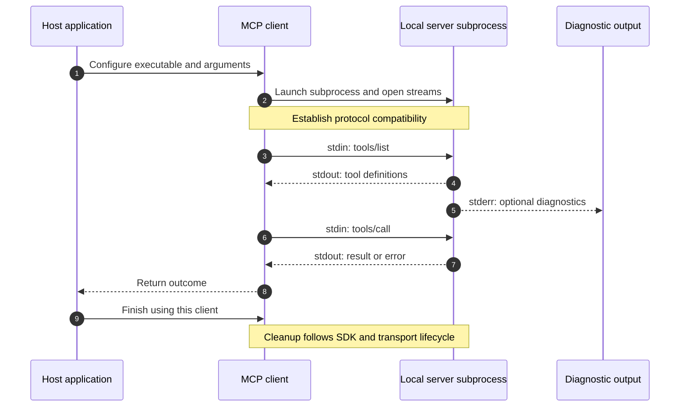
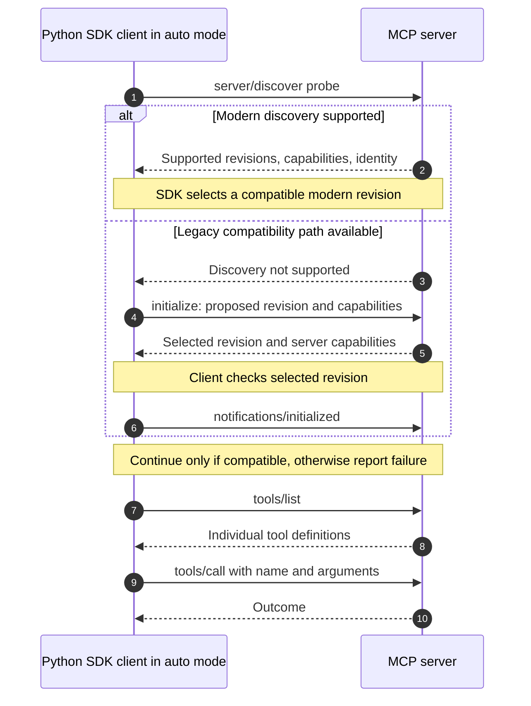

# MCP Client–Server Communication: HTTP, Multiple Servers, and stdio

**Learning objective:** Explain how an application discovers and uses MCP capabilities over HTTP or stdio, coordinates multiple servers, and establishes protocol compatibility.

**Starting knowledge:** Basic Python functions, requests and responses, and JSON. No language model or framework is required to understand the communication shown here.

## 1. Begin with HTTP: who communicates with whom?

The **Model Context Protocol (MCP)** defines messages through which applications access server-provided capabilities. Three roles are involved:

| Role | Responsibility | Example |
|---|---|---|
| **Host application** | Coordinates the workflow, context, and permissions | A trip-planning application |
| **MCP client** | Sends protocol messages and handles responses | The host's client for a Time server |
| **MCP server** | Advertises capabilities and implements their behavior | A service that calculates time-zone information |

A **transport** carries those messages. With **Streamable HTTP**, the client targets an MCP endpoint such as `https://example.com/mcp`. The server is started independently; connecting to its URL does not launch it as the client's child process. The endpoint can be on the same machine or a remote machine. The path `/mcp` is a common choice, not a required name.

The host chooses an operation explicitly in Python or lets an agent propose a tool call. The client communicates the request; the server performs the operation. MCP does not itself choose a tool or require an LLM.

### 1.1 Discover tools before invoking them

A tool has a **name**, a **description**, and an **input schema** describing accepted arguments. Listing tools retrieves those definitions. Calling a tool requests an operation with concrete values.

The diagram begins after protocol compatibility has been established; Section 4 explains that earlier step.



For example, `tools/list` might describe `get_current_time` and its `timezone` argument. A later `tools/call` could supply `Europe/Helsinki`. The list response describes the interface; only the call asks for a clock value. The name and schema must match the actual server.

### 1.2 What HTTP carries

MCP uses **JSON-RPC**, a message format with method names, parameters, and request IDs. HTTP carries these protocol messages; it does not replace them with ordinary webpage requests.

Under revision `2026-07-28`, each client message is sent by POST. A request can receive one JSON response or a request-scoped **Server-Sent Events (SSE)** response containing related notifications and a final response. SSE inside Streamable HTTP is distinct from the older HTTP+SSE transport. These rules come from the [Streamable HTTP specification](https://modelcontextprotocol.io/specification/2026-07-28/basic/transports/streamable-http).

An MCP endpoint is not an arbitrary website URL. A fetch tool can receive a webpage URL as an argument, while its MCP client still communicates with the tool server through a separate endpoint or stdio connection.

**Question:** Does a successful HTTP connection prove that a tool returned correct information?

<details>
<summary>Show answer</summary>

No. Reachability, protocol compatibility, valid arguments, tool execution, and data accuracy are separate checks. A tool may report an error over a functioning connection. Even a successful result must be interpreted against the task.

</details>

## 2. One host can coordinate multiple MCP servers

A trip planner might obtain time information from one server and maps from another. The host associates each discovered tool with its provider and routes calls accordingly. Each provider retains its own implementation and access requirements.



“One client calls several servers” can describe a library's convenience wrapper. At the communication level, the host still maintains distinct logical relationships with the providers. A tool catalog should retain server identity, for example through prefixes or an explicit registry, because different servers can publish the same tool name. The [Python SDK's session-group documentation](https://py.sdk.modelcontextprotocol.io/client/session-groups/) describes one multi-server implementation.

The workflow is:

1. Configure each endpoint and its access requirements.
2. Establish compatibility separately with each server.
3. Discover supported tools and retain their provider identities.
4. Select an appropriate tool and send its arguments to that provider.
5. Check each outcome and combine relevant results in the host.

One unavailable provider does not establish that every provider failed. Likewise, a common request method does not make tool arguments, data, or permissions identical.

**Question:** Does adding a Maps server require copying its routing implementation into the host?

<details>
<summary>Show answer</summary>

No. The host needs configuration, compatible client support, discovered contracts, and application logic for selecting and interpreting the tools. The routing implementation remains behind the server boundary. MCP standardizes access without eliminating integration and permission decisions.

</details>

## 3. Use stdio when the server is a local subprocess

HTTP is not the only transport. With **stdio**, the client launches a local server program and exchanges messages through its standard streams. No MCP HTTP endpoint or listening port is needed for this arrangement.

| Stream | Direction and purpose |
|---|---|
| Server `stdin` | Client writes MCP messages; server reads them |
| Server `stdout` | Server writes MCP messages; client reads them |
| Server `stderr` | Server diagnostics; separate from the protocol channel |

The [stdio specification](https://modelcontextprotocol.io/specification/2026-07-28/basic/transports/stdio) defines newline-delimited JSON-RPC messages. Ordinary logging belongs on stderr; arbitrary text on the protocol stdout channel can break message decoding. Diagnostic output alone does not establish that a tool failed.



The server can still use the network internally. For example, a local weather server can receive an MCP request through stdin and then contact a weather API through HTTPS. “Local MCP transport” therefore does not mean “offline operation.”

### 3.1 Configure a stdio client in Python

The following complete client script uses the Python MCP SDK v2 interface and the existing Time reference server. Install its client dependencies with:

```bash
python -m pip install "mcp>=2,<3" uv
```

Save the code as `inspect_time_client.py`, then run `python inspect_time_client.py`. The first `uvx` launch may download the server and its dependencies. The SDK handles protocol messages; no manual JSON-RPC serialization is needed.

```python
import asyncio
import shutil

from mcp import Client, StdioServerParameters


async def main():
    uvx = shutil.which("uvx")
    if uvx is None:
        raise RuntimeError("Install uv and ensure uvx is on PATH.")

    server = StdioServerParameters(
        command=uvx,
        args=["mcp-server-time"],
    )
    async with Client(server, mode="auto") as client:
        print("Selected protocol:", client.protocol_version)
        listed = await client.list_tools()
        print("First page of tools:", [tool.name for tool in listed.tools])
        print("More pages:", listed.next_cursor is not None)
        result = await client.call_tool(
            "get_current_time", {"timezone": "Europe/Helsinki"}
        )
        print("Tool error flag:", result.is_error)
        print("Content:", result.content)


if __name__ == "__main__":
    asyncio.run(main())
```

The launch parameters do not start the server when constructed. Entering the client context opens communication; operations take place inside it. In a notebook, define the imports and `main` function, then run `await main()` instead of the script's final `asyncio.run(main())` block. The [SDK transport guide](https://py.sdk.modelcontextprotocol.io/client/transports/) explains URL-based and subprocess-based client construction.

For an already running HTTP server, the same SDK operations can instead run inside `async with Client(endpoint, mode="auto") as client:`, where `endpoint` is its reachable MCP URL. Endpoint creation, deployment, and any required authentication must already be configured. An HTTP server is not created by that client statement.

**Question:** Does closing a client mean that the same server process and its state will always be destroyed?

<details>
<summary>Show answer</summary>

No universal lifecycle rule applies to every SDK wrapper. Process cleanup and reuse depend on the implementation. A remote HTTP server normally continues independently of one client's use. Some stdio wrappers can reuse subprocesses. State in process memory disappears when that process ends; database-backed state can survive it. Check the chosen library's lifecycle contract.

</details>

## 4. Establish protocol compatibility before using capabilities

A transport answers **how messages travel**. A protocol revision answers **which message rules apply**. A tool schema answers **which arguments one operation accepts**. Matching any one of these does not establish the others.

There are two compatibility models:

- **Handshake-era revisions through `2025-11-25`:** the client sends `initialize`, receives the selected revision and server capabilities, and sends `notifications/initialized`. The [legacy lifecycle specification](https://modelcontextprotocol.io/specification/2025-11-25/basic/lifecycle) defines this exchange. If the selected revision is unsupported by the client, it must not continue as if compatibility were established.
- **Request-oriented revision `2026-07-28`:** requests declare protocol metadata. The server can accept or reject the declared revision. Clients may use `server/discover` first or handle an unsupported-version response and retry with a mutually supported revision. There is no mandatory initialization handshake. The [versioning specification](https://modelcontextprotocol.io/specification/2026-07-28/basic/versioning) defines these rules.

### 4.1 Automatic selection is SDK behavior

The current Python SDK's `Client(..., mode="auto")` probes with `server/discover` and can fall back to legacy initialization when the server does not support the modern path. This convenience sequence is documented in the [SDK protocol-version guide](https://py.sdk.modelcontextprotocol.io/protocol-versions/); it is not a universal requirement for every MCP client.



An authentication error, unreachable endpoint, or broken subprocess must not be interpreted automatically as proof of an old protocol. Compatibility fallback handles recognized protocol behavior, not every possible failure.

`server/discover` reports server-level information. `tools/list` returns individual tool contracts. Neither executes a tool. `client.protocol_version` reports the path selected by this SDK and should be observed rather than assumed.

**Question:** Is `server/discover` a renamed `tools/list` or a mandatory new handshake?

<details>
<summary>Show answer</summary>

Neither. Server discovery concerns supported protocol revisions, identity, and capabilities. Tool listing describes individual operations. A modern client can discover first, but the protocol also permits requests without that preliminary call. The Python SDK's automatic probe is a library choice.

</details>

## 5. Compare the older and newer protocol models

| Concern | Handshake-era model: through `2025-11-25` | Request-oriented model: `2026-07-28` |
|---|---|---|
| Initial compatibility exchange | `initialize`, response, then `notifications/initialized` | No initialization handshake; optional server discovery |
| Revision and capability context | Established during initialization | Declared through request metadata |
| HTTP behavior | Streamable HTTP could use protocol sessions and a separate GET stream | No protocol sessions or separate GET stream; POST response streams remain |
| Session identifier | `Mcp-Session-Id` could be used by stateful Streamable HTTP servers | Not the modern protocol's session mechanism |
| Tool interface | Discover tools, then call a named tool with arguments | The same conceptual distinction remains |
| Application state | Server can retain application data | Server can still retain application data |

In the newer revision, protocol metadata is carried in the JSON-RPC `_meta` fields; HTTP also has specified metadata headers. “Stateless protocol” does not mean that a server cannot maintain a database, cache, or a car's coordinates. It means that protocol interaction no longer depends on the old initialization-session mechanism. The [modern transport specification](https://modelcontextprotocol.io/specification/2026-07-28/basic/transports/streamable-http) documents the HTTP changes.

### 5.1 Keep protocol dates separate from package versions

| Identifier | Meaning |
|---|---|
| `2025-11-25` or `2026-07-28` | MCP protocol revision |
| Python package `mcp` v1 or v2 | SDK implementation release family |
| A Time server package version | Release of that server implementation |
| `stdio` or Streamable HTTP | Transport selection |

An SDK can support multiple protocol revisions. Different client and server package versions can communicate when their protocol and capability support overlap. Conversely, installing a newer package does not make every remote server support the same revision.

**Question:** Is HTTP always modern MCP and stdio always legacy MCP?

<details>
<summary>Show answer</summary>

No. Transport and revision are separate choices. Compatible implementations can use either compatibility model over HTTP or stdio. Inspect the selected protocol and server support rather than inferring the revision from the transport.

</details>

## 6. Capabilities beyond tools

The same client–server relationship can expose three different capability types:

| Capability | Purpose | Discovery | Use |
|---|---|---|---|
| **Tools** | Request an operation | `tools/list` | `tools/call` |
| **Resources** | Read data identified by a URI | `resources/list` | `resources/read` |
| **Prompts** | Retrieve reusable message templates | `prompts/list` | `prompts/get` |

A server need not support all three. Reading a resource does not automatically add it to an LLM conversation, and retrieving a prompt does not itself run a model. The host decides what to use and how to incorporate the result.

The repeatable workflow is: configure the provider, establish compatibility, discover supported capabilities, request a permitted operation, and inspect the outcome. The transport changes how messages travel; the server still owns its implementation, and the host still owns application decisions.
