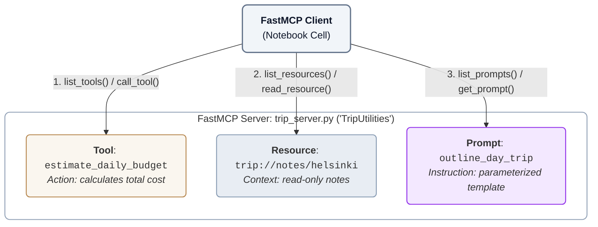

# Phase 2: Trip MCP Server and Client with FastMCP

<!-- > **Goal:** Build on the Phase 1 Math server by creating a Trip MCP server that offers **three kinds of MCP capabilities**. Use a FastMCP client to discover each capability and test it directly—before adding the official MCP SDK, LangChain, or an LLM. -->

> Each phase in this series runs in its own dedicated notebook, so execute this phase in a new colab.


## The five-phase learning journey

- Phase 1:Create an MCP **tool**, server and client with FastMCP 
- Phase 2: Extend a FastMCP server with **tools, resources and prompts** 
- Phase 3: Recreate the Trip server using the **official MCP SDK v2**; compare SDK and FastMCP clients 
- Phase 4: Connect MCP to **LangChain without an LLM** 
- Phase 5: Add a **Groq LLM** and compare agent tool use with resource/prompt chains 

**Working principle:** First make the server respond correctly to an MCP client. After that, test how LangChain consumes its capabilities. Add an LLM only at the last stage.

## What you will learn

By the end of Phase 2 you should be able to:

1. Explain how MCP **tools, resources, and prompts** differ.
2. Register all three capabilities using FastMCP decorators.
3. Launch a local server through a **stdio** MCP client.
4. Discover and **call a tool**, **read a resource**, and **render a prompt**.
5. Combine returned resource text and prompt text into a proposed LLM input **without invoking a model**.
6. Explain the limitations of illustrative notes and unverified travel information.

---

## 1. From one calculator tool to a Trip server

Phase 1 introduced one server, one tool, and one client. We keep the **same FastMCP client–server architecture**, but the new server exposes three different kinds of content:

<!-- ```text
Notebook: FastMCP client
        |
        |-- list_tools()     -> call_tool(...)
        |-- list_resources() -> read_resource(...)
        |-- list_prompts()   -> get_prompt(...)
        |
        v
trip_server.py: FastMCP("TripUtilities")
        |
        |-- TOOL:     estimate_daily_budget(days, daily_cost)
        |-- RESOURCE: trip://notes/helsinki
        `-- PROMPT:   outline_day_trip(city, focus)
``` -->



| Capability | What it provides | Example in this server | Client action |
|---|---|---|---|
| **Tool** | A callable operation with inputs and an output | Compute a total trip budget | `call_tool()` |
| **Resource** | Readable content identified by a URI | Illustrative notes about Helsinki | `read_resource()` |
| **Prompt** | A reusable template rendered with arguments | Ask for a one-day itinerary | `get_prompt()` |

**Think:** Why would you expose notes as a resource instead of a tool? Why represent an itinerary *request* as a prompt instead of a resource?

## 2. Setup

Some notebook stderr streams do not provide the file descriptor needed by a subprocess launcher. The following cell redirects diagnostics before the first MCP import. It prepares the later stdio examples; it does not start a server.

**Notebook cell 1a and 1b**

```python
import sys
sys.stderr = open("mcp_server.log", "w")
```

Install the client dependencies

```python
%pip install -q fastmcp
```

## 3. Build the FastMCP Trip server

Run the following cell to create your trip server. The client in later cells will launch this file as a subprocess.

> **Notebook usage:** `%%writefile trip_server.py` must be the **first line** in its notebook cell. It writes a Python file to disk; it does not start the server.

**Notebook cell 2: create `trip_server.py`:**


```python
%%writefile trip_server.py
from fastmcp import FastMCP

mcp = FastMCP("TripUtilities")

@mcp.tool()
def estimate_daily_budget(days: int, daily_cost: float) -> float:
    """Estimate a trip budget from duration and daily cost."""
    if days < 0 or daily_cost < 0:
        raise ValueError("Inputs must be nonnegative")
    return days * daily_cost


@mcp.resource("trip://notes/helsinki")
def helsinki_notes() -> str:
    """Return illustrative planning notes for a city visit."""
    return (
        "Illustrative trip notes (not live travel data).\n"
        "City: Helsinki\n"
        "Interests: museums, architecture, and cafés.\n"
        "Preference: walk between nearby places where practical.\n"
        "Reminder: verify opening hours, accessibility, and routes."
    )

@mcp.prompt()
def outline_day_trip(city: str, focus: str = "museums") -> str:
    """Provide a reusable request for a one-day itinerary."""
    return (
        f"Prepare a one-day itinerary for {city}, focusing on {focus}. "
        "Use verified sources for opening hours and travel times; "
        "label unverified details as uncertain."
    )

if __name__ == "__main__":
    mcp.run(transport="stdio")
```

### 3.1 Understand the tool

```python
@mcp.tool()
def estimate_daily_budget(days: int, daily_cost: float) -> float:
    ...
```

- `@mcp.tool()` registers a callable operation in the MCP server.
- The client supplies `days` and `daily_cost` as **named arguments**.
- The function rejects negative inputs and otherwise returns `days * daily_cost`.
- Unlike a calculator that accepts free-form Python expressions, this tool has a **specific, typed operation**.

For `days=5` and `daily_cost=120.0`, the expected answer is **600.0**. This is an arithmetic total based on inputs, **not a verified real-world price quote**.

### 3.2 Understand the resource

```python
@mcp.resource("trip://notes/helsinki")
def helsinki_notes() -> str:
    ...
```

- The decorator assigns the resource a **URI**: `trip://notes/helsinki`.
- The content is **illustrative**: interests in museums, architecture, and cafés; a walking preference; and a reminder to verify operating hours, accessibility and routes.
- A client **reads** the resource. The resource is not itself an action the LLM must execute.

**Question:** Is the `trip://...` URI an ordinary web URL? No—it is an identifier exposed by this MCP server, not a claim that a public website exists there.

### 3.3 Understand the prompt

```python
@mcp.prompt()
def outline_day_trip(city: str, focus: str = "museums") -> str:
    ...
```

- `@mcp.prompt()` registers a **parameterized instruction template**.
- The client chooses values for `city` and `focus`.
- The server renders a request asking for a one-day itinerary and reminds the eventual assistant to use verified sources for time-sensitive facts.
- Retrieving a prompt **does not generate the itinerary**. That will only happen when an LLM is added in Phase 5.

**Checkpoint:** Identify which server capability performs a calculation, which returns contextual facts, and which returns an instruction.

## 4. Client test A: discover and call the tool

This is the shortest first test. As in Phase 1, the client launches `trip_server.py` as a subprocess using stdio.

**Notebook Cell 3a: FastMCP tool client:**

```python
# Cell 3a
import sys
from pathlib import Path
from fastmcp import Client
from fastmcp.client.transports import StdioTransport

transport = StdioTransport(
    command=sys.executable,
    args=[str(Path("trip_server.py").resolve())]
)

client = Client(transport)

async with client:
    # Discover tools
    tools = await client.list_tools()
    print("Available tools:", [t.name for t in tools])

    # Call tool through MCP
    result = await client.call_tool(
        "estimate_daily_budget",
        {"days": 5, "daily_cost": 120.0}
    )

    print("Budget:", result.data)

    if not result.is_error:
      print(result.structured_content)
```

### What to observe

You should see the following output:

```text
Available tools: ['estimate_daily_budget']
Budget: 600.0
{'result': 600.0}
```

- `list_tools()` discovers registered tools, so the client does **not** import `estimate_daily_budget`.
- `call_tool("estimate_daily_budget", {...})` sends the call through MCP.
- `result.data` is FastMCP's convenient parsed result.
- In this example, `result.structured_content` also contains `{'result': 600.0}`.
- The calculation runs in the server process, not as a directly imported notebook function.

**Try:** Change `days` to `3` and `daily_cost` to `85.5`. Predict the result before running.

## 5. Client test B: tools, resources and prompts

Now run the more complete client from **Cell 3b**. It performs four activities, all through FastMCP:

1. Discover and invoke the **tool**.
2. Discover and read the **resource**.
3. Discover and render the **prompt**.
4. Combine resource text and prompt text into one string that a later LLM application *could* consume.

**Notebook Cell 3b: complete FastMCP client:**

```python
# Cell 3b FastMCP Client
# Discover and use tools, resources, and prompts

import sys
from pathlib import Path
from fastmcp import Client
from fastmcp.client.transports import StdioTransport

transport = StdioTransport(
    command=sys.executable,
    args=[str(Path("trip_server.py").resolve())]
)

client = Client(transport)

async with client:

    # 1. TOOLS: discover and execute
    print("=== AVAILABLE TOOLS ===")
    tools = await client.list_tools()

    for tool in tools:
        print(f"{tool.name}: {tool.description}")

    result = await client.call_tool(
        "estimate_daily_budget",
        {"days": 5, "daily_cost": 120.0}
    )
    print("Budget:", result.data)

    # 2. RESOURCES: discover and read
    print("\n=== AVAILABLE RESOURCES ===")
    resources = await client.list_resources()

    for resource in resources:
        print(f"{resource.name}: {resource.uri}")

    resource_content = await client.read_resource(
        "trip://notes/helsinki"
    )

    notes = "\n".join(
        item.text
        for item in resource_content
        if hasattr(item, "text")
    )
    print("\nResource content:\n", notes)

    # 3. PROMPTS: discover and render
    print("\n=== AVAILABLE PROMPTS ===")
    prompts = await client.list_prompts()

    for prompt in prompts:
        print(f"{prompt.name}: {prompt.description}")

    prompt_result = await client.get_prompt(
        "outline_day_trip",
        {"city": "Helsinki", "focus": "museums"}
    )

    prompt_text = "\n".join(
        msg.content.text
        for msg in prompt_result.messages
        if hasattr(msg.content, "text")
    )
    print("\nRendered prompt:\n", prompt_text)

    # 4. USE RESOURCE + PROMPT TOGETHER
    llm_input = f"""
Context:
{notes}

Task:
{prompt_text}
"""
    print("\n=== COMBINED LLM INPUT ===")
    print(llm_input)
```

### Read the code carefully

| Client call | What to expect | Data you use afterward |
|---|---|---|
| `list_tools()` | List of tools | `tool.name`, `tool.description` |
| `call_tool()` | Executed operation | `result.data` |
| `list_resources()` | List of readable resources | `resource.name`, `resource.uri` |
| `read_resource()` | Resource content blocks | Text from items with `.text` |
| `list_prompts()` | List of prompt definitions | `prompt.name`, `prompt.description` |
| `get_prompt()` | Rendered prompt messages | `msg.content.text` |

A resource and a prompt may both contain text, but their **purpose differs**: one is **context**, the other is an **instruction template**.

### Expected essential output


```text
=== AVAILABLE TOOLS ===
estimate_daily_budget: Estimate a trip budget from duration and daily cost.
Budget: 600.0

=== AVAILABLE RESOURCES ===
helsinki_notes: trip://notes/helsinki

Resource content:
Illustrative trip notes (not live travel data).
City: Helsinki
Interests: museums, architecture, and cafés.
Preference: walk between nearby places where practical.
Reminder: verify opening hours, accessibility, and routes.

=== AVAILABLE PROMPTS ===
outline_day_trip: Provide a reusable request for a one-day itinerary.

Rendered prompt:
Prepare a one-day itinerary for Helsinki, focusing on museums. Use verified sources for opening hours and travel times; label unverified details as uncertain.
```

Next, your code will print the combined string:

```text
Context:
Illustrative trip notes (not live travel data).
City: Helsinki
Interests: museums, architecture, and cafés.
Preference: walk between nearby places where practical.
Reminder: verify opening hours, accessibility, and routes.

Task:
Prepare a one-day itinerary for Helsinki, focusing on museums. Use verified sources for opening hours and travel times; label unverified details as uncertain.
```

**Crucial:** This combined string is named `llm_input` in the notebook, but **no LLM is called here**. It is only a preview of how the pieces might be assembled later.

## 6. Guided practice

### Exercise A: Tool arguments and validation

Change the budget test to `days=3`, `daily_cost=85.5` and check the result against your own calculation. Then try a negative value and observe the error. Note that Phase 2's tool **raises** `ValueError`; the exact client-side error presentation may differ from Phase 1's calculator, which returned error strings.

### Exercise B: Resource discovery

Add a client loop that prints every resource's **name** and **URI**. Explain why the client needs the URI to call `read_resource()`.

### Exercise C: Prompt rendering

Change the prompt call to:

```python
prompt_result = await client.get_prompt(
    "outline_day_trip",
    {"city": "Turku", "focus": "architecture"}
)
```

**Predict:** Which words in the resulting request change? Which safety reminder remains the same?

<details>
<summary><b>Sample Solution</b></summary>

```python
import sys
from pathlib import Path
from fastmcp import Client
from fastmcp.client.transports import StdioTransport

transport = StdioTransport(
    command=sys.executable,
    args=[str(Path("trip_server.py").resolve())]
)

client = Client(transport)

async with client:

  prompt_result = await client.get_prompt(
    "outline_day_trip",
    {"city": "Turku", "focus": "architecture"}
  )
  prompt_text = "\n".join(
    msg.content.text
    for msg in prompt_result.messages
    if hasattr(msg.content, "text")
  )
  print("\nRendered prompt:\n", prompt_text)
```
</details>

### Exercise D: Context versus instructions

Look at `llm_input`. Underline the **context** and circle the **task**. Then explain why the notes should be treated as illustrative rather than a source of current opening hours or travel times.

### Exercise E: Architecture explanation

In two or three sentences each, answer:

1. What makes `estimate_daily_budget` different from `helsinki_notes`?
2. What is the difference between `get_prompt()` and asking an LLM to generate text?
3. What does `async with client:` manage?
4. Why does the notebook not need to run `python trip_server.py` in a separate cell?
5. If the resource notes change on the server, what must the client do to get updated content?

## 7. Troubleshooting

| Symptom | Check |
|---|---|
| `ModuleNotFoundError: fastmcp` | Install FastMCP in the notebook's environment |
| `trip_server.py` not found | Run the `%%writefile` cell; confirm your working directory |
| `SyntaxError` near `%%writefile` | Put `%%writefile` at the **very top** of its cell |
| Client hangs or disconnects | Verify stdio transport, Python interpreter and server startup; avoid protocol-breaking stdout prints |
| Tool appears, but resource does not | Check `@mcp.resource(...)` and recreate the server subprocess |
| Prompt is not found | Check `@mcp.prompt()` and prompt name `outline_day_trip` |
| Negative budget raises an error | That is intended input validation; try nonnegative arguments |
| The output shows a prompt but no itinerary | Expected: there is no LLM in this phase |

<!-- ## 8. Exit ticket

Submit:

- The three capability names shown by your client: tool, resource URI, and prompt.
- The result of `estimate_daily_budget(days=5, daily_cost=120.0)`.
- A short excerpt of the Helsinki resource text.
- The rendered request for a **different city or focus**.
- A paragraph explaining **why `llm_input` is not an LLM response**. -->

---

## 8. Next: Phase 3: same capabilities, different server library

In Phase 3, the Trip server keeps the same MCP names and behavior, but changes its implementation to:

```python
from mcp.server import MCPServer
```

You will then test **the same server** using:

- The official MCP SDK v2 client; and
- The standalone FastMCP client.

**Main question:** Do the client and server need to come from the same library? No. They need compatible **MCP protocol and transport support**, even if the Python APIs expose returned data differently.

## References

- [FastMCP documentation](https://gofastmcp.com/)
- [Model Context Protocol introduction](https://modelcontextprotocol.io/introduction)
- [Official MCP Python SDK v2](https://py.sdk.modelcontextprotocol.io/v2/)

**Main takeaway:** MCP has three complementary building blocks: **invoke a tool**, **read a resource**, and **render a prompt**. Test each one directly before introducing an LLM.
