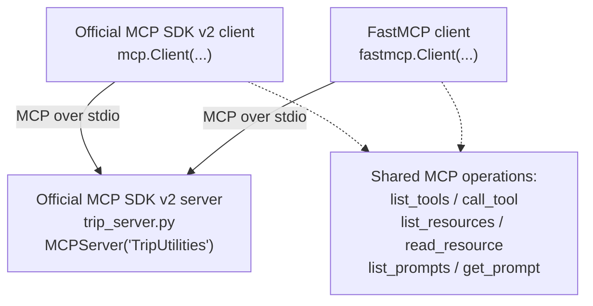

# Phase 3: Trip MCP Server with the Official SDK and Two Client Libraries


> **Goal:** Implement the Trip MCP server with the **official MCP Python SDK v2**, then access that same server using **two different client libraries**. Observe what stays the same at the MCP protocol level and what changes in the Python APIs.
> 
> Each phase in this series runs in its own dedicated notebook, so execute this phase in a new colab.


## The five-phase learning journey

- Phase 1:Create an MCP **tool**, server and client with FastMCP 
- Phase 2: Extend a FastMCP server with **tools, resources and prompts** 
- Phase 3: Recreate the Trip server using the **official MCP SDK v2**; compare SDK and FastMCP clients 
- Phase 4: Connect MCP to **LangChain without an LLM** 
- Phase 5: Add a **Groq LLM** and compare agent tool use with resource/prompt chains 


## What you will learn

By the end of Phase 3 you should be able to:

1. Create an MCP server using `MCPServer` from the official SDK.
2. Register the same tool, resource and prompt introduced in Phase 2.
3. Test all three using an **official MCP SDK v2 client**.
4. Test the **same server** again using a **FastMCP client**.
5. Identify which concepts and operation names are shared across clients, and where their return objects differ.
6. Explain why client and server libraries do **not** need to match, provided their MCP versions and transports are compatible.

---

## 1. Same MCP behavior, two clients

The protocol-level operations from Phase 2 have not changed:



Both clients can talk to an MCP server without importing its business functions directly. The standard MCP concepts are **tools, resources, prompts and transports**.

**Important naming distinction:**

- `from mcp.server import MCPServer` is the **official MCP SDK v2** server class used here.
- `from mcp import Client` is its **official SDK v2 client**.
- `from fastmcp import Client` comes from the **standalone FastMCP package**.
- Older MCP SDK v1 materials may show `mcp.server.fastmcp.FastMCP`; that is a different API path and is **not the server code used in this phase**.

## 2. Setup and working-directory caution


Some notebook stderr streams do not provide the file descriptor needed by a subprocess launcher. The following cell redirects diagnostics before the first MCP import. It prepares the later stdio examples; it does not start a server.

**Notebook Cell 1a**

```python
import sys
sys.stderr = open("mcp_server.log", "w")
```

Install the client dependencies

**Notebook Cell 1b**

```python
%pip install -q fastmcp mcp
```

<!-- If you see stderr redirection in early setup cells, treat it as an optional diagnostics workaround, not part of MCP's core protocol. For straightforward local learning, visible error output is often easier to debug. -->

**Working-directory caution:** Phase 2 and Phase 3 both write to **`trip_server.py`**. This phase intentionally replaces the FastMCP implementation with an official-SDK implementation. Use separate working directories if you want to keep both files available simultaneously; otherwise rerun the appropriate `%%writefile` cell before testing.

## 3. Build the official MCP SDK v2 server

The server still exposes exactly the same three capabilities as in Phase 2:

| Capability | Name or URI | What it does |
|---|---|---|
| Tool | `estimate_daily_budget` | Computes `days * daily_cost` for nonnegative inputs |
| Resource | `trip://notes/helsinki` | Returns illustrative Helsinki visit notes |
| Prompt | `outline_day_trip` | Renders a one-day itinerary request using `city` and `focus` |

> **Notebook usage:** `%%writefile trip_server.py` must be the **first line** of its notebook cell. It writes the file; the client will start the server subprocess later.

**Notebook Cell 2: official SDK server:**

```python
%%writefile trip_server.py

from mcp.server import MCPServer

mcp = MCPServer("TripUtilities")

@mcp.tool()
def estimate_daily_budget(
    days: int, daily_cost: float
) -> float:
    if days < 0 or daily_cost < 0:
        raise ValueError("Inputs must be nonnegative")
    return days * daily_cost

@mcp.resource("trip://notes/helsinki")
def helsinki_notes() -> str:
    """Return illustrative planning notes for a city visit."""
    return (
        "Illustrative trip notes (not live travel data).\n"
        "City: Helsinki\n"
        "Interests: museums, architecture, and cafés.\n"
        "Preference: walk between nearby places where practical.\n"
        "Reminder: verify opening hours, accessibility, and routes."
    )

@mcp.prompt()
def outline_day_trip(city: str, focus: str = "museums") -> str:
    """Provide a reusable request for a one-day itinerary."""
    return (
        f"Prepare a one-day itinerary for {city}, focusing on {focus}. "
        "Use verified sources for opening hours and travel times; "
        "label unverified details as uncertain."
    )

if __name__ == "__main__":
    mcp.run(transport="stdio")
```

### What changed from Phase 2?

| Feature | Phase 2: standalone FastMCP | Phase 3: official SDK v2 |
|---|---|---|
| Server import | `from fastmcp import FastMCP` | `from mcp.server import MCPServer` |
| Server creation | `FastMCP("TripUtilities")` | `MCPServer("TripUtilities")` |
| Tool decorator | `@mcp.tool()` | `@mcp.tool()` |
| Resource decorator | `@mcp.resource(...)` | `@mcp.resource(...)` |
| Prompt decorator | `@mcp.prompt()` | `@mcp.prompt()` |
| Server transport | `mcp.run(transport="stdio")` | `mcp.run(transport="stdio")` |

For this **small server**, the high-level server code is intentionally very similar.

Notice that the estimate_daily_budget function below intentionally omits a docstring. When you discover this tool via the client, pay attention to the description field—without a docstring, the description will be blank. In Exercise B, you will restore it to see how documentation drives tool discoverability.

## 4. Test with the official MCP SDK v2 client

The official client uses `StdioServerParameters` to describe how to start the server. `mcp.Client` handles the connection lifecycle.

**Notebook Cell 3: official SDK client:**

```python
# Cell 3: Official MCP SDK Client
# Discover and use tools, resources, and prompts

import sys
from pathlib import Path
from mcp import Client, StdioServerParameters

TRIP_CONTEXT_SERVER = StdioServerParameters(
    command=sys.executable,
    args=[str(Path("trip_server.py").resolve())],
)

async with Client(TRIP_CONTEXT_SERVER) as client:

    print("Server:", client.server_info)

    # 1. TOOLS: discover and execute
    print("\n=== AVAILABLE TOOLS ===")
    tools_result = await client.list_tools()

    for tool in tools_result.tools:
        print(f"{tool.name}: {tool.description}")

    result = await client.call_tool(
        "estimate_daily_budget",
        {"days": 5, "daily_cost": 120.0}
    )

    if result.is_error:
        print("Tool error:", result.content)
    else:
        print("Budget:", result.structured_content)

    # 2. RESOURCES: discover and read
    print("\n=== AVAILABLE RESOURCES ===")
    resources_result = await client.list_resources()

    for resource in resources_result.resources:
        print(f"{resource.name}: {resource.uri}")

    resource_result = await client.read_resource(
        "trip://notes/helsinki"
    )

    notes = "\n".join(
        item.text
        for item in resource_result.contents
        if hasattr(item, "text")
    )
    print("\nResource content:\n", notes)

    # 3. PROMPTS: discover and render
    print("\n=== AVAILABLE PROMPTS ===")
    prompts_result = await client.list_prompts()

    for prompt in prompts_result.prompts:
        print(f"{prompt.name}: {prompt.description}")

    prompt_result = await client.get_prompt(
        "outline_day_trip",
        {"city": "Helsinki", "focus": "museums"}
    )

    prompt_text = "\n".join(
        msg.content.text
        for msg in prompt_result.messages
        if hasattr(msg.content, "text")
    )
    print("\nRendered prompt:\n", prompt_text)

    # 4. USE RESOURCE + PROMPT TOGETHER
    llm_input = f"""
Context:
{notes}

Task:
{prompt_text}
"""
    print("\n=== COMBINED LLM INPUT ===")
    print(llm_input)
```

### Understand the SDK response objects

| SDK call | SDK result | How the notebook accesses it |
|---|---|---|
| `list_tools()` | A `ListToolsResult` | `tools_result.tools` |
| `call_tool()` | MCP tool result | `result.is_error`, `result.structured_content` |
| `list_resources()` | A `ListResourcesResult` | `resources_result.resources` |
| `read_resource()` | A resource result | `resource_result.contents` |
| `list_prompts()` | A `ListPromptsResult` | `prompts_result.prompts` |
| `get_prompt()` | Rendered prompt result | `prompt_result.messages` |

**Read this carefully:** Both libraries have `list_tools()`, but the official SDK returns a result object whose tool list is in `.tools`. We must respect the API of the **client library we imported**, even if the underlying MCP operation is the same.

### Expected output:

```text
Server: name='TripUtilities' ...

=== AVAILABLE TOOLS ===
estimate_daily_budget:
Budget: {'result': 600.0}

=== AVAILABLE RESOURCES ===
helsinki_notes: trip://notes/helsinki

Resource content:
Illustrative trip notes (not live travel data).
City: Helsinki
Interests: museums, architecture, and cafés.
Preference: walk between nearby places where practical.
Reminder: verify opening hours, accessibility, and routes.

=== AVAILABLE PROMPTS ===
outline_day_trip: Provide a reusable request for a one-day itinerary.

Rendered prompt:
Prepare a one-day itinerary for Helsinki, focusing on museums. Use verified sources for opening hours and travel times; label unverified details as uncertain.
```

The official client also prints `llm_input`, a **combined context-plus-task string**. No LLM is actually called in Phase 3.

## 5. Test the same server with a FastMCP client

We do **not** rewrite the server. We only change the **client**.

**Notebook Cell 4: FastMCP client:**

```python
# Cell 4: FastMCP Client
# Discover and use tools, resources, and prompts

import sys
from pathlib import Path
from fastmcp import Client
from fastmcp.client.transports import StdioTransport

transport = StdioTransport(
    command=sys.executable,
    args=[str(Path("trip_server.py").resolve())]
)

client = Client(transport)

async with client:

    # 1. TOOLS: discover and execute
    print("=== AVAILABLE TOOLS ===")
    tools = await client.list_tools()

    for tool in tools:
        print(f"{tool.name}: {tool.description}")

    result = await client.call_tool(
        "estimate_daily_budget",
        {"days": 5, "daily_cost": 120.0}
    )
    print("Budget:", result.data)

    # 2. RESOURCES: discover and read
    print("\n=== AVAILABLE RESOURCES ===")
    resources = await client.list_resources()

    for resource in resources:
        print(f"{resource.name}: {resource.uri}")

    resource_content = await client.read_resource(
        "trip://notes/helsinki"
    )

    notes = "\n".join(
        item.text
        for item in resource_content
        if hasattr(item, "text")
    )
    print("\nResource content:\n", notes)

    # 3. PROMPTS: discover and render
    print("\n=== AVAILABLE PROMPTS ===")
    prompts = await client.list_prompts()

    for prompt in prompts:
        print(f"{prompt.name}: {prompt.description}")

    prompt_result = await client.get_prompt(
        "outline_day_trip",
        {"city": "Helsinki", "focus": "museums"}
    )

    prompt_text = "\n".join(
        msg.content.text
        for msg in prompt_result.messages
        if hasattr(msg.content, "text")
    )
    print("\nRendered prompt:\n", prompt_text)

    # 4. USE RESOURCE + PROMPT TOGETHER
    llm_input = f"""
Context:
{notes}

Task:
{prompt_text}
"""
    print("\n=== COMBINED LLM INPUT ===")
    print(llm_input)
```

### Compare the FastMCP response objects

| FastMCP call | FastMCP result in notebook | How to access it |
|---|---|---|
| `list_tools()` | Direct list of tool definitions | `tools` |
| `call_tool()` | Tool result with parsed data | `result.data` |
| `list_resources()` | Direct list of resources | `resources` |
| `read_resource()` | Resource content blocks | `resource_content` |
| `list_prompts()` | Direct list of prompt definitions | `prompts` |
| `get_prompt()` | Rendered prompt messages | `prompt_result.messages` |

When you run the FastMCP client against the official SDK server, you will see output structured like this::

```text
=== AVAILABLE TOOLS ===
estimate_daily_budget:
Budget: estimate_daily_budgetOutput(result=600.0)
```

**Why does it differ from Phase 2?** FastMCP's parsed `result.data` for this **official SDK-produced structured tool result** is shown as a typed output object, rather than a bare `600.0`. The exact Python representation depends on the response structure and library versions; do **not** assume every `result.data` is a scalar.

The FastMCP client still reads the **same Helsinki notes** and renders the **same itinerary request** as the official SDK client. The underlying MCP server has not changed.

## 6. Compare the clients side by side

| Question | Official MCP SDK v2 | Standalone FastMCP |
|---|---|---|
| Client import | `from mcp import Client` | `from fastmcp import Client` |
| Configure local stdio server | `StdioServerParameters(...)` | `StdioTransport(...)` |
| Open client | `async with Client(params)` | `async with Client(transport)` |
| List tool names | `[t.name for t in result.tools]` | `[t.name for t in tools]` |
| Call tool | `client.call_tool(name, args)` | `client.call_tool(name, args)` |
| Read tool output | `result.structured_content` | `result.data` (or structured content) |
| Read resources | `read_resource(uri)` | `read_resource(uri)` |
| Fetch prompts | `get_prompt(name, args)` | `get_prompt(name, args)` |

The important distinction is **protocol interoperability versus Python API interchangeability**:

- **Interoperability:** Both clients can communicate with the same official SDK server over MCP/stdio.
- **API details:** Client configuration, result wrappers, parsing conveniences and error behavior may differ.
- **Testing practice:** Verify the server with a client before integrating an LLM; you can choose either client library for the test.

**Think:** If the server is official SDK code, does it require an official SDK client? **No.** It requires a compatible MCP client.

## 7. Guided practice

### Exercise A: Verify identical behavior

Run both clients with `days=5` and `daily_cost=120.0`. Show how each reports the same underlying total (**600.0**) despite a different Python object representation.

### Exercise B: Improve tool discovery

Add the following docstring to the server's budget function:

```python
"""Estimate the total trip budget from a number of days and daily cost."""
```

Rerun the `%%writefile` cell and reconnect both clients. Does the description now appear in their tool listings?

### Exercise C: Change prompt arguments

In both clients, request:

```python
{"city": "Tampere", "focus": "architecture"}
```

**Question:** Does changing the prompt argument alter the fixed Helsinki resource notes? Why not?

### Exercise D: Inspect the tool schema

Inspect `tool.input_schema` or print the tool object. Identify the fields that describe the expected `days` and `daily_cost` arguments. Compare the client-displayed schema with the server's Python type hints.

### Exercise E: Sketch the architecture

Draw **one server** receiving MCP requests from **two clients**, then label where the protocol is shared and where the Python library APIs differ.

### Exercise F: Before LangChain

Explain why Phase 3 should succeed before starting Phase 4. What can a working MCP client test tell you if a later LangChain conversion fails?

## 8. Troubleshooting

| Symptom | Check |
|---|---|
| `ModuleNotFoundError: mcp` or `fastmcp` | Install both packages in the environment used for the notebook and subprocess |
| `MCPServer` import fails | Confirm you are running an official MCP SDK version that supplies the v2 API shown in the notebook |
| `trip_server.py` contains FastMCP code | Another phase overwrote the file; rerun this phase's `%%writefile` cell |
| Client connection fails | Check `sys.executable`, absolute server path and stdio transport |
| `list_tools()` gives an unexpected shape | Check whether the imported `Client` is from `mcp` or `fastmcp` |
| Budget output isn't a float | Structured results may be dicts or typed objects; inspect fields instead of assuming a scalar |
| Tool description appears blank | The Phase 3 function has no docstring |
| Prompt prints but no itinerary appears | Normal: Phase 3 has **no LLM** |

<!-- ## 9. Exit ticket

Submit:

- A short snippet showing the official SDK server's **three registered capabilities**.
- A screenshot or copied output from **each client** listing tool, resource and prompt.
- The budget calculation from both clients, with one sentence about the **different result representations**.
- A short comparison of `tools_result.tools` versus `tools`.
- One paragraph answering: **Why can a FastMCP client connect to an official MCP SDK server?** -->

---

## 9. Next: Phase 4: add LangChain, but not an LLM

Now that MCP works with both clients, you will integrate its capabilities with LangChain:

- **Tool:** Use `langchain.mcp.MCPAdapter` to convert MCP tools into LangChain tools that can be invoked directly.
- **Resource:** Use the official SDK client to read the Helsinki notes and place the text in a LangChain `Document`.
- **Prompt:** Use the official SDK client to retrieve the rendered itinerary request and convert its messages to a LangChain `ChatPromptTemplate`.

**Why do this without an LLM first?** To isolate MCP communication and LangChain object conversion from any model-driven tool selection or text generation. Phase 5 then adds a Groq model to use the results.

## References

- [Official MCP Python SDK v2](https://py.sdk.modelcontextprotocol.io/v2/)
- [FastMCP documentation](https://gofastmcp.com/)
- [LangChain MCP integration](https://docs.langchain.com/oss/python/langchain/mcp)

**Main takeaway:** **The server and client do not need to use the same Python library.** They need compatible MCP protocol and transport support, and client code must handle the API of its chosen library.
