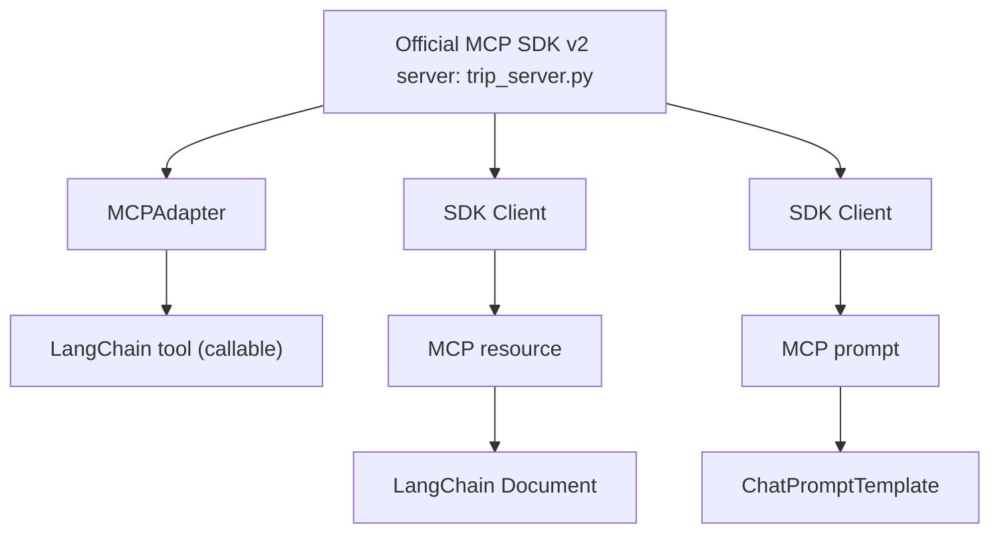

#  Phase 4: Trip MCP Server with LangChain, Without an LLM


> **Goal:** Keep the Trip MCP server from Phase 3 and integrate its three capabilities into LangChain. First test an executable **LangChain tool**, then represent an MCP **resource** as a LangChain `Document`, and finally represent an MCP **prompt** as a LangChain `ChatPromptTemplate`. Do all this before connecting any language model.
> 
> Each phase in this series runs in its own dedicated notebook, so execute this phase in a new colab.


## The five-phase learning journey

- Phase 1:Create an MCP **tool**, server and client with FastMCP 
- Phase 2: Extend a FastMCP server with **tools, resources and prompts** 
- Phase 3: Recreate the Trip server using the **official MCP SDK v2**; compare SDK and FastMCP clients 
- Phase 4: Connect MCP to **LangChain without an LLM** 
- Phase 5: Add a **Groq LLM** and compare agent tool use with resource/prompt chains 

<!-- **Learning strategy:** Do not introduce an LLM until you can verify each server capability and its LangChain representation independently. -->

## What you will learn

By the end of Phase 4, you should be able to:

1. Explain why LangChain integration is a **separate testing step** between MCP and an LLM.
2. Use `MCPAdapter` to discover MCP tools as LangChain-compatible tools.
3. Invoke the budget tool using LangChain's `.ainvoke()` rather than through a model.
4. Use the official MCP SDK client to retrieve resource text and create a LangChain `Document`.
5. Retrieve an MCP prompt with arguments and turn the returned messages into a LangChain `ChatPromptTemplate`.
6. Explain why these three adaptations do **not** all work in the same way.

**Prerequisite:** Complete Phase 3 or be comfortable with an MCP server exposing `estimate_daily_budget`, `trip://notes/helsinki`, and `outline_day_trip`.

## 1. The idea: adapt, then test, then add an LLM

MCP standardizes how clients request **tools**, **resources**, and **prompts** from servers. LangChain provides objects for building applications with these capabilities, but the mapping is not identical:

| Server capability | How this notebook gets it | LangChain representation | What you test |
|---|---|---|---|
| Tool `estimate_daily_budget` | `MCPAdapter.list_tools()` | `StructuredTool` | Call `.ainvoke()` with known inputs |
| Resource `trip://notes/helsinki` | SDK `Client.list_resources()` and `read_resource()` | `Document` | Inspect `page_content` and `metadata` |
| Prompt `outline_day_trip` | SDK `Client.list_prompts()` and `get_prompt()` | `ChatPromptTemplate` | Inspect the rendered messages |

**Architecture for the three tests:**



Tools remain **callable** through the adapter while the connection is active. In this notebook, a `Document` and a rendered prompt are **snapshots** of content that the application fetched. They are not automatically live MCP calls.

No LLM runs in this phase. That makes it easier to distinguish an MCP or LangChain integration error from a future model error.

## 2. Setup: notebook cells 1a–1c


**Cell 1a: diagnostic stderr redirection:**


```python
# Cell 1a
import sys
sys.stderr = open("mcp_server.log", "w")
```

<!-- 
**Cell 1c** contains commented-out alternative diagnostic code; it is not executed. 

```python
# Cell 1b
##import sys

##MCP_DIAGNOSTIC_LOG = open("mcp_server.log", "w", encoding="utf-8")
##sys.stderr = MCP_DIAGNOSTIC_LOG
##print("MCP server diagnostics will be written to mcp_server.log")
``` 
-->

Redirecting global `sys.stderr` is a notebook-specific workaround, **not a requirement of MCP or LangChain**. It can hide useful errors from the notebook output.


**Cell 1b: install dependencies (notebook shell syntax):**


```python
# Cell 1c
%pip install -q mcp "langchain[mcp]>=1.4.0,<2"
```

Make sure to install the compatible package versions specified in the command below. 

Keep `trip_server.py` in your current working directory. **Caution:** Phases 2–5 may all write a file with this name. Run each lab in its own folder or intentionally overwrite the file with the correct version before proceeding.

## 3. Write the MCP server (Cell 2)

This is the **same official SDK v2 server** introduced in Phase 3. Keep the capabilities fixed so that the only new topic is LangChain integration.

**Run the following as one notebook cell.** The `%%writefile` magic must appear on the first line of that cell, not after a `# Cell 2` comment.


```python
%%writefile trip_server.py

from mcp.server import MCPServer

mcp = MCPServer("TripUtilities")

@mcp.tool()
def estimate_daily_budget(
    days: int, daily_cost: float
) -> float:
    """Estimate a trip budget from duration and daily cost."""
    if days < 0 or daily_cost < 0:
        raise ValueError("Inputs must be nonnegative")
    return days * daily_cost

@mcp.resource("trip://notes/helsinki")
def helsinki_notes() -> str:
    """Return illustrative planning notes for a city visit."""
    return (
        "Illustrative trip notes (not live travel data).\n"
        "City: Helsinki\n"
        "Interests: museums, architecture, and cafés.\n"
        "Preference: walk between nearby places where practical.\n"
        "Reminder: verify opening hours, accessibility, and routes."
    )

@mcp.prompt()
def outline_day_trip(city: str, focus: str = "museums") -> str:
    """Provide a reusable request for a one-day itinerary."""
    return (
        f"Prepare a one-day itinerary for {city}, focusing on {focus}. "
        "Use verified sources for opening hours and travel times; "
        "label unverified details as uncertain."
    )

if __name__ == "__main__":
    mcp.run(transport="stdio")
```
### Check the server's three capabilities

- `@mcp.tool()` registers **`estimate_daily_budget(days, daily_cost)`**, with validation rejecting negative values. For 5 days at 120 per day, the computation is `600.0`.
- `@mcp.resource("trip://notes/helsinki")` publishes **illustrative** Helsinki notes. These are not live facts or verified opening hours.
- `@mcp.prompt()` registers **`outline_day_trip(city, focus="museums")`**, a reusable request template.
- `mcp.run(transport="stdio")` starts a server using standard input/output. The client starts this subprocess; there is no separate HTTP address in this lab.

**Checkpoint:** Confirm that the cell reports `Writing trip_server.py` (or `Overwriting trip_server.py`) and that the server file exists.

## 4. Test A: MCP tool → LangChain tool (Cell 3)

Use MCPAdapter as your MCP client and tool adapter. You do not need a separate SDK client for this tool test.


```python
# Cell 3: Convert Trip MCP tools to LangChain tools
# No LLM required

import json
from pathlib import Path
from langchain.mcp import MCPAdapter

async with MCPAdapter(Path("trip_server.py").resolve()) as adapter:

    # Discover and convert MCP tools
    trip_tools = await adapter.list_tools()

    print("=== LANGCHAIN TOOLS ===")

    for tool in trip_tools:
        print("\nNAME:", tool.name)
        print("DESCRIPTION:", tool.description)
        print("ARGUMENTS:")
        print(json.dumps(tool.args, indent=2, ensure_ascii=False))
        print("TOOL CLASS:", type(tool).__name__)

    # Test the LangChain tool without an LLM
    budget_tool = next(
        t for t in trip_tools
        if t.name == "estimate_daily_budget"
    )

    result = await budget_tool.ainvoke({
        "days": 5,
        "daily_cost": 120.0
    })

    print("\nBUDGET RESULT:", result)
```
### Read the code carefully

1. `Path("trip_server.py").resolve()` identifies the server process to launch.
2. `async with MCPAdapter(...)` manages the MCP connection and its cleanup.
3. `adapter.list_tools()` discovers MCP tools and **converts** them to LangChain tools.
4. `tool.args` displays the arguments inferred from the MCP tool schema; the notebook prints their names and types.
5. `.ainvoke({"days": 5, "daily_cost": 120.0})` invokes a LangChain tool **directly**. No LLM selects the tool or invents arguments.

**Expected output:** `estimate_daily_budget` is listed as a `StructuredTool`, with `days` of type `integer` and `daily_cost` of type `number`. The budget result contains a text block carrying **`600.0`**. The response is not necessarily a bare float—it is represented as LangChain tool content, and generated content IDs can change between runs.

**Connection-lifecycle rule:** Invoke the adapted tool **inside** the active `async with MCPAdapter(...)` block. Later, an agent using that tool must also run while the adapter connection is available.

## 5. Test B: MCP resource → LangChain Document (Cell 4)

For this exercise, the notebook uses the **official MCP SDK v2** client. We retrieve text from the server and explicitly wrap it in a LangChain `Document`—this is not done by `MCPAdapter.list_tools()`.


```python
# Cell 4:  MCP resources with LangChain
# Unlike MCP tools, which the LangChain adapter converts automatically,
# here we explicitly retrieve MCP resource content and wrap it in a LangChain Document.

import sys
from pathlib import Path

from mcp import Client, StdioServerParameters
from mcp.types import TextResourceContents
from langchain_core.documents import Document

TRIP_CONFIG = StdioServerParameters(
    command=sys.executable,
    args=[str(Path("trip_server.py").resolve())]
)

async with Client(TRIP_CONFIG) as client:

    # 1. Discover MCP resources
    resources = await client.list_resources()

    print("=== AVAILABLE RESOURCES ===")
    for resource in resources.resources:
        print("NAME:", resource.name)
        print("URI:", resource.uri)

    # 2. Read and convert to LangChain Documents
    trip_documents = []

    for resource in resources.resources:
        result = await client.read_resource(str(resource.uri))

        for content in result.contents:
            if isinstance(content, TextResourceContents):
                doc = Document(
                    page_content=content.text,
                    metadata={"source": str(resource.uri)}
                )
                trip_documents.append(doc)

    # 3. Inspect LangChain Documents
    print("\n=== LANGCHAIN DOCUMENTS ===")

    for doc in trip_documents:
        print("CLASS:", type(doc).__name__)
        print("SOURCE:", doc.metadata["source"])
        print("CONTENT:\n", doc.page_content)
```
### Read the code carefully

- `StdioServerParameters` tells the client to run the local server with the **same Python interpreter** as the notebook.
- `Client(TRIP_CONFIG)` makes a direct SDK client connection to the server.
- `list_resources()` discovers the available resource URIs.
- `read_resource(...)` retrieves the content of each resource.
- `isinstance(content, TextResourceContents)` keeps this example **text-only**. Binary resources would need different handling.
- `Document(page_content=..., metadata={"source": ...})` stores the content and its provenance for later LangChain use.

**Expected output:**

```text
NAME: helsinki_notes
URI: trip://notes/helsinki
CLASS: Document
SOURCE: trip://notes/helsinki
CONTENT:
Illustrative trip notes (not live travel data).
City: Helsinki
Interests: museums, architecture, and cafés.
Preference: walk between nearby places where practical.
Reminder: verify opening hours, accessibility, and routes.
```

**Important:** `Document` is not a callable MCP tool, nor does creating it automatically create a vector database or perform retrieval-augmented generation (RAG). It is simply a LangChain object holding content and metadata.

## 6. Test C: MCP prompt → LangChain ChatPromptTemplate (Cell 5)

The official SDK client retrieves the MCP prompt. The notebook converts its text messages into LangChain `HumanMessage` and `AIMessage` objects, then builds a `ChatPromptTemplate`.


```python
# Cell 5:  MCP prompts with LangChain
# Unlike MCP tools, which the LangChain adapter converts automatically,
# here we explicitly retrieve MCP prompts content and convert to LangChain ChatPromptTemplate

import sys
from pathlib import Path

from mcp import Client, StdioServerParameters
from mcp.types import TextContent
from langchain_core.prompts import ChatPromptTemplate
from langchain_core.messages import HumanMessage, AIMessage

TRIP_CONFIG = StdioServerParameters(
    command=sys.executable,
    args=[str(Path("trip_server.py").resolve())]
)

async with Client(TRIP_CONFIG) as client:

    # 1. Discover MCP prompts
    prompts = await client.list_prompts()

    print("=== AVAILABLE PROMPTS ===")
    for prompt in prompts.prompts:
        print("NAME:", prompt.name)
        print("DESCRIPTION:", prompt.description)
        print("ARGUMENTS:", prompt.arguments)

    # 2. Retrieve a rendered MCP prompt
    result = await client.get_prompt(
        "outline_day_trip",
        {"city": "Helsinki", "focus": "museums"}
    )

    # 3. Convert MCP messages to LangChain messages
    lc_messages = []

    for msg in result.messages:
        if isinstance(msg.content, TextContent):
            if msg.role == "user":
                lc_messages.append(
                    HumanMessage(content=msg.content.text)
                )
            elif msg.role == "assistant":
                lc_messages.append(
                    AIMessage(content=msg.content.text)
                )

    # 4. Convert into a LangChain ChatPromptTemplate
    trip_prompt = ChatPromptTemplate.from_messages(
        lc_messages
    )

    # 5. Inspect the LangChain prompt
    print("\n=== LANGCHAIN PROMPT ===")
    print("CLASS:", type(trip_prompt).__name__)

    for msg in trip_prompt.format_messages():
        print("ROLE:", msg.type)
        print("CONTENT:", msg.content)
```
### Read the code carefully

1. `list_prompts()` discovers prompt names and argument definitions e.g. `outline_day_trip`; `city` is required and `focus` optional.
2. `get_prompt("outline_day_trip", {"city": "Helsinki", "focus": "museums"})` asks the MCP server to **render** the prompt for those specific arguments.
3. `HumanMessage` and `AIMessage` preserve the `user` and `assistant` roles of text messages in this example.
4. `ChatPromptTemplate.from_messages(lc_messages)` creates a LangChain prompt object.
5. `format_messages()` lets us inspect the messages **without contacting an LLM**.

**Expected output:**

```text
CLASS: ChatPromptTemplate
ROLE: human
CONTENT: Prepare a one-day itinerary for Helsinki, focusing on museums.
Use verified sources for opening hours and travel times;
label unverified details as uncertain.
```

The lines above are wrapped for readability. The server renders a single string. Importantly, the returned LangChain prompt is already rendered for Helsinki and museums: **it does not still contain `{city}` and `{focus}` variables**. To get another city/focus combination, request another MCP prompt or build an additional parameterized LangChain template.

The code handles **text messages with user/assistant roles**; it is tailored to this server and is not a universal converter for every possible MCP message/content type.

## 7. Compare the three LangChain outputs

| Question | Tool | Resource | Prompt |
|---|---|---|---|
| What was requested from MCP? | A callable operation | Text at a URI | A rendered instruction |
| What LangChain object is created? | `StructuredTool` | `Document` | `ChatPromptTemplate` |
| How was it created? | Automatically by `MCPAdapter.list_tools()` | Manually from SDK resource contents | Manually from SDK prompt messages |
| Can you `.ainvoke()` it to run the MCP operation? | **Yes**, while connected | **No**—it is stored context | **No**—it supplies messages, not an MCP tool call |
| Does Phase 4 need an LLM? | No | No | No |

The word **prompt** here means a reusable MCP prompt template. The LangChain `ChatPromptTemplate` in the notebook contains its *rendered* messages; its text does not establish that the eventual LLM will verify any current travel facts.

## 8. Guided practice

### Exercise A: Inspect the tool contract

Modify the tool test to print `tool.name`, `tool.args`, and `type(tool).__name__`. Explain how a LangChain caller knows the required parameter names. Record the tool result for `days=3` and `daily_cost=75.0` (**expected arithmetic: 225.0**).

### Exercise B: Observe validation

Invoke the budget tool with a negative day count. Record whether your installed adapter propagates an exception or a structured tool error. Explain why errors should be tested **before** an agent is introduced.

### Exercise C: Change the resource

Add one more static note (for example, an accessibility preference) to the resource function in `trip_server.py`. Rerun Cell 2, then Cell 4. Verify that `Document.page_content` changes. Explain why the `Document` from a previous run does **not** update itself automatically.

### Exercise D: Change prompt arguments

Retrieve `outline_day_trip` with `city="Tampere"` and `focus="architecture"`. Inspect the resulting LangChain messages. Which parts came from the server's template, and which came from your arguments?

### Exercise E: Trace the layers

Draw an arrow diagram for (i) a LangChain tool call and (ii) resource-to-`Document` conversion. Label the **MCP server**, **MCP client or adapter**, and **LangChain object** in each diagram. There is no LLM in either trace.

### Exercise F: Before advancing

Confirm that (i) the tool returns the expected arithmetic, (ii) `trip_documents` contains the Helsinki notes, and (iii) `trip_prompt.format_messages()` contains the intended one-day itinerary request.

## 9. Troubleshooting and Debugging Tips

| Symptom | Likely cause / action |
|---|---|
| `trip_server.py` not found | Run the server-writing cell first and check the current working directory. |
| `ModuleNotFoundError: langchain.mcp` | Check that the notebook's `langchain[mcp]` install completed; restart the kernel if necessary. |
| Tool list is empty | Confirm that you launched the correct `trip_server.py` and that it declares `@mcp.tool()`. |
| Error after leaving `async with MCPAdapter(...)` | The connection has closed. Invoke the LangChain tool while it is open. |
| No documents created | Inspect resource discovery/contents and make sure the resource returns text. |
| Prompt arguments appear missing | Check `get_prompt()` arguments and whether the server was regenerated after edits. |
| Server appears to hang or print protocol errors | With `stdio`, keep server stdout reserved for protocol messages; send diagnostics to stderr. |

**Notebook-specific caution:** The `%%writefile` magic must be the first line in the actual code cell. A preceding comment such as `# Cell 2` belongs in a Markdown cell or should be removed before execution.

**Note**: Ensure you are using the package versions specified in Cell 1 to avoid API incompatibilities.

## 10. Exit ticket

Answer in your own words:

1. Why do we test LangChain tools without an LLM first?
2. Why can `MCPAdapter.list_tools()` return a LangChain tool, while a resource needs explicit conversion into a `Document` in this notebook?
3. What are the roles of `page_content` and `metadata`?
4. Why is the MCP `outline_day_trip` prompt already filled in when we build `trip_prompt`?
5. Which object will the agent execute in Phase 5, and which objects will supply context and instructions?

<!-- **Submission:** Show the output for the tool, document, and prompt; submit one annotated architecture diagram and concise answers to the questions. -->

## 11. Next: Phase 5: add Groq, a LangChain agent, and chains

In the next phase, keep this **same MCP server**. You will use `create_agent()` to let an LLM choose the budget tool, then use `ChatPromptTemplate | ChatGroq` chains to work with resource context and MCP-rendered instructions. You will also learn to check whether the LLM's claims are actually supported by the available data.

## References

- [Model Context Protocol](https://modelcontextprotocol.io/)
- [Official MCP Python SDK](https://py.sdk.modelcontextprotocol.io/)
- [LangChain Python documentation](https://docs.langchain.com/oss/python/langchain/overview)

