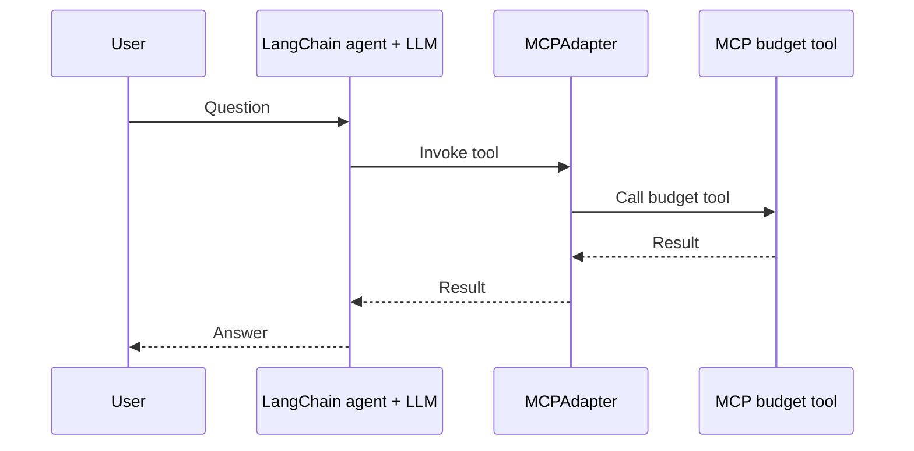
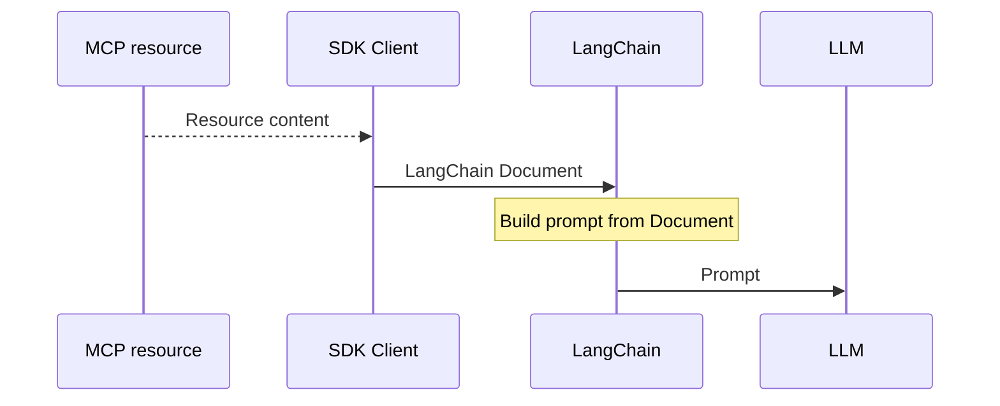
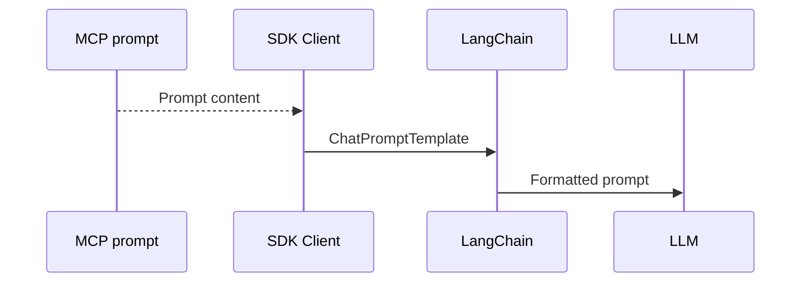

#  Phase 5: Trip MCP Server with LangChain and  LLM


> **Goal:** Extend Phase 4 by introducing an LLM in **three separate experiments**: a tool-calling LangChain agent; a resource-grounded prompt chain; and a prompt-driven itinerary chain. Compare what the application controls, what the model decides, and what can go wrong when outputs are not verified.
> 
> Each phase in this series runs in its own dedicated notebook, so execute this phase in a new colab.


## The five-phase learning journey

- Phase 1:Create an MCP **tool**, server and client with FastMCP 
- Phase 2: Extend a FastMCP server with **tools, resources and prompts** 
- Phase 3: Recreate the Trip server using the **official MCP SDK v2**; compare SDK and FastMCP clients 
- Phase 4: Connect MCP to **LangChain without an LLM** 
- Phase 5: Add a **Groq LLM** and compare agent tool use with resource/prompt chains 

<!-- **Learning strategy:** Do not introduce an LLM until you can verify each server capability and its LangChain representation independently. -->

## What you will learn

By the end of Phase 5, you should be able to:

1. Configure Groq credentials without printing a secret and check the availability of a selected model.
2. Use `ChatGroq`, `MCPAdapter`, and `create_agent()` so an LLM can call an MCP budget tool.
3. Read the agent trace and identify **user message → model tool call → MCP tool response → model answer**.
4. Supply an MCP resource, now a LangChain `Document`, to an LLM through a prompt chain.
5. Supply an MCP-rendered prompt, now a LangChain `ChatPromptTemplate`, directly to an LLM.
6. Explain why a well-formed LLM answer is **not evidence** that opening hours, distances, citations, or other live facts were verified.

**Prerequisite:** Phase 4's direct tool/document/template tests. This notebook uses a hosted Groq model, unlike earlier phases, so it needs credentials and network access.

## 1. Compare the three LLM workflows

| Experiment | LangChain integration | What the application supplies | What the model does |
|---|---|---|---|
| **A. Tool + agent** | `create_agent(model, tools=...)` | Tool schemas and the question | Decides whether and how to call the tool |
| **B. Resource + chain** | `ChatPromptTemplate | chat_model` | Resource text (`Document.page_content`) and the question | Answers using the supplied notes |
| **C. Prompt + chain** | `trip_prompt | chat_model` | Already-rendered MCP prompt messages | Generates the requested itinerary text |


These are **three intentionally separate examples**. In A, the model can trigger an MCP tool invocation. In B and C, the Python application has already fetched the resource or prompt, so the LLM does not call the MCP server for them.

## 2. Setup: diagnostics, Groq secret and packages

**Cell 1a: diagnostic stderr redirection:**


```python
# Cell 1a
import sys
sys.stderr = open("mcp_server.log", "w")
```


**Groq credential setup:**

Store GROQ_API_KEY under Colab Secrets (the key icon in the sidebar).

**Cell 1b: diagnostic stderr redirection:**

```python
import os
from google.colab import userdata

if not os.environ.get("GROQ_API_KEY"):
    try:
        secret = userdata.get("GROQ_API_KEY")
        if secret:
            os.environ["GROQ_API_KEY"] = secret
    except Exception as exc:
        print("Could not read Colab secret:", type(exc).__name__)

assert os.environ.get("GROQ_API_KEY"), (
    "Enable GROQ_API_KEY in Colab Secrets before continuing."
)
print("Groq credentials loaded without displaying the key.")
```
This code attempts to read `GROQ_API_KEY` from Colab Secrets if the environment variable is not already set. It deliberately **does not print the API key**. If you are not on Colab, set `GROQ_API_KEY` securely in your execution environment before this cell; the `google.colab` import itself is Colab-specific.

**Notebook dependency installation:**


```python
# Cell 1c
%pip install -q mcp "langchain[mcp]>=1.4.0,<2" langchain-groq groq
```

The `langchain[mcp]` range reflects the provided notebook's setup. A kernel restart may be necessary after package upgrades.

**Model selection and availability check (Cell 2):** 

> If your selected model is unavailable or encounters rate limits, check the [currently supported models, TPM, and RPM limits at Groq](https://console.groq.com/docs/rate-limits).


```python
# Cell 2
from groq import Groq

GROQ_CLIENT = Groq(api_key=os.environ["GROQ_API_KEY"])
# GROQ_MODEL = "qwen/qwen3.8-27b"
GROQ_MODEL = "openai/gpt-oss-120b"

available_ids = sorted(m.id for m in GROQ_CLIENT.models.list().data)
print("Selected:", GROQ_MODEL)
print("Available:", GROQ_MODEL in available_ids)

if GROQ_MODEL not in available_ids:
    print("Account model IDs:", available_ids)
    raise RuntimeError(
        "Choose an available tool-capable Groq model, then rerun this cell."
    )
```

Verify that your chosen model returns Available: True before proceeding. If not, pick another tool-capable model from Groq's dashboard. 

**Checkpoint:** The key is set, the dependencies import successfully, and the chosen model is available to your Groq account.

## 3. Keep the official MCP Trip server unchanged (Cell 3)

Phase 5 rewrites the same `trip_server.py` used in Phases 3 and 4. **This is a useful experimental control:** the server has not gained an LLM. The change is in the application that consumes it.

Run the following as one notebook cell with `%%writefile` **first**:


```python
%%writefile trip_server.py

from mcp.server import MCPServer

mcp = MCPServer("TripUtilities")

@mcp.tool()
def estimate_daily_budget(
    days: int, daily_cost: float
) -> float:
    """Estimate a trip budget from duration and daily cost."""
    if days < 0 or daily_cost < 0:
        raise ValueError("Inputs must be nonnegative")
    return days * daily_cost

@mcp.resource("trip://notes/helsinki")
def helsinki_notes() -> str:
    """Return illustrative planning notes for a city visit."""
    return (
        "Illustrative trip notes (not live travel data).\n"
        "City: Helsinki\n"
        "Interests: museums, architecture, and cafés.\n"
        "Preference: walk between nearby places where practical.\n"
        "Reminder: verify opening hours, accessibility, and routes."
    )

@mcp.prompt()
def outline_day_trip(city: str, focus: str = "museums") -> str:
    """Provide a reusable request for a one-day itinerary."""
    return (
        f"Prepare a one-day itinerary for {city}, focusing on {focus}. "
        "Use verified sources for opening hours and travel times; "
        "label unverified details as uncertain."
    )

if __name__ == "__main__":
    mcp.run(transport="stdio")
```
### Server reminder

- Tool: `estimate_daily_budget(days, daily_cost)` returns `days * daily_cost` after validation.
- Resource: `trip://notes/helsinki` returns static **illustrative**, not live, trip notes.
- Prompt: `outline_day_trip(city, focus)` provides reusable instructions; it does not retrieve verified facts.

**Working-directory warning:** This cell overwrites `trip_server.py`. Keep phases in separate directories or rerun the correct server-writing cell before testing.

## 4. Experiment A: MCP tool + LangChain agent + Groq LLM (Cell 4)

Here we build an **agent**, not just a direct tool test. The model sees the user request and an allowed tool schema. The LangChain agent orchestrates tool execution through `MCPAdapter` when the model requests it.





```python
# Cell 4: Trip MCP Tool + LangChain Agent + Groq LLM

from pathlib import Path
from langchain.agents import create_agent
from langchain_groq import ChatGroq
from langchain.mcp import MCPAdapter

# 1. Initialize LLM
chat_model = ChatGroq(
    model=GROQ_MODEL,
    temperature=0
)

# 2. Connect to MCP server and convert tools
async with MCPAdapter(Path("trip_server.py").resolve()) as adapter:

    trip_tools = await adapter.list_tools()

    print("=== LANGCHAIN TOOLS ===")
    for tool in trip_tools:
        print(tool.name, tool.description)

    # Select budget tool
    budget_tools = [
        t for t in trip_tools
        if t.name == "estimate_daily_budget"
    ]
    assert len(budget_tools) == 1

    # 3. Create LangChain agent with MCP tool
    agent = create_agent(
        model=chat_model,
        tools=budget_tools,
        system_prompt=(
            "You are a helpful trip-planning assistant. "
            "Use the estimate_daily_budget tool for "
            "budget calculations. Do not invent prices."
        )
    )

    # 4. Ask LLM to use MCP tool
    result = await agent.ainvoke(
        {
            "messages": [
                {
                    "role": "user",
                    "content": (
                        "Use the estimate_daily_budget tool "
                        "to calculate the total budget for "
                        "a 5-day trip costing 120 euros per day."
                    )
                }
            ]
        },
        config={"recursion_limit": 16}
    )

    # 5. Display conversation and tool calls
    print("\n=== AGENT CONVERSATION ===")
    for message in result["messages"]:
        print(
            type(message).__name__,
            str(message.content)[:700]
        )
        if getattr(message, "tool_calls", None):
            print("TOOL CALLS:", message.tool_calls)
```
### What changed from Phase 4?

| Phase 4: no model | Phase 5: model-powered agent |
|---|---|
| Direct `budget_tool.ainvoke({...})` | `agent.ainvoke({"messages": [...]})` |
| Python explicitly chooses argument values | LLM emits a tool call with chosen arguments |
| `MCPAdapter` converts and executes tools | `MCPAdapter` still converts and executes tools |
| The test result is a tool response | The result includes a conversation trace and final model answer |

**Expected output:**

```text
HumanMessage: Use the estimate_daily_budget tool to calculate...
AIMessage: TOOL CALLS: estimate_daily_budget
          args: {'daily_cost': 120, 'days': 5}
ToolMessage: ... 'text': '600.0' ...
AIMessage: final answer based on 600.0
```

The precise IDs and final wording can vary. The important evidence is the **actual tool call and ToolMessage**, not merely the final answer `600` (which an LLM could also compute itself).

### Why the `async with` matters

The entire `agent.ainvoke()` operation is inside `async with MCPAdapter(...)` so that the MCP connection remains open while the agent calls the tool. The `budget_tools` allowlist ensures this demonstration exposes only `estimate_daily_budget` to the agent.

**Safety boundary:** This tool uses a supplied `daily_cost`; it does not provide current prices. The model should not claim to have verified live travel prices.

## 5. Experiment B: MCP resource + LangChain Document + LLM (Cells 5a–5b)

Unlike Experiment A, the LLM **does not choose or call an MCP tool**. The application reads the Helsinki resource first, converts it into a `Document`, and then inserts the text into a LangChain prompt.





### Cell 5a: retrieve the resource and create a Document


```python
# Cell 5a:  MCP resources with LangChain
# Unlike MCP tools, which the LangChain adapter converts automatically,
# here we explicitly retrieve MCP resource content and wrap it in a LangChain Document.

import sys
from pathlib import Path

from mcp import Client, StdioServerParameters
from mcp.types import TextResourceContents
from langchain_core.documents import Document

TRIP_CONFIG = StdioServerParameters(
    command=sys.executable,
    args=[str(Path("trip_server.py").resolve())]
)

async with Client(TRIP_CONFIG) as client:

    # 1. Discover MCP resources
    resources = await client.list_resources()

    print("=== AVAILABLE RESOURCES ===")
    for resource in resources.resources:
        print("NAME:", resource.name)
        print("URI:", resource.uri)

    # 2. Read and convert to LangChain Documents
    trip_documents = []

    for resource in resources.resources:
        result = await client.read_resource(str(resource.uri))

        for content in result.contents:
            if isinstance(content, TextResourceContents):
                doc = Document(
                    page_content=content.text,
                    metadata={"source": str(resource.uri)}
                )
                trip_documents.append(doc)

    # 3. Inspect LangChain Documents
    print("\n=== LANGCHAIN DOCUMENTS ===")

    for doc in trip_documents:
        print("CLASS:", type(doc).__name__)
        print("SOURCE:", doc.metadata["source"])
        print("CONTENT:\n", doc.page_content)
```

**Expected output:** the document's source metadata is `trip://notes/helsinki`. The notes mention museums, architecture, cafés, practical walking preferences, and the need to check operating hours/accessibility/routes. This is **illustrative planning context**, not verified current travel data.

### Cell 5b: add a Groq LLM using a prompt chain

```python
# Cell 5b: MCP Resources + LangChain + Groq LLM

from langchain_groq import ChatGroq
from langchain_core.prompts import ChatPromptTemplate

# 1. Initialize LLM
chat_model = ChatGroq(
    model=GROQ_MODEL,
    temperature=0
)

# 2. Get content from LangChain Documents
assert trip_documents, "No MCP resources were loaded"

trip_context = "\n\n".join(
    doc.page_content for doc in trip_documents
)

# 3. Create LangChain prompt
prompt = ChatPromptTemplate.from_messages([
    (
        "system",
        "You are a cautious trip-planning assistant. "
        "Use the provided resource context to answer questions. "
        "The notes are illustrative, not live travel data. "
        "Do not invent opening hours, routes, prices, "
        "or other unverified details."
    ),
    (
        "human",
        "Resource context:\n{context}\n\n"
        "Question: {question}"
    )
])

# 4. Create LangChain chain
chain = prompt | chat_model

# 5. Ask the LLM using MCP resource content
result = await chain.ainvoke({
    "context": trip_context,
    "question": (
        "What interests and preferences should guide "
        "my visit to Helsinki?"
    )
})

print("=== LLM ANSWER ===")
print(result.content)
```

### Key Concept: Why an Agent in Experiment A, but Chains in B & C?

In LangChain, there is a fundamental difference between an **Agent** and a **Chain**:

* **A Chain (`prompt | model`):** A rigid, one-way pipeline. The application developer pre-fetches all information, builds the prompt, and passes it to the model. The model does not make decisions about what tools to run—it simply answers based on what you handed it.
* **An Agent (`create_agent`):** A feedback loop where the LLM is given tools. The model dynamically evaluates the user's request and decides *at runtime* whether to call a tool, what arguments to send, and when it has enough information to formulate a final answer.

**Why the shift across MCP capabilities?**
* **Tools (Exp A) require an Agent:** Tools are callable functions. The LLM must be given the autonomy to decide *when* to execute them.
* **Resources (Exp B) use a Chain:** Resources are passive context (like files or database snapshots). The client retrieves the text *beforehand* and injects it into the prompt. No dynamic tool execution is needed.
* **Prompts (Exp C) use a Chain:** Prompts are instruction templates. Once retrieved from the MCP server, they are already rendered into messages. You simply pipe them into the model.

### Read the chain carefully

- `trip_context` combines the loaded documents' `page_content` values into one string.
- `ChatPromptTemplate.from_messages(...)` defines a system instruction and a human message with two placeholders: `{context}` and `{question}`.
- `chain = prompt | chat_model` creates a LangChain chain, **not** a tool-calling agent.
- `chain.ainvoke({"context": ..., "question": ...})` sends the illustrative notes and the user's question to Groq.


> Notice that we use `chain = prompt | chat_model` instead of `create_agent()`. We do not need an agent because there are no callable tools for the model to choose from. The application already fetched the resource context in Cell 5a; the model's only job is to generate an answer based on that pre-loaded context.

**Expected output:** the model organizes the answer around **museums, architecture, cafés and walkability**, and advises checking opening hours and routes. It also adds some generic examples not explicitly present in the resource notes. 

**Important distinction:** Creating a `Document` does **not** automatically add search, retrieval, or citations. The application simply passed this document's text into the prompt. The model has no live city-data source in this experiment.

## 6. Experiment C: MCP prompt + LangChain prompt + LLM (Cells 6a–6b)

Now the server provides the **task instructions**. The application retrieves `outline_day_trip(city="Helsinki", focus="museums")`, converts the rendered MCP message to a LangChain prompt, and sends it to Groq.



### Cell 6a: retrieve and convert the MCP prompt


```python
# Cell 6a:  MCP prompts with LangChain
# Unlike MCP tools, which the LangChain adapter converts automatically,
# here we explicitly retrieve MCP prompts content and convert to LangChain ChatPromptTemplate

import sys
from pathlib import Path

from mcp import Client, StdioServerParameters
from mcp.types import TextContent
from langchain_core.prompts import ChatPromptTemplate
from langchain_core.messages import HumanMessage, AIMessage

TRIP_CONFIG = StdioServerParameters(
    command=sys.executable,
    args=[str(Path("trip_server.py").resolve())]
)

async with Client(TRIP_CONFIG) as client:

    # 1. Discover MCP prompts
    prompts = await client.list_prompts()

    print("=== AVAILABLE PROMPTS ===")
    for prompt in prompts.prompts:
        print("NAME:", prompt.name)
        print("DESCRIPTION:", prompt.description)
        print("ARGUMENTS:", prompt.arguments)

    # 2. Retrieve a rendered MCP prompt
    result = await client.get_prompt(
        "outline_day_trip",
        {"city": "Helsinki", "focus": "museums"}
    )

    # 3. Convert MCP messages to LangChain messages
    lc_messages = []

    for msg in result.messages:
        if isinstance(msg.content, TextContent):
            if msg.role == "user":
                lc_messages.append(
                    HumanMessage(content=msg.content.text)
                )
            elif msg.role == "assistant":
                lc_messages.append(
                    AIMessage(content=msg.content.text)
                )

    # 4. Convert into a LangChain ChatPromptTemplate
    trip_prompt = ChatPromptTemplate.from_messages(
        lc_messages
    )

    # 5. Inspect the LangChain prompt
    print("\n=== LANGCHAIN PROMPT ===")
    print("CLASS:", type(trip_prompt).__name__)

    for msg in trip_prompt.format_messages():
        print("ROLE:", msg.type)
        print("CONTENT:", msg.content)
```

**Expected output:** a `ChatPromptTemplate` containing a `human` message that asks for a Helsinki museum itinerary and requests verification of opening hours/travel times. Since the MCP server **already rendered the arguments**, the resulting LangChain template no longer needs `{city}` and `{focus}` values.

### Cell 6b: send the prompt to Groq


```python
# Cell 6b: MCP Prompt + LangChain + Groq LLM

from langchain_groq import ChatGroq

# 1. Initialize LLM
chat_model = ChatGroq(
    model=GROQ_MODEL,
    temperature=0
)

# 2. Create LangChain chain
chain = trip_prompt | chat_model

# 3. Invoke LLM using the MCP prompt
result = await chain.ainvoke({})

# 4. Display response
print("=== LLM ANSWER ===")
print(result.content)
```
The chain uses `.ainvoke({})` because `trip_prompt` already contains the completed itinerary request and has **no remaining input variables**.

### Notice an important limitation: 

Even though the prompt asked to `use verified sources`, the model fabricated opening hours and citations because no retrieval tool was provided.

> **A prompt that says “use verified sources” is not the same as actually supplying a verification source or tool.**


Do not treat the generated itinerary's hours, distances, ticket claims, venue status, or citations as verified facts. For a deployment that must produce current travel details, add reliable retrieval or tool capabilities, provide the verified evidence to the model, and validate claims before presenting them as confirmed. Alternatively, require the model to state clearly that current details cannot be verified.

## 7. Compare how the LLM is used

| Question | A. Tool + agent | B. Resource + chain | C. Prompt + chain |
|---|---|---|---|
| What does the LLM receive? | User question and tool schema | Resource content and question | MCP-rendered instruction |
| Can the LLM cause an MCP tool call? | Yes, via the agent | Not in this code | Not in this code |
| Does the application fetch MCP content first? | Discovers tools | Yes, resource text | Yes, prompt messages |
| LangChain mechanism | `create_agent(...)` | `prompt | chat_model` | `trip_prompt | chat_model` |
| Evidence of correct integration | `tool_calls` and `ToolMessage` | Prompt input includes `trip_context` | Prompt messages contain the rendered request |
| Typical failure to notice | Incorrect tool selection/arguments | Unsupported claims beyond context | Invented verification/citations |

**Do not confuse three different things:** (i) tool *execution*, (ii) data supplied as *context*, and (iii) messages supplied as *instructions*. They can all involve the same MCP server, but they enter the LangChain application differently.

## 8. Guided practice

### Exercise A: Inspect a genuine tool call

In Cell 4, identify exactly where the model selects `estimate_daily_budget` and where the server returns `600.0`. Explain why reading only the final `AIMessage` would not prove a tool was invoked.

### Exercise B: Change the calculation

Ask for a **4-day trip at 85 euros per day**. Inspect `message.tool_calls` to confirm the model supplied `days=4` and `daily_cost=85`. Expected arithmetic: **340.0**. Do not rely on the final answer alone.

### Exercise C: Change the resource context

Edit the server resource so it mentions a preference for **accessible walking routes**. Regenerate `trip_server.py`, rerun Cell 5a, then Cell 5b. Highlight which parts of the LLM answer reflect the changed resource.

### Exercise D: Change the MCP prompt

In Cell 6a, request the prompt with `city="Tampere"` and `focus="architecture"`; rerun Cell 6b. Explain why you must refetch the rendered MCP prompt, rather than only changing a variable in the LLM call.

### Exercise E: Audit unsupported statements

Look at the itinerary generated by your model in Cell 6b. Highlight at least **three claims** about current hours, journey times, venue details, or sources that were **not actually verified in this workflow**. Rewrite those claims to indicate uncertainty.

### Exercise F: Safer instructions

Add an instruction such as: *“You have no live browsing or map tools in this exercise. Do not provide exact opening hours, travel times, prices or citations unless they are supplied as verified context. If missing, say what needs checking.”* Compare the new response. Does it consistently respect the restriction?

### Exercise G: Architecture comparison

Sketch the three pipelines (agent/tool, resource/chain, prompt/chain) and label exactly which component launches the MCP server, which retrieves its content, and when the Groq model is called.

## 9. Troubleshooting Guide

| Symptom | What to check |
|---|---|
| `GROQ_API_KEY` assertion fails | Add the key to Colab Secrets or set a secure environment variable. Never print the key. |
| `google.colab` is unavailable | You are not running in Colab; use local environment-variable configuration instead. |
| Selected Groq model is unavailable | Run the notebook's model-availability cell and choose an available model with tool support. |
| `langchain.mcp` import fails | Install the versions specified in Cell 1c and restart the kernel. |
| No tool call appears | Inspect the agent's intermediate `AIMessage.tool_calls`; check that the tool was loaded and allowed. The LLM may not choose a tool unless prompted. |
| MCP call fails after leaving `async with` | Keep agent execution inside the active adapter context. |
| `trip_documents` is undefined | Execute Cell 5a before Cell 5b. |
| `trip_prompt` is undefined | Execute Cell 6a before Cell 6b. |
| Model produces convincing but unsupported factual details | Audit against actual supplied sources; prompting alone does not perform verification. |

**Notebook execution order matters:** the resource and prompt LLM cells depend on Python variables created in earlier notebook cells. Run the notebook top to bottom or repeat those setup cells when testing a section independently.

**Security note:** Keep API keys out of notebooks, logs, screenshots, and submissions. Limit the tools made available to an agent and treat untrusted tool/resource content as data, not as system instructions.

## 10. Exit ticket

Answer in your own words:

1. What is the difference between directly calling `budget_tool.ainvoke()` in Phase 4 and calling `agent.ainvoke()` in Phase 5?
2. How can you tell that the LangChain agent actually executed the MCP budget tool?
3. Why does the resource-chain example not need a tool-calling agent?
4. Why is `chain.ainvoke({})` valid for the converted MCP prompt in this notebook?
5. What evidence is missing when the LLM claims it checked opening hours or travel times in the itinerary experiment?
6. What additional capability would be needed to make current opening hours and travel routes verifiable?
7. Why did Experiment A require an agent (`create_agent`), whereas Experiment B and Experiment C only needed a linear chain (`|`)?

<!-- **Submission:** Include the tool-call trace, the resource-chain result, the prompt-chain result, an evidence audit of the itinerary, and a short comparison of the three approaches. -->

## 11. Final synthesis: the complete five-phase progression

```text
Phase 1  FastMCP Math tool + FastMCP client
   ↓
Phase 2  FastMCP Trip server: tool + resource + prompt
   ↓
Phase 3  Official MCP SDK Trip server + two client libraries
   ↓
Phase 4  MCP -> LangChain tool / Document / ChatPromptTemplate (no LLM)
   ↓
Phase 5  LangChain agent + Groq LLM; resource and prompt chains
```

The core engineering habit is **incremental verification**. Test the server, test the client, test the LangChain representation, and only then evaluate the model's decisions and outputs. An LLM can make a working integration more useful, but it also introduces a separate class of errors: unsupported claims and incorrect tool use.

## References

- [Model Context Protocol](https://modelcontextprotocol.io/)
- [Official MCP Python SDK](https://py.sdk.modelcontextprotocol.io/)
- [LangChain Python documentation](https://docs.langchain.com/oss/python/langchain/overview)
- [Groq API documentation](https://console.groq.com/docs/overview)

