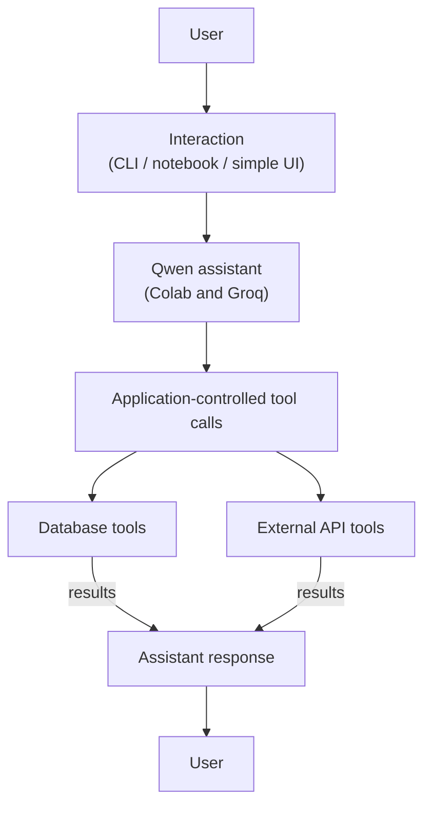

# Document B: Sprint 1 Review Presentation Template

## 1. Purpose

Your presentation should tell the story of **what your team planned, built, tested, and learned during Sprint 1**. The focus is on a real working increment and evidence of its behavior, not on listing technologies or describing features that may be implemented later.

Explain not only what worked, but also what failed, what remains incomplete, how you used Scrum, and what you would improve in the next sprint. A clearly explained limitation is more useful than an unsupported claim of success.

Use the slide structure below as a template. You may adapt slide design and combine small sections, but **all required topics, evidence, and the live demonstration must remain**.

## 2. Jigsaw presentation format

The review uses a **Jigsaw Challenge**: team members present their group's work to peers at assigned breakout-rooms (Zoom), discuss technical decisions, and learn from other projects.

### Before the Jigsaw: Team preparation

Use the preparation period to:

1. Rehearse the full **12-minute presentation**, including the live demo.
2. Check that the repository, application, and demo data are ready.
3. Prepare a **one-page technical defense cheat sheet** covering the workflow, tools, database, model, evaluation results, Scrum process, and limitations.
4. Make sure **every member** can share their screen, present the **entire project**, and answer questions.
5. Agree on a fallback (for example, saved outputs or screenshots) in case the live model or API is temporarily unavailable. Clearly identify fallback evidence as recorded rather than live.

AI tools may be used during preparation to practice questions or check understanding. During the actual **presentation and technical defense, do not use live AI assistance**. Explain the work in your own words.

### During the Jigsaw: Two responsibilities 

**As a presenter:** Go to your assigned breakout-room, present the project, demonstrate the working increment, and answer technical questions. Be accurate about completed and incomplete functionality.

**As a listener:** Pay attention to other teams' choices, ask **at least one substantive technical question**, and note at least one useful implementation or evaluation idea and one limitation or failure you learned about.

Each group sends representatives to its assigned breakout-rooms according to the arrangements given in class. The exact breakout-rooms assignments and timetable will be communicated separately.

### Peer voting

After the Jigsaw presentations, we will **vote**, and **one group will be selected as the winning team based on the vote**. The voting procedure will be will explained in class. When judging a presentation, consider the clarity of the explanation, usefulness of the working increment, evidence from the demo and evaluation, technical understanding, use of Scrum, and honest discussion of limitations. These are areas to consider.

## 3. Slide-by-slide template

The suggested timings add up to **12 minutes**. The bracketed prompts are placeholders: replace them with details and evidence from **your own project**.

### Slide 1: Project Overview

**Include**

- **Project:** `[Project title]`
- **Team:** `[Names / group number]`
- **Intended users:** `[Who will use it?]`
- **Problem:** `[What is difficult or time-consuming for these users?]`
- **First useful task:** `[What can the Sprint 1 version actually help the user do?]`
- **Project data:** `[Brief description of the data or external source]`

**Key question:** *What problem did we choose, and why is a tool-using AI assistant relevant to that problem?*

Keep the domain introduction brief. Most of the presentation should be about development and results.

### Slide 2: Sprint 1 Goal, Scope, and Backlog

**Include**

- **Sprint Goal:** `"[Your team's Sprint Goal]"`
- **Selected Product Backlog Items:** `[PBI IDs + short descriptions]`
- **Planned first increment:** `[What was intended to work by the review?]`
- **Scope decisions:** `[What did the team deliberately leave for later?]`

| Planned backlog item | Acceptance criterion | Status at review |
|---|---|---|
| `[PBI-01: ...]` | `[Observable condition]` | Done / Partial / Not done |
| `[PBI-02: ...]` | `[Observable condition]` | Done / Partial / Not done |

**Key question:** *What did we commit to delivering in Sprint 1, and why was this a realistic first step?*

Do not present the entire Product Backlog. Select the items that explain the Sprint Goal.

### Slide 3: How We Used Scrum

Show **roles, artifacts, and events/ceremonies**, with concrete examples from your actual sprint.

**Roles**

- **Product Owner:** `[Name and a prioritization/clarification decision]`
- **Scrum Master:** `[Name and how they helped remove or expose a blocker]`
- **Developers:** `[How all team members contributed technically]`

**Scrum artifacts**

- **Product Backlog:** `[Where it is kept, and one example of prioritization or change]`
- **Sprint Backlog and Sprint Goal:** `[Where they are kept, and how progress was tracked]`
- **Working Increment:** `[What integrated functionality exists now]`
- **Definition of Done:** `[How you decided an item was truly complete]`

**Scrum events / ceremonies**

| Event | What we actually did | Outcome or decision |
|---|---|---|
| Sprint Planning | `[When/how]` | `[Sprint Goal and selected work]` |
| Daily Scrum / progress check-ins | `[Actual frequency and method]` | `[Example of identified obstacle or adjustment]` |
| Sprint Review | `[What is being demonstrated and reviewed]` | `[Feedback or backlog implication]` |
| Sprint Retrospective | `[When/how, or plan immediately after review]` | `[Specific teamwork improvement]` |

**Key question:** *How did Scrum help us make decisions, coordinate work, and respond to what we discovered?*

Describe the process **as it happened**, including adaptations or events that did not occur. Avoid a generic explanation of Scrum terminology without examples from your team.

### Slide 4: System Architecture and Qwen Setup

Show a **simple architecture diagram of the implementation that exists**, not an idealized future design. A possible starting structure is:

**Explain**

- How the user interacts with the application. **Streamlit is optional in Sprint 1.**
- Which operations the model requests and which the application/tools actually execute.
- How database and API results become part of the assistant's response.
- Any important validation or control used for tool arguments or external actions.

**Key question:** *What happens technically between a user's request and the final response?*

Fine-tuning, RAG, MCP, and multi-agent architectures are outside Sprint 1 scope.

### Slide 5: What We Implemented

Give a brief overview of the **actual working functionality** and how components connect.

| Component | What it does in our product | Evidence / status |
|---|---|---|
| Assistant behavior | `[Understands user request and uses tools]` | `[demo or code reference]` |
| Generic/tool function | `[Name and purpose]` | `[actual tool result]` |
| Database | `[What is stored; how records are accessed/filtered]` | `[example query/results]` |
| External API adapter | `[Service and information/action provided]` | `[working result OR documented blocker]` |
| User interaction | `[CLI/notebook/simple UI]` | `[live demo]` |

Explain **one or two implementation decisions** (for example, choosing a database schema, selecting a tool interface, or validating inputs). Do not spend the whole slide listing libraries.

**Key question:** *What did we build that makes the first user task possible?*

### Slide 6: Live Demonstration: The Working Increment

The demonstration is the central part of your Sprint Review. Prepare a short, repeatable sequence:

**Demo A: A real user task**

1. Enter `[a representative user request]`.
2. Show the assistant's response.
3. Point out which tool was used, what data was returned, and why the answer is supported by that data.

**Demo B: Filtering or an edge case**

1. Enter `[a request with a database filter OR a no-match case]`.
2. Show that the application uses the relevant records and returns the expected response, including honest handling when nothing matches.

**If an external API is integrated:** Demonstrate it in one of these workflows or show a clearly labeled, recorded successful integration result. If blocked, explain the blocker and show the evidence of the attempted work; do not claim the integration works.

A terminal, notebook, or simple interaction interface is acceptable. A Streamlit GUI is **not required**.

**Key question:** *Can the audience see the assistant complete a real task, rather than only hear that the code exists?*

### Slide 7: Evaluation: How Do We Know It Works?

Assistant evaluation is **required**. Present at least **three** representative end-to-end scenarios from `docs/SPRINT_1_EVALUATION.md`.

| Test | Expected behavior | Observed result | Outcome |
|---|---|---|---|
| `[normal user task]` | `[correct answer/action]` | `[what happened]` | Pass / Partial / Fail |
| `[database/filter task]` | `[only matching records]` | `[what happened]` | Pass / Partial / Fail |
| `[empty result or failure case]` | `[safe, honest response]` | `[what happened]` | Pass / Partial / Fail |

Explain briefly:

- How you knew the answer was correct (for example, comparison against database records or API results).
- Whether the appropriate tool was invoked.
- One incorrect, unexpected, or inconsistent response and its likely cause.
- What you can **and cannot** conclude from such a small evaluation.

**Key question:** *What evidence supports the claim that our assistant works?*

Automated unit tests of functions are **optional in Sprint 1** and become **required in Sprint 2**. Do not confuse function unit testing with required assistant-level evaluation.

### Slide 8: Responsible Use, Limitations, and Failures

Discuss what is relevant to your actual implementation:

- **Data and privacy:** `[Where the database/API data came from; whether it can be used; whether it contains personal or sensitive information]`.
- **Security:** `[How API keys or secrets are protected, and what operations the assistant can perform]`.
- **Reliability:** `[One hallucination, incorrect filter, invalid tool argument, failed API call, or another meaningful limitation]`.
- **Response to the failure:** `[How the system behaves now, and what improvement is needed]`.

**Key question:** *What could go wrong in this product, and what did we do—or plan to do—to reduce the risk?*

If something failed, explain it accurately. You are not expected to claim that every experiment succeeded.

### Slide 9: Sprint Review, Retrospective, and Next Steps

Conclude with three short statements:

1. **What we delivered:** `[Working increment and completed Sprint Goal or the part achieved]`.
2. **What we learned about our work process:** `[One useful Scrum/team practice and one improvement for the next sprint]`.
3. **What changes next:** `[One or two highest-priority Product Backlog updates for Sprint 2]`.

Possible Sprint 2 work includes adding the required **Streamlit interface**, systematic **function unit tests**, and improvements justified by the Sprint 1 evaluation. 

**Key question:** *What did Sprint 1 teach us about our product and how we should develop it?*

## 4. Prepare for technical questions

Each presenter should be ready to answer questions such as:

### Product and architecture

- What user task does your first version solve, and why does it benefit from an LLM?
- Why is your solution an assistant or agent with tools rather than a standalone chatbot?
- What makes your tool-use architecture appropriate for the first version?

### Tools, database, and API

- How does the assistant decide which tool to use, and what executes the tool call?
- What happens if a tool receives invalid arguments or returns no data?
- How is information added, retrieved, and filtered in your database?
- How did you verify that the assistant's answer reflects the database or API response?
- What happens when your external API is unavailable?

### Evaluation and responsible development

- What are your three evaluation scenarios, and why did you choose them?
- Which scenario did not work as expected, and what might explain the failure?
- How would you know that the assistant invented a fact?
- What are the relevant data permissions, privacy issues, or risks of external service access?

### Scrum

- What was your Sprint Goal, and how did it guide the selected work?
- How did the Product Owner and Scrum Master contribute to decisions and coordination?
- What changed in your Product Backlog during the sprint?
- What evidence shows that a backlog item was Done?
- How did your planning, progress check-ins, review, and retrospective affect the way the team worked?

**A strong technical answer connects an explanation to what your own group actually implemented, observed, or recorded.** If you do not know the answer, say what you know and identify what you would investigate.

## 5. Final presentation checklist

- [ ] We can explain the user, problem, first feature, and Sprint Goal clearly.
- [ ] Our slides show **roles, artifacts, and actual Scrum events/ceremonies**.
- [ ] The architecture reflects the implementation we have, including Qwen, tools, and data access.
- [ ] We have a working demo and a realistic fallback if a service is unavailable.
- [ ] We show evidence of database use/filtering and explain external API status.
- [ ] We present at least **three recorded assistant-level evaluation scenarios**.
- [ ] We describe at least one limitation, failure, or incomplete item honestly.
- [ ] We explain what changed in the backlog and what we plan to improve in Sprint 2.
- [ ] **Every team member** can present the full deck and answer technical questions without live AI assistance.
- [ ] We are ready to ask useful technical questions and learn from other teams during the Jigsaw.

---

**Sprint Review guiding question:** *What working value did our team deliver, how do we know it works, and what will we change after inspecting the results?*
