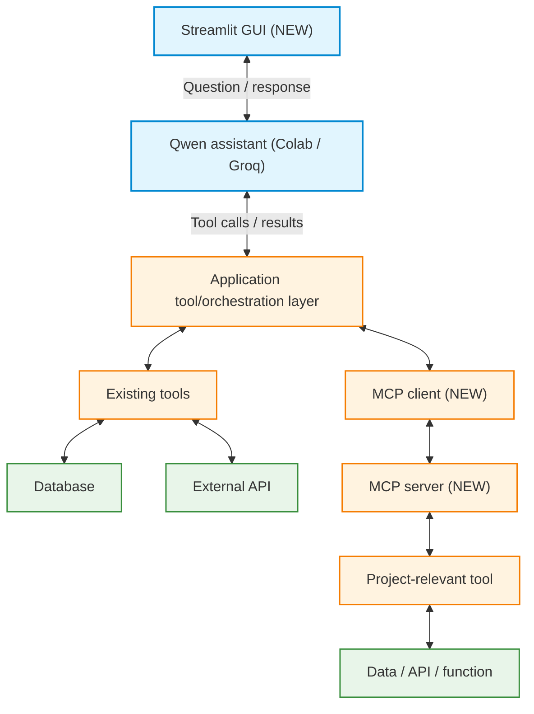

# Sprint 2 Review Presentation Template

**Presentation:** approximately **10–12 minutes** per presenter, followed by technical questions.

## 1. Purpose

Your presentation should explain how your team **extended the Sprint 1 working product into a Sprint 2 increment**. Show what was preserved, what was added, how the components work together, and what your evaluation and tests reveal.

**Sprint 2 is cumulative:** the existing Qwen assistant, tools, database functionality, external API target, and assistant evaluation continue. The new requirements are **MCP server + MCP client**, **Streamlit GUI**, and **function unit tests**. The presentation must show these capabilities working together in the **same product**.

Tell the story of **what you planned, built, tested, and learned**. Explain completed and incomplete items accurately, and show how Scrum was applied in your team.

Use the structure below as a template. You may adapt visual design, but include **all topics and the live demo**. 

## 2. Jigsaw presentation format

The review follows the **Jigsaw Challenge** structure. Each group member need to present the **whole project** at an assigned table, learn from peers, and answer questions about the team's real implementation.

### Before the Jigsaw: Home Team preparation

1. Rehearse the **12-minute deck**, including the live Streamlit demonstration.
2. Make sure the repository, database/sample records, Qwen access, **MCP server**, and Streamlit app are ready.
3. Prepare a **one-page technical defense cheat sheet** on the previous baseline, new MCP pathway, Streamlit integration, test results, Scrum decisions, and limitations.
4. Check that **every team member** can share their screen, present the full deck, demonstrate the increment, and answer questions about it.
5. Prepare an accurately labeled recorded-output fallback if a live service fails during the session.

You may use AI for practice during preparation. **Do not use live AI assistance during the presentation or technical defense.** Explain the implementation and results in your own words.

### During the Jigsaw: Presenting and listening

**As a presenter:** Present for approximately **10–12 minutes**, demonstrate the working increment, and answer technical questions within the table slot.

**As a listener:** Ask **at least one substantive technical question**; note at least one useful technical or Scrum idea and one limitation or failure you learned about from another group. Focus on understanding the design decisions and supporting evidence.

### Peer voting

Following the Jigsaw presentations, students will **vote for a winning group**. Consider clarity, technical understanding, useful integrated functionality, strength of the demonstration and evaluation, meaningful function testing, application of Scrum, and honest reflection on limitations.

## 3. Slide-by-slide template

The suggested timings total **12 minutes**. Replace the bracketed text with observations and evidence from your own repository and sprint.

### Slide 1: Project Overview

**Include**

- **Project title and group:** `[name / members / group number]`
- **Intended users and problem:** `[one or two sentences]`
- **Useful user task:** `[what the original assistant does]`
- **Sprint 2 value:** `[what the increment makes possible or easier]`

**Key question:** *What user problem are we solving, and how does Sprint 2 improve the product?*

Keep the background brief. The focus is the development and evidence.

### Slide 2: From Sprint 1 to Sprint 2: Goal, Scope, and Backlog

State your **Sprint 2 Goal** and show the difference between the old and current product.

| Capability / backlog item | Sprint 1 status | Sprint 2 result / status |
|---|---|---|
| `[existing user workflow]` | `[worked / partial / blocked]` | `[retained / improved / regression]` |
| `[database / API integration]` | `[status]` | `[current status]` |
| `[MCP client/server item]` | Not part of Sprint 1 | `[working / partial / blocked]` |
| `[Streamlit item]` | - | `[working / partial / blocked]` |
| `[unit tests item]` | - | `[implemented / gaps]` |

**Include**

- **Sprint 2 Goal:** `"[a user-oriented working result]"`
- **Selected Product Backlog Items:** `[PBI IDs and acceptance criteria]`
- **Scope changes:** `[what was added, dropped, or reprioritized after Sprint 1 review]`

**Key question:** *What increment did we commit to, beyond what already worked in Sprint 1?*

### Slide 3: How We Used Scrum in Sprint 2

Show **roles, artifacts, and actual Scrum events/ceremonies**.

**Roles**

- **Product Owner:** `[name; example of prioritizing or clarifying user value]`
- **Scrum Master:** `[name; example of addressing a dependency or blocker]`
- **Developers:** `[how technical implementation and testing were shared by all members]`

**Artifacts**

- **Product Backlog:** `[one change based on feedback or technical learning]`
- **Sprint 2 Backlog and Sprint Goal:** `[how items/tasks were selected and tracked]`
- **Working Increment:** `[what is integrated now]`
- **Definition of Done:** `[how acceptance and testing were checked]`

**Events / ceremonies**

| Event | What actually happened | What changed or was decided |
|---|---|---|
| Sprint Planning | `[when/how]` | `[goal and selected PBIs]` |
| Daily Scrum / progress check-ins | `[actual frequency]` | `[obstacle/coordination example]` |
| Sprint Review | `[what is being inspected]` | `[feedback/backlog implication]` |
| Sprint Retrospective | `[held or planned after review]` | `[specific team-process improvement]` |

**Key question:** *How did Scrum help us coordinate the new MCP, Streamlit, and testing work while preserving Sprint 1 functionality?*

Be precise about any events that did not happen or were adapted.

### Slide 4: Architecture: Before and After

Show a diagram of the **real Sprint 2 architecture**, making the original functionality and the added MCP/Streamlit pieces visible. One possible structure is:

Your actual implementation may route the tools differently. **Do not draw components you have not built.** Label the additions from Sprint 2 clearly.

**Explain**

- How does Streamlit send requests to local Qwen and Groq.
- Which tools and data operations remain from Sprint 1.
- Where the **MCP client** and **MCP server** run, how they connect, and what they are responsible for.
- How the MCP result reaches the assistant and is reflected in the user-facing answer.

**Key question:** *What changed technically between the Sprint 1 architecture and the Sprint 2 increment?*

### Slide 5: MCP Client and Server: What We Implemented

Describe the **actual MCP functionality**.

| Component | What our implementation does | Evidence |
|---|---|---|
| MCP server | `[which project-relevant tool is exposed and why]` | `[server code / offered tool]` |
| MCP client | `[how it connects and invokes the tool]` | `[client code / invocation evidence]` |
| Assistant integration | `[what user request causes MCP use]` | `[request → invocation → tool result → response]` |
| Validation/error handling | `[what happens with wrong arguments, no result, or service failure]` | `[actual observation]` |

**Explain one technical decision:** `[Why this capability was exposed through MCP rather than adding an isolated toy example]`.

**Key question:** *How do we know the assistant is actually using the MCP client and server rather than only calling a local function or displaying a sample?*

### Slide 6: Streamlit GUI and Preserved Sprint 1 Features

**Include**

- How a user enters a request and receives the assistant's answer.
- How the application exposes or supports the **existing Sprint 1 workflow**.
- How the user can access the **new MCP-enabled capability**.
- One practical interface decision or limitation, if relevant.

**Key question:** *Can a user access both the previous and new capabilities through the same integrated product?*

### Slide 7: Live Demonstration: The Sprint 2 Increment

The demonstration is the central part of the Review. Use the **working Streamlit application** and prepare a short repeatable sequence.

**Demo A: Preserve Sprint 1 behavior**

1. Enter `[existing user request]` in Streamlit.
2. Show a useful response using an existing tool or database filter.
3. Explain how you verified it against the source data. If a Sprint 1 feature regressed, state it honestly.

**Demo B: New MCP-enabled user workflow**

1. Enter `[request requiring your MCP-exposed capability]` in Streamlit.
2. Show the assistant invoking the **MCP client**, the client connecting to/using the **MCP server**, and the returned tool result (logs or a trace may help).
3. Show the final answer and explain how it reflects the MCP tool result.

**Demo C: Edge/failure behavior**

Demonstrate `[no-match result / invalid tool argument / unavailable MCP server]` and show that the application responds clearly instead of inventing information.

If the demo uses a saved output because of a live-service issue, **label it as recorded** and explain what is and is not currently running.

**Key question:** *Can the audience see one integrated product performing its earlier task and a new MCP-supported task through Streamlit?*

### Slide 8: Assistant Evaluation: How Do We Know It Still Works?

**Assistant evaluation remains mandatory**, separate from unit tests. Summarize the results recorded in `docs/SPRINT_2_EVALUATION.md`.

| Evaluation scenario | Expected behavior | Observed result / evidence | Outcome |
|---|---|---|---|
| `[Sprint 1 normal task: regression]` | `[expected]` | `[observed]` | Pass / Partial / Fail |
| `[Sprint 1 database/filter task]` | `[expected]` | `[verified records]` | Pass / Partial / Fail |
| `[Sprint 1 error/no-match task]` | `[expected]` | `[observed]` | Pass / Partial / Fail |
| `[Sprint 2 MCP success]` | `[expected]` | `[client/server result + response]` | Pass / Partial / Fail |
| `[Sprint 2 MCP edge/failure]` | `[clear error handling]` | `[observed]` | Pass / Partial / Fail |

One or more scenarios should be performed through **Streamlit**. Explain what was checked against the actual database/API/MCP results.

**Key question:** *What evidence shows that existing features still work and the new MCP workflow performs a real task?*

Mention at least one unexpected result or limitation and avoid broad reliability claims from a few cases.

### Slide 9: Function Unit Tests

Unit tests of **project-defined functions are required in Sprint 2**. Show concise, real evidence of the tests you wrote and executed.

**Include**

- Functions/components tested: `[database functions, ordinary/API tools, MCP server tools, client wrappers, relevant logic]`.
- Testing approach: `[pytest/unittest, mocks for external dependencies, normal/edge/error conditions]`.
- Test command and observed result: `[command, number passing/failing, any uncovered function or known failure]`.

| Example function | Test condition | Result |
|---|---|---|
| `[filter function]` | `[valid / no match]` | `[Pass / Fail]` |
| `[MCP-exposed function]` | `[valid / invalid arguments]` | `[Pass / Fail]` |
| `[API adapter]` | `[simulated service failure]` | `[Pass / Fail]` |

**Key question:** *What did unit tests reveal about our functions that an end-to-end assistant demonstration alone might miss?*

Do not confuse **unit tests** with the **assistant evaluation** on Slide 8. Both are required.

### Slide 10: Responsible Use, Failures, Review, and Next Steps

Conclude with brief evidence-based reflections:

1. **Security and data responsibility:** `[data source/permission, credentials handling, tool validation, or safe MCP operations]`.
2. **Most important limitation or failure:** `[a real issue, its effect, and what you tried]`.
3. **Sprint Review:** `[which Sprint 2 items are Done / Partial / Blocked; what feedback matters]`.
4. **Sprint Retrospective:** `[one teamwork/process strength and one specific improvement]`.
5. **Next priorities:** `[one or two Product Backlog changes for Sprint 3 based on evidence]`.

**Key question:** *What working value did we add in Sprint 2, what did we learn, and what will we improve next?*

Do not present future work as completed functionality. RAG, fine-tuning, and multi-agent systems are **not** Sprint 2 requirements.

## 4. Prepare for technical questions

Each team member should be able to answer questions about the whole project, not only about the code they personally wrote.

### Product and incremental development

- What useful task did your assistant already perform at the end of Sprint 1?
- What working capability did Sprint 2 add for the user?
- Which old feature did you re-test, and did it still work?
- If a Sprint 1 requirement was incomplete, what happened to it in Sprint 2?

### MCP architecture and integration

- What is the responsibility of your **MCP server**, and what is the responsibility of your **MCP client**?
- Which tool is exposed by the server? Why is it useful for your product?
- How does the client discover/access and invoke that tool?
- What happens to a user request between Streamlit, Qwen, the MCP client, the MCP server, and the final answer?
- What evidence proves the assistant used the MCP pathway and not just a local function?
- How do you handle an unavailable server, invalid tool arguments, or an empty result?

### Streamlit, tools, database, and API

- How does Streamlit communicate with the assistant, and how is the response displayed?
- How can the original database-backed workflow still be used?
- How are data added, retrieved, and filtered, and how do you verify correctness?
- What is the status of the external API integration, and how are failures handled?
- Why did you keep some tools as ordinary functions rather than expose every tool through MCP?

### Evaluation and unit testing

- What is the difference between **assistant-level evaluation** and **function unit testing**?
- How did you test for regressions from Sprint 1?
- Which evaluation case shows MCP success, and which shows a failure/edge condition?
- How did you verify that an answer was grounded in actual tool or database results?
- Which functions have unit tests? How do you simulate an unavailable API or other external dependency?
- What limitation remains after your current tests?

### Scrum and responsibility

- What was the Sprint 2 Goal, and why did the team select those Product Backlog Items?
- What did the Product Owner prioritize and what did the Scrum Master help resolve?
- What happened during your planning, check-ins, review, and retrospective?
- What acceptance evidence supports a Done item?
- What did Sprint 1 feedback change about your Sprint 2 plan?
- What will the Product Backlog prioritize next, based on observed results?

**Good technical answers refer to the team's actual implementation, test evidence, decisions, and failures.** It is acceptable to identify something you have not solved and explain what you would investigate.

## 5. Final presentation checklist

- [ ] We explain the product's user problem and **what continued from Sprint 1**.
- [ ] Our Sprint 2 Goal and backlog show the new increment, not a separate project.
- [ ] We present **Scrum roles, artifacts, events/ceremonies, and Definition of Done**.
- [ ] Our architecture shows **Streamlit, Qwen, existing tools/database/API, MCP client, and MCP server** accurately.
- [ ] The **MCP server** exposes at least one useful tool and the **MCP client** uses it as part of the assistant.
- [ ] We demonstrate the working **Streamlit GUI**.
- [ ] Our live demo includes both a **preserved Sprint 1 task** and a **new MCP-enabled task**.
- [ ] We show assistant evaluation with **regression, MCP success, and failure/edge scenarios**.
- [ ] We show **executed function unit tests** and explain at least one relevant test.
- [ ] We describe important data/security considerations and one failure or limitation honestly.
- [ ] We distinguish Done, Partial, and Blocked work and explain future Product Backlog changes.
- [ ] Every team member can present the **whole deck** and answer questions without live AI assistance.
- [ ] We are ready to ask substantive questions and learn from other groups in the Jigsaw.
