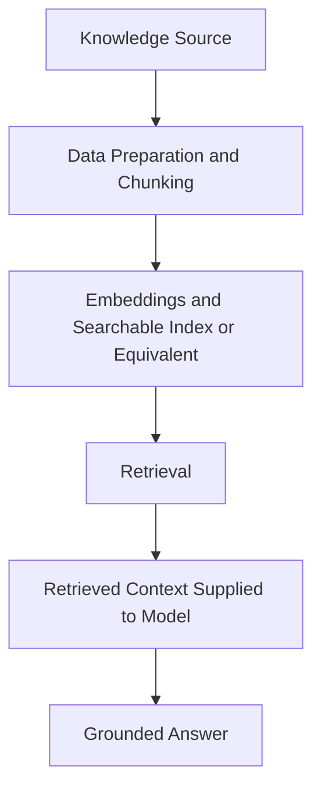

# Sprint 3 — Deliverables and Submission Requirements

## 1. Sprint 3 goal

Continue developing the **same AI product from Sprints 1 and 2**. Preserve the working assistant, implement three new AI capabilities, and evaluate their contribution to the product.

**Every group must:**

- Preserve the Qwen assistant, Streamlit interface, generic/API tools, database, external API integration target, and MCP server/client workflow.
- Implement **RAG, a multi-agent system, and Qwen fine-tuning** for meaningful project-related tasks.
- Conduct three paired comparisons: with/without RAG, single/multi-agent, and base/fine-tuned Qwen.
- Run end-to-end assistant evaluations, regression checks and function unit tests.
- Update Scrum artifacts and prepare the final Sprint Review, Retrospective and Jigsaw presentation.

All three new capabilities must be implemented and evaluated, but they do not have to improve performance. Negative results are valid when supported by evidence. Do not build three disconnected demonstrations.

**Submit to OMA:** the GitHub repository link and Sprint 3 Jigsaw presentation slides. Keep supporting evidence in the repository.

## 2. Technical requirements

### A. Preserve Sprint 1 and 2 functionality

| Component | Required evidence |
|---|---|
| Qwen assistant and original user workflows | At least one verified original task; identify the model and access route (e.g., Colab or Groq). |
| Generic/API tools and database | A real tool-backed request and verified database insertion, retrieval and filtering functionality relevant to the project. |
| External API | Working integration or a documented blocker with evidence of attempted work. |
| MCP server and client | At least one project-relevant tool invoked through the assistant: assistant → MCP client → MCP server → tool → assistant. |
| Streamlit | A working user interaction with the integrated application. |

Record any regression or incomplete requirement, its evidence and next action. Do not mark unfinished work as Done.

### B. Retrieval-Augmented Generation (RAG)

Build a retrieval pipeline using project-relevant documents or other suitable unstructured knowledge. Choose your own retrieval tools and vector store.

- Explain the knowledge source, data permissions and why RAG is useful beyond ordinary database filtering.
- Demonstrate at least one successful retrieval question and one case with missing or irrelevant evidence.
- Record retrieved chunks or source references and check whether the answer is supported by them.

### C. Multi-agent system

Implement **at least two cooperating agents with distinct responsibilities** using one or both of the following approaches:

| Approach | Minimum implementation |
|---|---|
| Agent Orchestration (e.g., Deep Agent) | Structured coordination, such as task decomposition, delegation or handoff between agents with distinct roles/tools. |
| Agent2Agent (A2A) | A specialist agent with a discoverable Agent Card and A2A task/message endpoint, invoked by a coordinating/client agent. |

Combining both approaches is optional. Explain your chosen approach, each agent's role, tools/knowledge and the reason for dividing responsibilities. Provide a coordination trace showing task state, exchanged messages/artifacts and the final result. Retain a single-agent baseline that can attempt the same task.

### D. Fine-tuning

Fine-tune a suitable **Qwen model** for a specific project task (e.g., classification, structured output or response behavior).

- Document the starting checkpoint, objective, dataset source and permissions, preparation method and an example training record.
- Separate training and held-out evaluation data; document validation data if used.
- Record the training method (e.g., LoRA), key settings, environment and limitations.
- Save a reproducible training script/notebook and a usable model/adapter reference.
- Run actual inference on held-out project inputs using both the base and fine-tuned model. Training-loss plots alone are insufficient.
- Connect the tuned variant to the product's task and evaluation workflow.

## 3. Evaluation and testing

All three forms of evidence are required. Relevant test inputs and evidence may be reused where they satisfy the respective requirements.

| Evaluation type | Main question |
|---|---|
| End-to-end assistant evaluation | Does the application work correctly for users, including earlier sprint functionality? |
| Comparative evaluation | What changes when we add RAG, multiple agents or fine-tuning? |
| Function unit tests | Do individual project-defined functions behave correctly? |

### A. End-to-end assistant evaluation

Re-run earlier sprint scenarios and test the new capabilities. Record actual requests, expected and observed behavior, evidence and status. Verify answers against tool/API/database results or retrieved sources where relevant.

Use or adapt this template:

| ID | Scenario / actual request | Mode | Expected behavior | Observed result / evidence | Status |
|---|---|---|---|---|---|
| E-01 | Original user task | Existing assistant | | | |
| E-02 | Database/filter task | Database tool | | | |
| E-03 | No match / invalid request | Existing failure path | | | |
| E-04 | MCP success | MCP workflow | | | |
| E-05 | MCP error / unavailable server | MCP failure path | | | |
| E-06 | Knowledge question | RAG | | | |
| E-07 | Missing / irrelevant evidence | RAG edge case | | | |
| E-08 | Coordinated task | Multi-agent | | | |
| E-09 | Coordination failure/edge case (where feasible) | Multi-agent | | | |
| E-10 | Held-out task examples | Base / tuned Qwen | | | |

Use Pass / Partial / Fail as status. Exercise at least one MCP scenario through Streamlit. Equivalent documented Sprint 1 scenarios are acceptable. Include a short summary of regressions, the contribution of each new capability, remaining risks and next actions.

### B. Comparative evaluation

Conduct **all three paired comparisons**. You do not need to test every possible combination of models, RAG settings and agent architectures.

| Comparison | Keep as similar as possible | What to examine (examples) |
|---|---|---|
| Without RAG vs. with RAG | Questions, model, agent setup, prompts/tools and scoring | Correctness, grounding, unsupported claims, retrieval failures, latency |
| Single agent vs. multi-agent | Tasks, models, information/tools, RAG setting and scoring | Task success, coordination, tool calls, complexity, latency |
| Base vs. fine-tuned Qwen | Held-out inputs, matching base checkpoint, prompts and scoring | Task-specific quality, errors, consistency, resource use/cost |

**Procedure:**

1. Define success criteria before reviewing results.
2. Prepare a small shared evaluation set of approximately **6–10 representative inputs in total**, including normal and difficult cases and at least one missing-evidence or expected-failure case. Select appropriate inputs for each comparison; reuse them where relevant. Fine-tuning evaluation inputs must be held out from training.
3. Run both variants on the same selected inputs for each comparison. Document what changes and what stays fixed.
4. Save actual outputs, relevant source/tool evidence and configuration details. State whether results are from single or repeated runs.
5. Summarize results using counts or rates where meaningful. Explain benefits, weaknesses, trade-offs and limitations. Do not generalize small-sample results to real-world reliability.

**Results template:**

| Comparison | Test input | Variant A result | Variant B result | Evidence / scores | Conclusion |
|---|---|---|---|---|---|
| RAG | | Without RAG | With RAG | | |
| Agents | | Single agent | Multi-agent | | |
| Fine-tuning | | Base Qwen | Tuned Qwen | | |

Include at least one concrete example per comparison and a summary across the evaluation inputs used. Link to supporting outputs/logs/traces in the repository.

### C. Function unit tests

Maintain the Sprint 2 tests and extend them to new project-defined functions and relevant edge/error cases. Test the following where applicable:

- Database operations, generic/API tools, validation, result processing and MCP tools/client wrappers.
- RAG preprocessing, chunking, metadata/filtering, retrieval-result handling and grounding validation.
- Agent routing, handoff, state processing, orchestration and invalid intermediate results.
- Fine-tuning data parsing, cleaning, formatting, data splits and inference/evaluation helpers.
- Streamlit business logic (separately from rendering where practical).

Include executable tests, the test command, actual run results and explanations of failures or untested functions.

## 4. Scrum artifacts and process

All team members, including the Product Owner and Scrum Master, contribute to technical implementation, testing and understanding the product. Record role assignments, any rotation and how work was shared. The Product Owner supports user value, priorities and feedback; the Scrum Master facilitates coordination, visibility of obstacles and improvement.

| Artifact / event | Required evidence |
|---|---|
| Product Vision and Product Backlog | Updated scope, priorities and acceptance criteria based on feedback and evaluation results. |
| Sprint Planning and Sprint 3 Backlog | Sprint Goal, selected PBIs, tasks, owners, estimates, statuses, dependencies, trade-offs, comparison plan and acceptance evidence. |
| Daily Scrum / progress check-ins | Actual frequency and format, coordination decisions, at least one obstacle and response. |
| Working Increment and Definition of Done | Integrated application, tests and reproducible acceptance evidence; mark items Done only when acceptance criteria are met. |
| Sprint Review | Demonstrated increment, Done/Partial/Blocked items, measured results, feedback and backlog implications. |
| Retrospective | One helpful practice, one delivery issue and one specific improvement for future projects. |

Suggested Sprint Backlog template:

| PBI | Tasks | Owner(s) | Estimate | Dependencies | Status | Acceptance evidence |
|---|---|---|---|---|---|---|
| | | | | | | |

## 5. Repository deliverables

Suggested filenames are not mandatory. All required information must be easy to locate.

| Deliverable | Suggested location |
|---|---|
| Integrated application and dependencies (Sprint 1–3) | `app.py`, `src/`, `requirements.txt` or equivalent |
| RAG code, knowledge-source notes and evidence | `src/rag/`, `docs/RAG_NOTES.md` |
| Multi-agent code, single-agent baseline and traces | `src/agents/`, `docs/` |
| Fine-tuning code/notebook, data preparation, model/adapter reference and outputs | `training/`, `notebooks/`, `docs/FINE_TUNING.md` |
| Comparative evaluation | `docs/SPRINT_3_COMPARISON.md` |
| End-to-end evaluation and regression results | `docs/SPRINT_3_EVALUATION.md` |
| Function unit tests and run results | `tests/` |
| Product Vision, Product Backlog and Sprint 3 Backlog | `docs/` or GitHub Issues |
| Sprint Review and Retrospective | `docs/SPRINT_3_REVIEW.md` |
| Reproduction instructions | `README.md` |

### README requirements

A reader should be able to reproduce the main results without an oral explanation. Include:

- User problem, product evolution across Sprints 1–3, architecture and model configurations.
- Installation, safe credential configuration, dataset/database setup and RAG index creation/loading.
- MCP server/client startup, Streamlit launch, and instructions for running with/without RAG and single/multi-agent modes.
- Instructions for reproducing fine-tuning or loading the artifact, running base/tuned inference, executing unit tests and locating evaluation results.
- Known limitations, model access requirements and API/service dependencies.

Use only authorized data. Address relevant privacy, security, reliability and safe tool execution concerns. Never commit credentials, confidential records or data/model artifacts you cannot distribute.

## 6. Final checklist and submission

- [ ] Sprint 1 and 2 functionality is preserved and re-evaluated, including Streamlit and MCP.
- [ ] RAG retrieves relevant knowledge and supplies it to generation; success and limitation cases are documented.
- [ ] At least two agents cooperate on a meaningful task, with a trace and single-agent baseline.
- [ ] Qwen fine-tuning has actually been run, with a reproducible artifact reference and held-out base/tuned inference.
- [ ] All three paired comparisons and end-to-end evaluations include actual results and limitations.
- [ ] Function unit tests are executable and latest results are recorded.
- [ ] GitHub repository is accessible, with reproducible README instructions, current Scrum artifacts and review/retrospective.
- [ ] Unfinished or blocked work is clearly identified; each team member can explain the architecture, results and limitations.
- [ ] Jigsaw presentation is ready for the Sprint Review and live demonstration, including product evolution, technical choices, evaluation findings, Scrum learning and limitations.

**Submit to OMA:** your GitHub repository link and Sprint 3 Jigsaw presentation slides/file.

**Guiding question:** Can our existing assistant still solve its original problem, and what does the evidence show about the benefits and trade-offs of RAG, multiple agents and fine-tuning?
