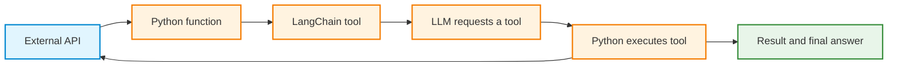
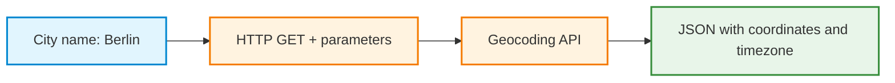
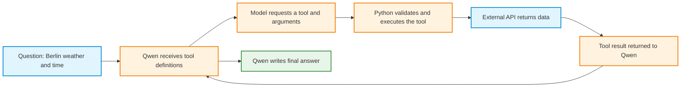
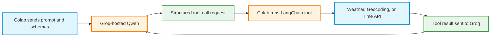

# Theory: From API Calls to LLM Tools

## Learning objective

Explain how an external API becomes a reusable Python function, how LangChain exposes that function as a tool, and how a language model can request the tool during a conversation. Distinguish hosted and locally running models, and explain why tool execution must be evaluated rather than assumed to be correct.



The central distinction is that a **language model requests a tool call; application code performs the call**. Exposing a function as a tool does not automatically give a model permission or the ability to execute arbitrary code.

## 1. An API provides access to an external service

An **application programming interface (API)** defines how software can request an operation or data from another service. A web API commonly uses an HTTP request consisting of:

- An **endpoint URL**, identifying the service and operation.
- **Parameters**, supplying inputs such as a city name or coordinates.
- An HTTP **response status**, indicating whether the request succeeded.
- A **response body**, often formatted as JSON.

For example, a Geocoding request sends a city name to Open-Meteo and receives geographic details. A weather request supplies coordinates and receives current measurements. A time request supplies a timezone and receives local time information.



A **JSON object** can be converted into a Python dictionary. The program can then extract only the required values, such as `latitude`, `longitude`, or `timezone`.

**Key distinction:** An API is an external service interface. It is not a LangChain tool by itself.

## 2. A Python function makes an API call reusable

In Step 1 of the activity, Python executes individual requests. In Step 2, each request is placed inside a function with meaningful inputs and a predictable returned structure.

Examples from the activity:

| Function | Inputs | Returned information |
|---|---|---|
| `geocode_city(city_name, country_code=None)` | City name; optional country code | City, country, coordinates, timezone |
| `get_current_weather(latitude, longitude)` | Latitude, longitude | Current temperature, humidity, wind, units |
| `get_local_time(timezone)` | IANA timezone, such as `Europe/Berlin` | Local datetime, UTC offset, daylight-saving status |

The function contains the URL, request parameters, HTTP response handling, and extraction logic. Other code only needs to supply the function arguments.

A function **returns** data so that later operations can reuse it. Printing a result for inspection is useful during testing, but printed text is not a substitute for a returned value.

**Important:** The function still calls the same API. Wrapping the HTTP request does not change the external service or make the response more accurate.

## 3. LangChain converts a function into a tool

A **tool** is a callable operation presented through a consistent interface. In the activity, LangChain's `@tool` decorator wraps existing Python functions and exposes:

1. **Name:** Identifies which tool is being requested.
2. **Description:** Explains the tool's purpose and suitable use cases.
3. **Input schema:** Defines accepted argument names and types.
4. **Execution method:** Allows the operation to be called from Python, for example with `.invoke()`.

The Step 3 wrapper follows this pattern:

```python
from langchain_core.tools import tool
from geocoding_api import geocode_city

@tool
def geocode_city_tool(city_name: str, country_code: str | None = None) -> dict:
    """Find a city's name, country, coordinates, and timezone."""
    return geocode_city(city_name, country_code)
```

A direct test of the tool does not require any language model:

```python
result = geocode_city_tool.invoke({
    "city_name": "Berlin",
    "country_code": "DE"
})
print(result)
```

The function's **type hints** supply information for the schema. The **docstring** supplies a description that can help a model choose the correct tool. A well-defined schema also enables argument validation, although it does not guarantee that a model will choose valid arguments every time.

**Step 3 boundary:** Python selects the tool explicitly and calls `.invoke()`. No model is involved in deciding which tool to use.

## 4. With an LLM, tool selection becomes part of the model's job

In Steps 4 and 5, a prompt is sent to Qwen together with descriptions of the available tools. A tool-capable model can respond with a **tool-call request** specifying a tool name and its arguments.

The program then handles the rest:



For a question that needs more than one API, the model may request multiple tool calls over several rounds. A possible sequence is:

1. Request `geocode_city_tool` for Berlin.
2. Read the returned coordinates and timezone.
3. Request `get_current_weather_tool` with the coordinates.
4. Request `get_local_time_tool` with the timezone.
5. Use the returned weather and time values to write the final response.

This is a **possible tool sequence**, not a guarantee that every model will select the same order. Tool selection and argument construction must be checked in execution traces.

### Tool calling has separate responsibilities

| Component | Responsibility | What it does not do |
|---|---|---|
| **API** | Supplies data when called | Decide which task an LLM should perform |
| **Python function** | Implements the HTTP request | Interpret a natural-language prompt independently |
| **LangChain tool** | Adds a callable tool interface and schema | Automatically execute merely because a model mentions its name |
| **LLM** | Proposes a tool and arguments; interprets returned data | Execute arbitrary Python operations on its own |
| **Application loop** | Validates, dispatches, and records calls; returns results to the model | Guarantee the final answer is correct |

## 5. Step 4: Tool calling with Groq-hosted Qwen

**Groq** is the hosted inference service used in Step 4. **Qwen** is the language-model family used through that service. Groq and Qwen are not interchangeable names.

**Part 4A** verifies the remote model connection: load `GROQ_API_KEY` from Colab Secrets, select an available model, send a simple prompt, and inspect its response. **No tools** are required for this first test.

**Part 4B** provides the three existing LangChain tools to the hosted Qwen model. The application communicates with Groq, receives structured tool-call requests, executes the corresponding Python functions, returns the tool results, and requests a final answer.



An API key is required to authenticate the **Groq model request**. The key is not an argument to the Geocoding, Weather, or Time functions. The Step 4 model is hosted remotely, so Colab does not need to download the model or enable a GPU.

**Important:** A model-generated tool-call request is an instruction for the application, not proof of execution. The execution trace must contain the actual tool call and the result returned by the API.

## 6. Step 5: Tool calling with local Qwen3.5-4B

In Step 5, Qwen3.5-4B runs in the Colab runtime instead of on Groq's servers. The supplied loading activity uses **4-bit quantization** to reduce model memory requirements; a suitable GPU is still needed.

- **Part 5A:** Change to a GPU runtime, rebuild temporary files after the session change, install dependencies, load the local model, and test basic text generation before involving tools.
- **Part 5B:** Present the same LangChain tool definitions to the local model, interpret generated tool requests, execute the approved tools, and return the results to Qwen.
- **Part 5C:** Evaluate tool selection, argument validity, successful execution, final-answer accuracy, and efficiency.

The local workflow has an additional implementation detail: a raw Hugging Face generation may produce a **text-formatted tool request** rather than a structured LangChain tool-call message. The activity's custom parser and orchestration loop interpret that text and dispatch approved tools. An alternative is to use a compatible chat-model integration or adapter that supports structured tool calling.

The tools themselves remain unchanged. The external APIs are still accessed over the network from Python. **Running the LLM locally does not make the external API data local.** A Groq API key is not needed for the local Qwen model.

### Hosted versus local model

| Aspect | Step 4: Groq-hosted Qwen | Step 5: Local Qwen3.5-4B |
|---|---|---|
| Where model inference runs | Groq's infrastructure | Colab GPU |
| Colab GPU required | No | Yes |
| Groq API key required | Yes | No |
| Model weights downloaded to Colab | No | Yes |
| Tool execution | Python in Colab | Python in Colab |
| API functions and LangChain wrappers | Same three tools | Same three tools |
| Tool-call handling in this activity | Structured Groq response plus custom loop | Generated tool-request text plus parser and custom loop |

## 7. Why evaluation matters

A coherent final response does **not** establish that the correct API was called or that the model used the returned values faithfully. Failures can occur at different stages:

- **Selection:** The model chooses a time tool for a weather-only question, or skips a required tool.
- **Arguments:** The model supplies a city name to a tool that expects numeric coordinates.
- **Execution:** The API is unavailable, the city does not exist, or the application rejects a tool name.
- **Grounding:** The model ignores, misstates, or invents details that are not in the tool result.
- **Efficiency:** The model repeats the same call unnecessarily or fails to finish within the allotted rounds.

Use a small, repeatable test set. The activity can include a single-tool time request, a single-tool weather request with known coordinates, a city-name request needing geocoding and weather, and a combined weather-and-time question.

| Criterion | Evidence to inspect | Example check |
|---|---|---|
| Tool choice | Requested tool names | Correct tool selected for the task |
| Argument validity | Tool-call inputs | Correct names and types |
| Execution | Returned tool results, errors | API call completed successfully |
| Answer grounding | Final answer compared with the same run's API result | Values and units agree |
| Completion and efficiency | Status, number of calls, repeated requests | Request finishes without avoidable calls |

**Dynamic data require care.** Weather and local time change. Compare the final answer with the **tool output recorded during the same run**, not with a fixed temperature or a later time lookup. An API error should be distinguished from a model-selection or parsing error.

### Evaluation also applies to Groq

The Step 5 evaluation is demonstrated with local Qwen, but the **same principles should also be applied to the Groq model from Step 4**. A fair comparison should keep the API functions, tool definitions, prompts, scoring criteria, and approximate test conditions consistent.

Record meaningful differences in the environments and tool-calling implementations. For example, forcing the first Groq tool call and allowing local Qwen to choose freely would not be a fair comparison of *tool selection*. Compare genuine evidence, not just whether both models produced fluent text.

## 8. Looking ahead: Weather and trip planning

The three tools already form a useful foundation. A city name can be converted to coordinates and timezone; those values can support weather and local-time requests. A future trip planner could reuse the same tools and add travel-related capabilities such as route, lodging, or activity searches. Such capabilities would require additional APIs and additional evaluation.

The main architectural pattern is reusable:

**External API → Python function → LangChain tool → model-requested call → controlled execution → evaluated result.**

## 9. Next lecture preview: LangChain `create_agent()`

The current activities deliberately expose the tool-calling loop so that tool requests, execution, and returned results are visible. A later lecture introduces an agent framework that can manage this cycle.

<details>
<summary>Next lecture: How LangChain create_agent() manages the tool-calling loop</summary>

### Why use an agent framework?

In Steps 4 and 5, custom Python code manages conversation messages, checks requested tool names, runs the selected functions, appends tool results, and repeats until a final answer is produced or an execution limit is reached.

LangChain's `create_agent()` can manage much of this orchestration. The agent repeatedly calls a **compatible chat model**, executes requested tools through the supplied tool definitions, sends the results back to the model, and stops when the model completes the task or another stopping condition is reached.

The conceptual structure is:

1. Supply a compatible chat model.
2. Supply the existing LangChain tools.
3. Supply a system instruction describing how the tools should be used.
4. Invoke the agent with a question.
5. Inspect the returned messages and tool results.

Illustrative structure (not a copy-and-run cell; `compatible_chat_model` must be initialized separately):

```python
from langchain.agents import create_agent

agent = create_agent(
    model=compatible_chat_model,
    tools=[
        geocode_city_tool,
        get_current_weather_tool,
        get_local_time_tool,
    ],
    system_prompt="Use tools for current weather and local time."
)

result = agent.invoke({
    "messages": [
        {"role": "user", "content": "Give the weather and local time in Berlin."}
    ]
})
```

**What changes?** LangChain manages the repeating model-to-tool-to-model cycle. The underlying weather, geocoding, and time API functions remain the same.

**What does not change?** Tool correctness, network availability, valid arguments, error handling, access restrictions, and evaluation still matter. A tool's description does not guarantee correct model behavior.

**Important for local Qwen:** The raw Hugging Face model object used in Step 5 is not automatically a LangChain chat model with structured tool calling. A compatible integration or an adapter is required to translate generated requests into the structured calls expected by the agent. `create_agent()` is therefore a **next-lecture extension**, not a direct drop-in replacement for the current local loop.

**Discussion prompt:** Which parts of the existing custom loop become LangChain responsibilities, and which responsibilities must remain in the API functions, tool definitions, model integration, and evaluation process?

</details>

## Check understanding

1. Why does converting an API request to a Python function make the code easier to reuse?
2. What additional information does `@tool` expose beyond a regular function?
3. Which component chooses a tool, and which component executes it?
4. Why does Step 3 work without an LLM?
5. Why is the Groq API key required in Step 4 but not for local Qwen in Step 5?
6. Why must a local Qwen output sometimes be parsed before the corresponding LangChain tool can be executed?
7. What can a final answer conceal about failed or incorrect tool calls?
8. Why should evaluation also be applied to the Groq model?

## References

- [Open-Meteo Geocoding API](https://open-meteo.com/en/docs/geocoding-api)
- [Open-Meteo Weather API](https://open-meteo.com/en/docs)
- [Time.Now Developer API](https://time.now/developer)
- [LangChain tools](https://docs.langchain.com/oss/python/langchain/tools)
- [LangChain models](https://docs.langchain.com/oss/python/langchain/models)
- [LangChain agents and create_agent](https://docs.langchain.com/oss/python/langchain/agents)
- [Groq tool-use overview](https://console.groq.com/docs/tool-use/overview)
- [Groq local tool calling](https://console.groq.com/docs/tool-use/local-tool-calling)
