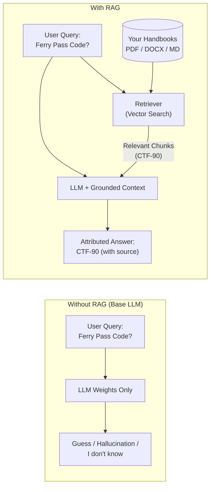
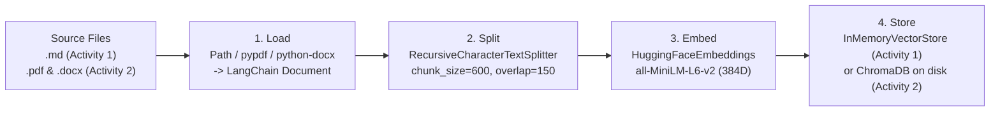
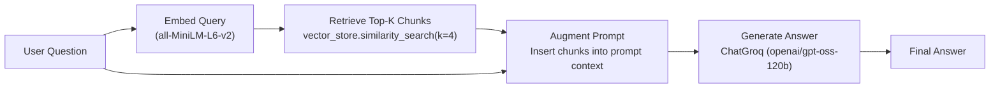
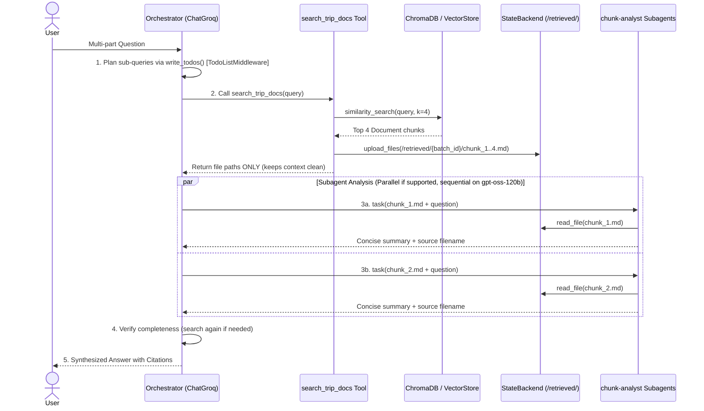
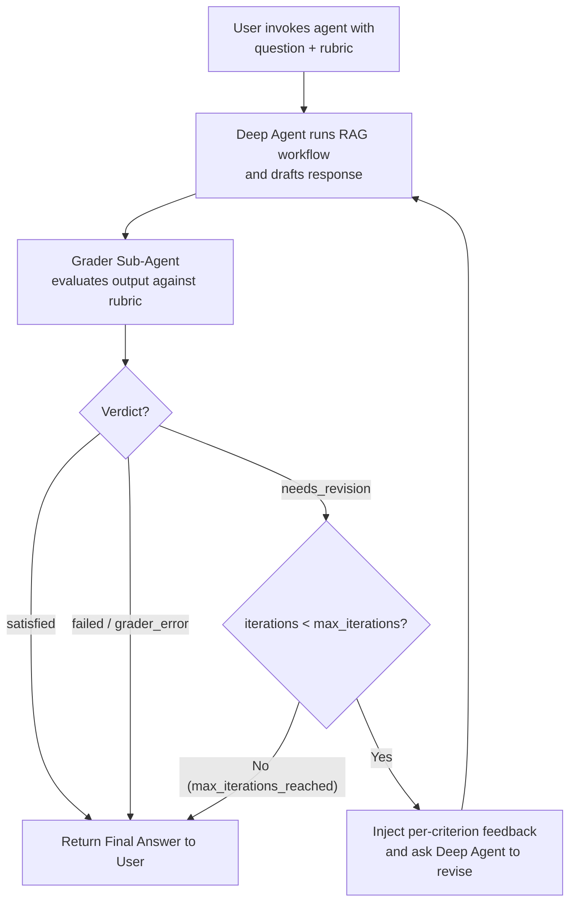

# Theory & Architecture: From Embeddings to Agentic RAG with Deep Agents

This guide explains the theory behind every component we built across our RAG labs (`activity1.md` and `activity2.md`)—from why standard LLMs fail on private data, to 2D vector geometry, LangChain's indexing and retrieval pipeline, **ChromaDB**, **Deep Agents** orchestration, and runtime evaluation with **Grading Rubrics**.

---

## 1. Why Retrieval-Augmented Generation (RAG)?

Large Language Models (LLMs) store knowledge in their neural network weights during pre-training. While this gives them broad general knowledge, it creates three major limitations for real-world applications:

1. **Private, Recent, or Unsupplied Data**: An LLM cannot reliably access or verify information—such as internal company policies, private PDFs, or our fictional travel company (**Vellamo & Pine Atelier**) and its **Solvik Archipelago** rules (like pass code `CTF-90` or `Protocol Gull`)—unless that information is supplied in its context or made available through tools.
2. **Knowledge Cutoff**: Pre-trained weights freeze at a point in time; updating them via fine-tuning every time a schedule or price changes is slow and expensive.
3. **Hallucinations & Context Limits**: If you ask an ungrounded model about unsupplied facts, it may confidently invent plausible-sounding falsehoods. Conversely, pasting dozens of PDFs and Word documents directly into the prompt hits token limits, increases latency/cost, and degrades accuracy ("context rot").



> [!IMPORTANT]
> **RAG separates reasoning from memory.** The LLM provides language understanding and synthesis, while an external vector store provides **attributed passages** from your documents at inference time. Keep in mind that retrieved evidence is *not* automatically verified truth—if a source file is outdated or incomplete, or if the LLM misinterprets a chunk, the final answer can still be wrong.

---

## 2. How Embeddings Work: Sentence & Semantic Embeddings

Computers cannot directly measure whether *"boat ticket password"* means the same thing as *"Silver Birch Ferry pass code"*. **Embeddings** solve this by converting text into coordinates (vectors) in a geometric space where **meaning corresponds to direction and distance**.

### From Keywords to Semantic Vectors

- **Keyword search (BM25 / exact match)** looks for identical strings. Searching for *"storm evacuation"* might miss a paragraph that only says *"winds exceed 55 knots ... Underground Maintenance Rail (Tunnel 4)"*.
- **Word embeddings** (like early Word2Vec) assign one vector per word, which struggles with polysemy (e.g., *"bank"* of a river vs. *"bank"* account).
- **Sentence / Semantic embeddings** (like HuggingFace's `sentence-transformers/all-MiniLM-L6-v2` used in our labs) read an entire sentence or chunk with a Transformer encoder and pool token representations into a single fixed-length vector—**384 numbers** per chunk—capturing the *overall meaning* of the passage.

> [!NOTE]
> **Limitation of Dense Embeddings & Hybrid Search:** Semantic embeddings excel at paraphrases, but can struggle on **exact identifiers, codes, and numbers** (such as `CTF-90`, `SA-2026-ALPHA`, `NA-DINE-77`, or `€18`). In production RAG systems, teams often use **hybrid retrieval**—combining **BM25 keyword search** with **dense vector search** (and optional reranking)—so both conceptual queries and exact code lookups work reliably.

### Measuring Similarity with Cosine Similarity

When comparing two embedding vectors $\mathbf{A}$ and $\mathbf{B}$, we usually measure **cosine similarity**—the cosine of the angle $\theta$ between them:

$$\text{cosine\_similarity}(\mathbf{A}, \mathbf{B}) = \frac{\mathbf{A} \cdot \mathbf{B}}{\|\mathbf{A}\| \, \|\mathbf{B}\|}$$

- **Close to `+1.0`**: Vectors point in nearly the same direction (very similar meaning).
- **Close to `0.0`**: Vectors are perpendicular (unrelated topics).
- **Close to `-1.0`**: Vectors point in opposite directions.

### Python Illustration: 3 Vectors in 2D Space

Real embeddings live in 384 dimensions (or 1,536+ for larger models), which humans cannot visualize. The runnable script below creates **3 vectors in 2D space** to illustrate how two semantically similar queries point in nearly the same direction while an unrelated topic points elsewhere:

<details>
<summary>Show Code</summary>

```python
import numpy as np
import matplotlib.pyplot as plt


def cosine_similarity(a: np.ndarray, b: np.ndarray) -> float:
    return float(np.dot(a, b) / (np.linalg.norm(a) * np.linalg.norm(b)))


# Imagine a simplified 2D semantic space:
#   x-axis = "Maritime / Boarding"
#   y-axis = "Fees / Rules"
vectors = {
    "v1: Silver Birch Ferry pass code": np.array([0.90, 0.44]),
    "v2: Boat boarding password": np.array([0.78, 0.63]),
    "v3: Excess luggage storage fee": np.array([-0.55, 0.84]),
}

v1 = vectors["v1: Silver Birch Ferry pass code"]
v2 = vectors["v2: Boat boarding password"]
v3 = vectors["v3: Excess luggage storage fee"]

print(f"Cosine similarity (v1 vs v2 - similar meaning):   {cosine_similarity(v1, v2):.3f}")
print(f"Cosine similarity (v1 vs v3 - different meaning): {cosine_similarity(v1, v3):.3f}")

# Plot the 3 vectors in 2D space
fig, ax = plt.subplots(figsize=(6, 6))
colors = ["tab:blue", "tab:green", "tab:red"]

for (label, vec), color in zip(vectors.items(), colors):
    ax.quiver(0, 0, vec[0], vec[1], angles="xy", scale_units="xy", scale=1, color=color, width=0.012)
    ax.text(vec[0] * 1.06, vec[1] * 1.06, label, fontsize=9, color=color, fontweight="bold")

ax.axhline(0, color="gray", linewidth=0.6, linestyle="--")
ax.axvline(0, color="gray", linewidth=0.6, linestyle="--")
ax.set_xlim(-1.0, 1.35)
ax.set_ylim(-0.2, 1.2)
ax.set_aspect("equal")
ax.set_title("3 Semantic Vectors in 2D Space (Angle = Similarity)")
ax.set_xlabel("Dimension 1 (Maritime / Transit)")
ax.set_ylabel("Dimension 2 (Policies / Fees)")
plt.grid(alpha=0.3)
plt.tight_layout()
plt.show()
```
</details>

> [!TIP]
> You will see `cosine_similarity(v1, v2) ≈ 0.975` (a small angle between blue and green arrows), while `cosine_similarity(v1, v3) ≈ -0.125` (a wide angle pointing toward the red arrow). Our HuggingFace model `all-MiniLM-L6-v2` performs this exact same geometric comparison—just across **384 dimensions** instead of 2!

<details>
<summary><strong>Bonus: Check Real 384D Cosine Similarities with <code>HuggingFaceEmbeddings</code></strong></summary>

You can verify the exact same behavior using the real embedding model from our labs (always dividing by vector norms so the formula works for both normalized and unnormalized embedding models):

```python
import numpy as np
from langchain_huggingface import HuggingFaceEmbeddings


def cosine_similarity(a: np.ndarray, b: np.ndarray) -> float:
    return float(np.dot(a, b) / (np.linalg.norm(a) * np.linalg.norm(b)))


emb_model = HuggingFaceEmbeddings(model_name="sentence-transformers/all-MiniLM-L6-v2")

texts = [
    "Silver Birch Ferry pass code",
    "Boat boarding password",
    "Excess luggage storage fee",
]
e1, e2, e3 = [np.array(emb_model.embed_query(t)) for t in texts]

print("Vector dimensions:", len(e1))
print("Real similarity (ferry pass vs boat password):", round(cosine_similarity(e1, e2), 3))
print("Real similarity (ferry pass vs luggage fee):  ", round(cosine_similarity(e1, e3), 3))
```

</details>

---

## 3. How We Use LangChain for Indexing, Retrieval, Augmentation & Generation

Every RAG system splits into two phases: an **Indexing Pipeline** (preparing your documents once) and a **Query Pipeline** (retrieving, augmenting, and generating answers at runtime).

### Phase A: The Indexing Pipeline



1. **Load (`Document` abstraction)**:
   - In `activity1.md`, we read local `.md` files with `Path.read_text()`.
   - In `activity2.md`, we used `pypdf.PdfReader` (emitting one `Document` per PDF page with `page` metadata) and `python-docx` (`docx.Document` paragraphs; note that Word tables require reading `word_doc.tables` separately).
   - Both produce LangChain `Document(page_content=..., metadata={"source": filename, ...})` objects so downstream splitters and vector stores treat every format identically.
2. **Split (`RecursiveCharacterTextSplitter`)**:
   - Splitting into ~600-character chunks keeps each vector focused on one topic.
   - Setting `chunk_overlap=150` provides a **target maximum overlap** across natural separators (`\n\n`, `\n`, spaces)—helping keep cross-paragraph context (such as **Silver Birch Ferry** in Paragraph 1 and *"that same ferry ... Pass Code CTF-90"* in Paragraph 2) together when boundaries align, though exact overlap varies with separator placement.
3. **Embed (`HuggingFaceEmbeddings`)**:
   - Converts every chunk into a 384-dimensional vector locally without needing an embedding API key.
4. **Store (`InMemoryVectorStore` vs. `Chroma`)**:
   - **`InMemoryVectorStore` (`activity1.md`)**: Fast, zero-setup storage in Python RAM. Great for quick experiments, but wiped whenever the Python kernel or Colab runtime restarts.
   - **`Chroma` / ChromaDB (`activity2.md`)**: Persists vectors, text, and metadata to disk (`persist_directory="./chroma_trip_db"`), survives Python process restarts (though Colab runtime resets still wipe `/content/` unless mounted to Google Drive), supports fast HNSW vector search, and enables metadata filtering (e.g., `filter={"file_type": "docx"}`).

> [!NOTE]
> Because LangChain standardizes the `VectorStore` interface, swapping `InMemoryVectorStore` for `Chroma` required changing only the store initialization—the splitter, embeddings, and retrieval tool stayed identical.

### Phase B: Retrieval, Augmentation & Generation

In a traditional LangChain pipeline, retrieval, augmentation, and generation happen in a fixed linear chain:



- **Retrieval**: Embed the query and fetch the top $k=4$ nearest chunks from the vector store.
- **Augmentation**: Provide retrieved text (and source metadata) as grounded context to the model.
- **Generation**: `ChatGroq(model="openai/gpt-oss-120b", temperature=0)` synthesizes a clear, low-temperature factual answer grounded in those chunks.

---

## 4. Why We Use Deep Agents & Its Benefits

A fixed single-step RAG chain (`retriever | prompt | llm`) is fast, cheap, and deterministic for straightforward lookups. While conventional LangChain pipelines *can* handle complex queries using programmed query expansion or multi-query retrieval, **Deep Agents (`create_deep_agent`)** upgrades RAG from a fixed pipeline into an **autonomous, context-engineered agent** when flexibility matters:

- **Dynamic multi-part planning**: When a question spans unrelated topics (like *Skylark-4 luggage*, *excess storage fees*, and *Protocol Gull evacuations*), the agent can plan and issue multiple distinct searches rather than relying on a single blended query vector.
- **Context bloat prevention ("Context Quarantine")**: Dumping 8–16 raw retrieved chunks directly into the main prompt wastes tokens and degrades focus. Offloading chunks to a filesystem backend keeps the orchestrator context clean.
- **Iterative self-correction**: If an initial search returns incomplete chunks, the agent can refine its query and search again—at the trade-off of **higher latency, more LLM calls, and nondeterministic execution** compared to ordinary RAG.

> [!NOTE]
> **Pedagogical Note:** With only three short handbooks (~13,500 characters total), a production app would not need subagents or filesystem offloading—a single RAG chain would be faster and simpler. We use this small dataset in `activity1.md` and `activity2.md` as a fast, low-cost sandbox so you can inspect the agentic RAG mechanics clearly before scaling to large corpora.



### Key Capabilities of Deep Agents for RAG

1. **Opt-in Task Planning (`TodoListMiddleware`)**: Starting in Deep Agents v0.7, task planning is opt-in—passing `middleware=[TodoListMiddleware()]` enables `write_todos` so the orchestrator can decompose complex questions into separate focused search queries. Note that `write_todos` and `max_concurrent_analysts` are **prompt-guided agent behaviors**, not guaranteed execution steps—on simple single-fact queries, the model may skip planning and search immediately.
2. **Filesystem Offloading (`StateBackend`)**: `search_trip_docs` writes full chunk text to `/retrieved/<batch_id>/chunk_i.md` and returns *only the file paths* to the orchestrator. Raw text never clogs the main agent's context window.
3. **Subagent Delegation, Tool Isolation & Context Quarantine (`task()`)**:
   - The orchestrator delegates each file to a `chunk-analyst` subagent starting in an **isolated context** (`mode="isolated"`) containing only the question and a single file path.
   - **Least-Privilege Tool Override (`"tools": []`)**: Custom `SubAgent` dictionaries inherit the parent's custom tools by default unless `"tools"` is specified. Passing `"tools": []` explicitly prevents `chunk-analyst` from inheriting `search_trip_docs`, while keeping built-in `FilesystemMiddleware` tools (`read_file`, `ls`, `grep`) available so it can inspect `/retrieved/` files and return `<300`-word summaries.
   - **Sequential vs. Parallel on Groq:** Parallel `task()` execution depends on the underlying model's capabilities. On Groq, `openai/gpt-oss-120b` executes tool calls **sequentially** (one `task()` per turn), whereas `qwen/qwen3.8-27b` supports **parallel tool calls** and can run multiple subagents concurrently.
4. **Flexible Model Routing**: By default, subagents inherit the parent `ChatGroq` model (`openai/gpt-oss-120b`), **or** you can assign a faster/cheaper model (such as **`openai/gpt-oss-20b`**) to `chunk-analyst` while keeping a stronger reasoning model for orchestration.

### LangChain vs. LangGraph vs. Deep Agents

**LangChain**, **LangGraph**, and **Deep Agents** are related technologies that operate at different levels. **LangChain** provides components for building LLM applications, including document loaders, text splitters, embeddings, vector stores, tools, and agents. **LangGraph** is a lower-level orchestration framework for building stateful workflows with explicit control over steps, decisions, and execution. **Deep Agents** builds on LangChain and LangGraph to provide higher-level capabilities for complex tasks, such as planning, filesystem tools, context management, and subagent delegation. In our labs, we use LangChain to prepare and retrieve documents, while Deep Agents coordinates the retrieval and analysis workflow—so we do not need to build the underlying LangGraph workflow manually.


---

## 5. Evaluation & Grading Rubrics

Building a RAG agent is only half the job—you also need to evaluate whether it retrieves the right evidence, follows formatting rules, and knows when to abstain.

### Three Dimensions of RAG Evaluation

When testing a RAG system, distinguish three separate questions:
1. **Retrieval Quality**: Did ChromaDB and your `chunk_size`/`chunk_overlap` settings actually surface the right chunk? (e.g., running the pre-agent `similarity_search()` checkpoint, and checking Demo B).
2. **Rubric Compliance vs. Evidence Groundedness**: Does the answer follow formatting and citation rules (*compliance*), and are its claims actually supported by the retrieved chunks (*groundedness*)?
3. **Answer Correctness & Abstention**: Is the answer factually right against ground truth—including both **partial-answer** prompts (answering what is documented and abstaining on missing details) and **truly out-of-corpus** questions (clearly stating when none of the requested facts appear in the handbooks)?

### Two Ways to Evaluate with LangChain & Deep Agents

#### A. Runtime Self-Evaluation with Grading Rubrics (`RubricMiddleware`)
Available in `deepagents>=0.6.5`, **`RubricMiddleware`** adds an **LLM-as-a-judge** loop directly at runtime before returning an answer to the user:



- You configure `RubricMiddleware(model=grader_model, max_iterations=3)` alongside `TodoListMiddleware()` and a `checkpointer` (e.g., `InMemorySaver()`).
- At `.invoke()` time, you pass `"rubric"` alongside `"messages"` (for example: *"Must cite the handbook filename, answer all parts of the query, and avoid speculative claims"*).
- If any criterion fails (`needs_revision`), the grader injects specific feedback and forces the Deep Agent to revise until every criterion passes or `max_iterations` is reached.

> [!WARNING]
> **Important Caveat:** Unless the grader sub-agent is given tools (such as `read_file`) to inspect the retrieved chunks in `/retrieved/`, `RubricMiddleware` only evaluates **rubric compliance** (apparent completeness, tone, and presence of citations)—it cannot independently verify whether a cited fact is actually present in the source document.

#### B. Offline Batch Evaluation with LangSmith
While `RubricMiddleware` checks single runs at runtime, **LangSmith** lets you run your agent against a benchmark dataset (combining exact-fact questions, paraphrased queries, multi-document queries like Demo A, partial-answer queries, and out-of-corpus unanswerable questions) every time you change `chunk_size`, swap embedding models, or update prompts—measuring **Retrieval Relevance**, **Groundedness**, and **Correctness** systematically.

### Evaluating the Retriever vs. Evaluating the RAG Assistant

Evaluating a RAG application involves checking **two different parts of the system**:

- **The retriever:** Does similarity search return the right document chunks for a question? We can inspect the top-$k$ results and measure retrieval quality using metrics such as *Recall@k* and *Precision@k*.
- **The RAG assistant (end-to-end):** Does the assistant use the retrieved evidence to produce a correct, grounded, and complete answer, cite the appropriate sources, and acknowledge when information is missing? We can also examine tool usage, latency, and token consumption.

In our labs, we inspect retrieval results before invoking the agent, test its answers against expected facts, and explore `RubricMiddleware` for checking answer quality. **LangSmith** can support more systematic evaluation across multiple test questions.

---

## 6. Official LangChain, Deep Agents & Groq Documentation Links

- **RAG with Deep Agents (Tutorial & Architecture):** https://docs.langchain.com/oss/python/deepagents/rag
- **Using ChromaDB in Deep Agents RAG:** https://docs.langchain.com/oss/python/deepagents/rag#chroma
- **Deep Agents Overview (Middleware, `TodoListMiddleware` & Harness):** https://docs.langchain.com/oss/python/deepagents/overview
- **Subagents (Context Isolation, Tool Inheritance, `task()`, Custom Models):** https://docs.langchain.com/oss/python/deepagents/subagents
- **Filesystem Backends (`StateBackend` & Persistence):** https://docs.langchain.com/oss/python/deepagents/backends
- **Grading Rubrics (`RubricMiddleware`):** https://docs.langchain.com/oss/python/deepagents/rubric
- **Context Engineering for Agents:** https://docs.langchain.com/oss/python/deepagents/context-engineering
- **Semantic Search & Knowledge Bases (Loaders, Splitters, Embeddings):** https://docs.langchain.com/oss/python/langchain/knowledge-base
- **Evaluate a RAG Application with LangSmith:** https://docs.langchain.com/langsmith/evaluate-rag-tutorial
- **Groq Tool Use & Parallel Tool Support:** https://console.groq.com/docs/tool-use/overview
- **Groq Model Deprecations:** https://console.groq.com/docs/deprecations
