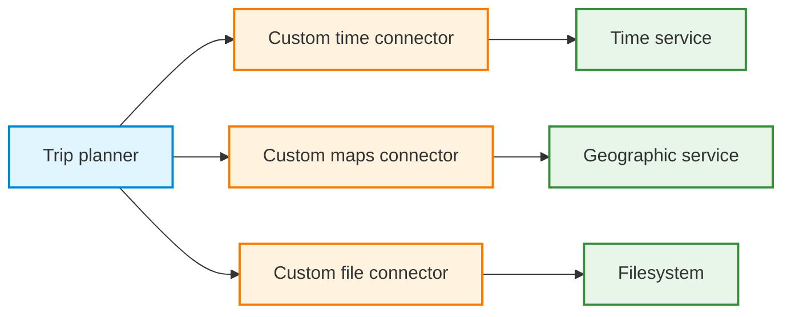
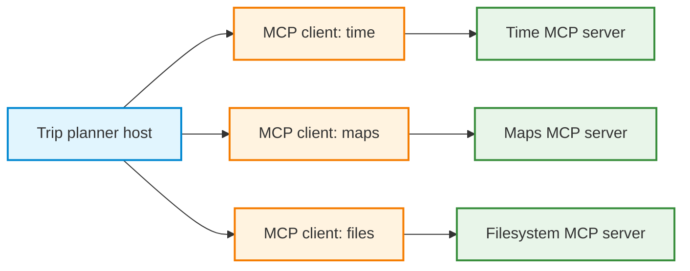
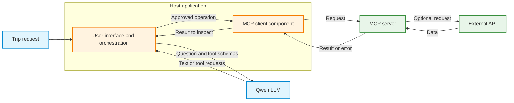
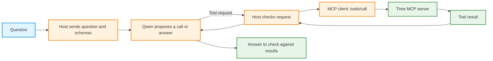
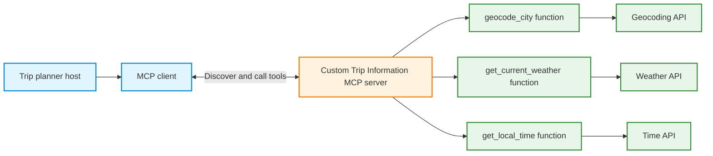

# Theory: Model Context Protocol (MCP): Connecting AI Applications to Tools and Data

**Topic:** MCP architecture, servers, clients, tool discovery, invocation, integration, and trust boundaries  

## Learning objectives

After studying this chapter, you should be able to explain:

1. The integration problem that Model Context Protocol (MCP) addresses, and its relationship to APIs and ordinary functions.
2. The separate responsibilities of an **MCP host**, an **MCP client**, an **MCP server**, and a **language model**.
3. The three main kinds of server capabilities: **tools, resources, and prompts**.
4. How a client discovers tool definitions, supplies arguments, receives results, and reports failures.
5. How local `stdio` and remote Streamable HTTP connections differ.
6. Why MCP does not require LangChain or a language model, and why LangChain may nevertheless be useful.
7. How time conversion, geographic search, route planning, and file operations can be combined in a trip-planning application.
8. How existing Python and API functions can later be exposed by a **custom MCP server**.

---

## 1. The problem: applications need external capabilities

A language model can interpret a question and generate a response, but its generated text is not the same as a live measurement or an executed operation. For example, a model cannot reliably determine the **current** time in a city from training data, independently inspect a folder on a computer, or calculate an up-to-date walking route without access to an external capability.

A conventional application solves this by calling external APIs or local Python functions:

- A **geocoding API** converts a place name into coordinates.
- A **weather API** retrieves conditions for those coordinates.
- A **time service** determines the local time in a specified timezone.
- A **filesystem function** reads or writes an authorized file.

A tool-calling agent introduces another layer: the language model *requests* a function or tool, and application code validates and executes that request. The model does not run arbitrary Python merely because it names a function.

### The integration problem

Without a shared protocol, each application may need custom code to integrate with each external system: credentials, tool descriptions, parameter schemas, execution methods, error formats, and result processing. Maintaining those individual connections becomes difficult when many applications and services must interoperate.



APIs remain essential. MCP reduces repeated work at the application-facing discovery and invocation boundary. Provider-specific authentication, data interpretation, and application policy still require implementation.

## 2. What MCP solves

**Model Context Protocol (MCP)** is an open protocol for connecting AI applications to external tools and contextual information through a consistent interface. A tool provider exposes capabilities through an **MCP server**; an application accesses them through an **MCP client**.

Instead of needing a different calling convention for every provider, an MCP-compatible application can perform common operations such as **discover available tools** and **request execution of a named tool with structured arguments**.



MCP primarily standardizes the **boundary between consumers and providers**. It does not replace HTTP APIs, databases, Python functions, application logic, or language models. An MCP server can still call an ordinary API internally.

The benefits include **reusable integrations**, **discoverable capabilities**, **structured inputs and outputs**, and **separation of tool implementation from tool consumption**. A compatible protocol does not guarantee that a server is trustworthy, a result is correct, or a model will select the right tool.

## 3. The architecture: host, client, server, and model

The terms have distinct meanings.

| Component | Responsibility | Trip-planner example |
|---|---|---|
| **Host application** | Coordinates the user interface, connections, available capabilities, and tool-execution policy | A Python trip planner running in Google Colab |
| **MCP client** | Communicates with one MCP server using MCP messages | A Python client connected to a Time server |
| **MCP server** | Advertises capabilities, accepts valid requests, and runs the underlying implementation | A Time server providing timezone conversions |
| **LLM** | Interprets a request and may propose which tools to use | Groq-hosted Qwen or local Qwen |
| **External system** | Supplies data or performs the underlying operation when needed | A geocoding service, mapping backend, or permitted directory |

**One host application can manage multiple MCP client connections.** A client is typically a component inside the host. An SDK or adapter may aggregate several connections behind one Python object. The underlying server implementations may be local subprocesses or remote services. The server is not the model, and the MCP client is not necessarily an agent.

### Two distinct paths

The **MCP path** connects a host to tool providers. The **model path** connects the host to a language model. The host joins them when model-directed tool calling is needed.



This separation explains why an MCP client works **without an LLM**: Python can request `list_tools()` or `call_tool()` explicitly. Adding an LLM changes *who proposes the tool operation*, not where the tool implementation resides.

## 4. What an MCP server exposes

An MCP server is a program that provides capabilities through MCP. It can be implemented in Python, TypeScript, or another language with an appropriate SDK. The implementation might perform calculations, access an API, read permitted files, query a database, or return prepared context.

The three core categories are:

| Capability | Meaning | Example |
|---|---|---|
| **Tool** | An executable operation with a name and structured inputs | `get_current_time`, `geocode`, `route`, `write_file` |
| **Resource** | Information made available for reading, often identified by a URI | A saved destination guide or itinerary document |
| **Prompt** | A reusable prompt template provided through the server | A template for comparing attractions in a destination |

Tools are the main focus of a tool-calling trip planner. Resources and prompts are separate MCP features and should not be confused with tool definitions.

In a typical LLM application, the model proposes a tool call, the host selects a resource to add as context, and a user or application selects a prompt template. These are common interaction patterns, not a restriction on what ordinary Python code can request.

### Tool metadata is not tool execution

Consider a Time server advertising a tool called `get_current_time`. Its metadata might describe an input requiring an IANA timezone string:

```json
{
  "name": "get_current_time",
  "description": "Get the current time in a specified timezone.",
  "inputSchema": {
    "type": "object",
    "properties": {
      "timezone": { "type": "string" }
    },
    "required": ["timezone"]
  }
}
```

*Illustrative tool-definition excerpt. Exact descriptions and additional fields depend on the server release.*

This **schema** tells a caller how to construct a request. It does not contain the current time. Only a subsequent invocation requests a time calculation.

The server may also advertise metadata such as a display title, output schema, and annotations. Tool names, descriptions, and schemas are useful for both ordinary applications and LLM tool calling, but they must not be treated as automatically trusted instructions.

## 5. What an MCP client does

An MCP client implements the **consumer side** of the protocol. Its main responsibilities are to establish communication, discover supported capabilities, send requests, and interpret responses.

For tool use, the essential operations are:

1. **Connect** to a configured server.
2. **Discover** the server's advertised tools.
3. **Inspect** each tool's name, description, and input schema.
4. **Accept a tool selection** from host code, a user, or a model and prepare its arguments.
5. **Call** the tool through the MCP connection.
6. **Read** returned content or a structured result.
7. **Handle** errors and close the connection appropriately.

In the Python MCP SDK, the relevant methods are named `list_tools()` and `call_tool()`. They correspond to the protocol operations `tools/list` and `tools/call`.

### Why discovery matters

With a conventional imported function, the program already knows its name and Python signature. With MCP, the client can ask the server which tools it currently exposes. That makes a reusable application possible: different servers can advertise different operations without requiring every implementation to be copied into the host application.

Discovery does **not** mean that a client should run every discovered operation. The host may deliberately expose only an approved subset to a model. Selection and authorization belong to application policy; the communication layer does not inherently decide what the user wants. Tool listings may span multiple pages.

## 6. A complete example: time information without an LLM

The public reference **Time MCP Server** exposes `get_current_time` and `convert_time`. The example below uses a local server subprocess over `stdio` (standard input and output). The server implementation is supplied by the installed `mcp-server-time` package; it is not written inside the client program.

**Requirements:** Python 3.11+, the v2 Python MCP SDK, and `uv` providing `uvx`. Internet access is needed to install packages and download the server on first launch. No API key, GPU, or model is needed.

In a terminal, install dependencies with:

```bash
python -m pip install "mcp>=2,<3" uv
```

In Colab, install with a code cell containing `%pip install "mcp>=2,<3" uv`.

For a script, save the complete code below as `time_mcp_client.py` and run `python time_mcp_client.py`. In Colab, paste the imports and function definition into a cell, **omit the final `if __name__ ...` block**, then run `await main()` in another cell. Colab already has an event loop, so calling `asyncio.run()` there can fail.

```python
"""Discover and call an existing Time MCP server without an LLM."""
import asyncio
import json
import shutil

from mcp import Client, StdioServerParameters
from mcp.types import TextContent


async def main():
    uvx = shutil.which("uvx")
    if uvx is None:
        raise RuntimeError("The uvx command is unavailable. Install uv first.")

    server = StdioServerParameters(
        command=uvx,
        args=["mcp-server-time"],
    )

    async with Client(server) as client:
        # 1. Discover available operations.
        tools = []
        cursor = None
        while True:
            listing = await client.list_tools(cursor=cursor)
            tools.extend(listing.tools)
            if listing.next_cursor is None:
                break
            cursor = listing.next_cursor
        tool_names = {tool.name for tool in tools}

        for tool in tools:
            print("Tool:", tool.name)
            print("Description:", tool.description)
            print("Input schema:", json.dumps(tool.input_schema, indent=2))

        # 2. Execute a known operation only if it was advertised.
        if "get_current_time" not in tool_names:
            raise RuntimeError("Required time tool was not advertised.")

        result = await client.call_tool(
            "get_current_time",
            {"timezone": "Europe/Helsinki"},
        )

        # 3. Distinguish a tool-reported failure from normal content.
        if result.is_error:
            print("The Time server reported a tool error.")
        else:
            print("Structured content:", result.structured_content)
        # Text can contain returned data or error diagnostics.
        for block in result.content:
            if isinstance(block, TextContent):
                print("Returned text:", block.text)


if __name__ == "__main__":
    asyncio.run(main())
```

The code contains **no Groq client, no LangChain decorator, and no LLM inference**. Python explicitly selects the tool. The MCP client supplies the communication layer, while the Time MCP server performs the operation. The timestamp depends on the moment of execution.

**Runtime note:** `uvx` resolves the server dependencies in a separate environment. Do not assume that it requires SDK v1; the [server package metadata](https://github.com/modelcontextprotocol/servers/blob/main/src/time/pyproject.toml) declares the requirements for each release. Entering the direct SDK client context starts the subprocess; leaving it closes the client and stops that subprocess.

The example prints tool-reported errors. Startup, transport, and protocol exceptions are not caught here and appear as a traceback. A returned timestamp uses the runtime clock and timezone database; MCP does not independently certify that clock. If installation cannot find SDK v2, check Python compatibility and package-index access before continuing.

## 7. How requests and results travel

Consider the question: **“What is the current time in Helsinki?”** A model-enabled host could proceed as follows:



A model's tool-call request is usually represented in the model's own interface, such as a structured API tool call or model-generated tool-call markup. The host converts that request into an MCP tool invocation. The MCP server returns data to the client, not directly to the model's internal weights.

### Tool results have more structure than plain text

A call can return **content blocks** and, where provided, **structured content** that application code can inspect directly. Check `is_error` before interpreting content as successful data. Here `is_error` and `structured_content` are SDK v2 Python attributes; wire-format field names can differ, as with `inputSchema` in the tool-definition example. Some failures instead occur as transport, connection, or protocol exceptions before a normal tool result is returned.

Model-facing tool-call IDs and MCP request IDs belong to different interfaces. The host or SDK correlates requests and results at each boundary; their identifiers need not be the same string. A model proposal alone is not execution evidence, and a result does not prove the final answer used it correctly.

These distinctions matter for evaluation:

| Situation | Typical observation | Appropriate interpretation |
|---|---|---|
| Tool discovered successfully | Name and JSON input schema available | The operation is advertised, not yet executed |
| Tool returns successful data | Error flag is false and expected content is present | The server reports a result; inspect its relevance and validity |
| Invalid arguments | Tool error or protocol-level failure | The request did not satisfy the operation's requirements |
| Unknown tool | Rejection or error | The server does not provide that operation |
| Connection unavailable | Connection, startup, or transport exception | MCP communication could not proceed |
| Model gives an answer without calling tools | Text generated but no execution evidence | Live information was not verified through MCP |

## 8. Example: assembling a trip plan from several servers

A trip-planning application may connect to multiple specialized MCP servers without implementing their underlying geographic or file-management functionality.

| Server | Example tools | Contribution to the trip plan |
|---|---|---|
| **Time MCP server** | `get_current_time`, `convert_time` | Local time and timezone conversions |
| **OpenStreetMap MCP server** | `geocode`, `find_nearby_pois`, `route`, `optimize_route` | Location lookup, nearby attractions, routes, and stop ordering |
| **Filesystem MCP server** | Reading, listing, and writing tools | Retrieve notes or save a generated itinerary within an authorized directory |

A request such as **“Find museums near Berlin Central Station and propose a walking route”** may require multiple dependent operations.


The route depends on the selected stops. A separate geocoding call is useful for coordinates or disambiguation, but is not mandatory for every request: this community server accepts place names or coordinate strings and can geocode internally. Inspect each schema rather than impose one universal sequence. See the [OpenStreetMap tool reference](https://osm-mcp.ni-c.de/reference/tools). MCP standardizes access to each operation but **does not automatically determine the correct planning sequence**.

The OpenStreetMap MCP server is a community project and may use public geographic backends. Its availability, data completeness, and upstream usage limits must be distinguished from MCP protocol correctness. The filesystem server requires access restrictions because writing a file changes state. Route distances and durations are backend estimates for a travel profile; they do not establish live traffic, accessible paths, or attraction opening hours.

No tool in this example inherently purchases tickets, makes reservations, or guarantees that an attraction is open at a specific time. Those capabilities would need separate verified providers and appropriate authorization.

## 9. How an MCP client communicates: transports

MCP specifies communication between clients and servers independently of the server's underlying implementation. Two important transport patterns are:

| Transport | Typical deployment | How communication occurs | Common example |
|---|---|---|---|
| **`stdio`** | Local tool server | The host launches a child process and exchanges protocol messages over standard input/output | Time, Filesystem, or local OpenStreetMap server |
| **Streamable HTTP** | Network-reachable server | A client connects to an MCP HTTP endpoint | A hosted documentation or maps server |

A local server is still an MCP server. The term *server* describes its protocol role, not necessarily a machine on the public internet.

A subprocess-based MCP server generally uses **standard output for protocol messages**. Unstructured diagnostic output belongs on standard error so it does not corrupt the protocol stream.

Transport selection affects setup, hosting, network access, authentication, and failure handling. It does not change the central meanings of tool discovery and tool invocation. Older integrations may refer to the legacy HTTP+SSE transport. Streamable HTTP is a separate transport that can itself stream responses using SSE; SSE does not always mean the legacy transport. See the [transport specification](https://modelcontextprotocol.io/specification/2026-07-28/basic/transports).

## 10. MCP compared with ordinary APIs and LangChain tools

MCP, HTTP APIs, and LangChain operate at different layers.

| Question | Ordinary API + Python function | MCP | LangChain tool integration |
|---|---|---|---|
| Where is functionality implemented? | In Python or behind an API | Behind an MCP server | In a function or in an MCP-backed tool |
| How is an operation described? | Function signature or API specification | Discoverable MCP tool metadata | LangChain tool name, description, and argument schema |
| How is it invoked? | Function call or HTTP request | MCP `tools/call` | `.invoke()` or `.ainvoke()` |
| Does it require an LLM? | No | No | No for direct invocation; usually yes for agent-directed invocation |
| Does it require LangChain? | No | **No** | **Yes, when this abstraction is chosen** |
| What is its principal purpose? | Execute known functionality | Standardize provider–consumer communication | Simplify tool and agent programming |

### Where LangChain fits

A LangChain MCP integration can **discover tools on MCP servers and expose them as LangChain-compatible tools**. Those tools can be passed to an agent or called directly with `.ainvoke()`. The `MCPAdapter` integration in `langchain.mcp` is one available implementation of this approach.

For this optional notebook example, install the adapter dependency first:

```python
%pip install "langchain[mcp]>=1.4.0,<2"
```

Run the next cell in Colab with internet access. In a script, place its asynchronous block inside an `async def` and use the entry-point pattern from Section 6. No model API key is required.

```python
# Discover tools; no discovered tool is invoked.
from langchain.mcp import MCPAdapter

async with MCPAdapter("https://docs.langchain.com/mcp") as adapter:
    tools = await adapter.list_tools()
    for tool in tools:
        print(tool.name, tool.description)
```

This snippet illustrates discovery through a framework. The `langchain.mcp` API is beta; record installed versions when reproducing it. The MCP server is still responsible for advertising and implementing its capabilities. LangChain neither defines MCP nor becomes mandatory merely because an LLM is present.

### Where Groq and local Qwen fit

A Python host may discover MCP tools, expose selected tool schemas to **Groq-hosted Qwen**, receive a structured model tool-call request, and forward that request through a local MCP client. A **locally running Qwen** model can use the same MCP tool providers, although its tool-call format and inference loop may be different.

A different option is **Groq's native remote-MCP integration**. With a compatible **HTTPS-accessible** server and supported model, the hosted platform can manage discovery, execution, and feedback through its Responses API. It does not directly launch a local Colab `stdio` process. This demonstrates that LangChain is optional when a provider already offers MCP orchestration.

**Key distinction:** MCP standardizes tool access, while model adapters, LangChain agents, or native hosting platforms determine how the LLM's requests are converted into executions and how the resulting data returns to the model.

## 11. Security, permissions, and reliability

MCP standardizes communication; it is **not automatically a security boundary**. Host applications and servers must enforce appropriate controls.

### Tool selection is not permission

A model may request a tool, but the host should still restrict which tools may be used. A filesystem server should operate only within permitted directories. A tool that writes files, sends messages, or makes purchases requires more caution than a read-only time lookup.

Recommended protections include:

- **Allowlisting:** Expose only relevant tools instead of every capability from every server.
- **Argument validation:** Check required fields, types, and application-specific constraints.
- **Least privilege:** Restrict filesystem roots, network access, credentials, and write permissions.
- **Approval for consequential actions:** Require appropriate authorization before external changes.
- **Secret handling:** Keep API keys out of source code, prompts, submitted notebooks, and logs.
- **Untrusted-result handling:** Treat server responses as data rather than instructions that override application policy.
- **Operational limits:** Use timeouts, call budgets, and error handling to avoid uncontrolled loops or costs.

A response from a map search could contain text that attempts to instruct the assistant to reveal secrets or ignore previous requirements. Such content remains **untrusted tool output** even when delivered through a correctly functioning MCP server. MCP protocol compliance does not establish the truth or safety of the returned text.

### Technical failure versus reasoning failure

A working protocol connection can coexist with an incorrect model decision. Conversely, a sensible model tool request can fail because a server is unavailable. Both dimensions need separate evidence. A timeout or missing reply does not prove that an operation never ran: a state-changing operation may have completed before its response was lost. Check its outcome or use an idempotent design before retrying.

| Failure dimension | Example | What should be checked? |
|---|---|---|
| Connection | Server executable missing or remote endpoint unreachable | Process startup, URL, transport and credentials |
| Tool discovery | Requested tool absent | Server capabilities and actual tool listing |
| Input validity | `route` receives the wrong argument structure | Input schema and server-side validation |
| Tool execution | Upstream mapping API times out | Server result and upstream service status |
| Agent reasoning | Model routes to the wrong museum or omits a requested stop | Selected locations, arguments, dependencies, and model trace |
| Answer groundedness | Model invents travel times not returned by a tool | Compare answer claims with same-run tool results |

## 12. From consuming servers to implementing a custom MCP server

Existing servers are useful for learning the **client side**: connecting, discovering, requesting operations, and interpreting results. The complementary development task is to build the **server side**.

A custom **Trip Information MCP Server** could expose functions with the hypothetical contracts below. These are design examples, not implementations or imports supplied by this chapter:

| Existing Python function | MCP tool to expose | Input | Output |
|---|---|---|---|
| `geocode_city(city_name, country_code=None)` | `geocode_city` | City name and optional country code | Coordinates and IANA timezone |
| `get_current_weather(latitude, longitude)` | `get_current_weather` | Coordinates | Current weather values and units |
| `get_local_time(timezone)` | `get_local_time` | IANA timezone | Local datetime and timezone details |

In this proposed API-backed design, the functions remain responsible for the underlying requests. A geocoder does not necessarily return an IANA timezone; that contract may require a separate lookup. Local time can also be computed from a clock and timezone database without a time web API. The MCP server adds a **standard tool interface** around them: names, descriptions, input schemas, protocol handlers, and transport configuration.



**Implementing the proposed server** would involve registering the existing Python functions as server tools, validating inputs, selecting a transport, running the server, and confirming that a standard client can discover and invoke the new operations. The client-side concepts remain unchanged: the server provides capabilities, and the client consumes them through MCP.

## 13. Common misconceptions

| Misconception | Correct interpretation |
|---|---|
| “MCP is a new language model.” | MCP is a protocol between applications and capability providers. |
| “An MCP server must be a remote website.” | A server can run as a local subprocess using `stdio`. |
| “An MCP tool executes when its schema is listed.” | Discovery returns metadata; execution requires a separate call. |
| “MCP replaces existing APIs.” | A server can call existing HTTP APIs internally. |
| “A model connects directly to every server.” | The host and its MCP client or a hosting platform manage server connections. |
| “MCP requires LangChain.” | LangChain is an optional integration and agent abstraction. |
| “A valid MCP response must be correct and safe.” | Results still require validation, trust boundaries, and grounding checks. |
| “The same MCP servers require the same LLM.” | The same capabilities can support different models if the host handles each model's tool-call interface. |

## 14. Synthesis

MCP addresses a recurring integration problem: many AI applications need access to external operations and data, but implementing a separate custom integration for every provider creates duplication. **An MCP server publishes capabilities; an MCP client discovers and invokes them; an MCP host coordinates connections and decides what to expose to an LLM.** Tools perform operations, resources provide context, and prompts provide reusable templates. Time conversion, geocoding, routing, and filesystem access illustrate how separate providers can contribute to one trip planner. LangChain may make the model-facing integration more convenient, and some hosted model platforms can provide native remote MCP support, but neither is required by the protocol. Building a custom server adds the other half of this architecture: publishing existing Python functionality so that independently developed clients can consume it through the same standard interface.

---

## References and further reading

1. [Model Context Protocol: official documentation](https://modelcontextprotocol.io/)
2. [MCP Python SDK: host, client, server, tools, resources, and prompts](https://py.sdk.modelcontextprotocol.io/get-started/first-steps/)
3. [MCP Python SDK: client operations and tool responses](https://py.sdk.modelcontextprotocol.io/client/)
4. [MCP Time reference server](https://github.com/modelcontextprotocol/servers/blob/main/src/time/README.md)
5. [MCP Filesystem reference server](https://github.com/modelcontextprotocol/servers/tree/main/src/filesystem)
6. [OpenStreetMap MCP community server](https://github.com/ni-c/osm-mcp)
7. [LangChain MCP integration and `MCPAdapter`](https://docs.langchain.com/oss/python/langchain/mcp)
8. [Groq remote MCP documentation](https://console.groq.com/docs/tool-use/remote-mcp)

**Terminology note:** SDK imports and individual tool names can change between package versions. The concepts of capability discovery, invocation, server responsibility, and host-controlled authorization remain the focus of the chapter.
