# Agent2Agent (A2A): From Agent Orchestration to Agent Interoperability

## Introduction

An AI agent can use a language model to interpret a goal, choose tools, carry out actions and examine their results. A more complex agentic application may divide work among several specialized agents. However, creating several agents within one application does not automatically solve the problem of connecting independently developed agentic applications.

Agent2Agent (A2A) is an open communication protocol designed to address this problem. It establishes a common interface through which agents can advertise what they do, exchange requests and results, and collaborate on work without needing to share their implementation. In particular, it makes it possible to communicate with agents deployed in external systems, potentially developed by different organizations, using different agent frameworks and language models.

The Model Context Protocol (MCP) addresses a complementary problem: connecting model-powered applications to tools, resources and prompts. A2A extends the architectural possibilities by allowing independent agentic services to participate in a conversation or a task-oriented interaction. For example, a purchasing assistant may ask a seller to find suitable products, receive a request for clarification, obtain a quotation, and decide whether to proceed. It does not need access to the seller's internal tools or prompts.

This document explains the distinction between internal orchestration and external interoperability, the core A2A protocol objects, server and client implementations, the relationship with MCP, and ways to test a distributed agentic system. The examples are self-contained and use fictional prices and travel data. No actual orders or reservations are made. The protocol examples target A2A **1.0**; the Python examples use **a2a-sdk 1.3.1** as an illustrative pinned SDK release rather than a claim that it is the newest available package.


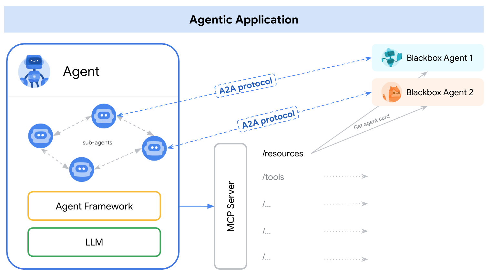
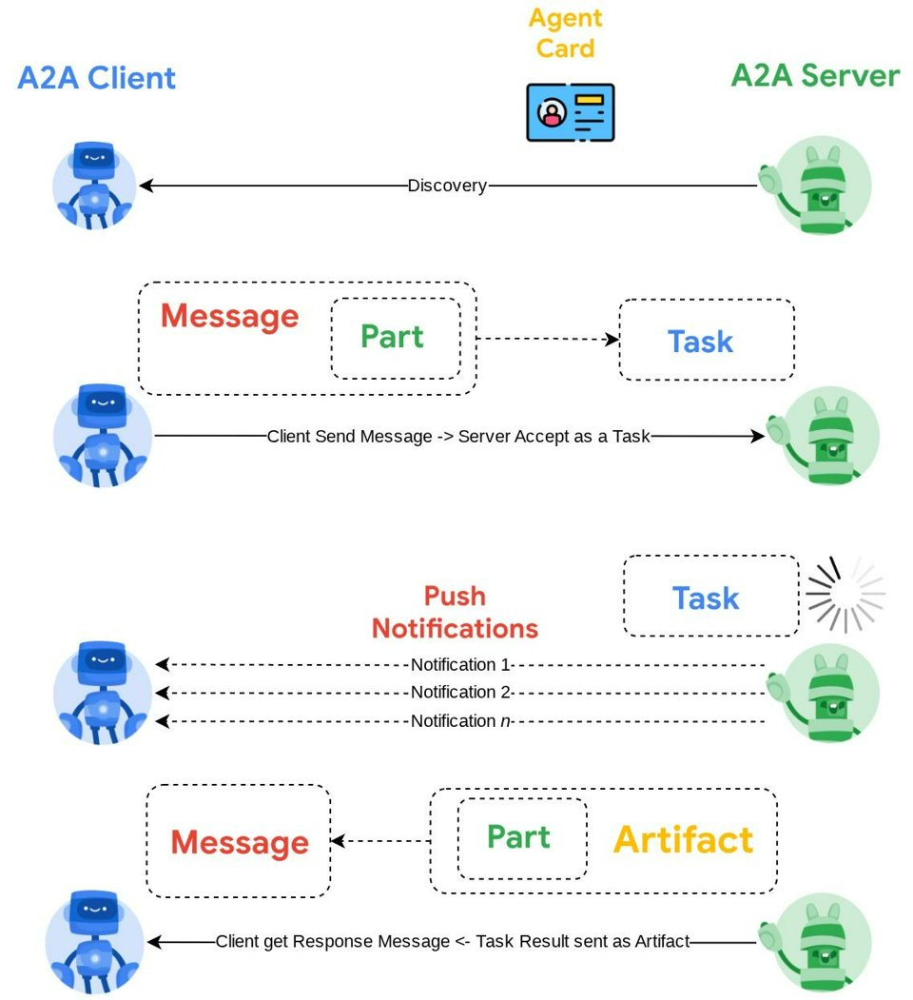

*[src](https://codelabs.developers.google.com/intro-a2a-purchasing-concierge#1)*

## 1. Starting point: an individual agent

Consider a personal research assistant that is asked to compare two products. A model might interpret the request, call a search tool, retrieve documents, calculate differences and produce a recommendation. The agent is responsible for selecting the next action, but the search and calculation tools carry out specific operations.

A simplified execution cycle is:

1. Receive a goal and relevant constraints.
2. Interpret the request and determine what information is missing.
3. Select a tool or another available capability.
4. Execute the selected action and examine the result.
5. Continue until there is sufficient evidence to answer, or request clarification.

The language model is only one component of this system. An agent framework typically manages messages, tool dispatch, execution state, and the control loop. Tools provide access to operations that the model should not attempt to perform solely from its learned knowledge, such as looking up current inventory or computing an exact total.

For example, the model may infer that two desserts are required, but a price calculation should be performed using the authoritative menu and deterministic arithmetic. The answer should be based on the result of that calculation, not on an invented price.

## 2. Internal subagents and the limits of orchestration

A complex request may exceed the scope of a single agent's prompt, context window or responsibilities. A common solution is to introduce a coordinating agent and several specialized subagents. For example, a research system can contain a researcher, a budget analyst and a reviewer. Each subagent can have its own instructions and tools.

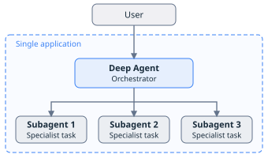

*Figure 1. A coordinating agent delegates specialized work within an application.*

Frameworks such as Deep Agents provide mechanisms for delegating work to subagents. A subagent may receive a focused task and return a result to its parent without exposing its complete intermediate conversation. This can reduce context clutter and improve separation of responsibilities. The parent remains responsible for choosing when delegation is useful and combining the results.

For instance, a purchasing assistant can ask a food researcher to collect menu information and a budget analyst to compare the options. These subagents can operate with different prompts or even different models. The important feature is that their invocation is managed through the application's orchestration framework.

### 2.1 What internal subagents solve

Internal delegation provides a convenient way to specialize behavior, divide a large problem into smaller tasks, isolate working context, reuse internal tools, and structure responsibility. It is particularly suitable when the components are developed and maintained as part of the same application.

The subagent abstraction does not necessarily imply that every subagent runs in the same process. Some frameworks can invoke remote workers or persist their state separately. Nor does it require all subagents to use the same LLM. The limitation concerns the **integration contract**, not merely the number of processes or models.

### 2.2 What internal subagents do not solve by themselves

Suppose a travel company has an existing hotel agent built in LangGraph, another organization operates a flight agent built in CrewAI, and a financial service offers a deterministic currency conversion service. The travel concierge should not need to import these applications' internal Python classes, copy their prompts, access their private databases or install their dependencies into its own environment.

An application-specific delegation mechanism might work for the concierge's own subagents but provide no standardized method to discover the independently operated hotel agent, understand the kinds of inputs it accepts, negotiate a task, request a progress update, or interpret a returned deliverable. Custom APIs could be built to solve each integration separately, but the client would then need to maintain many different adapters.

| Architectural concern | Internal subagent delegation | Independent agent interoperability |
|---|---|---|
| Ownership | Usually one application or team | Potentially different teams or organizations |
| Invocation | Framework-specific task or function interface | Shared network protocol |
| Implementation | Often known to the application developer | May remain private |
| Discovery | Registered in application configuration | Advertised capabilities and endpoints |
| State | Framework-managed context and persistence | Remote service manages its own task and conversation state |
| Deployment | May share runtime or use workers | Can be deployed, versioned and scaled independently |
| Failure | Internal execution errors | Also includes network, authentication and remote availability failures |
| Trust | Usually within an application boundary | Explicit authorization and data-sharing boundaries |

These are typical architectural differences rather than absolute restrictions. A local subagent can be wrapped in a service, and a remote service can be exposed to an orchestration framework as a tool. A2A provides a standardized boundary for the latter case.

## 3. From orchestration to interoperability

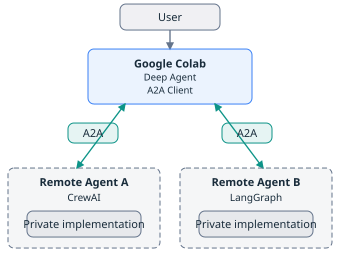

*Figure 2. The coordinating application invokes independently implemented agents through a common interface. Colab is only one possible deployment environment.*

Orchestration concerns how work is divided, ordered and coordinated. Interoperability concerns whether independently implemented components can communicate using a shared contract. These two concerns complement each other.

A2A does not decide which agent is best suited to a goal, how a budget should be allocated, or when a plan should be revised. Those decisions belong to the application or its coordinating agent. A2A supplies the communication mechanisms needed to carry out such decisions across service boundaries.

### 3.1 Black-box or opaque execution

Imagine a burger seller that internally uses CrewAI, a pizza seller implemented with LangGraph, and a dessert seller implemented with LangChain. A purchasing concierge may be written with Deep Agents. The concierge only needs the remote agents' published interfaces and the ability to interpret their responses. It does not need the sellers' internal implementation details.

This property is called opaque execution. It allows a seller to change its model, business tools, database or reasoning framework while retaining a compatible public interface. It also preserves a separation of responsibilities: each seller controls its own prices, inventory and order policy.

Opaque execution does not mean the remote agent is automatically trustworthy. Its advertised capabilities and returned results still require validation. A2A also does not require an agent to expose its private reasoning or hidden chain of thought. A task status and an artifact are observable protocol outputs, not a transcript of internal reasoning.


### 3.2 Combining local and remote agents

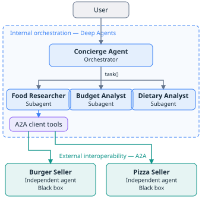

*Figure 3. Internal subagents may coexist with A2A communication in the same application.*

A concierge can use internal subagents to divide work, while its remote communication tools allow those subagents or the coordinator to contact external services. The budget analyst can remain an internal component, while menu information is obtained from independent sellers. Both architectures can be used without replacing one another.

A useful design rule is to choose an internal subagent when the main requirement is specialization within an application, and an A2A service boundary when independent ownership, deployment or integration is important. A network service introduces additional complexity, so not every small function or subagent benefits from being exposed through A2A.

## 4. What A2A standardizes

A2A defines a shared application-level communication contract. It describes the information an agent advertises, the structures exchanged with a remote agent, and the operations used to manage interactions. It enables interoperability without prescribing an internal framework, model or reasoning strategy. See the [official introduction](https://a2a-protocol.org/latest/topics/what-is-a2a/) and [protocol definition](https://a2a-protocol.org/latest/definitions/).

The distinction between the protocol, a transport binding, an SDK, a framework and a model is fundamental:

| Layer | Responsibility | Example |
|---|---|---|
| Application | User goals, domain rules and policies | Purchasing concierge |
| Agent framework | Planning, delegation, tools and execution control | Deep Agents, CrewAI, LangGraph |
| Model | Language understanding and generation | Gemini, GPT-OSS, Qwen |
| A2A protocol | Agent interaction contract | A2A 1.0 |
| Binding and transport | Representation and transmission of operations | JSON-RPC over HTTP, gRPC, HTTP+JSON |
| SDK | Library implementing protocol abstractions | Python `a2a-sdk` |
| Deployment | Where the service runs | Local process, container or managed cloud service |

A2A is not a new language model. It is also not a replacement for an agent framework. An application can use the same protocol with different frameworks and different models, provided their public behavior follows the selected protocol binding.

An SDK is not the protocol itself. It provides language-specific helpers, types, clients and server components. A2A 1.0 and Python SDK 1.3.1 are separate version identifiers; neither the seller application's version nor the model name specifies protocol compatibility. The protocol version should be advertised in the agent interface and checked by the client.

## 5. A2A and MCP: complementary protocols

The Model Context Protocol standardizes the connection between model-powered applications and capabilities such as tools, resources and prompts. A2A addresses communication across agent service boundaries. A useful conceptual distinction is that MCP extends what an agent can access, whereas A2A extends which independent agents it can collaborate with. The official discussion is available in [A2A and MCP](https://a2a-protocol.org/latest/topics/a2a-and-mcp/).

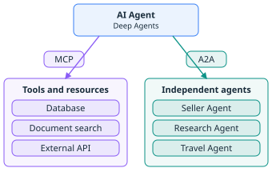

*Figure 4. An agent can use MCP to access tools and A2A to communicate with independent agents.*

### 5.1 Tool-oriented interaction

A weather lookup illustrates a tool-oriented interaction. An agent needs the weather for a particular city. A tool exposes a description and an input schema; the agent supplies the city, receives weather data, and uses it in its own decision-making process.

For example, a tool might accept the following arguments:

```json
{"city": "Helsinki", "units": "metric"}
```

The model selects the tool and supplies arguments; the tool implementation determines how the weather data is retrieved. MCP provides a standard way for an application to discover and invoke such tools, and also supports resources and prompts. A direct Python function or ordinary HTTP API can provide similar underlying capabilities without MCP; the protocol is useful when a standardized integration is desired.

### 5.2 Agent-oriented interaction

Consider a request to organize a dinner for six people, respecting dietary preferences and a budget. A seller agent may need to ask how many guests require vegetarian meals, consult its inventory, propose alternatives, and obtain approval before creating an order. This interaction is more than a single lookup: it can be a dialogue with changing requirements and tracked work.

The coordinating client can send a goal expressed in natural language or structured content. The seller chooses how to fulfill it. If it needs clarification, it can return an appropriate message or task status. The client then decides how to respond, possibly asking the user. This preserves the seller's autonomy while allowing coordination.

| Aspect | MCP | A2A |
|---|---|---|
| Primary purpose | Integrating capabilities, data and context | Collaborating across agent services |
| Typical discovery | Tools, resources and prompts | Agent Cards and skills |
| Typical input | Structured tool arguments or resource references | Messages containing text, structured data or files |
| Typical output | Tool result or resource content | Message, task status, artifact or updates |
| Coordination | Usually controlled by the consuming application | Remote agent may make its own domain decisions |
| Example | Look up a hotel room in a database | Ask a hotel agent to find suitable accommodation |
| Longer interactions | Depends on MCP version and application design | Explicit task and context abstractions |

This comparison describes their primary design focus, not a strict capability boundary. MCP is not limited to stateless functions, and A2A is not limited to natural-language messages or LLM-based agents. An A2A agent can also be wrapped as a tool exposed through MCP, especially for bounded operations. An application must decide how to preserve any richer interaction semantics, such as a remote task that requires clarification.

### 5.3 Using both in a single application

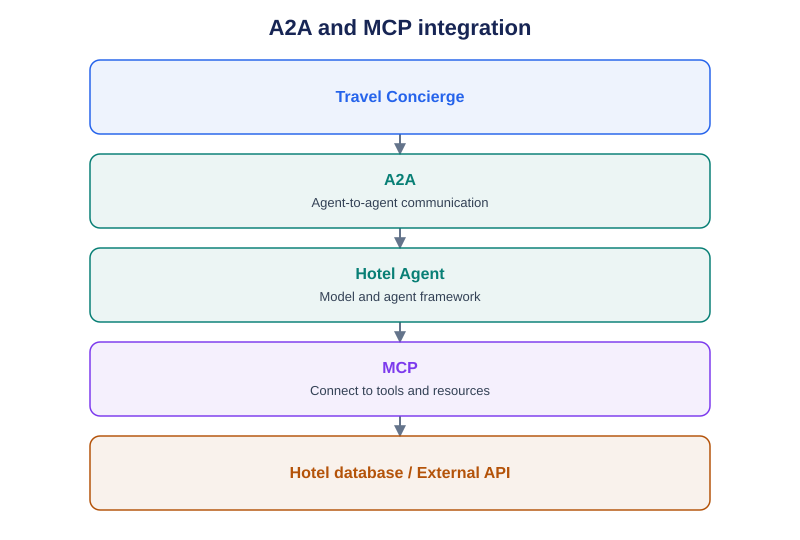

*Figure 5. A concierge talks to a hotel agent, which can use MCP to access its underlying resources.*

A travel concierge may ask a hotel agent to find an affordable hotel for particular dates. The hotel agent may use MCP to query an accommodation database. The concierge should not need direct access to that database. It receives the result through A2A, while the hotel agent retains control of the data and its policies.

The same distinction applies to a purchasing system. A concierge delegates the goal of finding a meal to a seller through A2A. The seller uses a price lookup or order calculation tool internally. These tools may be local Python functions, MCP tools or other authorized APIs. MCP is not a prerequisite for A2A, and A2A is not a prerequisite for MCP.

## 6. A2A architecture: client, server and application logic

The client is the participant initiating an A2A interaction. The server receives that interaction and exposes the remote application's capabilities. These are roles in a particular interaction rather than permanent categories of agent. A server can become a client when it delegates work to another service.

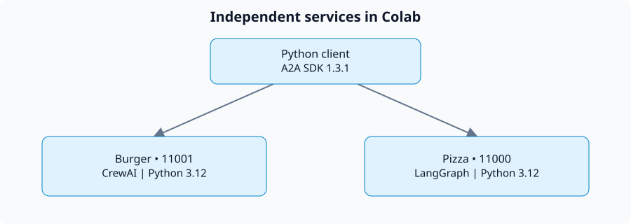

*Figure 6. A direct Python client can communicate with two independent seller services.*

A client need not be an intelligent agent. A conventional Python program can retrieve an Agent Card, construct a request, send it and extract the result. Similarly, an A2A server can expose deterministic logic without calling a model. This allows the protocol to be understood and tested before adding probabilistic behavior.

The use of different ports in a local environment demonstrates the service boundary. In this example the burger agent listens on port 11001 and the pizza agent on port 11000. Each service can have an independent Python environment and its own dependencies. The client communicates over HTTP rather than importing the sellers' business logic.

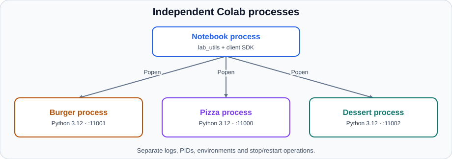

*Figure 7. Independent processes can be started, inspected and stopped separately. Local loopback deployment is a development arrangement, not a production security model.*

### 6.1 Discovery before communication

An agent cannot be selected merely because it exists. The client needs to know what the agent does and how to reach it. An **Agent Card** provides a standardized description. In a development environment, the client may already know a list of server URLs. In a larger system, it may obtain candidate agents from a curated directory or another discovery mechanism.

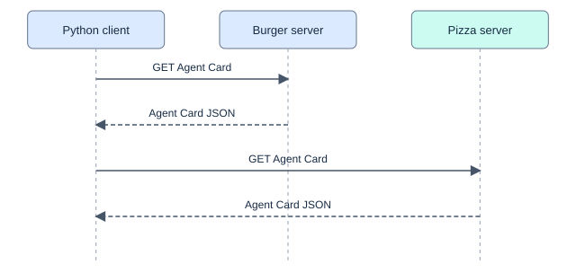

*Figure 8. A client retrieves Agent Cards before choosing a remote service.*

A common discovery convention is an HTTP GET request to `/.well-known/agent-card.json` on the service's domain. The resulting JSON describes the public agent interface. Discovery does not imply that an LLM must be invoked. A2A does not provide a universal search engine that locates every agent on the internet, nor does it prescribe a single registry API. See [Agent Discovery](https://a2a-protocol.org/latest/topics/agent-discovery/).

For example, the following Python program retrieves a card from a running local service. It requires the `requests` package and an actual server listening on the specified port. The code does not start that server.

```python
import requests

url = "http://127.0.0.1:11002"
response = requests.get(url + "/.well-known/agent-card.json", timeout=10)
response.raise_for_status()
card = response.json()
print(card["name"])
print(card["supportedInterfaces"])
```

## 7. The Agent Card

A useful analogy is a professional business card. A person can advertise their expertise, employer and contact details without revealing their private methods of working. An Agent Card plays a similar role for an agentic application. It is a machine-readable service description, not the agent's system prompt or source code.

The following illustrative A2A 1.0 Agent Card describes a dessert service. It uses local HTTP for a development environment and advertises a JSON-RPC interface. No external network service is implied by this example.

```json
{
  "name": "Dessert Agent",
  "description": "Provides dessert menus, prices and quotations.",
  "version": "1.0.0",
  "supportedInterfaces": [
    {
      "url": "http://127.0.0.1:11002/",
      "protocolBinding": "JSONRPC",
      "protocolVersion": "1.0"
    }
  ],
  "capabilities": {"streaming": false, "pushNotifications": false},
  "defaultInputModes": ["text/plain"],
  "defaultOutputModes": ["text/plain"],
  "skills": [
    {
      "id": "dessert_quote",
      "name": "Dessert quotations",
      "description": "List available desserts and calculate prices in EUR.",
      "tags": ["dessert", "menu", "pricing"],
      "examples": ["What does two Tiramisu and one Cheesecake cost?"]
    }
  ]
}
```

| Field | Purpose |
|---|---|
| `name`, `description` | Human-readable identity and scope |
| `version` | Version of the agent application |
| `supportedInterfaces` | Available endpoint URLs, protocol bindings and protocol versions |
| `capabilities` | Optional protocol features supported by the server |
| `defaultInputModes`, `defaultOutputModes` | Default content types |
| `skills` | Description of domain capabilities and example requests |
| Security declarations, when present | Mechanisms and requirements for authenticated access |

A skill describes a capability at the agent boundary. It need not correspond to exactly one internal tool or a function that can be invoked by name. For instance, a quotation skill may require several internal lookups, calculation and validation steps.

The client can use skill descriptions to narrow the choice of candidate agents. However, semantic matching is an application responsibility. The protocol does not guarantee that a model will choose the correct agent, and the card does not prove that its claims are accurate. Validate capabilities with controlled requests and check access policy before delegating work.

## 8. Messages, tasks, parts, artifacts and contexts

The main protocol objects represent different aspects of an interaction. It is important not to confuse the incoming request with the work that the server performs or with the output that it produces. The normative definitions are available in the [protocol schema](https://a2a-protocol.org/latest/definitions/) and the [Core Concepts](https://a2a-protocol.org/latest/topics/key-concepts/) documentation.

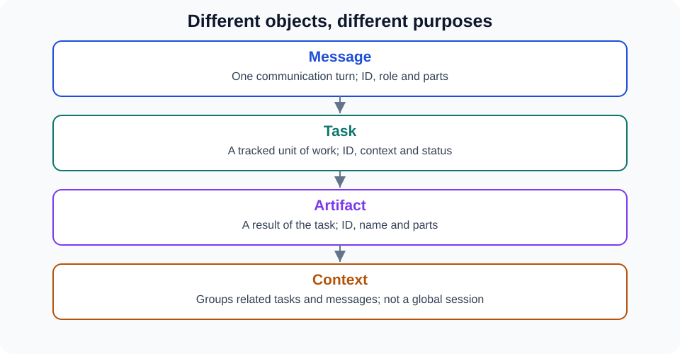

*Figure 9. Messages convey communication, tasks represent work, artifacts contain results, and contexts group related activity.*

### 8.1 Message and Part

A message is a communication turn. It has an identifier and a role, and carries one or more parts. The role indicates the sending side of the interaction (`user` or `agent` in the conceptual model); a coordinating agent sending a request to a remote seller uses the client-side user role. The role does not prove that the sender is a human, nor does it grant authorization.

A part can contain text, a structured JSON value, binary content, or a URL referencing content. In A2A 1.0 these are alternative content fields (`text`, `data`, `raw`, or `url`). A part may also contain metadata, a media type or a filename. For example, a request could contain a textual instruction and an attached specification; an artifact could contain a machine-readable list of items and a textual summary.

The following is an illustrative Protobuf JSON representation of a request message, using the enum name emitted by a Python Protobuf serializer:

```json
{
  "messageId": "message-001",
  "role": "ROLE_USER",
  "parts": [
    {"text": "Calculate the price of two Tiramisu and one Cheesecake."}
  ]
}
```

### 8.2 Task

A task represents an identifiable unit of work. The serving agent can return a task when it wants to track execution and communicate its status. A short interaction can also return a message directly; not every request needs a task. A client must be prepared for the response type it has negotiated rather than assume that every response contains an artifact.

The task ID identifies work on the serving agent. A task may contain its status, associated context, relevant message history and artifacts. A completed task indicates that the server considers that unit of work finished. It does not, by itself, prove that the business result is correct or that a purchase was successful.

### 8.3 Artifact

An artifact is a result produced by the task. In a purchasing example it might contain a quotation; in a research example it might contain a report; in a travel example it might contain a structured list of available flights. Keeping artifacts separate from messages makes it easier to track outputs and their provenance.

For example, a dessert quotation task could return the following illustrative result payload:

```json
{
  "task": {
    "id": "task-001",
    "contextId": "context-001",
    "status": {"state": "TASK_STATE_COMPLETED"},
    "artifacts": [
      {
        "artifactId": "artifact-001",
        "name": "dessert_quote",
        "parts": [
          {"text": "2 × Tiramisu (€6.50) + 1 × Cheesecake (€6.00) = €19.00"},
          {"data": {"currency": "EUR", "totalCents": 1900}}
        ]
      }
    ]
  }
}
```

The structured part makes downstream calculations easier: the client need not parse a human-readable price from prose. The exact domain schema is an agreement between applications; A2A provides the container, not a universal dessert quotation schema. This is an illustrative payload, not a captured response from a running service.

### 8.4 Context and identifiers

A context ID groups related activity on a remote service. It is useful when a client asks a follow-up question after obtaining a quotation. The original request may return task `task-001` in context `context-001`; a subsequent refinement can create a new task in the same context and reference the earlier work. A terminal task is not restarted simply because a follow-up was requested.

| Identifier | Scope and purpose |
|---|---|
| JSON-RPC request `id` | Correlates a wire-level request and response |
| `messageId` | Identifies an individual communication turn |
| Task `id` | Identifies a unit of work on the remote agent |
| `contextId` | Groups related work on the serving agent |
| `artifactId` | Identifies a particular produced result |

These identifiers are not interchangeable. A context ID does not guarantee persistent memory or global cross-agent state. The client must maintain its own mapping between the overall user request and each service's task and context identifiers. The server must implement and protect any persistence needed for continuity.

## 9. Task lifecycle and interaction patterns

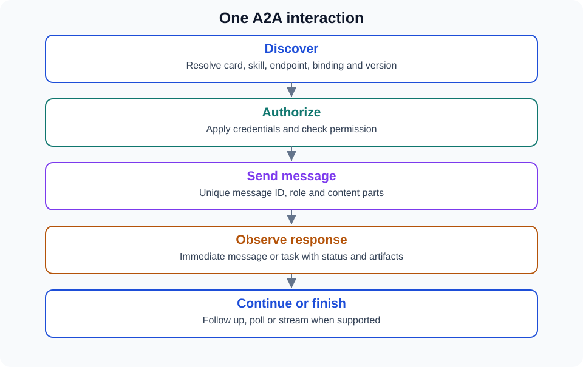

*Figure 10. Discovery, authorization, request, response and continuation are distinct steps.*

A client begins by resolving the service interface, then authenticates as required and sends a message. The response may be immediate or involve a tracked task. A task can report progress, deliver artifacts, or indicate a need for further information.

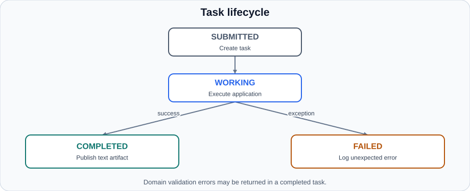

*Figure 11. A simplified lifecycle used by a synchronous quotation service. This diagram does not include all possible protocol states.*

Common task states include:

| State | Interpretation |
|---|---|
| `SUBMITTED` | Work has been accepted or queued for processing |
| `WORKING` | Work is in progress |
| `INPUT_REQUIRED` | Additional information is necessary |
| `AUTH_REQUIRED` | An additional authorization step is necessary |
| `COMPLETED` | Work has finished successfully at the protocol task level |
| `FAILED` | Work has failed |
| `CANCELED` | Work was canceled |
| `REJECTED` | The request was not accepted for execution |

The state names in this table omit the `TASK_STATE_` prefix for readability. The protocol also defines an unspecified enum value, which is not a meaningful successful task state. Not every task traverses every state. Completed, failed, canceled and rejected are terminal outcomes; an input or authentication requirement is an interruption that may be resolved through appropriate follow-up. See [Life of a Task](https://a2a-protocol.org/latest/topics/life-of-a-task/) for details.

### 9.1 Multi-turn interaction

Suppose the client asks a seller to create a simulated order for two desserts. The seller may first ask the client to confirm the quoted total. The server can report that input is required and provide the clarification request. The client can ask the user, then send the confirmation with the appropriate task and context references.

This is different from marking a task completed with the text “please confirm.” Although a simple stateless service could use completed responses to communicate such information, it would not be implementing a resumable confirmation workflow. To support a real multi-turn workflow, persist the relevant state, represent the interruption accurately and enforce authorization before performing a side effect.

A follow-up after a terminal task is a new unit of work, potentially in the same context. The distinction matters for retry handling, traceability and preventing accidental duplicate orders.

### 9.2 Request/response, streaming, polling and push

A small price lookup can complete within one request. A report-generation service may require several minutes. A2A accommodates different interaction patterns according to the binding and advertised capabilities:

- Request/response: send a request and receive a message or task response. A task need not already be complete when the response arrives.
- Polling: retrieve the current task status at appropriate intervals using its identifier.
- Streaming: receive incremental task status or artifact updates over an open connection when supported. HTTP bindings may use Server-Sent Events (SSE); gRPC can use its streaming mechanism.
- Push notifications: receive asynchronous notifications through an authorized callback endpoint when supported.

Streaming is not synonymous with language-model token streaming. It can carry application-level task and artifact events. Nor does it eliminate the need for reconnection and timeout handling. See [Streaming and Asynchronous Operations](https://a2a-protocol.org/latest/topics/streaming-and-async/).

## 10. Network bindings, protocol version and Python SDK

A2A 1.0 defines operations independently of a single network representation. Supported standard bindings include JSON-RPC, gRPC and HTTP+JSON. A client selects an interface that it supports and uses the operation representation defined for that binding. It should not attempt to send an arbitrary combination of legacy fields and new method names.

For the JSON-RPC binding, a simplified illustrative send request is:

```json
{
  "jsonrpc": "2.0",
  "id": "req-001",
  "method": "SendMessage",
  "params": {
    "message": {
      "messageId": "message-001",
      "role": "ROLE_USER",
      "parts": [{"text": "What is the price of Tiramisu?"}]
    }
  }
}
```

The JSON-RPC envelope carries the operation, correlation ID and parameters. The message is nested within the parameters. With a successful response, the `result` contains a message or task; a protocol error uses the error representation defined for the binding. Consult the specification for required headers, exact enum encodings, operation mappings, and interface-specific requirements when implementing raw HTTP clients. Using the SDK reduces the need to construct the wire representation manually.

Older tutorials may use `message/send`, `/.well-known/agent.json`, Pydantic models or `kind` discriminators in message parts. These belong to earlier protocol or SDK generations and should not be mixed into a v1 implementation without a compatible adapter. The A2A 1.0 [migration overview](https://a2a-protocol.org/latest/whats-new-v1/) explains the protocol changes. The Python SDK version may also alter helper signatures and generated Protobuf types. Always read the documentation for the version actually installed.

## 11. Implementing a direct Python client

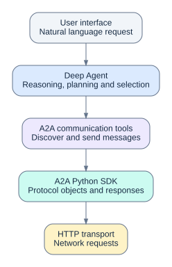

*Figure 12. The client application calls an A2A library, which handles protocol structures and network communication.*

A direct Python client is useful for isolating protocol behavior from intelligent decision-making. A fixed service URL and explicit request allow the developer to examine the result without depending on an LLM to choose the correct tool.

The following SDK example assumes a compatible A2A 1.0 service running on port 11002 and `a2a-sdk==1.3.1` installed in the client environment. It illustrates the asynchronous interface, not a complete deployment. In a script, use `asyncio.run(main())`; in a notebook, use `await main()`.

```python
from a2a.client import create_client, ClientConfig
from a2a.helpers import new_text_message
from a2a.types import Role, SendMessageRequest
from google.protobuf.json_format import MessageToDict

async def main():
    client = await create_client(
        agent="http://127.0.0.1:11002",
        client_config=ClientConfig(streaming=False),
    )
    try:
        message = new_text_message(
            text="What does one Tiramisu cost?",
            role=Role.ROLE_USER,
        )
        request = SendMessageRequest(message=message)
        async for response in client.send_message(request):
            print(MessageToDict(response))
    finally:
        await client.close()
```

The SDK may provide an asynchronous iterator even for a non-streaming client configuration. This is a library interface detail rather than evidence that the server advertised streaming. A production client should inspect the returned payload, check the task state where appropriate, collect artifacts and handle exceptions. The client should also retain task and context IDs if it will need to resume or query work.

## 12. Implementing an A2A server

A server connects the protocol boundary to an application. It must translate incoming messages into application requests and publish results in a protocol-compatible form. The internal domain logic should remain independent of the networking layer whenever possible.

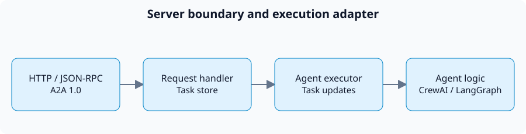

*Figure 13. The request handler and executor connect the A2A boundary with the application.*

A typical Python implementation uses a web server, protocol routes, a request handler, a task store and an executor. The Agent Card is served through a discovery endpoint. The executor reads the incoming message, invokes the underlying application, and emits a result or the appropriate task updates. Frameworks may provide different abstractions for the same responsibilities.

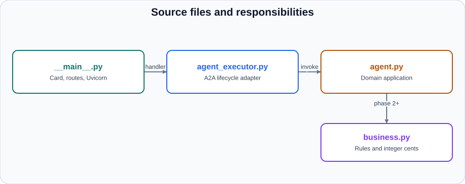

*Figure 14. One possible source-file organization: public server entry point, execution adapter, application and business rules.*

| Component | Responsibility |
|---|---|
| Agent Card | Advertises the public service contract |
| Routes / web application | Receives network requests and exposes endpoints |
| Request handler | Processes protocol operations and coordinates tasks |
| Task store | Keeps task records available for supported operations |
| Agent executor | Bridges request context and application execution |
| Business logic | Implements authoritative domain rules and tools |
| Model and agent framework (optional) | Interprets language and selects actions |

An in-memory task store is convenient for local examples but does not preserve state across restarts. A production deployment may need durable storage, concurrency control, access checks and retention policies. Likewise, calling a blocking agent function directly inside an asynchronous executor can block the event loop; an asynchronous implementation or suitable worker execution is preferable.

### 12.1 Minimal service: no LLM required

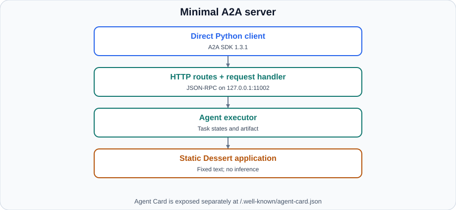

*Figure 15. A minimal A2A service can return a predefined response without invoking a model.*

The first useful implementation is a service that advertises its card and returns a fixed response. A direct client can verify discovery, endpoint selection, request decoding and response serialization. No model API key is required. When this works, protocol failures can be distinguished from business logic or inference failures.

### 12.2 Deterministic application: the dessert seller

A dessert seller can maintain an authoritative menu. For a self-contained example, use the following fictional prices:

| Dessert | Unit price |
|---|---:|
| Chocolate Cake | €5.50 |
| Vanilla Ice Cream | €3.50 |
| Cheesecake | €6.00 |
| Tiramisu | €6.50 |
| Fruit Salad | €4.00 |

The core price calculation should use integer cents or a decimal monetary type. Here is a small standalone business function that can be executed independently of an A2A server:

```python
MENU_CENTS = {
    "Chocolate Cake": 550,
    "Vanilla Ice Cream": 350,
    "Cheesecake": 600,
    "Tiramisu": 650,
    "Fruit Salad": 400,
}

def calculate_total(items: dict[str, int]) -> int:
    if not items:
        raise ValueError("At least one item is required")
    total = 0
    for item, quantity in items.items():
        if item not in MENU_CENTS:
            raise ValueError(f"Unknown dessert: {item}")
        if type(quantity) is not int or quantity <= 0:
            raise ValueError("Quantity must be a positive integer")
        total += MENU_CENTS[item] * quantity
    return total

assert calculate_total({"Tiramisu": 2, "Cheesecake": 1}) == 1900
```

A simple server might accept an explicit text command such as `PRICE Tiramisu` or a structured message containing a list of items. It can return the exact answer using these rules. The same server contract can later be extended to accept natural-language questions.

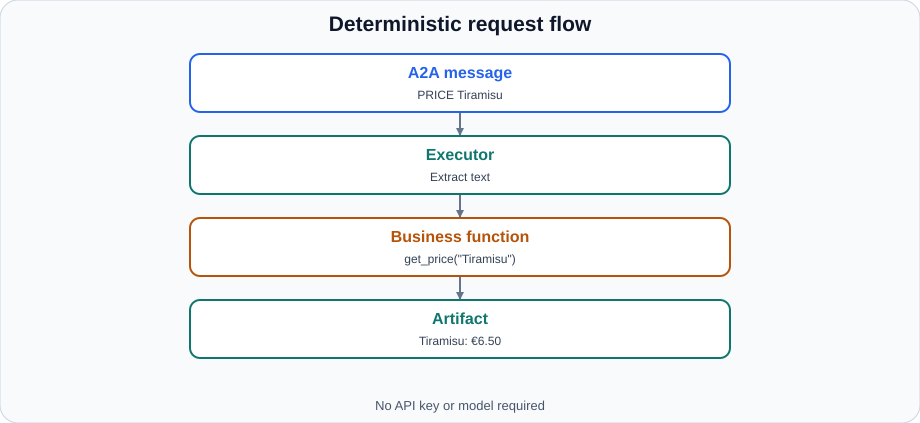

*Figure 16. The executor translates a request into an ordinary business operation.*

### 12.3 Intelligent service: add a model without replacing the business rules

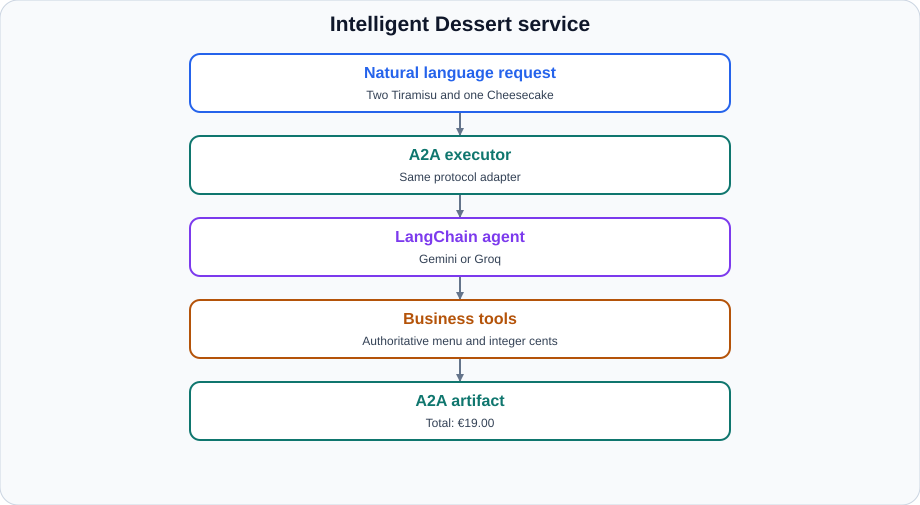

*Figure 17. An intelligent server interprets natural language and calls authoritative domain functions.*

When the server includes a model, the user can ask, “How much would it cost to have two Tiramisu and one Cheesecake?” The model can interpret the item names and quantities and choose a calculation tool. It should not invent the menu or calculate the authoritative amount independently.

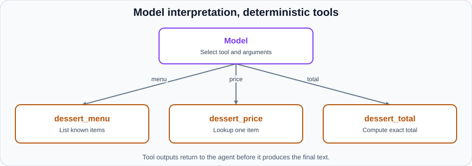

*Figure 18. The model selects a tool; deterministic logic returns the actual result.*

An agent framework can expose menu retrieval, price lookup and total calculation as tools. The server's executor calls the agent and translates the final result into a protocol response. The internal functions remain independently testable. If the service supports both command-style and natural-language requests, document their semantics clearly in the public capability description.

This illustrates why A2A does not require an LLM. The protocol works with a fixed response, a deterministic program, or an agent using a model. The choice depends on the application's needs.

### 12.4 Client intelligence and server intelligence are independent

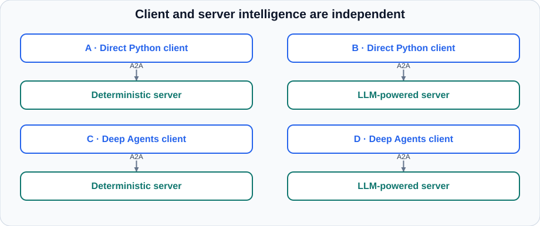

*Figure 19. Client-side and server-side intelligence can be introduced independently.*

A direct client can test a deterministic server, then test an intelligent server with the same public interface. An intelligent client can translate a user goal into a structured request for a deterministic service. Finally, two intelligent applications can interact. The four configurations help isolate which layer is responsible for unexpected behavior.

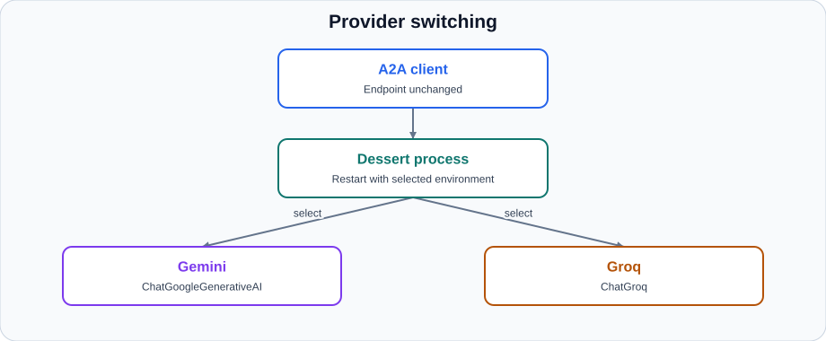

*Figure 20. A compatible service can change the model used internally while maintaining its public endpoint.*

Switching a model provider may require different packages, credentials and model initialization. Existing server processes may need to be restarted to read new environment settings. This is an implementation concern, not an A2A operation. Even if the network contract remains compatible, the behavior of the new model must be tested, especially its tool-calling ability and response quality.

## 13. Use case: a purchasing concierge

A purchasing concierge provides a common user interface to several independent sellers. The user does not need to know which framework each seller uses or how its internal tools are implemented. The concierge interprets the user request and chooses the appropriate services. This scenario is inspired by the [Google purchasing concierge Codelab](https://codelabs.developers.google.com/intro-a2a-purchasing-concierge#0). The example below uses an independent local deployment and fictional EUR prices; it does not require the cloud deployment described in the original Codelab.

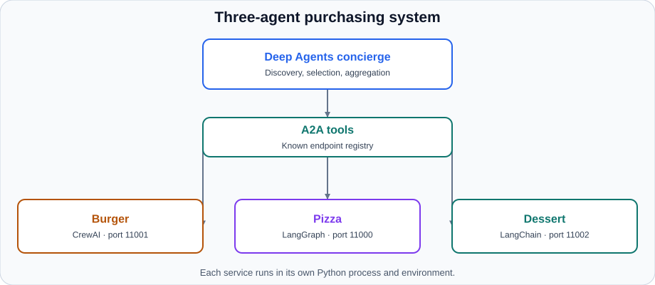

*Figure 21. The concierge coordinates three seller applications through A2A.*

Consider the following request:

> Compare meals for two people with a budget of €35. Include desserts, use current prices from the sellers, and do not place an order.

Three remote services advertise different skills:

| Agent | Example implementation | Domain expertise |
|---|---|---|
| Burger Agent | CrewAI | Burger menus, prices and quotations |
| Pizza Agent | LangGraph | Pizza menus, prices and quotations |
| Dessert Agent | LangChain or plain Python | Dessert menus, prices and quotations |

The coordinating application may use Deep Agents to plan the request and select tools. Two local communication tools could be made available to it:

- `discover_agents()`: retrieve Agent Cards from a configured, trusted set of endpoints and return the relevant skill descriptions.
- `ask_seller(agent_name, request)`: resolve the selected agent, send an A2A message, and return the relevant result or a structured description of a failure.

These names represent application-defined tools; they are not standardized A2A operation names. The tool implementation uses the SDK or another compatible client. The model does not need direct access to HTTP credentials, internal seller code or the seller database.

The concierge might first discover the three services, request their menus, identify appropriate combinations and ask the dessert agent to calculate the price of two cheesecakes. It can then combine the returned results. A deterministic calculator should verify the final total.

For example, assume the agents return these illustrative quotations:

| Item | Quantity | Unit price | Total |
|---|---:|---:|---:|
| Classic Cheeseburger | 1 | €8.50 | €8.50 |
| Margherita Pizza | 1 | €10.00 | €10.00 |
| Cheesecake | 2 | €6.00 | €12.00 |
| **Total** | | | **€30.50** |
| **Remaining budget** | | | **€4.50** |

This is one possible valid answer, not the only valid meal or a claim about current restaurant prices. The concierge should identify the sources of the quotations and make clear that no order has been created.

### 13.1 From explicit calls to intelligent coordination

In a conventional client, the developer explicitly decides which server to contact. In an intelligent client, the model uses the user request and advertised capabilities to select the relevant tool and construct a request. The communication layer is the same in both cases.

A coordinating agent might use an internal researcher to interpret dietary preferences and a budget analyst to evaluate the returned prices. Internal delegation is a way of organizing the concierge; A2A is the mechanism for communicating with the independent sellers. If only a dessert is requested, it is unnecessary to contact the burger and pizza agents simply because their endpoints are available.

The orchestration layer should expose meaningful tool results to the model, not silently treat every network response as success. For example, an unavailable seller should produce a result containing the agent name and the error type so that the coordinator can seek alternatives or communicate a limitation.

## 14. Use case: international travel planning

The international travel example in the [official A2A introduction](https://a2a-protocol.org/latest/topics/what-is-a2a/) illustrates how a broad goal can be divided among specialist services. The example is useful because the resulting choices depend on one another: accommodation depends on travel dates, activities depend on available time, and costs must be expressed in comparable currencies.

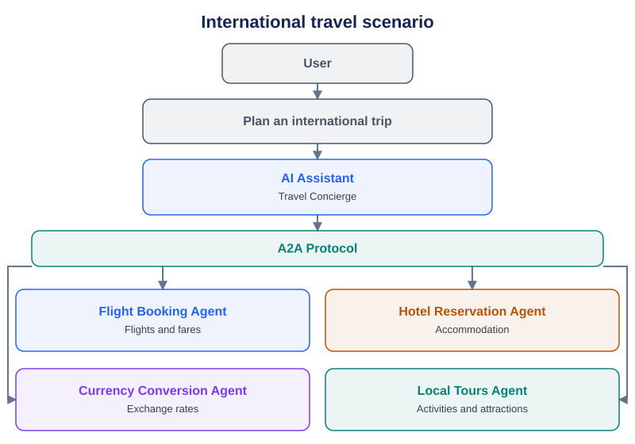

*Figure 22. A travel concierge communicates with flight, hotel, currency and local tour specialists.*

A user interacts with one assistant, but the assistant delegates work to separate services. The flight agent provides suitable journeys, the hotel agent searches accommodation, the local tours agent proposes experiences, and the currency service converts amounts. Each service is responsible for its own data, policies and calculation rules. The concierge is responsible for coordinating their results.

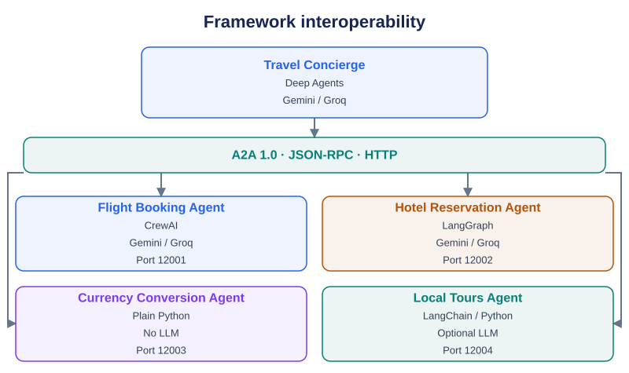

*Figure 23. One possible architecture uses different frameworks and model providers behind compatible interfaces. The ports are illustrative.*

A flight service could use CrewAI to interpret requests and search its own data. A hotel service could use LangGraph to manage accommodation searches. The currency service can be implemented with ordinary Python, using a fixed exchange-rate table for reproducibility. A tours service might be deterministic or use a language model to interpret preferences. None of these implementation choices needs to be exposed in detail to the concierge.

### 14.1 Defining the request and the service contracts

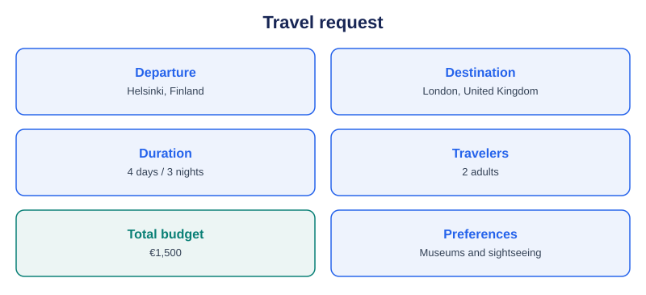

*Figure 24. Example user constraints for an international travel request.*

Consider a fictional planning scenario: two adults want to travel from Helsinki to London for four days and three nights, with a total budget of €1,500. They prefer museums and sightseeing. They need return flights, accommodation and at least two activities. No booking should occur.

Before delegating, the concierge should identify required parameters such as travel dates, currency, passenger count and accommodation requirements. A real quotation requires dates. For a simulated scenario, the application can use clearly stated example dates supported by its dataset, or ask the user for clarification. It should not silently invent availability.

The services can exchange structured data as well as natural language. For example, a hotel quotation could carry `hotelId`, `checkIn`, `checkOut`, `nightlyRate`, `currency`, `nights`, `roomCount` and `total`. A flight quotation should distinguish a per-passenger fare from a total fare and identify whether it is a return journey. A tour quotation should distinguish a per-person ticket from a group price. The client must understand these units before aggregating costs.

### 14.2 Dependencies between agent results

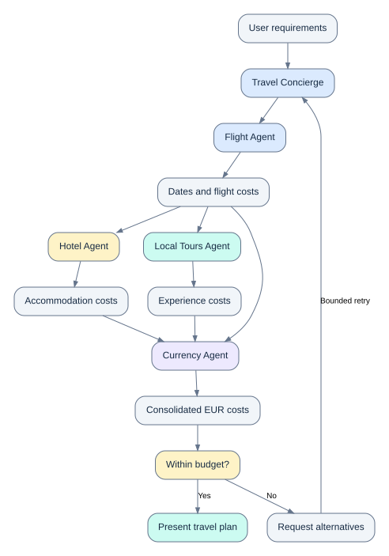

*Figure 25. Flight choices constrain accommodation and activity dates; cost conversion supports budget evaluation.*

The concierge cannot simply concatenate four responses. It needs to check whether the results are compatible. For example, a flight arriving late in the evening may make a first-day tour impossible. An accommodation offer for two nights is not sufficient for a three-night trip. A conversion service must receive the source currency and the target currency, not merely a numerical amount.

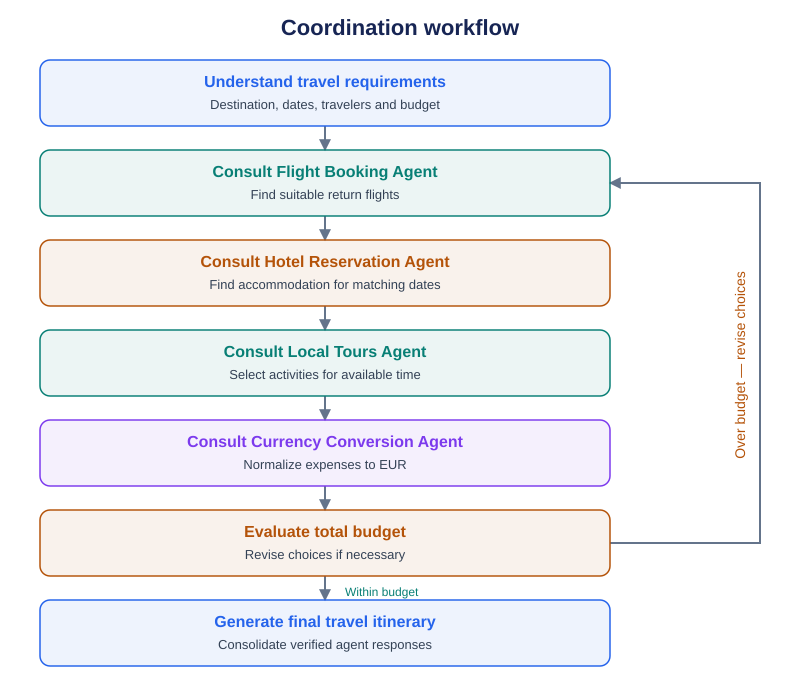

*Figure 26. A possible workflow with a revision loop when the proposed itinerary exceeds the budget.*

The workflow is not a mandatory sequence. Independent queries can be made in parallel if their inputs are already known. Dependent queries should wait for their prerequisites. A coordinating agent can revise the plan when an intermediate result does not satisfy the constraints, but the number of revisions should be bounded to avoid unnecessary cost or infinite retry loops.

### 14.3 Currency conversion and budget checking

The cost comparison must use a common currency. Suppose the hotel agent returns a price of GBP 400 for three nights, and a simulated exchange-rate table defines 1 GBP = EUR 1.20. The currency service returns EUR 480. The rate is fictional and must be identified as such; it is not a live exchange-rate quote.

A deterministic conversion function should specify its rate convention and rounding rule. For example:

```python
from decimal import Decimal, ROUND_HALF_UP

GBP_TO_EUR = Decimal("1.20")  # fictional fixed rate

def gbp_to_eur(amount: str) -> Decimal:
    value = Decimal(amount)
    if not value.is_finite() or value < 0:
        raise ValueError("Amount must be finite and nonnegative")
    return (value * GBP_TO_EUR).quantize(
        Decimal("0.01"), rounding=ROUND_HALF_UP
    )

assert gbp_to_eur("400") == Decimal("480.00")
```

The concierge can use the returned conversion in its own deterministic budget calculation. It should retain the original price, currency and applied rate so that the calculation can be traced later.

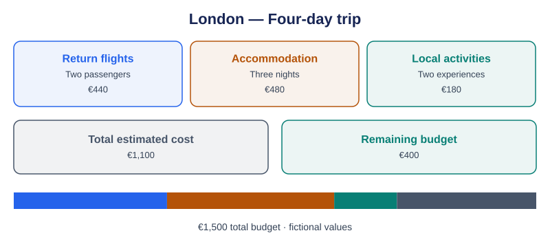

*Figure 27. Illustrative cost breakdown using fictional flight, hotel and activity quotations.*

| Expense | Total in EUR |
|---|---:|
| Return flights for two passengers | €440 |
| Accommodation for three nights | €480 |
| Two local experiences | €180 |
| **Total** | **€1,100** |
| **Remaining from €1,500** | **€400** |

A complete response should present a feasible itinerary, identify its information sources, explain which expenses are included, and distinguish excluded expenses such as meals, ground transport or travel insurance. It should not present an estimated itinerary as a confirmed reservation.

### 14.4 Hybrid travel architecture

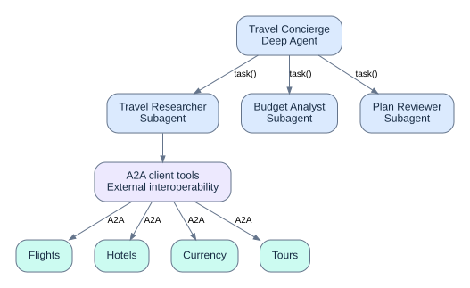

*Figure 28. Internal research, budget and review subagents can complement remote A2A services.*

The concierge can organize its own work using subagents while communicating with external specialist services through A2A. For instance, a budget analyst can validate conversion results, and a reviewer can check itinerary consistency. The concierge may also call the services directly without internal subagents. The choice is an orchestration decision and does not change the public protocol.

## 15. Reliability, security and operational considerations

Moving from a single application to independent services introduces distributed-system concerns. A2A standardizes the interaction, but it does not remove those concerns.

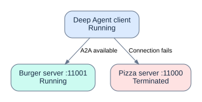

*Figure 29. One service may become unavailable while another continues operating.*

### 15.1 Distinguishing failure types

| Observation | Possible meaning | Appropriate client action |
|---|---|---|
| Connection refused | No server is accepting connections at the endpoint | Check the address, process and port |
| Agent Card returns 404 | Wrong discovery URL or unsupported path | Verify the deployed interface and protocol version |
| Authentication/authorization failure | Credentials are missing, invalid or insufficient | Obtain appropriate access; do not bypass policy |
| No compatible binding/version | Client and server advertise incompatible interfaces | Select a supported interface or upgrade deliberately |
| Read timeout | Client did not receive a response within its deadline | Check server logs and task status before retrying |
| Provider HTTP 429 | Inference quota or rate limit may be exceeded | Apply provider guidance, backoff and quota management |
| Failed task | The server reports unsuccessful execution | Inspect the status and safe diagnostic details |
| Completed task with invalid content | Protocol interaction succeeded but domain result is incorrect | Validate the artifact and reject or correct the result |

A timeout is not evidence by itself that a model rate limit was reached. The request may still be running on the remote service. Automatically repeating a side-effecting request could create duplicate actions. Where appropriate, use task retrieval, application-level idempotency and bounded retries. A message identifier is not a universal guarantee of exactly-once business execution.

### 15.2 Managing latency, model calls and concurrency

A single A2A message may trigger several model calls inside a remote agent. An intelligent client may also make model calls to decide which services to contact. The number of network requests is therefore not the same as the number of inference requests.

For small development experiments, sequential service calls and a configurable delay between model-driven requests can reduce bursts. A delay of 10–20 seconds is an example starting point, not a guarantee against any provider's quota. Production systems should use actual provider limits, deadlines, concurrency controls, bounded exponential backoff with jitter where suitable, and monitoring. Daily quotas cannot be fixed by adding a short delay.

Parallel calls can reduce latency when requests are independent, but they may increase quota pressure. The coordinator must also decide what to do when only some remote calls succeed. For example, a travel plan without hotel availability should be labeled incomplete rather than presented as fully feasible.

### 15.3 Trust and access control

An Agent Card is descriptive metadata, not proof of identity or authorization. Validate trusted endpoints and use TLS for real deployments. Use the authentication mechanism advertised for the selected interface and enforce authorization on the server. Model-provider API keys used internally by a remote agent are distinct from credentials used by an A2A client to access that agent.

Only necessary data should cross service boundaries. A seller does not need the user's entire conversation to provide a menu quotation. A travel agent should not receive passport details when only estimating hotel prices. Avoid including secrets in Agent Cards, prompts, logs or artifacts. Maintain explicit policies for data retention and multi-tenant access.

Remote messages and artifacts are untrusted application data. They may contain incorrect information or instructions that attempt to influence the coordinating model. Validate structured data, restrict tool permissions, and keep authorization and side-effect decisions outside untrusted content. Never permit a remote message to override the application's governing instructions or user authorization. For URLs in returned parts or discovery records, use allowlists and network protections where appropriate to reduce unintended access to internal endpoints.

For actual orders, reservations or payments, obtain explicit user authorization and validate the final terms before committing. The examples in this document are quotation-only simulations.

### 15.4 Observability

Keep a trace of the user request, selected agent, operation, request correlation ID, message ID, remote task and context identifiers, timestamps, response state and artifact identifiers. Record error categories and model-provider usage where appropriate. Redact secrets and unnecessary personal data. Such traces help locate whether a failure occurred in the client, network, protocol adapter, business logic or inference layer. They also support evaluation without requiring disclosure of private model reasoning.

## 16. Testing and validating A2A implementations

A distributed agentic system should be tested at several layers. A protocol-compatible response is necessary for interoperability, but it does not establish that the application correctly solves the user goal.

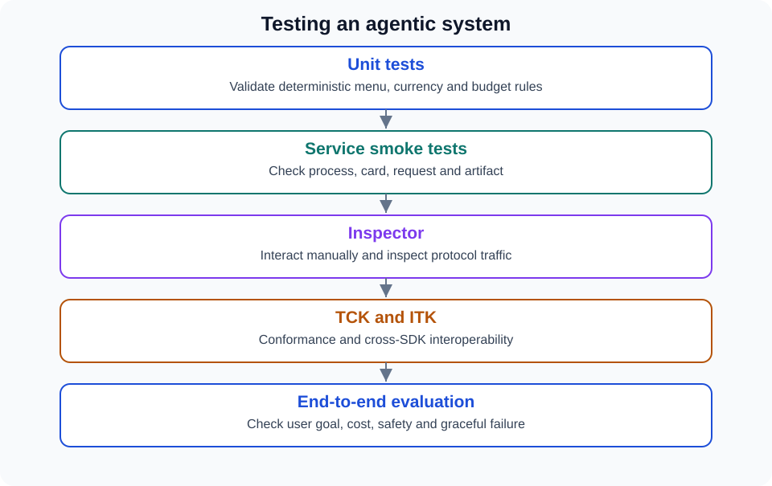

*Figure 30. Combine deterministic unit tests, service tests, protocol tools and end-to-end evaluation.*

### 16.1 Unit tests and service smoke tests

Start with deterministic functions. For the dessert service, verify known prices, positive integer quantities, invalid item handling and exact totals. For travel, test currency conversion and the interpretation of passenger and room counts. These tests should run without a language model.

Next start the server and use a direct client to verify that its card is discoverable, its interface is usable and its expected request receives an appropriate response. Check the payload type, task status, content parts, IDs and domain result. Exercise invalid inputs and an unavailable endpoint. Where a service advertises optional features, test those features as well.

Example tests:

| Test | Expected behavior |
|---|---|
| Read the dessert Agent Card | Returns a card with quotation skills and a compatible interface |
| Ask for the price of Tiramisu | Returns €6.50 in the fictional dataset |
| Calculate two Tiramisu and one Cheesecake | Returns €19.00 |
| Request an unknown item | Reports that the item is unavailable, without inventing a price |
| Stop the remote process | Client detects and reports unavailability |
| Switch the internal model | Public interface remains compatible; responses are re-evaluated |
| Send a travel request exceeding the budget | Concierge seeks alternatives or explains why no feasible plan was found |

### 16.2 A2A Inspector

The [A2A Inspector](https://github.com/a2aproject/a2a-inspector) is a web-based development utility for interacting with an A2A server and examining its behavior. It is particularly useful when learning the protocol because it makes the communication boundary visible. It can display the Agent Card and provide an interface for trying messages and inspecting protocol traffic.

A practical exploration is to run a local test agent and the Inspector in an environment where the Inspector backend can reach the agent. Enter the agent URL, examine its advertised skills, send a quotation request and inspect the response. Compare the observed task and artifact with the expected result. Check the project's documentation for installation instructions and supported protocol versions; the available features may vary across releases.

If the server is running in a remote Colab runtime, `127.0.0.1` on a separate personal computer refers to that computer, not the Colab machine. The Inspector must run in a network environment that can reach the server, or use an appropriately secured connection. Do not expose an unauthenticated development server to the public internet merely to inspect it.

### 16.3 A2A Technology Compatibility Kit (TCK)

The [A2A TCK](https://github.com/a2aproject/a2a-tck) is a compatibility test suite for protocol implementations. It checks behavior across supported bindings, including JSON-RPC, gRPC and HTTP+JSON. A conformance test checks whether a service follows the specification, such as responding appropriately to valid and invalid protocol requests. It does not establish that a travel recommendation is financially or practically correct.

Use the TCK version appropriate to the protocol and server under test. Review its prerequisites, binding configuration and supported cases in the repository. A passing smoke test is not equivalent to passing the relevant compatibility suite.

### 16.4 A2A Integration Testing Kit (ITK)

The [A2A ITK](https://github.com/a2aproject/a2a-itk) focuses on interoperability across SDK implementations. It uses reference agents and integration scenarios to exercise communication among agents implemented with different languages and SDK versions. This is particularly useful for SDK developers and teams validating cross-implementation compatibility in continuous integration.

The distinction from the TCK is important: the TCK focuses on specification conformance, whereas the ITK emphasizes whether implementations interact correctly together. Their scopes can overlap, but they provide different kinds of evidence. Review the repository's supported SDK and protocol matrix before choosing a configuration.

### 16.5 Evaluating the agentic application

An intelligent concierge should also be evaluated for task selection, tool arguments, arithmetic, completeness, consistency, safety and graceful failure. Because LLM outputs may vary, test multiple runs and assess required properties rather than requiring an identical sentence each time. A response can be linguistically excellent yet fail to contact the required agents or misinterpret a price unit.

For a purchasing example, verify that the model actually obtained the current simulated prices, selected appropriate quantities, remained within the budget and did not create an order. For a travel example, verify that dates are compatible, costs are correctly converted, and unavailable services are reported honestly. These application-level evaluations complement, rather than replace, protocol testing.

## 17. Connecting the concepts: choosing the right architecture

The main architectural choice is not whether every component should become an agent. It is how to expose capabilities at the appropriate boundary.

| Requirement | Suitable mechanism |
|---|---|
| Calculate an exact total within one application | Ordinary deterministic function |
| Provide a reusable external tool or data resource | API or MCP integration |
| Delegate a specialized task inside an orchestrating framework | Internal subagent |
| Collaborate with an independently implemented specialist service | A2A |
| Coordinate several remote services while using internal specialists | Hybrid orchestration with A2A |
| Connect a remote specialist to its own resources | MCP or another appropriate tool integration |

A useful development strategy is to implement the domain rules first, expose a minimal protocol-compatible server, test it with a direct client, add language understanding if needed, and finally introduce intelligent coordination. This makes it possible to identify the source of errors at each step.

The result is an architecture in which language models interpret goals, frameworks manage execution, tools provide concrete capabilities, and protocols standardize the boundaries between independent components. These layers are not interchangeable. Their combination enables agentic applications to cooperate without forcing every component to use the same framework, model or deployment environment.


## 18. Agentic AI design patterns and A2A

An agentic AI architecture has two separate design problems. The first is deciding how work is divided and how decisions are made. The second is deciding how independently implemented components communicate. An orchestration pattern addresses the first problem; A2A addresses the agent-to-agent boundary in the second. MCP addresses integration with tools and information. None of these choices automatically determines the others.

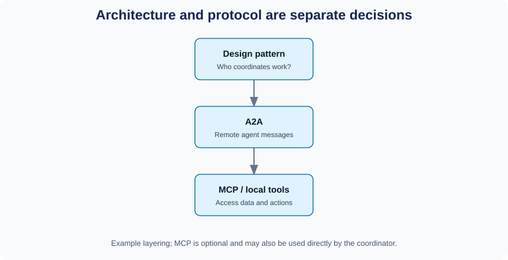

The [Google Cloud design-pattern guide](https://docs.cloud.google.com/architecture/choose-design-pattern-agentic-ai-system) and the [Microsoft Azure orchestration-pattern guide](https://learn.microsoft.com/en-us/azure/architecture/ai-ml/guide/ai-agent-design-patterns) both recommend selecting an architecture according to the workload rather than automatically introducing multiple agents. Google distinguishes single-agent, workflow and dynamic coordination patterns, including iterative refinement, coordinator, hierarchy, swarm, ReAct, human-in-the-loop and custom logic. Microsoft distinguishes sequential, concurrent, group chat, handoff and Magentic orchestration. 
The examples and mappings below adapt these concepts to A2A and do not require any specific cloud provider.

### 18.1 Begin with the simplest architecture that works

Suppose a purchasing application needs to calculate the price of two desserts. A multiplication function is sufficient. If the input is natural language, a single model may extract the item and quantity, and a deterministic function may calculate the amount. If the application needs to compare independently operated restaurants, a coordinator may need to contact several external services. Each new layer should solve an identifiable problem.

| Architecture | Example | Why choose it? |
|---|---|---|
| Ordinary code | Multiply €5.50 by two | Exact, cheap and reproducible |
| Direct model call | Extract a dessert name from a sentence | Flexible language interpretation without agent orchestration |
| Single agent with tools | Find menu items and prepare a quote | Dynamic tool use in a bounded domain |
| Internal subagents | Separate dietary review from menu analysis | Specialized prompts and context isolation |
| Independent A2A services | Compare offers from two independent sellers | Standardized remote communication across ownership or framework boundaries |
| Hybrid system | Concierge with internal planners and remote sellers | Combine local coordination with external capabilities |

This is not a maturity ladder. A smaller system may be the better design even for production. Consider the actual need for independent deployment, separate credentials, different models, workload isolation and reuse. Extra agents introduce additional state, testing, latency and cost.

### 18.2 Sequential orchestration

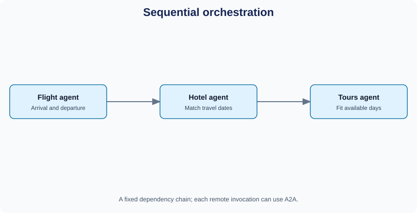

Consider a trip whose arrival and departure dates depend on the flight selected. First the flight service returns an itinerary; then the hotel service receives the dates; finally the tour service receives the available days. The coordinator owns the order of operations. It can be implemented as ordinary Python rather than an LLM. If the services are remote, each invocation can be an A2A exchange, with the previous result translated into the next request.

The important implementation detail is validation between stages. If the flight response lacks a departure date, the system must not fabricate a hotel date. It should request clarification, choose an alternative, or stop. A completed A2A task does not imply the artifact satisfies the next stage's requirements. Sequential execution is especially useful when provider rate limits or free-tier quotas make concurrency impractical.


### 18.3 Parallel or concurrent orchestration

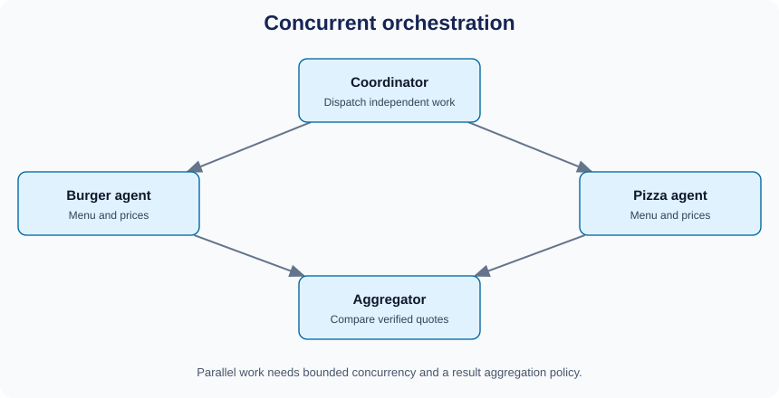

A meal concierge can request independent menus from a burger and pizza seller at the same time. Once both results arrive, it compares prices. The restaurants need not know about each other, and their A2A task and context identifiers remain independent. The coordinator associates both tasks with its own request identifier.

A parallel design requires an explicit policy for partial failures. If the pizza service is unavailable, the system might still recommend a burger meal but must disclose that comparison was incomplete. It must also avoid uncontrolled bursts of model calls. A semaphore can cap concurrency; a serialized execution policy can be substituted without changing the logical independence of the tasks. Actual simultaneous execution is not necessary when rate limits or shared resources make it unsafe or inefficient.

### 18.4 Iterative refinement, loop and review patterns

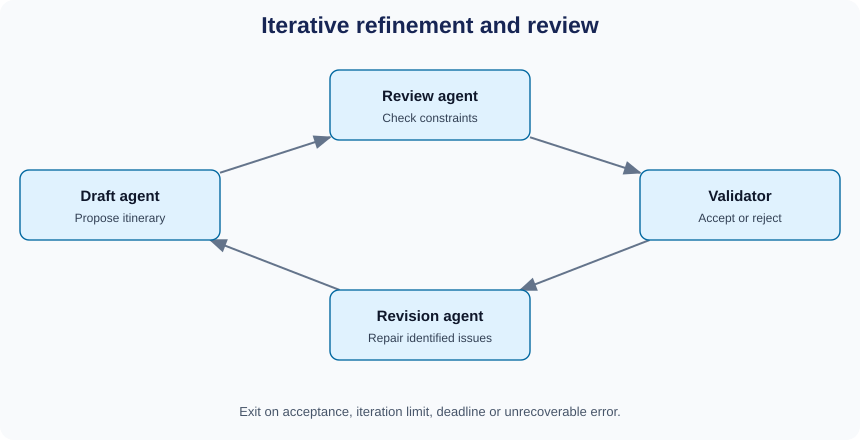

A first travel plan may exceed a €1,500 budget. A validator checks the prices using deterministic arithmetic, reports the violated constraint, and requests a revised plan. The planner can obtain a cheaper hotel offer and submit a revised itinerary. A separate reviewing agent can check preferences such as whether the itinerary contains at least two activities. A fixed loop controller can decide whether to continue, even when the content of each revision is model-generated.

A polling loop is a related but different use of repetition: checking whether a remote operation has finished is not the same as revising a proposed solution. A2A task updates, polling or streaming can report progress; they do not decide whether an itinerary is satisfactory. Define explicit termination rules, such as a maximum of three revisions, a deadline, or a validated result. Record the reason for termination and return an honest partial result when no feasible solution is found.

### 18.5 Coordinator and hierarchical task decomposition

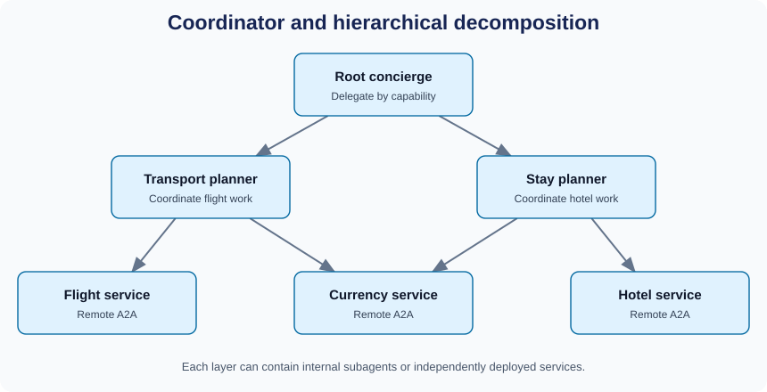

A purchasing concierge is a coordinator when it decides which seller to contact based on a request and combines the returned results. The coordinating model might interpret a request for a dessert and choose the dessert service without contacting the other sellers. For a large travel request, a root planner might delegate transport and accommodation planning to separate internal planners. Each planner may then invoke remote A2A services. The tree describes responsibility, not necessarily the physical deployment topology.

Use the hierarchy only if the intermediate roles add meaningful value. Each delegation should have a defined goal, required input, expected output and authority boundary. Avoid sending the entire user conversation to every specialist. For example, a currency service needs an amount and currency pair, not passport details or the entire travel history. Local subagents may share a framework-specific state mechanism; remote agents normally maintain their own state and must receive the necessary information through their interface.

### 18.6 Group chat, handoff and swarm

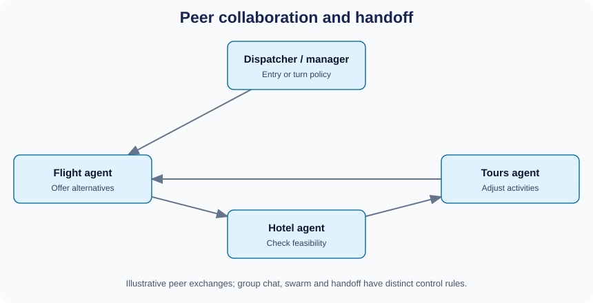

These patterns are related but not interchangeable. A group chat has a shared discussion and a turn-selection policy; handoff transfers active responsibility to another agent; a swarm permits more peer-directed collaboration. A2A supports messages between independently implemented services, but does not itself supply a shared group conversation, automatic transfer of control, or a consensus algorithm.

For example, a flight agent can identify a late arrival, a hotel agent can report that late check-in is unavailable, and a tours agent can suggest moving a morning activity. A coordinator can run this exchange in a managed discussion. Alternatively, a handoff may transfer the next step to the accommodation specialist when the problem becomes primarily about check-in. In a peer architecture, each service may initiate requests to another authorized service. It then acts as an A2A client for that exchange, even while serving its own incoming requests.

Define who owns the final answer, how messages are routed, how conflicting results are resolved and what stops the conversation. Limit the number of handoffs and reject unauthorized destinations. A remote agent returning another endpoint is not permission to contact it automatically.

### 18.7 Adaptive planning and Magentic orchestration

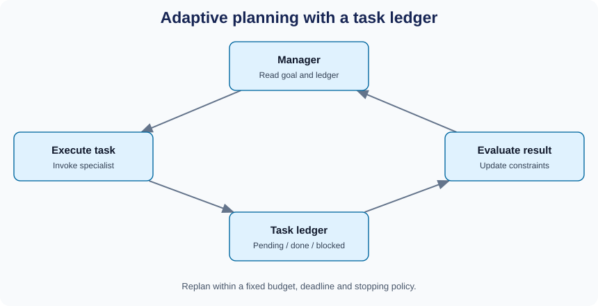

Microsoft's Magentic pattern uses a manager and an evolving task ledger. As an application example, a travel concierge might maintain a ledger with entries such as find return flights, find a hotel, normalize prices, and validate budget. When a hotel is unavailable, the manager adds an alternative search instead of following a rigid script. A Deep Agents coordinator can implement a related adaptive planning approach, but using Deep Agents does not automatically implement the precise Magentic pattern.

The ledger is application state. It is not an A2A task object. One ledger entry may involve multiple A2A requests, and a single remote task may produce several artifacts. Store the mapping between the plan entry and remote identifiers, preserve intermediate verified facts, and bound the number of model calls and replans. If a plan stalls, return the unresolved work rather than pretending to have finished.

### 18.8 ReAct and human-in-the-loop

ReAct is an iterative reasoning/action/observation approach within an agent. A dessert agent may select a menu lookup, observe its result, select a price calculator, and present a quote. The tools may be ordinary Python functions or MCP tools. An A2A request can also be exposed through a local communication tool. This is a way to combine ReAct with remote collaboration; it does not imply that a model's private reasoning should be exposed. Observable tool calls and results are sufficient for many debugging and evaluation tasks.

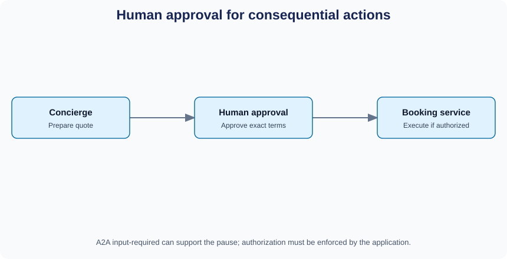

Human-in-the-loop is an architectural requirement wherever consequential actions require oversight. A seller may return a quote and request confirmation; a client presents the exact items, quantity and price to the human. In a task-oriented A2A exchange the server can use an input-required state where appropriate. The application must preserve the task context and enforce the authorization gate. A generic model-generated statement that an order is confirmed is not proof of human approval. A quote-only workflow must never perform a booking simply because the remote agent is capable of doing so.

### 18.9 Custom logic and mixed patterns

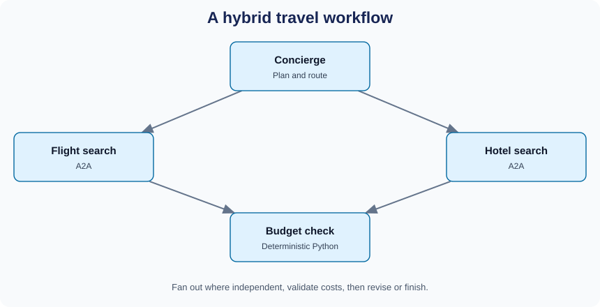

A real application need not select one pattern for every operation. An intelligent concierge can use adaptive planning to interpret the goal, a fixed pipeline for date-dependent work, concurrent requests for independent searches, and deterministic arithmetic for the final budget. A review loop may revise the plan, and a human gate may prevent irreversible actions. Remote services can independently use any of these patterns internally.

For example, after finding flights the concierge requests hotel options and compatible activities. It obtains a simulated GBP-to-EUR rate from the currency service and computes totals in integer cents or decimal arithmetic. If the quote exceeds the budget, it requests cheaper options. The orchestration logic decides these steps; A2A carries the requests and results; MCP may provide access to underlying databases inside individual services. A model need not control every transition.

### 18.10 Cross-reference of the two architecture guides

The following is a conceptual crosswalk, not an assertion that the two taxonomies are identical. A dash means there is no directly corresponding named pattern in the cited guide's main taxonomy.

| Google Cloud terminology | Microsoft Azure terminology | Application interpretation |
|---|---|---|
| Sequential | Sequential | Fixed dependencies |
| Parallel | Concurrent | Independent work and aggregation |
| Loop; review and critique; iterative refinement | Group chat (maker-checker is one possible use) | Bounded feedback or repeated work; not identical categories |
| Coordinator | — | Central specialist selection |
| Hierarchical task decomposition | — | Nested delegation |
| Swarm | Group chat; handoff (related aspects) | Peer interaction, turn selection and transfer differ |
| — | Magentic | Adaptive planning with a task ledger |
| ReAct | — | Agent-level action and observation |
| Human-in-the-loop | Human-in-the-loop implementation consideration | Explicit approval gates |
| Custom logic | Combining orchestration patterns | Application-specific control |

The two sources should be read directly for their precise definitions and additional examples. The patterns are technology-agnostic; adopting them does not require Google Cloud or Azure deployment.

### 18.11 Selecting a pattern and communication mechanism

Start by writing down the dependencies between results. If A must finish before B can begin, use a sequence for that dependency. If two independent analyses can be performed separately, consider parallel execution within resource limits. If the next specialist cannot be identified until the previous answer is available, use dynamic routing. If a proposal must improve through feedback, implement a bounded review loop. If a decision changes an external system, decide whether explicit human approval is necessary.

Separately ask whether a component needs an independent service boundary. If not, use a local function or internal subagent. If the component exposes tools or data, consider MCP. If an independently implemented service needs an agent-facing contract for requests, task progress and results, consider A2A. A2A is not necessary merely because there are multiple agents. Conversely, a deterministic remote service can expose A2A without adding a language model.

Evaluate both protocol behavior and application behavior. Record latency, inference calls, errors, budget correctness and completion criteria. Compare the hybrid architecture against a simpler baseline. The goal is reliable task completion, not maximizing the number of agents.


## 18. Questions for reflection and further exploration

1. Why is a framework-specific subagent invocation not necessarily sufficient to integrate an independently operated hotel agent?
2. Can a deterministic currency converter be an A2A server? When would exposing it as a tool be simpler?
3. What is the difference between an Agent Card skill and an internal function exposed to a model?
4. Why should a client distinguish a message from a task response?
5. How do task IDs, message IDs and context IDs contribute to a multi-turn conversation?
6. Why does a completed task not automatically establish the correctness of a price quotation?
7. What should a concierge do when a remote agent requests additional information or authorization?
8. How can a seller change its LLM provider without requiring a new client implementation? Which tests still need to be repeated?
9. Explain how A2A and MCP could be used together in a hotel reservation system.
10. Which testing approach would you use to check protocol conformance, cross-SDK interoperability and the correctness of a travel itinerary?
11. What additional controls are necessary when moving from a local loopback server to an external service?
12. Design a hybrid architecture combining internal research subagents and independently deployed A2A services. Identify the information that should and should not cross each boundary.


## 19. A2A questions and answers

### Foundations

**Q1. What is A2A?**

A2A is an open protocol for communication between agent-oriented applications. It standardizes capability descriptions, messages and task-related exchanges across implementation boundaries. A client can request work without importing the remote agent's framework-specific code.

**Q2. Why is A2A needed when agents already support subagents?**

Internal delegation solves decomposition within an application. It does not by itself establish a shared external contract for agents developed by different teams, deployed independently or implemented with different SDKs. A2A addresses that interface boundary. Both approaches can coexist.

**Q3. Is A2A an agent framework?**

No. Frameworks organize model calls, tools, state and execution. A2A specifies communication behavior. CrewAI, LangGraph or plain Python can implement services behind the same A2A interface.

**Q4. Does A2A require an LLM on either side?**

No. A Python client can send a message to a deterministic dessert service. A model-driven concierge can later contact the same service. Protocol interoperability is independent of the choice to use a model.

**Q5. Is A2A a replacement for MCP?**

No. MCP standardizes access to tools, resources and prompts, while A2A supports agent-oriented exchanges. A concierge can contact a hotel agent through A2A; that hotel agent can access its data through MCP. MCP is not restricted to local tools, and A2A can be invoked through a local tool wrapper.

**Q6. Does A2A automatically make an agent autonomous?**

No. Autonomy comes from the implementation and its decision policies. An A2A server may simply execute fixed business rules. A model-driven service may plan and use tools, within its authorized scope.

### Protocol and implementation

**Q7. What is an Agent Card?**

It is a machine-readable description of an agent's identity, skills, capabilities and supported interfaces. The client uses it to decide whether the service is relevant and how to connect. It is a declaration, not proof of quality or authorization.

**Q8. Does A2A automatically discover every agent on the Internet?**

No. A client needs a discovery mechanism, such as a configured endpoint, registry or published card URL. The usual well-known card endpoint supports retrieval when a service location is known; it is not a universal directory.

**Q9. What is the difference between a message and a task?**

A message communicates information or a request. A task represents work with an identity and lifecycle managed by the server. A message-only response can be sufficient for simple interactions; task-oriented responses are useful when progress, follow-up or artifacts need tracking.

**Q10. What are parts and artifacts?**

Parts carry content within protocol objects. An artifact represents an output of a task, such as a quotation, report or structured result. An artifact can contain multiple parts; not every message is an artifact.

**Q11. What is the difference between a task ID and a context ID?**

A task ID identifies a particular unit of work, while a context ID associates related interactions. A client should preserve the appropriate identifiers for follow-up. It must not assume that unrelated servers share the same context or state.

**Q12. What does a completed task mean?**

It means the server reports completion of the task lifecycle. It does not prove the quoted price is correct, that the result satisfies the user's requirements, or that any real-world booking has occurred. Validate the result independently.

**Q13. What happens when more information is needed?**

A task-oriented service may indicate that input is required and communicate the missing information. The client can present that request and continue using the relevant task/context identifiers according to the protocol. The application decides how to obtain input and whether it is authorized.

**Q14. Can A2A support long-running work?**

Yes. Task states and supported update mechanisms allow a client to observe progress. Streaming and push notifications depend on the advertised capabilities and compatible binding. A network timeout is not necessarily evidence that the server stopped working.

**Q15. Are A2A protocol and SDK versions the same?**

No. The protocol specifies interoperable behavior; an SDK is a library with its own release numbers. A2A 1.0 and Python SDK 1.3.1 are distinct version identifiers. Check both when selecting examples and dependencies.

### Architecture and coordination

**Q16. Which orchestration pattern does A2A use?**

None is mandatory. A coordinator may call services sequentially, concurrently, through a review loop or through adaptive planning. A2A defines the exchanges rather than the orchestration algorithm.

**Q17. Can the same agent act as both an A2A client and an A2A server?**

Yes. A hotel service may receive a request as a server and consult an authorized currency service as a client. Each relationship has its own task and authorization boundaries. The roles are relative to the interaction.

**Q18. Is an A2A server the same thing as a tool?**

Not necessarily. An application may wrap A2A communication in a callable tool for its own model. That wrapper does not change the remote service into a mere local function: the service can have its own lifecycle, state and internal implementation.

**Q19. Do all agents need the same model or framework?**

No. A CrewAI burger service can use one provider, a LangGraph pizza service another, and a Python dessert service no model. They need compatible protocol behavior, not identical internals.

**Q20. Can a Deep Agents coordinator use both internal subagents and A2A services?**

Yes. It can delegate local planning or review internally while contacting independent specialists through A2A. An internal task registry and remote task identifiers should be managed explicitly rather than assumed to share state.

**Q21. Should all remote agents be contacted in parallel?**

No. Dependencies, shared state, rate limits and costs may require sequential execution. Independent tasks can be logically parallel even when a scheduler limits actual concurrency. A2A does not impose a scheduling policy.

**Q22. Does A2A provide a shared memory or global plan?**

No. Each server may maintain its own context and task state. Global objectives, ledgers, shared memory and aggregation are application responsibilities. A client sends only the information necessary for each authorized remote task.

**Q23. When is A2A unnecessary?**

If one application can reliably solve the problem using local code, a single agent or internal subagents, an external agent protocol may add unnecessary deployment and debugging overhead. Choose it when a standardized agent service boundary has real value.

### Reliability, safety and evaluation

**Q24. What if an agent is unavailable?**

Distinguish connection failure, timeout, protocol error and a failed remote task. The coordinator may try an authorized alternative, return partial results or stop. A retry should not duplicate consequential work.

**Q25. Does A2A ensure security?**

A protocol contract does not automatically establish trust. Deployments must enforce authentication, authorization, secure transport, data minimization and validation. Treat remote descriptions and results as untrusted inputs, and restrict which endpoints can be contacted.

**Q26. How can an A2A implementation be tested?**

Use deterministic unit tests for business rules, a direct client for basic exchanges, an inspector for debugging and suitable conformance/interoperability suites for protocol behavior. Test the complete workflow separately, including failures and incorrect results.

**Q27. What is the difference between A2A Inspector, TCK and ITK?**

The Inspector helps developers examine interactions. TCK targets protocol compatibility; ITK targets integration and cross-SDK interoperability. Verify each project's supported protocol versions before applying it. None substitutes for business-logic tests.

**Q28. Why should price and currency calculations be deterministic?**

A model may interpret language or choose a tool, but currency conversion and arithmetic have precise rules. Use validated amounts, rates, currencies and rounding policies. A completed task containing an incorrect total must be rejected by the application validator.

**Q29. Does a human-in-the-loop pattern require A2A?**

No. Approval can be implemented inside one application. A2A can help represent remote work that needs input, but approval identity, permissions and consequences must be handled by the application.

**Q30. How can I decide whether an A2A system is successful?**

Evaluate whether independent services can discover and communicate with each other, whether returned artifacts satisfy the requirements, whether errors are handled safely and whether the system achieves the user's goal at acceptable cost and latency. Compare it with a simpler implementation to establish the value of the added complexity.


## 20. Evaluation of Multi-Agent AI Systems

### Q1. Why is evaluation important in multi-agent AI systems?

Evaluating a multi-agent AI system is more complex than evaluating an individual agent. In a multi-agent system, the final result depends not only on the performance of individual agents but also on their communication, coordination, task delegation and ability to combine intermediate results.

An individual agent may produce a correct response, but the coordinating agent may misinterpret that response, select an inappropriate specialist, overlook important information or incorrectly aggregate the results.

For example, in an international travel planning system:

- The Flight Booking Agent returns the correct flight prices.
- The Hotel Reservation Agent returns suitable accommodation options.
- The Currency Conversion Agent correctly converts GBP to EUR.
- The Local Tours Agent returns appropriate activities.

Despite all four agents performing correctly, the Travel Concierge may incorrectly calculate the total cost, select incompatible travel dates or recommend an itinerary that exceeds the user's budget.

Therefore, evaluating individual agents alone is not sufficient. The evaluation must also consider how the agents interact and whether the complete system satisfies the user's requirements.

### Q2. At which levels should a multi-agent AI system be evaluated?

Evaluation should be conducted at multiple levels, ranging from individual tools and agents to the complete multi-agent system.

| Evaluation level | What is evaluated? | Example |
|---|---|---|
| Tool and business logic | Correctness of deterministic functions and data retrieval | Is the currency conversion mathematically correct? |
| Individual agent | Reasoning, tool selection, response accuracy and adherence to instructions | Does the Flight Agent select flights that satisfy the requested dates? |
| Communication protocol | Agent discovery, message exchange, task states and artifacts | Does the A2A server return a valid completed task? |
| Agent-to-agent interaction | Interpretation of requests and responses between agents | Does the Travel Concierge correctly interpret the Hotel Agent's response? |
| Orchestration | Planning, delegation, agent selection, coordination and recovery | Does the concierge contact the appropriate agents in a meaningful order? |
| End-to-end system | Whether the complete system satisfies the user's objectives | Is the final itinerary accurate, complete and within budget? |
| Operational performance | Latency, cost, reliability, scalability and resource consumption | How many model calls are required to complete the travel plan? |
| Safety and security | Authorization, data protection and resistance to malicious instructions | Can a remote agent cause an unauthorized reservation? |

These levels complement each other. A successful evaluation at one level does not automatically guarantee success at another level.

### Q3. Is A2A protocol compliance sufficient to guarantee that a multi-agent system works correctly?

No. A2A protocol compliance establishes that agents can communicate using standardized interfaces and message structures. It does not guarantee that the agents understand requests correctly, produce accurate information or make appropriate decisions.

For example, an A2A server may return a valid task with the state `TASK_STATE_COMPLETED` and a correctly formatted artifact containing an incorrect price.

From a protocol perspective, the interaction may be successful. From an application perspective, the result is incorrect.

Tools such as A2A Inspector, A2A TCK and A2A ITK can support protocol inspection, conformance testing and interoperability testing. However, application-specific evaluation is still required to assess the correctness and usefulness of agent responses.

### Q4. Should the evaluation focus only on the final response?

No. The execution trajectory should also be evaluated.

An execution trajectory describes the sequence of actions taken by an agent or a multi-agent system to achieve an objective. It may include planning steps, tool calls, agent selection, A2A messages, intermediate responses, task states and recovery actions.

Consider a Travel Concierge that produces a correct itinerary within the specified budget. Although the final result is correct, the execution trajectory may reveal that the concierge:

- Contacted the same agent repeatedly without justification.
- Invoked irrelevant specialist services.
- Used unnecessary model calls.
- Ignored some agent responses.
- Experienced repeated timeouts.
- Reached the correct result accidentally.

Evaluating the execution trajectory helps identify inefficiencies, unnecessary costs, unreliable behavior and weaknesses in coordination that may not be visible in the final response.

Both outcome-based evaluation and trajectory-based evaluation are important.

### Q5. How can multi-agent coordination be evaluated?

Multi-agent coordination can be evaluated by examining whether the coordinating agent:

- Identifies the appropriate specialist agents for a given request.
- Delegates tasks using clear and relevant instructions.
- Respects dependencies between tasks.
- Executes independent tasks concurrently when appropriate.
- Correctly interprets intermediate results.
- Avoids unnecessary or repeated communication.
- Revises its plan when requirements cannot be satisfied.
- Handles unavailable agents and failed tasks.
- Produces a consistent and complete final response.

For example, the Travel Concierge should ensure that hotel reservation dates are compatible with the selected flights and that local activities fit within the available time.

The evaluation should therefore consider not only the correctness of individual responses but also the relationships between those responses.

### Q6. Which evaluation methods can be used?

Different evaluation methods can be combined.

| Evaluation method | Purpose |
|---|---|
| Unit testing | Validate individual functions and deterministic calculations. |
| Integration testing | Validate communication between components and agents. |
| Protocol conformance testing | Verify adherence to the A2A specification. |
| Scenario-based testing | Evaluate behavior under predefined user requests. |
| Trajectory evaluation | Examine intermediate actions and agent interactions. |
| LLM-as-a-judge | Assess qualitative aspects such as relevance, completeness and coherence. |
| Human evaluation | Assess usefulness, appropriateness and overall quality. |
| Performance testing | Measure latency, model usage, cost and reliability. |
| Failure injection | Examine behavior when agents become unavailable or return incorrect results. |

Deterministic evaluation should be preferred whenever an objective expected result is available.

For example, a budget calculation should be evaluated using ordinary Python assertions rather than relying exclusively on another LLM to determine whether the arithmetic is correct.

LLM-based evaluation can complement deterministic evaluation for aspects that are difficult to express using fixed rules, such as the relevance of recommendations or the clarity of a generated itinerary.

### Q7. Why should multi-agent systems be evaluated repeatedly?

LLM-powered agents can produce different outputs when given the same request. Their reasoning, tool selection and communication patterns may vary across executions.

Changing the model, model provider, prompt or available agents may also affect system behavior.

A single successful execution is therefore not sufficient evidence that a multi-agent system is reliable.

Repeated evaluation using different scenarios, inputs and model configurations provides a better understanding of the system's consistency, robustness and limitations.

### Q8. How can evaluation be applied to the international travel planning system?

The following scenarios can be used to evaluate different aspects of the system.

| Evaluation scenario | Expected behavior |
|---|---|
| Standard international trip | Produce a complete itinerary satisfying the specified requirements. |
| Restricted budget | Select affordable alternatives or explain why the budget cannot be satisfied. |
| Foreign currency expenses | Convert all relevant expenses into the requested currency. |
| Unavailable hotel | Search for alternative accommodation. |
| Unavailable specialist agent | Handle the failure without inventing missing information. |
| Incomplete user request | Request clarification when essential information is missing. |
| Conflicting agent responses | Detect inconsistencies and attempt to resolve them. |
| Incorrect price returned by an agent | Identify or flag the inconsistency using available validation mechanisms. |
| Repeated execution | Evaluate consistency across multiple runs. |
| Different LLM providers | Examine whether changing the underlying model affects performance. |

Evaluation results should document both successful and unsuccessful scenarios. Failed scenarios provide valuable information about the limitations of the implementation and possible areas for improvement.

The objective is not simply to demonstrate that the agents can communicate, but to establish whether they can collaborate reliably to solve the intended problem.

## 21. Questions for reflection and further exploration

1. Why is a framework-specific subagent invocation not necessarily sufficient to integrate an independently operated hotel agent?
2. Can a deterministic currency converter be an A2A server? When would exposing it as a tool be simpler?
3. What is the difference between an Agent Card skill and an internal function exposed to a model?
4. Why should a client distinguish a message from a task response?
5. How do task IDs, message IDs and context IDs contribute to a multi-turn conversation?
6. Why does a completed task not automatically establish the correctness of a price quotation?
7. What should a concierge do when a remote agent requests additional information or authorization?
8. How can a seller change its LLM provider without requiring a new client implementation? Which tests still need to be repeated?
9. Explain how A2A and MCP could be used together in a hotel reservation system.
10. Which testing approach would you use to check protocol conformance, cross-SDK interoperability and the correctness of a travel itinerary?
11. What additional controls are necessary when moving from a local loopback server to an external service?
12. Design a hybrid architecture combining internal research subagents and independently deployed A2A services. Identify the information that should and should not cross each boundary.

## 22. References and further exploration

The following resources provide additional detail, examples and development tools. Start with the official specification and its version-specific documentation when implementing protocol behavior. Tutorials may target different SDK and protocol generations, so confirm compatibility before reusing their code.

### 22.1 Official A2A documentation

| Resource | What to explore |
|---|---|
| [What is A2A?](https://a2a-protocol.org/latest/topics/what-is-a2a/) | Motivation, architecture, request lifecycle and international travel example |
| [A2A and MCP](https://a2a-protocol.org/latest/topics/a2a-and-mcp/) | Complementary agent and tool integration patterns |
| [Core Concepts](https://a2a-protocol.org/latest/topics/key-concepts/) | Agent Cards, messages, parts, tasks, artifacts and interaction patterns |
| [Protocol Definition](https://a2a-protocol.org/latest/definitions/) | Normative types, operations and schemas |
| [Agent Discovery](https://a2a-protocol.org/latest/topics/agent-discovery/) | Well-known discovery, registries, private configuration and card security |
| [Life of a Task](https://a2a-protocol.org/latest/topics/life-of-a-task/) | Task states, context and follow-up interactions |
| [Streaming and Asynchronous Operations](https://a2a-protocol.org/latest/topics/streaming-and-async/) | Long-running work and incremental updates |
| [What's New in v1.0](https://a2a-protocol.org/latest/whats-new-v1/) | Differences between earlier releases and the 1.0 protocol |
| [A2A specification repository](https://github.com/a2aproject/A2A) | Specification source, release history and project discussions |
| [Official Python SDK](https://github.com/a2aproject/a2a-python) | Client/server library, examples and release information |

### 22.2 Practical examples and tutorials

| Resource | What to explore |
|---|---|
| [Google Codelab: Purchasing Concierge and Remote Seller Agents](https://codelabs.developers.google.com/intro-a2a-purchasing-concierge#0) | A purchasing assistant coordinating CrewAI and LangGraph sellers. The original uses Google Cloud services and an ADK concierge; it is not a requirement for local A2A deployment. Check protocol and SDK versions. |
| [A2A samples](https://github.com/a2aproject/a2a-samples/) | Example integrations and agents in different frameworks; inspect each sample's dependencies and compatibility. |
| [A2A Python GitHub Agent](https://a2aprotocol.ai/docs/guide/a2a-python-github-agent) | A third-party guide to a GitHub-oriented agent with its own tools and executor. Verify its implementation details against the official SDK documentation. |

### 22.3 Inspection, testing and interoperability

| Resource | Purpose |
|---|---|
| [A2A Inspector](https://github.com/a2aproject/a2a-inspector) | Manual interaction, debugging and protocol inspection |
| [A2A ITK](https://github.com/a2aproject/a2a-itk) | Integration testing and cross-SDK interoperability |
| [A2A TCK](https://github.com/a2aproject/a2a-tck) | Protocol compatibility testing |

### 22.4 Suggested reading order

Begin with the official introduction, then study the A2A/MCP comparison and core concepts. Read the protocol definition alongside the Python SDK documentation when implementing a server or client. Explore the purchasing Codelab and official samples for implementation patterns. Finally, use the Inspector and study the TCK and ITK to understand how an implementation can be validated beyond a successful demonstration.

### 22.5 Agentic design patterns and orchestration

| Resource | What to explore |
|---|---|
| [Google Cloud: Choose a design pattern for your agentic AI system](https://docs.cloud.google.com/architecture/choose-design-pattern-agentic-ai-system) | Single-agent and multi-agent designs; deterministic workflows, dynamic coordination, feedback and human oversight |
| [Microsoft Azure: AI agent orchestration patterns](https://learn.microsoft.com/en-us/azure/architecture/ai-ml/guide/ai-agent-design-patterns) | Sequential, concurrent, group chat, handoff and Magentic patterns; architecture trade-offs and operational considerations |


<!-- 
## 19. References and further exploration

The following resources provide additional detail, examples and development tools. Start with the official specification and its version-specific documentation when implementing protocol behavior. Tutorials may target different SDK and protocol generations, so confirm compatibility before reusing their code.

### 19.1 Official A2A documentation

| Resource | What to explore |
|---|---|
| [What is A2A?](https://a2a-protocol.org/latest/topics/what-is-a2a/) | Motivation, architecture, request lifecycle and international travel example |
| [A2A and MCP](https://a2a-protocol.org/latest/topics/a2a-and-mcp/) | Complementary agent and tool integration patterns |
| [Core Concepts](https://a2a-protocol.org/latest/topics/key-concepts/) | Agent Cards, messages, parts, tasks, artifacts and interaction patterns |
| [Protocol Definition](https://a2a-protocol.org/latest/definitions/) | Normative types, operations and schemas |
| [Agent Discovery](https://a2a-protocol.org/latest/topics/agent-discovery/) | Well-known discovery, registries, private configuration and card security |
| [Life of a Task](https://a2a-protocol.org/latest/topics/life-of-a-task/) | Task states, context and follow-up interactions |
| [Streaming and Asynchronous Operations](https://a2a-protocol.org/latest/topics/streaming-and-async/) | Long-running work and incremental updates |
| [What's New in v1.0](https://a2a-protocol.org/latest/whats-new-v1/) | Differences between earlier releases and the 1.0 protocol |
| [A2A specification repository](https://github.com/a2aproject/A2A) | Specification source, release history and project discussions |
| [Official Python SDK](https://github.com/a2aproject/a2a-python) | Client/server library, examples and release information |

### 19.2 Practical examples and tutorials

| Resource | What to explore |
|---|---|
| [Google Codelab: Purchasing Concierge and Remote Seller Agents](https://codelabs.developers.google.com/intro-a2a-purchasing-concierge#0) | A purchasing assistant coordinating CrewAI and LangGraph sellers. The original uses Google Cloud services and an ADK concierge; it is not a requirement for local A2A deployment. Check protocol and SDK versions. |
| [A2A samples](https://github.com/a2aproject/a2a-samples/) | Example integrations and agents in different frameworks; inspect each sample's dependencies and compatibility. |
| [A2A Python GitHub Agent](https://a2aprotocol.ai/docs/guide/a2a-python-github-agent) | A third-party guide to a GitHub-oriented agent with its own tools and executor. Verify its implementation details against the official SDK documentation. |

### 19.3 Inspection, testing and interoperability

| Resource | Purpose |
|---|---|
| [A2A Inspector](https://github.com/a2aproject/a2a-inspector) | Manual interaction, debugging and protocol inspection |
| [A2A ITK](https://github.com/a2aproject/a2a-itk) | Integration testing and cross-SDK interoperability |
| [A2A TCK](https://github.com/a2aproject/a2a-tck) | Protocol compatibility testing |

### 19.4 Suggested reading order

Begin with the official introduction, then study the A2A/MCP comparison and core concepts. Read the protocol definition alongside the Python SDK documentation when implementing a server or client. Explore the purchasing Codelab and official samples for implementation patterns. Finally, use the Inspector and study the TCK and ITK to understand how an implementation can be validated beyond a successful demonstration.

---

All diagrams, menus, prices, and travel quotations in this guide are illustrative simulations. 

-->